# Games101：幾何（Geometry）

我們這章會從幾個具體例子，來看不同的幾何表示方法。 像是下圖的玻璃杯，它上面有各種不同的曲線，我們該如何描述這些曲線呢？

我們再來看下面這台車，在車頭的曲面上我們看不到任何三角形，它具有非常光滑的曲面，不管我們離多近，都看不到離散的三角形，這在圖學裡面又該如何被描述呢？

除了杯子與車身以外，我們還會遇到不同尺度的幾何問題。 像是布料的纖維（fiber）會先扭成股（ply），多股又會形成紗線（thread），紗線最後會交織成布料。 這種分層結構會影響布料的外形、縫隙與透光情形，我們使用的幾何模型也會跟觀察距離有關

又或者像是水花會在運動時分離或融合，物體表面的連接關係也會跟著改變； 城市場景會同時包含建築、室內空間、樹葉與草地； 毛髮則會在很小的範圍內包含大量細節。 因此在做的時候我們需要同時考慮幾何的表示方式、儲存成本，以及算繪時真正需要保留的細節

## 幾何的表示方法（Ways to Represent Geometry）

### 隱式幾何（Implicit geometry）

在圖學裡我們有兩種表示幾何的方法，第一種是隱式的幾何（Implicit geometry），另一種是顯式的幾何（Explicit geometry）。 隱式的幾何會以關係式來表示目標形體，例如一個三維空間裡面的單位球可以被寫成 

$$
x^2 + y^2 + z^2 = 1
$$

只要我們有了一個三維空間中的座標，就能夠判斷它是不是在這個球面上

隱式幾何的壞處在於，今天給我們一個式子，我們很難看出它表示的是什麼形狀。 例如下圖是一個圓環，但單看式子我們其實很難看出來它是一個圓環：

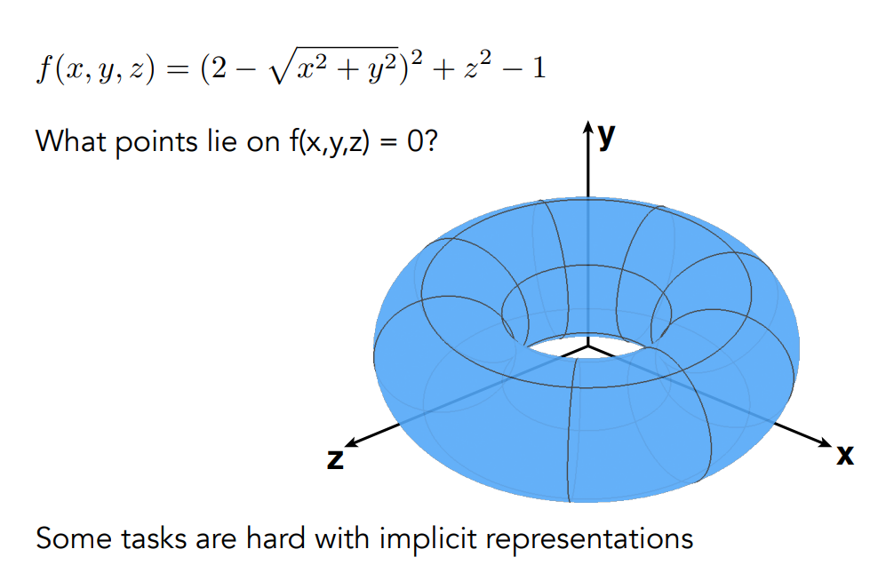

而隱式幾何的優點在於，我們可以很容易地判斷一個點在不在幾何的表面上，只需要把我們的座標帶入函數就可以算出來了，通常為 0 就代表在表面上，如果是個負數就代表在幾何內部，反之如果是個正數就代表在幾何外面。 當然，這還是要看你的式子怎麼定義的，但通常我們會設 $f(x,y,z) = 0$

### 顯式幾何（Explicit geometry）

顯式幾何是比較典型的表示方法，我們之前用的三角形面就是顯式的表示方法，真的給我們一些點，組成三角形，進而將模型表現出來。 但還有另一種顯式的方法，稱為參數映射，以下圖為例，你可以看到我們定義了要如何將給定的 $(u,v)$ 座標，映射到空間中的某一個點：

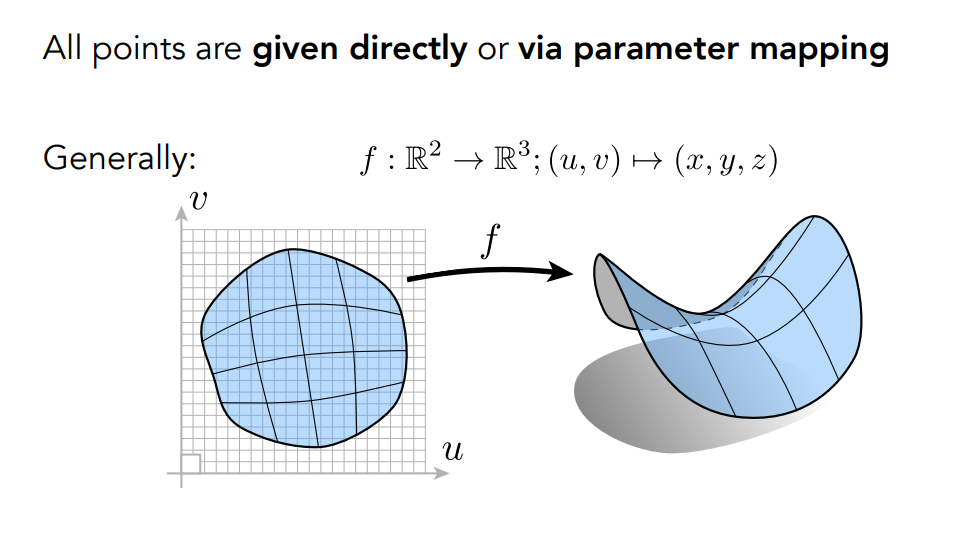

也就是說，我們可以定義一個函數，輸入是 $u$ 和 $v$，而輸出是 $x$、$y$ 與 $z$。 因此如果我們把所有的 $u$、$v$ 都走一遍，就可以找到它對應的所有 $x$、$y$ 與 $z$

我們再看一次圓環的例子：

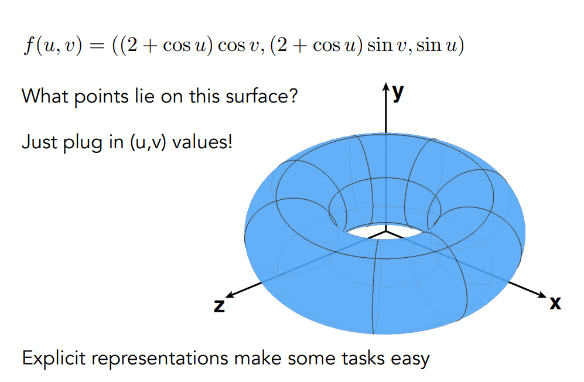

這邊我們把 $u$、$v$ 這兩個參數映射成了空間中的實際一個點，具體來說：

- $x = (2 + \cos u)\cos v$
- $y = (2 + \cos u)\sin v$
- $z = \sin u$

這就是為什麼它叫顯式幾何，如果我們想知道這個幾何長怎樣，只要把 $u$、$v$ 空間上的每一個 $u$、$v$ 都測一遍就可以知道了

顯式幾何的缺點是，當給我們一個三維空間中的點，我們很難去判斷一個點在不在目標幾何的表面上，或說表面的內側或外側

## 電腦圖學中的隱式表示法（Implicit Representations in Computer Graphics）

我們再來看幾個隱式幾何的例子。 這些形狀都可以用函數表示，但我們未必能直接從公式想像出形狀：

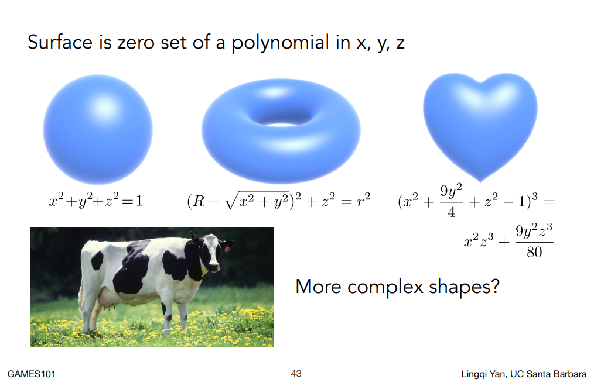

球面的公式我們可能可以看出來，而圓環的公式就已經有點勉強了，再到更右邊的心型就更難看了。 接著，如果我們想要直接找到一個公式能代表上圖中的乳牛，這件事就會變得非常困難

不過有一些工具可以幫助我們組合出幾何形狀，接下來我們就來介紹一下這些方法

### 建構式實體幾何（Constructive Solid Geometry）

我們首先要介紹的方法叫做建構式實體幾何（Constructive Solid Geometry），簡稱為 CSG。 CSG 會透過一系列基本的幾何運算，來組合出一個新的幾何，如下圖：

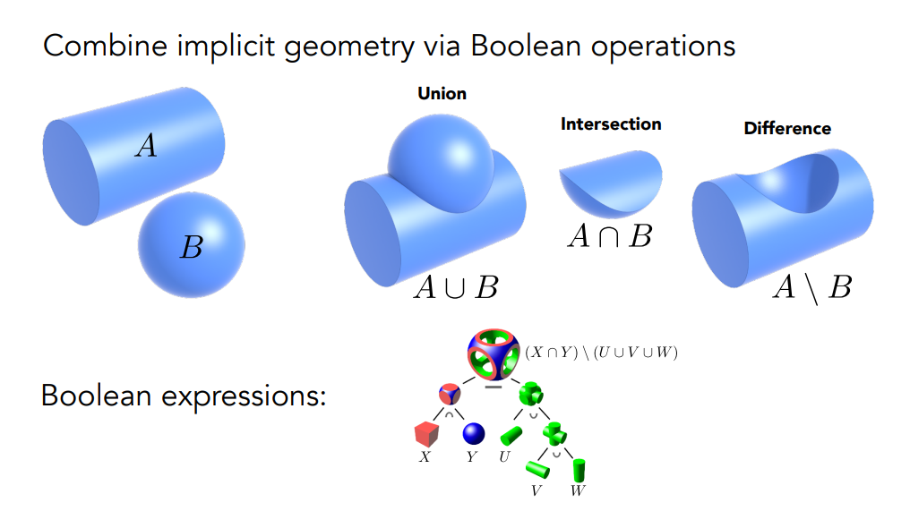

圖中的 A、B 為一個圓柱和一顆球，我們可以很容易地寫出它們的隱式關係式。 接著我們這邊透過布林運算將它們組合到了一起。 這邊的布林運算與集合論裡面的操作是一樣的，做 intersection 就是取它們交集的部分，取 union 就是兩者的聯集，而差集也可以定義，只要從 A 中間減去 B 所佔據的 A 的部分即可，反之同理

我們透過這些運算和一些簡單的基礎幾何，就可以像上圖下方那樣組出複雜的幾何，並用布林運算的組合式表示它了。 例如，我們先取立方體與球的交集，再扣掉三根互相垂直的圓柱所形成的聯集，就會得到鏤空骰子的形狀。 Maya、AutoCAD 等建模軟體都支援這類操作

### 距離函數（Distance Function）

我們接下來要看距離函數，它也是一種描述幾何的方法。 距離函數會記錄查詢點到物體表面的最近距離，而帶正負號的距離函數還會利用符號區分物體內部與外部。 看下面的例子：

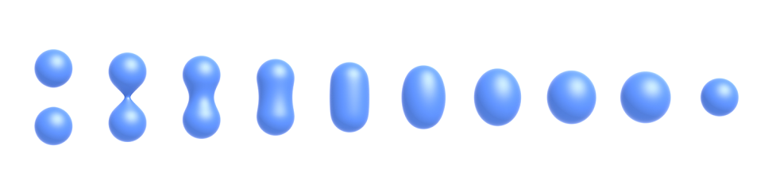

我們可以看到圖中的兩個球會逐漸靠近，最後融合成一個形狀，表面的連接關係也跟著改變了。 這個例子會透過距離函數的混合（blend），產生幾何之間的過渡形狀

再來看個比較具體的例子：

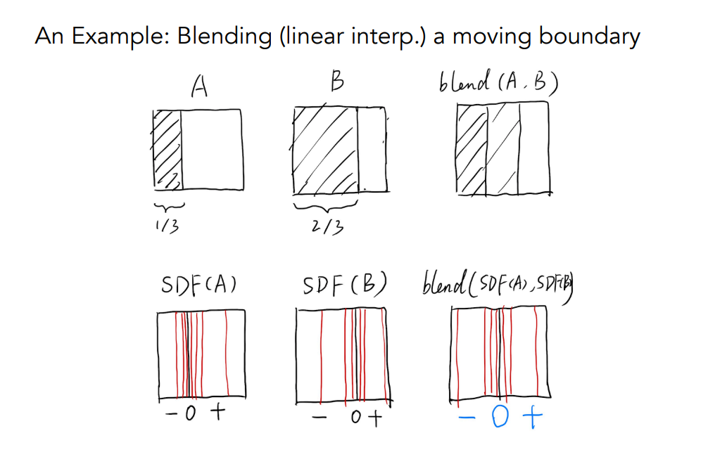

這邊用的距離函數被稱為帶正負號的距離函數（Signed Distance Function，SDF）。 我們的目的是要將 A 與 B 這兩個不同的方塊混合，它們各自擁有一部分的黑色區域與一部分的空白區域。 如果我們直接做線性的混合，混合結果就會變成一個黑⭢灰⭢白的方塊，因為重疊的部分肯定最黑，而中間部分只有 B 有塗色，所以是灰的，而最右邊都沒塗色，所以是白的

但如果我們希望混合結果仍然具有明確的黑白邊界，那就可以使用 SDF。 我們先分別求出 A 與 B 的距離函數，再混合兩個函數，就能取到右下角方塊中間的那條黑線。 那條黑線代表的就是距離函數等於 0 的狀態，接下來我們就可以根據其他位置距離函數的值來判斷黑/白（左/右）

我們可以把這個過程寫成公式。 假設物體佔據的區域為 $\Omega$，它的表面為 $\partial\Omega$，SDF 就會以內負外正的約定來記錄最近距離：

$$
d(\mathbf{x})=
\begin{cases}
-\min_{\mathbf{y}\in\partial\Omega}\|\mathbf{x}-\mathbf{y}\|, & \mathbf{x}\in\Omega,\\
\phantom{-}\min_{\mathbf{y}\in\partial\Omega}\|\mathbf{x}-\mathbf{y}\|, & \mathbf{x}\notin\Omega.
\end{cases}
$$

我們若想得到 A 與 B 之間的過渡形狀，可以先混合兩個距離場，再取出混合結果的零值表面：

$$
f_t(\mathbf{x})=(1-t)d_A(\mathbf{x})+t\,d_B(\mathbf{x}),
\quad S_t=\{\mathbf{x}\mid f_t(\mathbf{x})=0\},
\quad 0\leq t\leq 1.
$$

在前面的黑白方塊例子中，我們可以把左右邊界分別設成 $x=1/3$ 與 $x=2/3$。 兩個距離函數就會是 $d_A(x)=x-1/3$ 與 $d_B(x)=x-2/3$，它們的平均會等於 $x-1/2$，因此新的邊界就會落在 $x=1/2$。 這個計算保留了明確的黑白邊界，也把邊界移到了中間

我們知道原理後，再看下面的形狀變化就會比較容易理解了：

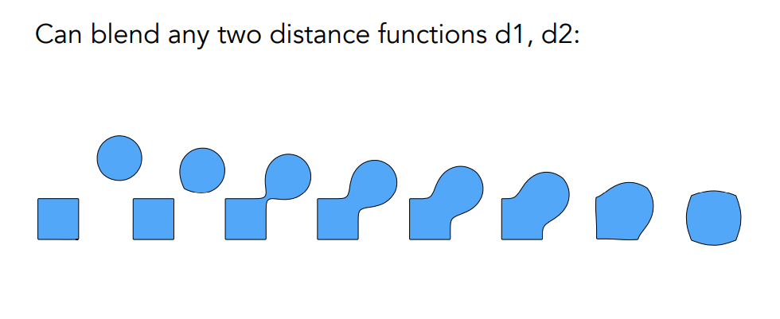

我們如果分別求出兩個物體的距離函數，再混合它們並取出零值表面，就會得到這種形狀變化。 混合後的函數不一定仍然是精確的 SDF，但它的零值表面仍然能定義幾何邊界

### 等位集合方法（Level-set method）

距離函數還可以配上一些其他的方法用，假設有個距離函數不好寫成參數式的形式，也就是不容易寫成 SDF 的格式，那也沒關係，只要能通過某種方法表述出來就可以了

在這邊我們介紹一種方法，叫做 level-set method。 它會把函數值儲存在格點上，再用相同函數值所構成的集合來描述表面：

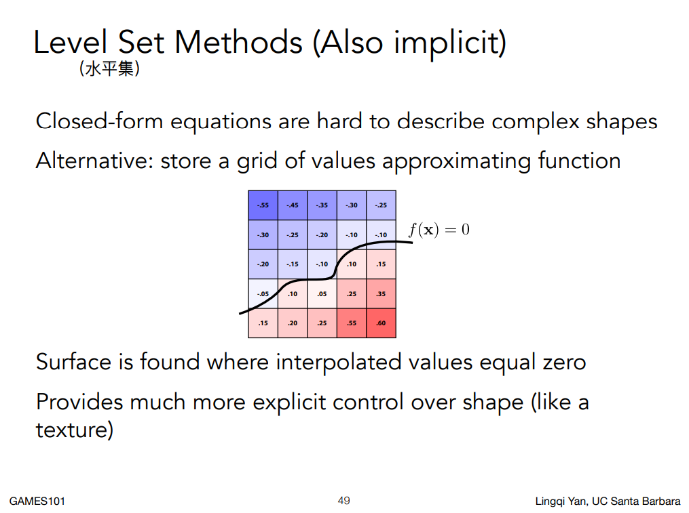

你可以看到函數在不同的地方有不同的值，接著我們只需要將值為 0 的地方連起來，就可以把整個物體的表面給表述出來了。 這個概念在地理上已經用了很久，就是所謂的等高線

我們也不一定得定義在二維的格子上，也可以在三維的格子上，結合紋理使用，就可以如下圖這樣描述出人體不同位置的密度訊息：

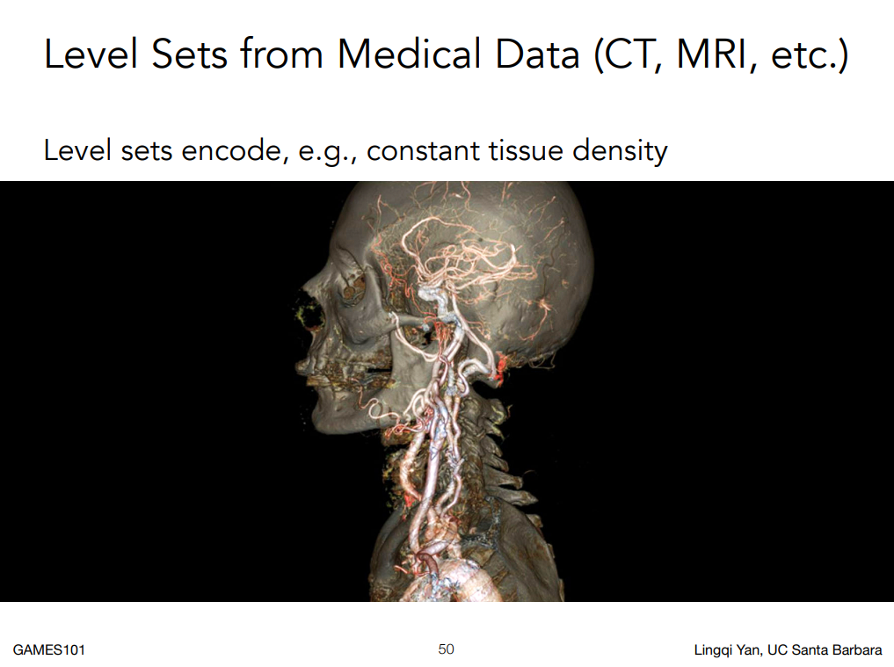

我們如果把格點上的純量值記成 $f(\mathbf{x})$，指定某個常數 $c$ 之後，等值面就會是：

$$
S_c=\{\mathbf{x}\mid f(\mathbf{x})=c\}.
$$

距離場的表面通常對應 $c=0$，人體掃描資料則可以使用某個密度值作為門檻。 我們在二維格子內可以使用雙線性內插，找出 $f=c$ 經過的位置，再把這個想法延伸到三維格子。 這樣一來，我們就把前面的三維紋理與隱式幾何連在一起了

### 分形（Fractals）

我們最後來看分形（fractals），這是種具有遞迴與自相似結構的幾何。 自相似表示了局部形狀會和整體相似，而我們可以透過重複套用某些規則來產生這種結構。 自然物體也可能在有限尺度內呈現近似的自相似形狀

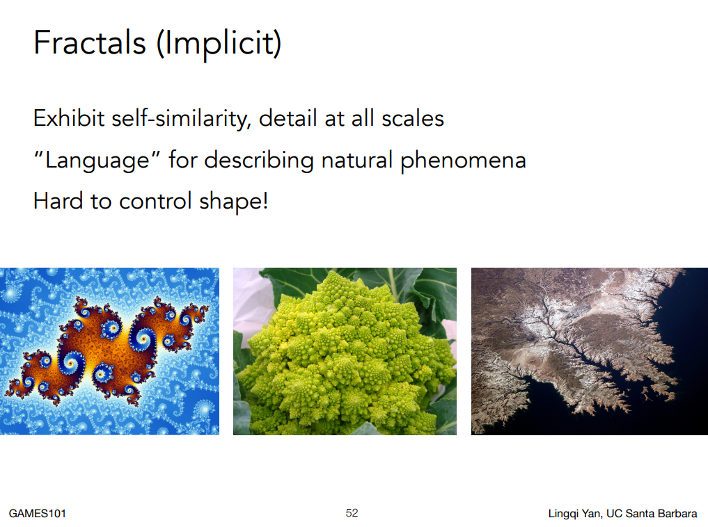

分形可能會在細小的尺度上具有很高的變化頻率，因此算繪結果容易出現強烈的走樣，而我們也需要處理這些細節的取樣問題

圖中的 Romanesco 也是自相似幾何的例子：整顆蔬菜具有許多尖錐狀的凸起，每個凸起又會包含更小的相似結構。 這種細節會在不同尺度上反覆出現，因此幾何表示與影像取樣都需要考慮觀察尺度

## 電腦圖學中的顯式表示法（Explicit Representations in Computer Graphics）

顯式幾何也有各種不同的表示方法，像是：

- triangle meshes
- Bezier surfaces
- subdivision surfaces
- NURBS
- point clouds

後面我們會再來一一介紹，首先從點雲開始

### 點雲（point clouds）

點雲會把物體表面的每個點都獨立表示出來，不像前面會以節點組成表面來描述一個物體。 這樣一來只要點足夠多，就能表示的足夠細緻，自然而然就看不到點與點之間的縫隙，也就形成表面了

一個點一樣會以空間中的 $x$、$y$、$z$ 來表示，因此點雲就是一個 $x$、$y$、$z$ 的列表，非常簡單，我們可以看下面的例子：

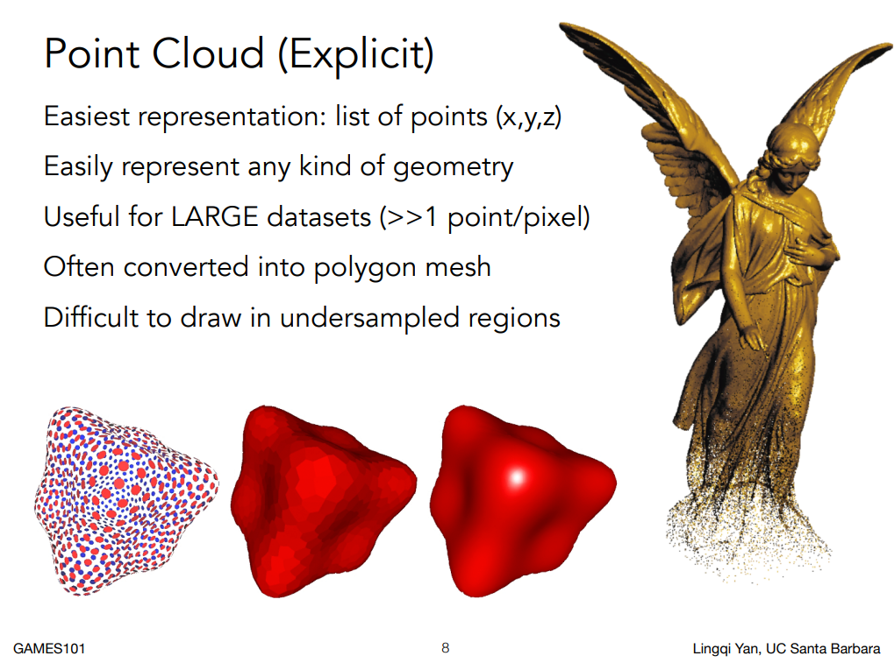

以右邊的雕像來說，你可以看到它上半部分的點雲密度非常大，因此我們可以很清楚的看到物體的表面。 接著慢慢往雕像的下半部分看，你會發現表面的中間已經開始有些縫隙，點雲的密度慢慢變得稀疏了。 到了最下面，你已經看不出面的存在了。 由此可見，我們如果要用點雲表現複雜且連續的表面，會需要非常非常多的點，因此人們通常不會直接使用點雲

但在做掃描建模的時候，得到的輸出都是點雲的形式，因此我們需要思考一個問題：要如何把點雲轉成三角形網格？ 這有很多的研究在做（表面重建），但由於這邊偏介紹所以我們就不提了

### 多邊形網格（Polygon Mesh）

圖學中用得最多的是多邊形面，尤其是三角形或四邊形的面，通常我們會把任何的面都拆成各種小的三角形，以下圖為例，你可以看到球冠的部分用了許多的小三角形，而中間的部分則用了一些細長的三角形：

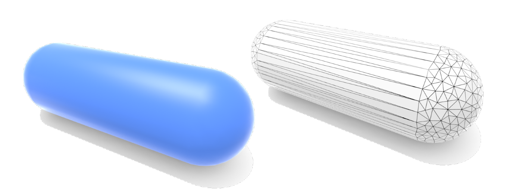

要用三角形去描述各種各樣的物體，最主要的問題就是三角形的連接關係，通常我們會用一些特定的文件格式來描述它，像是 wavefront object file，一般簡稱為 object file，後綴為 .obj，它是一個文本文件，裡面會把空間中的一堆點、法線和紋理座標分開來表示，然後再將它們組織起來，形成一個模型，看下面的例子：

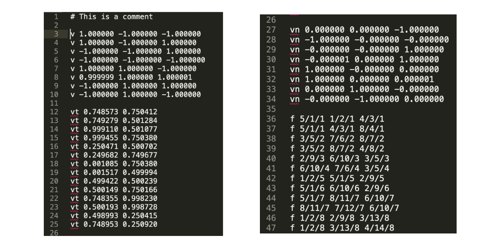

這個例子描述的是一個立方體，我們知道一個立方體共有八個空間中的點，我們用 `v` 來表示它，後面接對應的 x, y, z 座標。 而立方體有六個面，換句話說立方體有六個不同的法線，OBJ 會以 `vn` 來表示法線，這邊會有 8 行是因為這個是自動建模產生的檔案，所以會有一些冗餘。 `vt` 表示紋理座標，而 `f` 用來表示哪三個點會形成一個三角形。 具體的格式可以去看 wavefront object file format 的 spec

## 曲線（Curves）

### 貝塞爾曲線（Bézier curves）

我們接下來要看一個大重點：曲線。 無論是在動畫中描述相機的運動軌跡，還是在字體中描述彎曲的輪廓，都會需要曲線，因此曲線的應用非常廣泛。 這章會提一個很有名的曲線的顯式表示法：貝塞爾曲線（Bézier Curves）

貝塞爾曲線會用一系列的控制點去定義一條曲線的性質。 比如下面這個例子，曲線會從 $p_0$ 開始，沿著 $p_0$ 到 $p_1$ 的方向出發，並在點 $p_3$，沿著 $p_2$ 到 $p_3$ 的方向結束：

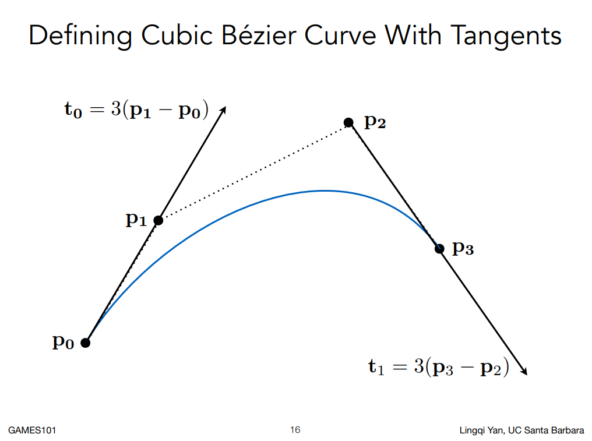

上圖中的參數式內有個係數「3」，這表示它對切線的長度也有定義，等等會再詳細解釋。 透過這四個控制點，我們可以確保這條曲線的起始點和終點一定會在 $p_0$ 和 $p_3$ 上，並且也有辦法定義這兩點的切線方向，如此一來我們便可以得到一條唯一的曲線了。 要注意，我們只保證曲線會通過兩個端點，並不要求它要通過中間的控制點

### de Casteljau 演算法（de Casteljau Algorithm）

我們現在就來看如何用 de Casteljau Algorithm 來計算貝塞爾曲線上的點。 剛剛的圖裡面有四個控制點，但其實控制點的數量可以自己定義，現在假設我們只有三個控制點，如下圖：

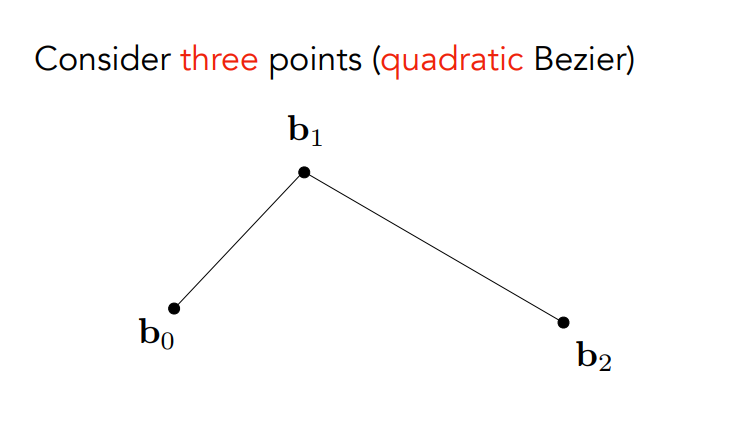

三個控制點生成的貝塞爾曲線有一個名稱，叫做二次貝塞爾曲線（Quadratic Bezier）。 從上圖你可以猜到，我們的曲線要從 $b_0$ 開始，在 $b_2$ 結束，而 $b_1$ 則決定它要往哪個方向彎

de Casteljau 演算法會使用一個介於 0 至 1 的參數 $t$，可以把它想像成動畫的時間參數，當 $t$ 為 0 的時候輸出要在點 $b_0$ 上，當 $t$ 為 1 的時候輸出要在 $b_2$ 上

de Casteljau 會在每條邊上用線性內插找出一個點，讓我們先以 $b_0 b_1$ 這條邊為例。 目前我們有給定的時間 $t$，我們認為 $t$ 為 0 時該邊上的內插點位於 $b_0$，$t$ 為 1 時該邊上的內插點位於 $b_1$。 假設 $t$ 現在大概為 $\frac{1}{3}$，那內插點就會在該邊上從 $b_0$ 出發大概 $\frac{1}{3}$ 的位置：

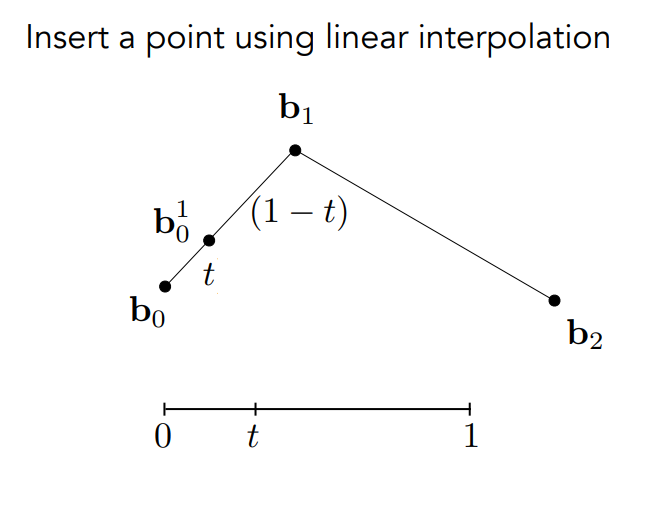

我們接著對另一條邊 $b_1 b_2$ 做一樣的事情，依照控制點的順序進行內插，所以第二個邊上的內插點會比較靠近 $b_1$，而不是 $b_2$：

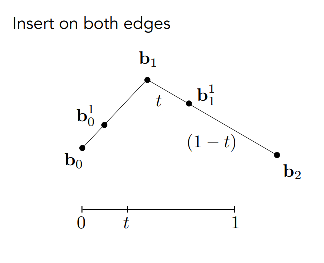

接下來把這兩個新得到的點連起來，再做一次內插：

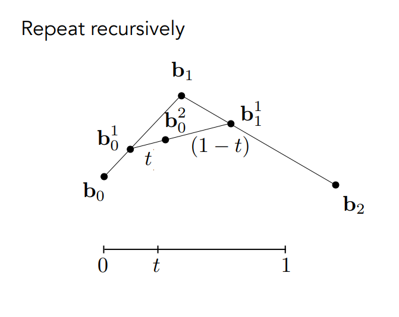

而因為不可能再有更多的線段了（剩一個點），因此這個點就是我們的輸出點了，這條貝塞爾曲線在時間 $t$ 的時候，輸出就是在這個位置。 如果我們要畫出完整的曲線，可以沿著參數 $t$ 來取樣，把對應的位置畫出來：

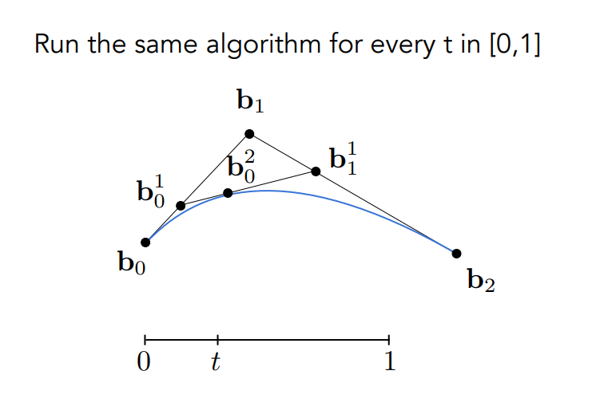

接著來看四個控制點的例子：

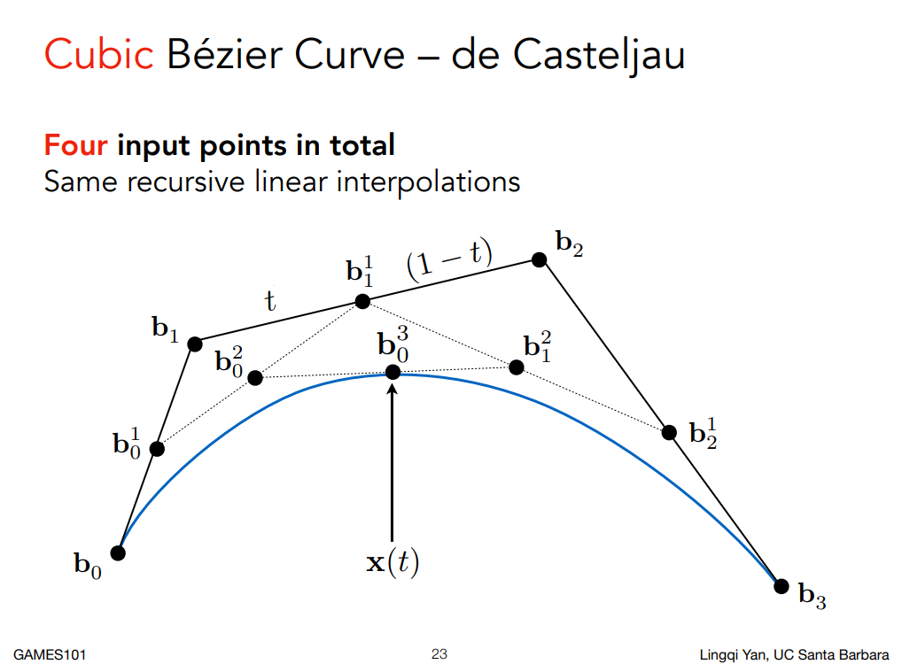

我們會沿用三個控制點的步驟，先在每條邊上找到內插點，再依序連接這些新點。 四個控制點原本形成了三條線段，第一輪內插會得到三個點與兩條線段，第二輪會得到兩個點與一條線段，最後一輪就會得到曲線在參數 $t$ 的位置了

### 貝塞爾曲線的代數求值公式（Evaluating Bézier Curves Algebraic Formula）

我們前面提到的是貝塞爾曲線的顯式表示法，現在讓我們來看它的代數形式。 由於貝塞爾曲線會由控制點來決定時間 $t$ 時的點在哪裡，因此一定有一個代數的表示方法，讓我們給定任意一個時間 $t$，就能直接得到對應的輸出點了

假設控制點仍然是 $b_0$、$b_1$、$b_2$ 與 $b_3$。 我們在 $b_0b_1$ 上做線性內插時，內插點會是 $(1-t)b_0+tb_1$，並記為 $b_0^1$，其中上標代表計算層數。 接著依此類推，就能找到最後的點了：

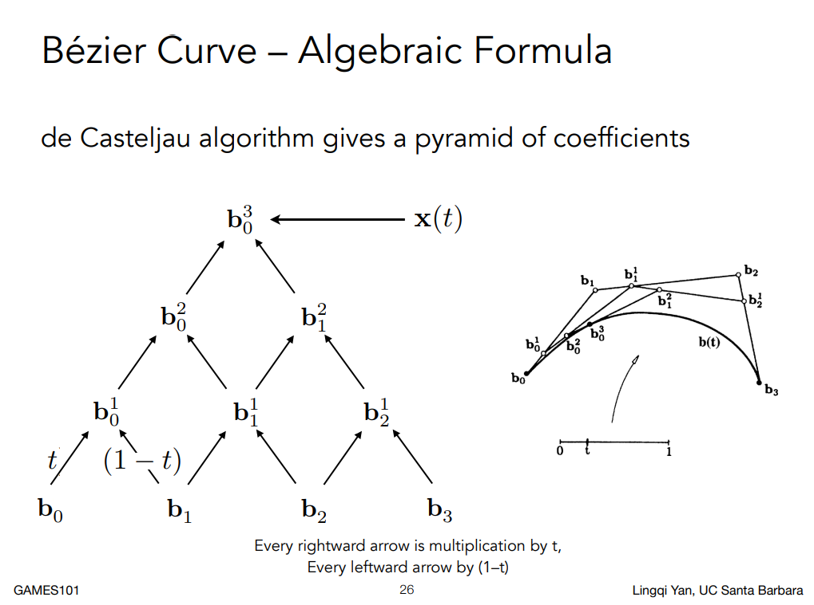

我們可以把所有層的計算統一寫成同一個遞迴式：

$$
b_i^0=b_i,\quad
b_i^r(t)=(1-t)b_i^{r-1}(t)+t\,b_{i+1}^{r-1}(t).
$$

這裡的 $r$ 代表目前的層數。 我們從 $n+1$ 個控制點開始，每往上一層，點的數量都會少一個，最後可以得到 $b(t)=b_0^n(t)$。 這個權重也符合端點條件：$t=0$ 會取左端點，$t=1$ 會取右端點

讓我們再用一個三個控制點的貝塞爾曲線來幫助理解：

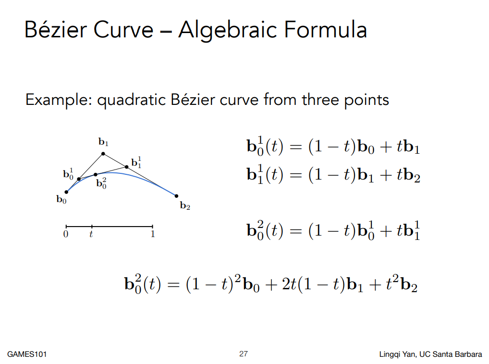

我們把兩層內插依序展開，就能得到二次曲線的式子了：

$$
\begin{aligned}
b(t)
&=(1-t)\bigl((1-t)b_0+tb_1\bigr)
+t\bigl((1-t)b_1+tb_2\bigr)\\
&=(1-t)^2b_0+2t(1-t)b_1+t^2b_2.
\end{aligned}
$$

如果再增加一個控制點，可以進一步得到三次曲線的式子：

$$
b(t)=(1-t)^3b_0+3t(1-t)^2b_1+3t^2(1-t)b_2+t^3b_3.
$$

當我們我們依序展開各層的內插時，都可以得到其最後輸出點的參數式。 這些係數就是伯恩施坦多項式。 下圖列出了有 $n + 1$ 個控制點的貝塞爾曲線的參數式，其中 $B^n_i(t)$ 為對應的係數：

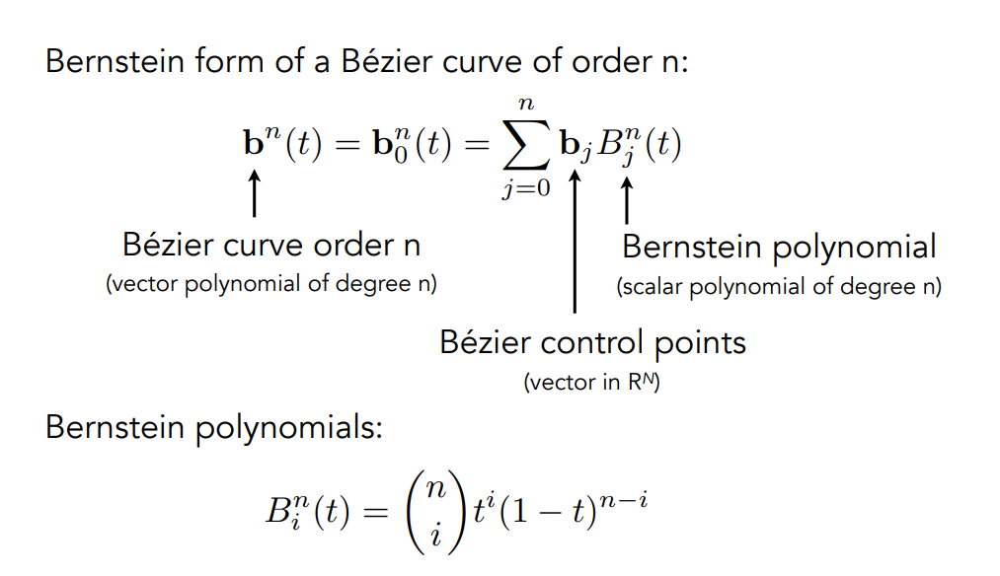

一般的 $n$ 次貝塞爾曲線會具有以下形式：

$$
b(t)=\sum_{i=0}^{n}B_i^n(t)b_i,
\quad B_i^n(t)=\binom{n}{i}t^i(1-t)^{n-i}.
$$

Bernstein 基函數在 $0\leq t\leq1$ 內都會大於或等於零，所有基函數的總和也會等於一：

$$
\sum_{i=0}^{n}B_i^n(t)=\bigl((1-t)+t\bigr)^n=1.
$$

因此，曲線上的每個點都會是控制點的凸組合。 這些權重同時具有 $B_i^n(t)=B_{n-i}^n(1-t)$ 的對稱性，我們可以從二項式係數直接看出這個關係

由於它的特性，我們其實也不用限定控制點要在一個平面上，下圖舉了一個在三維空間中的例子：

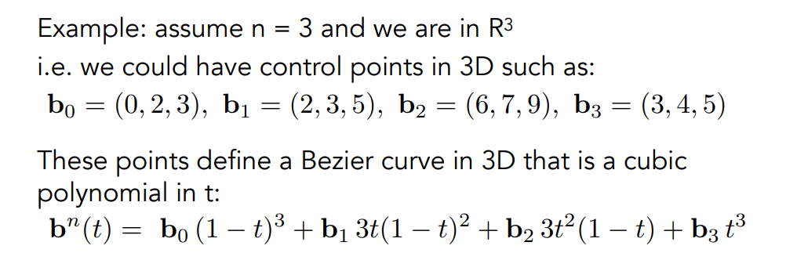

貝塞爾有一些不錯的性質，以四個控制點的曲線為例：

- 曲線在 $t=0$ 時會位於起點，在 $t=1$ 時會位於終點：
  - $b(0) = b_0$
  - $b(1) = b_3$
- 起點與終點的切線向量可以直接算出來：
  - $b'(0) = 3(b_1 - b_0)$
  - $b'(1) = 3(b_3 - b_2)$
- 我們可以直接對控制點做仿射變換，而新控制點畫出的曲線，會與原曲線經過相同仿射變換後的結果一致
  - 這個性質要求變換具有仿射形式，透視投影一般不符合這個條件
- 凸包性質（Convex hull）：你畫出來的曲線一定會位在控制點形成的凸包內

::: tip  
對整條曲線做的平移、旋轉或縮放等，也就是仿射變換 $T(\mathbf{x})=A\mathbf{x}+\mathbf{c}$ 而言，權重總和等於一的性質會讓我們得到：

$$
T\!\left(\sum_iB_i^n(t)b_i\right)
=\sum_iB_i^n(t)T(b_i).
$$

這代表我們可以藉由變換控制點來得到整條曲線的仿射變換結果。 上式的兩邊分別表示：

- 左邊：先用控制點算出曲線上的點，再對這個點做變換
- 右邊：先變換所有控制點，再用新的控制點算出曲線上的點

例如，把每個控制點都往右移動 $10$，新曲線就會等於原曲線整條往右移動 $10$

這是因為，如果我們把權重簡寫成 $w_i=B_i^n(t)$，而且已知 $\sum_iw_i=1$，則我們有：

$$
\begin{aligned}
\sum_iw_iT(b_i)
&=\sum_iw_i(Ab_i+\mathbf c)\\
&=A\sum_iw_ib_i+\mathbf c\sum_iw_i\\
&=A\sum_iw_ib_i+\mathbf c\\
&=T\!\left(\sum_iw_ib_i\right).
\end{aligned}
$$

權重總和等於一，讓平移量 $\mathbf c$ 在加權後剛好保留一次，因此兩種計算順序會得到相同結果。 例如假設兩個控制點的位置是 $2$ 和 $6$，權重各為 $\frac12$，算出的點就是：

$$
\frac12\times2+\frac12\times6=4
$$

現在要往右移動 $10$，有兩種算法：

- 先算出點，再平移：$4+10=14$
- 先平移控制點，再算出點：控制點變成 $12$ 和 $16$，加權後也是 $\frac12\times12+\frac12\times16=14$

關鍵是：第二種算法中，每個控制點加上的 $10$，也會乘上該點的權重。 因此，平移量合計是：

$$
\frac12\times10+\frac12\times10
=\left(\frac12+\frac12\right)\times10
=10
$$

可以看見因為權重總和等於 $1$，所以加權後的總平移量仍然是 $10$

最後對於透視投影，因為它還要做類似 $x/z$ 的運算，但「先加權再除以深度」與「各自除以深度再加權」的結果通常不會一樣：

$$
\frac{\sum_iw_ix_i}{\sum_iw_iz_i}
\neq
\sum_iw_i\frac{x_i}{z_i}.
$$

所以，直接投影控制點，再用原本的權重畫貝塞爾曲線，一般無法得到原曲線真正的透視投影結果
:::

### 分段貝塞爾曲線（Piecewise Bézier Curves）

我們雖然可以使用任意多個控制點，但當控制點的數量上升後，曲線的形狀就不容易直接從控制點看出來了。 另外，控制點的數量一多，我們也會變得不容易預測各個控制點對整段曲線的影響，比較難直接調整出想要的形狀。 底下是一條 $n=10$ 的貝塞爾曲線，圖中共有十一個控制點：

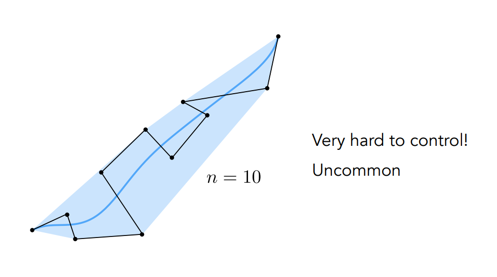

你可以看到它變得十分平滑，不利於使用控制點來取得你想要的形狀。 為了更好的操控貝塞爾曲線，人們使用了逐段（piecewise）的方法，利用多組使用三、四個控制點的貝塞爾曲線來組合出一個想要的曲線：

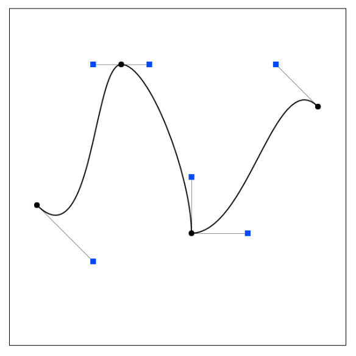

曲線在連接處可能會有轉折，如果要保持曲線的光滑，由於前面提到的貝塞爾切線的特性，你需要讓連接處的三個控制點共線，且和兩段的控制線段的長度是一樣的，這樣才能有 $C^1$ 連續

我們可以用兩段三次曲線 $a(t)$ 與 $b(t)$ 來說明接合條件。 兩段曲線各自的參數範圍都是 $[0,1]$，每段都有 4 個控制點，編號從 0 開始：

- 左段 $a(t)$：$a_0、a_1、a_2、a_3$
- 右段 $b(t)$：$b_0、b_1、b_2、b_3$

想像一個點先沿著 $a(t)$ 走，到了 $a(1)$ 時，再從 $b(0)$ 沿著 $b(t)$ 繼續走。 因為貝塞爾曲線會通過首尾控制點，所以：

$$
a(1)=a_3,\quad b(0)=b_0.
$$

讓 $a_3=b_0$，兩段曲線就會接在同一個位置，進而具有 $C^0$ 連續性。 我們把這個共同接點叫作 $P$：

$$
P=a_3=b_0.
$$

但只有位置重合，接點處仍可能出現「第一段從左邊抵達，第二段突然往上走」的尖角。 而 $C^1$ 連續進一步要求了抵達與離開時的切線向量要相同，由於兩段都是三次曲線，因此如果：

$$
\underbrace{a'(1)=3(P-a_2)}_{\text{抵達接點時的切線向量}},
\quad
\underbrace{b'(0)=3(b_1-P)}_{\text{離開接點時的切線向量}}.
$$

這兩個向量要相等，就必須滿足：

$$
3(P-a_2)=3(b_1-P).
$$

兩邊除以 $3$，得到：

$$
P-a_2=b_1-P.
$$

意思是：從 $a_2$ 指向接點 $P$ 的向量，與從接點 $P$ 指向 $b_1$ 的向量，方向和長度都相同。 可以把這三個點想成：

$$
a_2
\;\xrightarrow{\;\mathbf v\;}\;
P
\;\xrightarrow{\;\mathbf v\;}\;
b_1.
$$

從 $a_2$ 到 $P$，和從 $P$ 到 $b_1$，移動的方向與距離都一樣

把等式整理一下：

$$
P-a_2=b_1-P
\quad\Longrightarrow\quad
P=\frac{a_2+b_1}{2}
$$

因此共同接點 $a_3=b_0$，必須剛好位在 $a_2$ 與 $b_1$ 的正中央，才會有 $C^1$ 連續

例如，$a_2=(0,0)$、$P=(1,0)$、$b_1=(2,0)$，兩側的切線向量都是 $(3,0)$，這樣就符合 $C^1$。 但如果把 $b_1$ 改成 $(3,0)$，離開時的切線向量就變成 $(6,0)$ 了，方向雖然相同，長度卻不同，因此不符合 $C^1$

::: tip  
$C^0$ 和 $C^1$ 是描述曲線連續程度的符號，右上角的數字表示要求到幾階導數連續：

- $C^0$：位置連續。 兩段曲線接在同一個點，即 $a(1)=b(0)$。 但接點可能有尖角，例如兩條路接在一起，卻需要突然轉彎
- $C^1$：位置與一階導數都連續。 除了接點相同，還要求 $a'(1)=b'(0)$，也就是接點兩側的切線向量方向、長度都相同

一階導數描述「位置隨參數 $t$ 改變的方向與快慢」。 如果把 $t$ 當作時間，$C^1$ 就表示通過接點時，運動方向與速度都不會突然改變

因此，符合 $C^1$ 一定也符合 $C^0$。 但只符合 $C^0$，則未必符合 $C^1$  
:::

圖學中還有一些其他的曲線，例如 Spline，它是一種曲線的類別，也會有一系列的控制點，並能滿足一定的連續性。 其中用的比較多的是 B-splines，其中的 B 為 Basis 的縮寫，指基函數，所謂的基函數就類似我們剛剛的伯恩施坦多項式

B-splines 類似於對貝塞爾曲線的擴展，能力比貝塞爾曲線更強，可以讓我們用較低次數的分段多項式，組合出由許多控制點決定的曲線。 我們剛剛看到的高次貝塞爾曲線，會因為一個控制點的移動而改變整段曲線的形狀。 但設計者往往希望一次只修改某個控制點附近的區域，而 B-splines 的基函數具有局部支撐，因此 B-splines 就能提供這種局部控制

雖然其與貝塞爾曲線的方法非常類似，不管是從幾何角度，還是代數角度，它們的分析方法都類似，只是 B-splines 的幾何數更加複雜而已。 但由於這門課是入門課，所以這裡就不提了。 另外要再更進一步的曲線還有 NURBS，這邊就只提個名詞，不多做著墨了，有興趣的可以看看[清華胡志明老師的課程](https://www.bilibili.com/video/av66548502?from=search&seid=65256805876131485)

## 曲面（Surfaces）

接著我們來討論曲面。 我們可以把前面的參數曲線延伸成參數曲面，讓兩個參數共同決定三維空間中的一個點

### 貝塞爾曲面（Bézier Surfaces）

貝塞爾曲面的概念與貝塞爾曲線類似，一樣會有一系列的控制點，例如下圖有 16 個控制點：

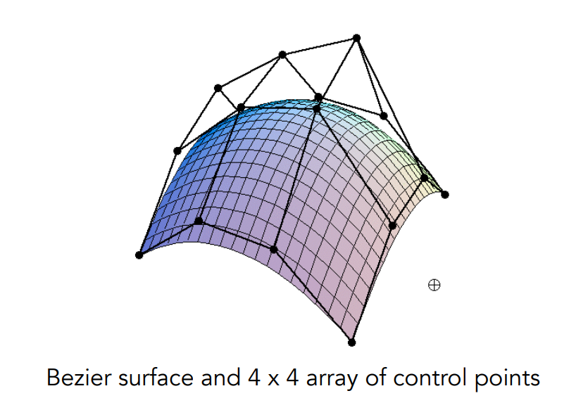

我們可以仿照雙線性內插的想法，在兩個參數方向各做一次貝塞爾曲線的計算。 下圖的控制點會排成四列，每列有四個控制點。 我們會先得到四條灰色的貝塞爾曲線，接著再對這四條曲線使用同一個參數 $u$ 來得到四個藍色的點，最後再把這四個點當成另一條貝塞爾曲線的控制點，並用參數 $v$ 算出最後的位置。 當 $u$ 與 $v$ 都在 $[0,1]$ 內變化時，我們就可以用這個位置拼出整塊曲面：

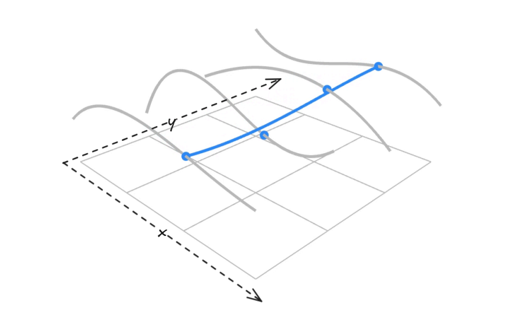

老師的上課錄影中有個 demo 影片，但我找不到下載的網址，[具體來說可以看這段影片](https://youtu.be/Zkx1aKv2z8o?t=1114)，看完影片應該會比較好理解。 另外由於有兩個方向，因此也需要有兩個 $t$ 參數，講義上將它們記作 $u$ 與 $v$，我們會先用 $u$ 求出四條曲線上的點，再用 $v$ 求出最後的曲面位置：

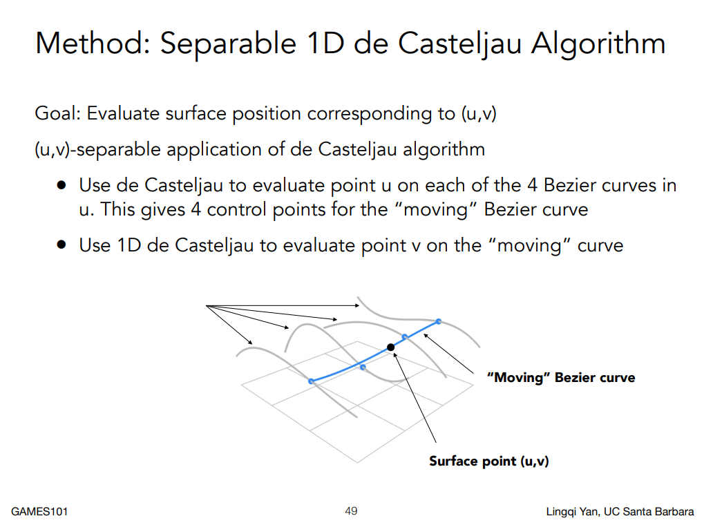

如果把控制點記為 $p_{ij}$，兩次曲線計算可以寫成以下的張量積曲面：

$$
q_i(u)=\sum_{j=0}^{3}B_j^3(u)p_{ij},
\quad
S(u,v)=\sum_{i=0}^{3}B_i^3(v)q_i(u)
=\sum_{i=0}^{3}\sum_{j=0}^{3}B_i^3(v)B_j^3(u)p_{ij}.
$$

這個式子會把平面參數 $(u,v)$ 映射成空間中的位置，因此貝塞爾曲面也是顯式表示法

### 網格操作：幾何處理（Mesh Operations: Geometry Processing）

前面的貝塞爾曲面會從控制點定義連續曲面，三角形網格則會直接保存頂點與連接關係。 當我們已經有一個網格時，我們通常還會需要三種幾何處理操作：

- 網格細分（mesh subdivision）：用來增加面與頂點的數量，並調整頂點位置，讓表面逐漸變得光滑
- 網格簡化（mesh simplification）：用來減少面與頂點的數量，並盡量維持原本的形狀
- 網格規則化（mesh regularization）：用來改善三角形的形狀與分布，讓網格減少過尖、過長的三角形

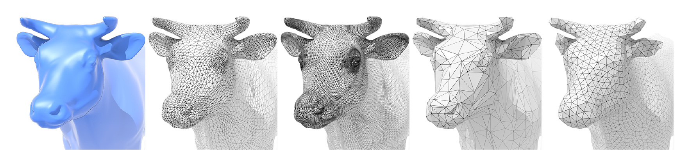

細分會讓原本粗糙的網格變得更密，簡化會讓模型使用更少的三角形，規則化則會讓各個三角形的尺寸與形狀更接近。 我們在改善網格品質時，也需要保留耳朵、牛角等幾何特徵，否則規則的三角形仍然可能組成失真的模型

## 網格細分（Mesh Subdivision）

我們在位移貼圖裡已經遇過了細分的需求：高度紋理會描述細小的凹凸，但粗大的三角形只有少量頂點，模型因此無法反映這些高度變化。 增加頂點後，位移貼圖才會有足夠的位置可以移動

這裡的細分曲面還會多做一件事：細分演算法會調整新舊頂點的位置，讓表面逐漸變得光滑。 如果我們只是在一個平面上的三角形裡增加更多三角形，那所有的新頂點仍然會落在原平面上，物體的外形會因此完全沒有改變

### Loop 細分（Loop Subdivision）

Loop subdivision 適用於三角形網格，其中 Loop 是提出這個方法的人的姓氏，不是說它這個方法跟迴圈有關。 這個演算法會重複執行兩個步驟：先把每個三角形拆成四個三角形，再依照不同的權重更新頂點位置

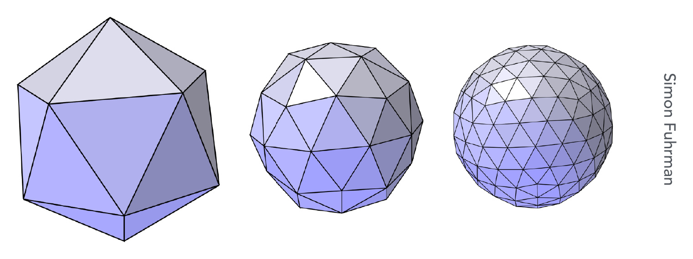

我們可以先在三條邊上各放一個新點，再把這三個點連起來。 如此一來，原本的大三角形就會被拆成中央的一個三角形，加上周圍的三個三角形，總共就有四個三角形了

#### 新頂點的位置

我們先考慮網格內部的一條邊 $AB$，它的兩側各有一個三角形，這兩個三角形的另外兩個頂點分別為 $C$ 與 $D$。 Loop 會把這條邊上的新頂點放在四個舊頂點的加權平均位置：

$$
p_{\mathrm{new}}=\frac{3}{8}(A+B)+\frac{1}{8}(C+D).
$$

邊的兩個端點會各占 $3/8$，兩個對側頂點則會各占 $1/8$，所有權重加起來剛好等於一

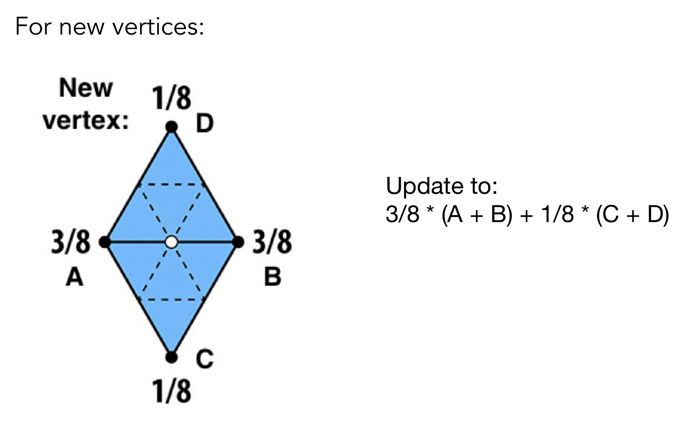

#### 舊頂點的位置

接著讓我們來更新原本就存在的頂點。 假設舊頂點為 $p$，它有 $n$ 個相鄰的舊頂點 $p_1,\ldots,p_n$，其中 $n$ 就是這個頂點的度數，也就是與它相連的邊數。 課程使用的更新規則為：

$$
p'=(1-nu)p+u\sum_{i=1}^{n}p_i,
\quad
u=
\begin{cases}
3/16, & n=3,\\
3/(8n), & n>3.
\end{cases}
$$

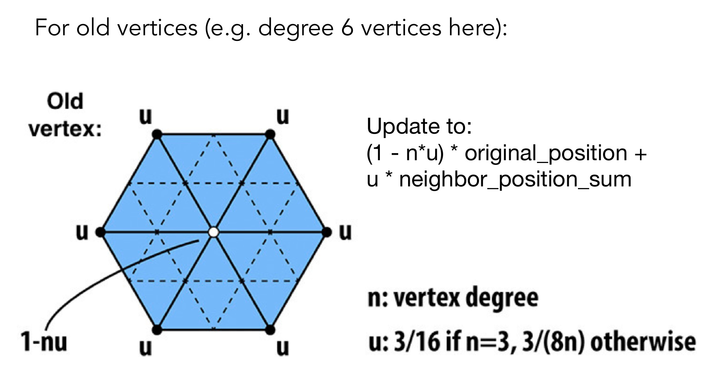

這裡的 $u$ 是權重係數，我們會把它與前面曲面使用的參數 $u$ 分開看待。 舊頂點會同時考慮原位置與周圍舊頂點的影響，權重總和為 $(1-nu)+nu=1$

例如，圖中的頂點具有六個鄰居，所以 $u=1/16$，更新後的位置為：

$$
p'=\frac{5}{8}p+\frac{1}{16}\sum_{i=1}^{6}p_i.
$$

我們在每一輪更新中，都會使用該輪開始前的舊頂點資料。 如果我們邊算邊覆寫，再讓後面的點使用已經更新的位置，結果就會受到走訪順序的影響，也就不再符合上面的更新規則了

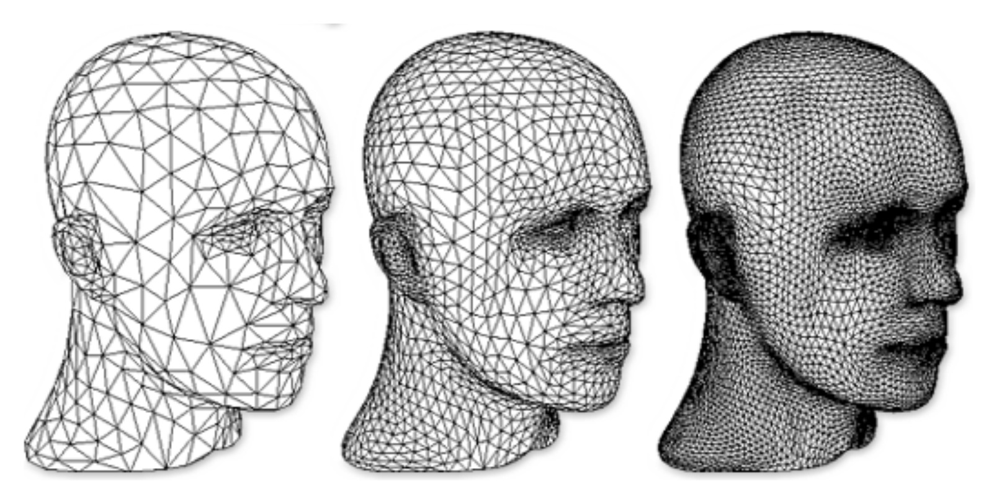

圖中的三角形數量每輪都會增加為原來的四倍，而新舊頂點的位置也會一起改變。 因此，模型會逐步接近一個平滑的曲面，原本明顯的稜角也會變得圓滑

### Catmull-Clark 細分（Catmull-Clark Subdivision）

Loop 的拆分規則以三角形為前提，但建模時的網格也可能會同時包含三角形、四邊形或更多邊的面。 此時我們可以使用 Catmull-Clark subdivision，它可以處理這種多邊形網格，並在第一輪細分後把各個面都轉成四邊形

我們先認識兩個會用來分析拓樸的名稱：

- 非四邊形面（non-quad face）：邊數不等於四的面
- 奇異頂點（extraordinary vertex）：度數不等於四的頂點
  - 這裡的「奇異」只是在描述它與規則四邊形網格不同的連接數量

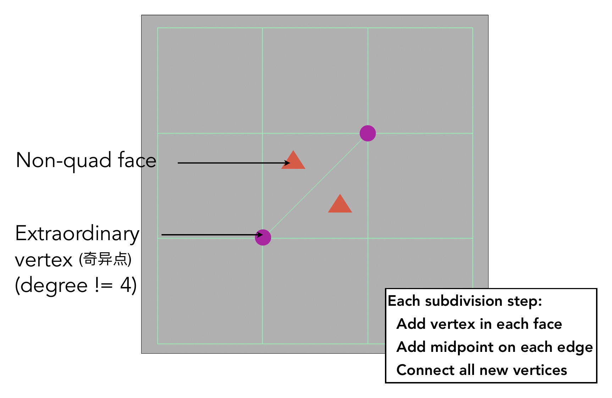

圖中紫色的兩個舊頂點各連了五條邊，所以它們都是奇異頂點。 兩個橘色標記則指出了非四邊形面，也就是中央的兩個三角形

#### 細分後的連接關係

Catmull-Clark 會在每個面裡面新增一個面點，並在每條邊上新增一個邊點。 接著會把面點連到這個面的所有邊點，再保留各個舊頂點與相鄰邊點的連線，此時舊面的每個角落就會對應到一個新的四邊形了

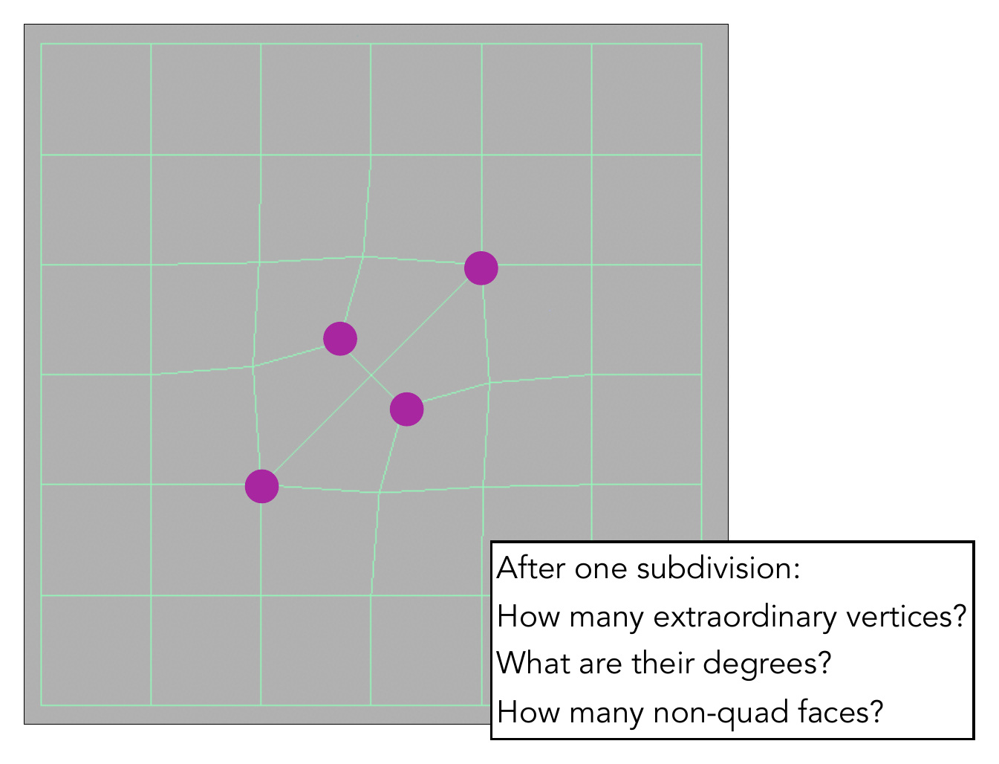

例如，三角形會拆成三個四邊形，五邊形會拆成五個四邊形。 由於每個新四邊形都會依序經過「舊頂點、邊點、面點與另一個邊點」，所以舊面的邊數不會改變新面具有四個角的事實

現在來看一下圖中奇異頂點的數量。 原本兩個度數為五的頂點仍然各連五條邊，而兩個三角形內的面點各連三個邊點，所以這一輪一共會出現四個奇異頂點。 一般來說，一個 $k$ 邊形的面點會具有度數 $k$，因此每個非四邊形面都會在第一輪增加一個奇異頂點

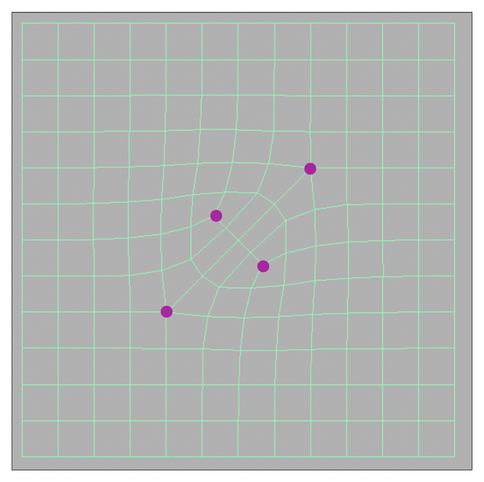

第一輪結束後，所有的面就都已經是四邊形了。 之後新產生的面點各會連著四條邊，而內部邊點也會各連著四條邊，因此後續細分不會再因為非四邊形面而增加奇異頂點了。 舊奇異頂點的度數則會維持原值

#### 面點、邊點與舊頂點的更新

上一節我們講了需要那些點以及線要怎麼連，現在我們來看一下這些點的位置要怎麼算。 我們先計算每個面的面點，其位置是這個面裡面所有舊頂點的平均。 如果這個面有 $k$ 個頂點，面點就會是：

$$
f=\frac{1}{k}\sum_{j=1}^{k}v_j.
$$

接著是內部邊，假設邊的兩個舊端點是 $v_1$ 與 $v_2$，兩側的面點是 $f_1$ 與 $f_2$，此時邊點會使用這四個位置的平均：

$$
e=\frac{v_1+v_2+f_1+f_2}{4}.
$$

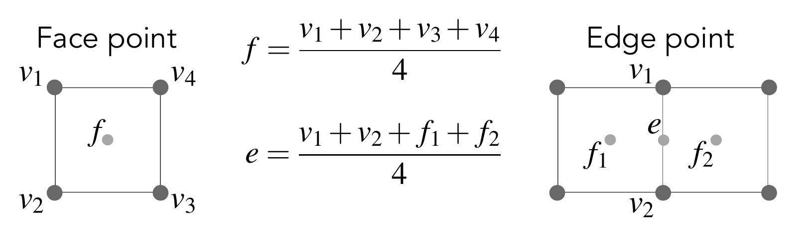

最後是舊頂點的更新。 以頂點度數為四的四邊形網格來說，假設 $p$ 是舊頂點，$f_1,\ldots,f_4$ 是周圍的面點，$m_1,\ldots,m_4$ 則是原本四條邊的中點。 此時舊頂點的新位置為：

$$
p'=\frac{f_1+f_2+f_3+f_4+2(m_1+m_2+m_3+m_4)+4p}{16}.
$$

這裡的 $m_i$ 會直接取舊邊兩個端點的平均，所以它與前面更新過的邊點 $e$ 是不同的量。 我們如果把相鄰面點的平均記成 $\bar f$，舊邊中點的平均記成 $\bar m$，則一般內部頂點的更新式可以寫成：

$$
p'=\frac{\bar f+2\bar m+(n-3)p}{n},
$$

其中 $n$ 是舊頂點的度數，如果令 $n=4$，就會得到投影片上的式子了。 面點、邊點與舊頂點會各自使用鄰近幾何的加權平均，因此多輪細分會讓整個曲面逐漸變的平滑。 下圖的兩列分別使用了 Loop 與 Catmull-Clark：

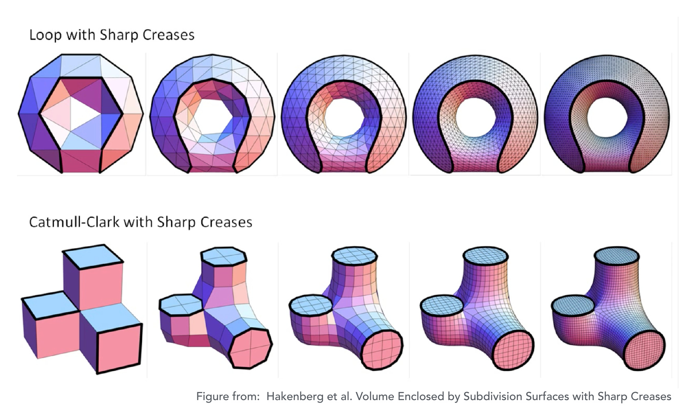

## 網格簡化（Mesh Simplification）

我們在觀察遠處物體時，通常都看不到高密度模型的細節，此時我們可以利用網格簡化來幫助減少不必要的運算。 網格簡化會在減少面數的同時，盡量保留物體的整體形狀，以降低頂點變換、幾何處理與儲存的成本

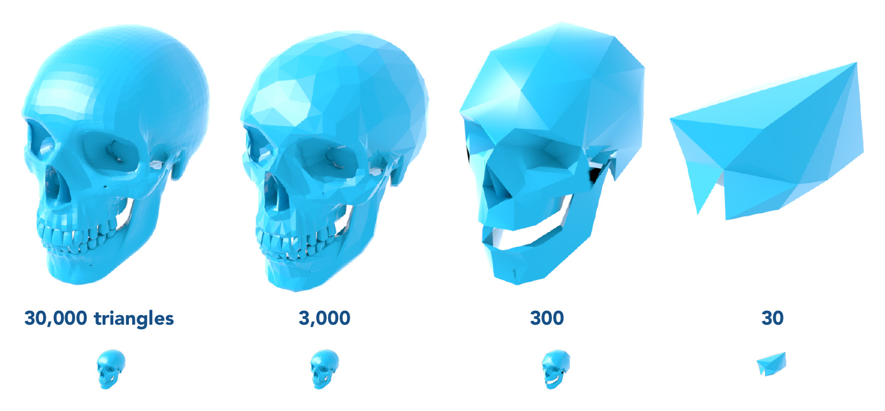

圖中的骷髏依序使用了 30,000、3,000、300 與 30 個三角形。 對於前兩者，我們尚有辦法看見逐漸消失的鼻子、牙齒等細節，但當模型縮小後，3,000 個與 300 個三角形的差別就比較難辨認了

### 細節層級（Level of Detail）

我們可以為同一個物體準備不同細節層級（Level of Detail，LOD）的模型，再依照觀察距離或物體在畫面中的大小來選擇適合的版本。 這個想法與 Mipmap 類似：近處會需要細緻的表示，遠處則可以使用較粗略的表示

幾何模型在切換層級時，它的頂點數與連接關係也可能會改變，所以它的過渡會比影像層級之間的內插更麻煩。 如果我們直接切換模型，觀察者看見的輪廓可能會突然發生跳動

### 邊坍縮（Edge Collapse）

如果要刪掉一個三角形，我們不能直接刪除它，否則物體表面可能會留下洞。 這裡我們介紹一種稱為「邊坍縮（edge collapse）」的方法來刪三角形，它會把某條邊的兩個端點合併成一個頂點，再更新周圍的連接關係

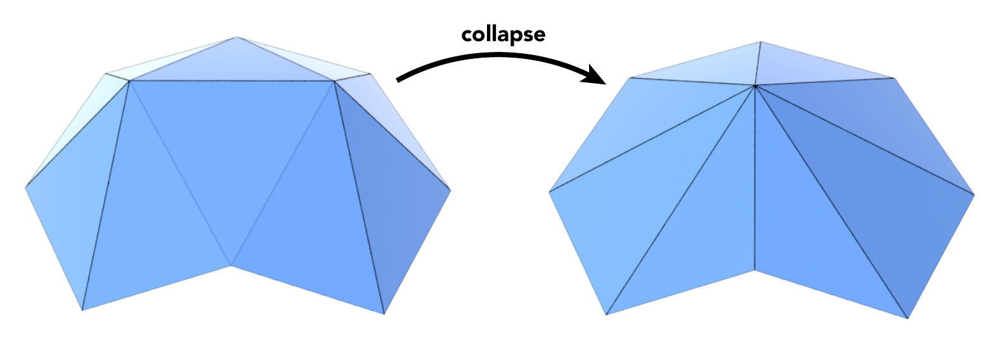

原本的邊會在合併後消失，部分與它相連的三角形也會因退化而被移除。 這個過程會有兩個問題：

- 新頂點應該放在哪裡
- 應該先坍縮哪一條邊

由於這兩個問題都需要一個能衡量形狀改變程度的誤差，所以我們現在來看一下二次誤差度量（Quadric Error Metrics）

### 二次誤差度量（Quadric Error Metrics）

二次誤差度量（Quadric Error Metrics，QEM）會用新頂點到相關平面的「距離平方和」來評估誤差。 這裡的二次指的是平方，演算法會尋找讓這個平方和最小的位置

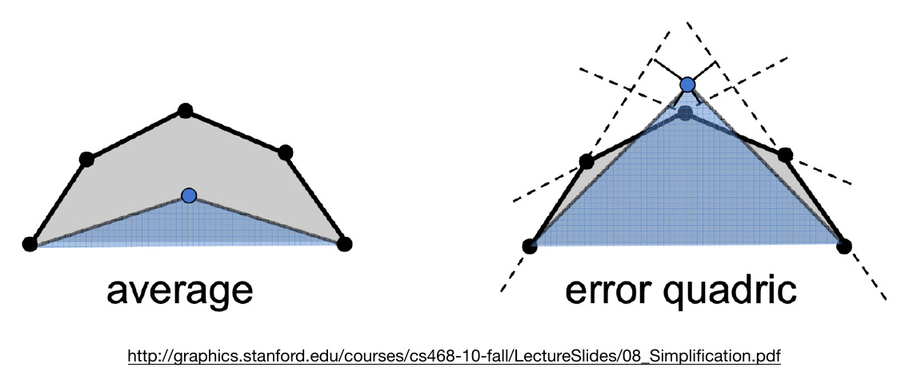

我們先看上圖的二維例子。 原本的折線包含了一段向上凸起的輪廓，如果我們把中間幾個頂點的位置直接平均掉，新頂點就會往內縮，簡化後的輪廓會變得太平坦

QEM 的做法是會去衡量新頂點到原本各條直線的距離。 如果是三維的情況，則會改成衡量新頂點到原本三角形所在平面的距離。 假設相關平面為 $\Pi_1,\ldots,\Pi_m$，我們會把新頂點 $\mathbf{x}$ 的誤差定義成：

$$
E(\mathbf{x})=\sum_{i=1}^{m}d(\mathbf{x},\Pi_i)^2
$$

並將能讓誤差最小的新頂點寫作 $\mathbf{x}^{\star}$：

$$
\mathbf{x}^{\star}=\operatorname*{arg\,min}_{\mathbf{x}}E(\mathbf{x}).
$$

也就是找到一個點，使它到所有 $\Pi_i$ 的「距離平方總和」最小

如果我們把第 $i$ 個平面的方程式寫成 $\mathbf{n}_i^{\mathsf T}\mathbf{x}+d_i=0$，並把法線 $\mathbf{n}_i$ 正規化成單位向量。 此時在平面 $\Pi_i$ 上任選一個點 $\mathbf p$。 從 $\mathbf p$ 指向 $\mathbf x$ 的向量是：

$$
\mathbf x-\mathbf p.
$$

這個向量可能斜斜地指向 $\mathbf x$。 把它投影到垂直於平面的方向，再取絕對值，就能得到點到平面的距離為：

$$
d(\mathbf x,\Pi_i)
=\left|\mathbf n_i^{\mathsf T}(\mathbf x-\mathbf p)\right|.
$$

又因為 $\mathbf p$ 在平面上，滿足：

$$
\mathbf n_i^{\mathsf T}\mathbf p+d_i=0
\quad\Rightarrow\quad
\mathbf n_i^{\mathsf T}\mathbf p=-d_i.
$$

代入後我們能得到：

$$
d(\mathbf x,\Pi_i)
=\left|\mathbf n_i^{\mathsf T}\mathbf x+d_i\right|.
$$

兩邊平方後，就可以去掉絕對值了：

$$
d(\mathbf x,\Pi_i)^2
=(\mathbf n_i^{\mathsf T}\mathbf x+d_i)^2
$$

因此，誤差也可以直接寫成：

$$
E(\mathbf{x})=\sum_{i=1}^{m}\left(\mathbf{n}_i^{\mathsf T}\mathbf{x}+d_i\right)^2.
$$

這個形式會把「距離平方和」變成可以計算的二次函數。 我們對 $\mathbf{x}$ 求導並令導數為零，就能得到求最佳位置的線性方程了。 先看第 $i$ 項，令

$$
\mathbf x=\begin{pmatrix}x\\y\\z\end{pmatrix},
\qquad
\mathbf n_i=\begin{pmatrix}a_i\\b_i\\c_i\end{pmatrix}.
$$

那麼這一項就是：

$$
E_i(\mathbf x)
=(\mathbf n_i^{\mathsf T}\mathbf x+d_i)^2
=(a_ix+b_iy+c_iz+d_i)^2.
$$

其中 $a_i,b_i,c_i,d_i$ 都是固定常數。 先對座標 $x$ 微分，把 $y,z$ 當常數：

$$
\frac{\partial E_i}{\partial x}
=
\underbrace{2(a_ix+b_iy+c_iz+d_i)}_{\text{外面的平方微分}}
\underbrace{\cdot a_i}_{\text{裡面對 }x\text{ 微分}}.
$$

對 $y,z$ 也一樣，它們最後分別會乘上 $b_i,c_i$。 把這三個偏導數排成向量，就是梯度 $\nabla E_i$：

$$
\begin{aligned}
\nabla E_i
&=
\begin{pmatrix}
\frac{\partial E_i}{\partial x}\\
\frac{\partial E_i}{\partial y}\\
\frac{\partial E_i}{\partial z}
\end{pmatrix}\\
&=
2(a_ix+b_iy+c_iz+d_i)
\begin{pmatrix}a_i\\b_i\\c_i\end{pmatrix}\\
&=
2\mathbf n_i(\mathbf n_i^{\mathsf T}\mathbf x+d_i).
\end{aligned}
$$

最後，因為總和的導數等於各項導數的總和：

$$
\frac{d}{dx}\sum_{i=1}^{m}E_i(x)
=E_1'(x)+E_2'(x)+\cdots+E_m'(x)
$$

因此我們可以得到：

$$
\nabla E(\mathbf x)
=2\sum_i\mathbf n_i
(\mathbf n_i^{\mathsf T}\mathbf x+d_i)
$$

把括號展開，再把常數項移到右邊後可以得到：

$$
\left(\sum_i\mathbf{n}_i\mathbf{n}_i^{\mathsf T}\right)\mathbf{x}^{\star}
=-\sum_i d_i\mathbf{n}_i.
$$

它可以寫成熟悉的形式：

$$
A\mathbf x^\star=\mathbf b
$$

在三維空間中，這通常就是三條一次方程式，求三個座標 $x,y,z$。 各平面的資料決定 $A$ 和 $\mathbf b$，解出來的 $\mathbf x^\star$ 就是距離平方和最小的位置

如果所有平面有唯一共同交點（此時係數矩陣可逆），答案就是那個交點； 如果沒有共同交點，答案就是使總誤差最小的折衷位置。 若平面方向不足以限制所有座標，最佳位置則可能不只一個，實作需要自己再另外選擇可用的位置

### 依照誤差選擇坍縮順序

我們可以為每條候選邊計算一個分數：演算法先假設這條邊會坍縮，再求出合併後的最佳位置與對應的最小誤差。 因為誤差較小的邊對原本形狀的影響比較小，所以會先被處理

由於每次坍縮都會改變附近的頂點與面，所以鄰近邊的候選位置及誤差也會跟著改變。 我們如果只在一開始排序一次，後面使用的分數就可能會過時。 因此演算法會在每次坍縮後，重新計算受影響區域的分數

我們可以用最小堆積來實作優先佇列，讓目前誤差最小的邊留在堆積頂端。 每一輪的流程如下：

1. 取出目前誤差最小、且可以執行坍縮的候選邊
2. 把兩個端點合併到該邊的候選位置，並更新附近的網格連接
3. 移除失效的候選邊，再重算附近邊的誤差與候選位置
4. 更新優先佇列，直到模型達到目標面數或允許的誤差

最小堆積能讓我們以 $O(1)$ 時間查看最小值，但刪除最小項目或更新一個項目通常會需要 $O(\log E)$ 時間，其中 $E$ 是候選邊的數量。 由於使用的是優先佇列，所以順序問題自然地被解決掉了，我們不需要在每一輪重新排序所有邊

這個方法是一種貪心演算法，因為每一輪都只會選當下誤差最小的操作。 局部最佳的選擇不會保證最後的模型具有全域最小誤差，但課程展示的結果說明了這個方法在實際模型上可以保留許多重要特徵

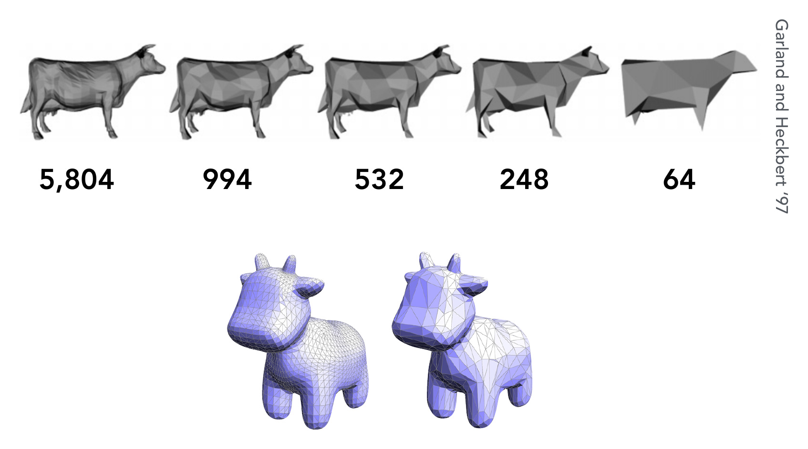

圖中的乳牛逐步從 5,804 個三角形減少到了 64 個三角形。 原本較平坦的區域會允許更多邊坍縮，所以簡化結果會在這些地方形成較大的三角形。 脖子、腿與其他形狀變化較大的地方則會傾向保留較密的網格，直到面數過少時，尾巴與細小結構才會開始消失
