# Games101：著色（Shading）

到目前為止，給一個模型，我們已經可以定義一個相機，通過 MVP 變換將其轉換到 NDC 中，再透過 viewport 將其變到二維的螢幕空間中了，接著我們也知道要如何利用取樣來將這個結果畫到螢幕上了：

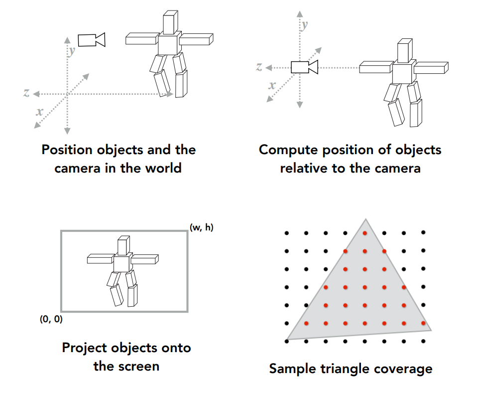

這些操作所帶來的結果可能如下圖左邊部分：

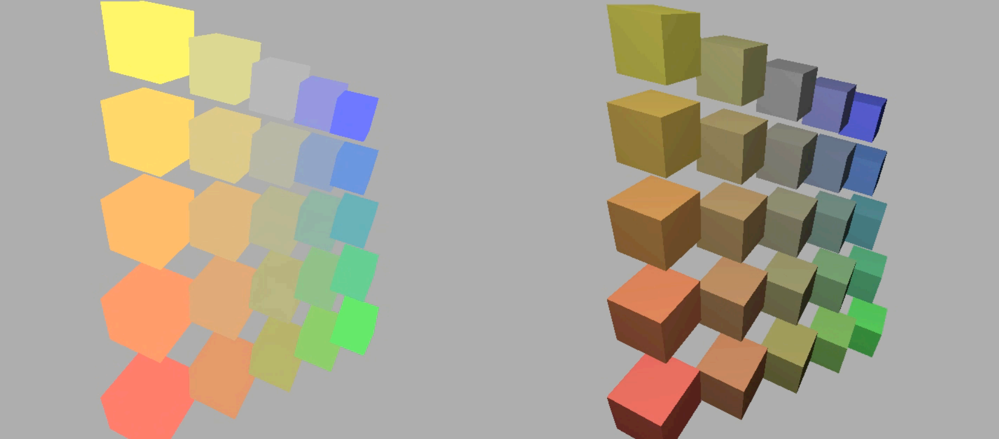

這看上去可能會有些視覺誤差，我們想要的應該是右邊的結果，雖然每個對應的立方體顏色相同，但不同面有不同的顏色會使它看起來更真實一些，這就是我們接下來要做的事 — 著色（Shading）

::: tip  
原影片中這是個會動的，能更清楚的看出視覺誤差，但截 gif 太大了我就不截了  
:::

如果大家學過素描，假設要畫一個球，且有一個光源，光源達到球上的某一塊區域時會形成一個有高光的區域，然後背向光源面由於接受不到光就會比較暗，且會產生一個投影，影子內的顏色會比較暗。 另外如果是不同材質的球，那其與光線的交互作用肯定不同，因此表現出來的形式肯定也不同

這些工作在圖學中就是由著色來完成的，因此著色主要負責兩個部分 — 顏色與材質，完成這組著色工作的模型我們稱其為著色模型

## Blinn-Phong 反射模型（Blinn-Phong Reflectance Model）

接下來我們就從最基礎的著色模型開始介紹，其名為 Blinn-Phong，它將光的表現分成了三個部分 — 高光（Specular highlights）、漫反射（Diffuse reflection）與環境光（Ambient lighting）：

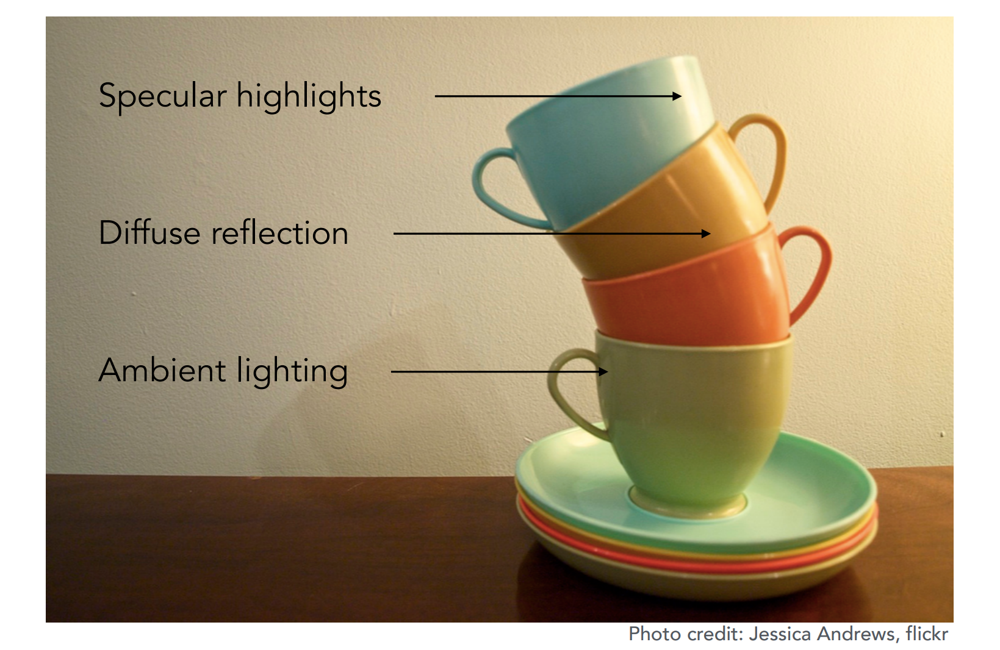

::: tip  
Specular 我其實不確定該翻成什麼，好像沒聽過有人把它翻成反光，所以這邊就還是先翻成高光了  
:::

在這張圖中，我們可以看到每個茶杯特別亮的部分，這被稱為高光。 除了高光，我們還可以在茶杯的表面看到一些變化相對緩和的部分，像是茶杯的中間部分，被稱為漫反射。 而對於沒有直接被光源照到的部分，像是圖中茶杯的左下角，則被稱為環境光

如果你還記得以前上物理課提到的漫反射，就可以知道光線打到粗糙的牆面上會反射到四面八方去，而高光也可以用相同的原理來理解，只是這個表面不再是個粗糙表面，而是個光滑表面，此時光線會沿著所謂的鏡面反射方向去做反射，這就是所謂的高光。 同時由於光線會反射，因此總是會有一部分的光達到茶杯的左下角，之後再反射回人眼，從而就形成了環境光。 把這三部分組合起來，我們就可以做出一種材質，使其與杯子長的很像，讓我們覺得圖中的這三個物體是杯子

### 著色點（Shading Point）

在講 Blinn-Phong 之前我們需要先定義一些相關的術語：

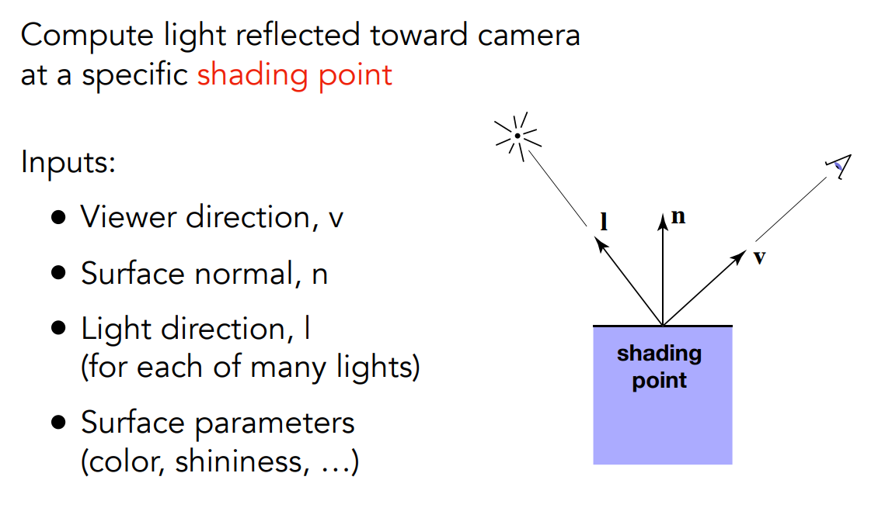

我們所看到的點被稱為著色點（shading point），它是我們主要的著色目標。 著色點會位於一個物體的表面，由於是一個點，我們認為著色點的所在範圍永遠是一個平面，此時就可以定義出平面的法向量（`n`）了。 然後我們還需要兩個向量，第一個是觀測方向（`v`），也就是相機與著色點形成的向量；第二個是光照方向（`I`），為光源與著色點形成的向量。 這些向量我們通常喜歡由著色點出發，因此如圖中所示三個向量都從著色點出發，另外因為是拿來表示方向的，所以它們都為單位向量

另外著色點還會有一些其它與物體表面相關的屬性，像是有多光滑，例如一個陶瓷的物體上了釉之後會變得比較亮，但如果它是一個石膏那就不一樣；再來如果它是一塊木頭，那在光打到它的時候你可能可以看到一些紋路。 它們反射光的方法基本上是一樣的，因此需要其它的屬性來輔助形成不同的效果

最後提一下區域性（locality），在考慮任何一個著色點的情況下，我們頂多就看光照與觀測範圍，並不會去關注其它物體，包括陰影。 也因此在著色時我們只考慮了光線的方向，並沒有考慮光線是否有被擋住，所以著色點會有明暗變化，但不會生成陰影，我們會在本章後面的 Shadow Mapping 小節補上陰影的計算：

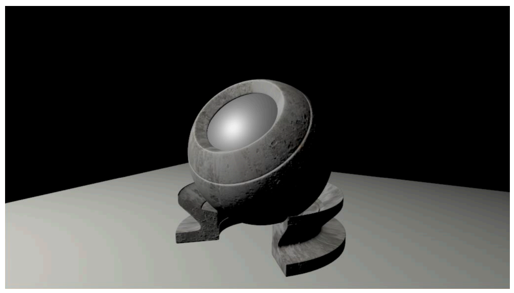

可以看到上圖中並沒有陰影，只有明暗變化（正常來說光源對面的地板應該要有陰影）

### 漫反射（Diffuse Reflection）

剛剛提到了 Blinn-Phong 由三個部分組成，現在我們從最簡單的漫反射項開始。 當有一根光線達到物體表面的某個點時，這個光線會被均勻的反射到各個不同的方向上去，這就是漫反射

而在物體表面的面向與光照方向有一定夾角時，得到的明暗會有變化：

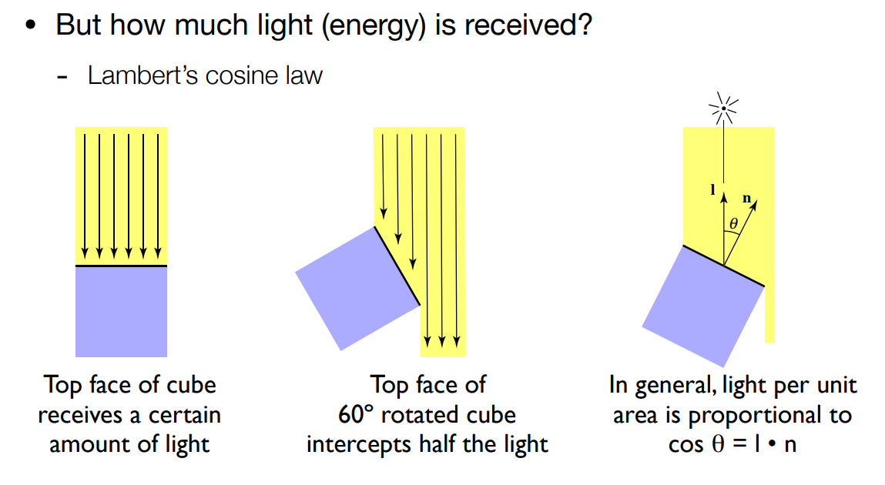

上圖中有六根光線，我們假設光是離散的，每一根光線代表了固定的能量，此時我們發現，如果物體表面和光照方向垂直的話，其可以接收到所有的六根光線；如果有個夾角，像是中間轉了 60 度的情況，那就只能接收到三根光線，此時物體的表面理應就要變得暗一些

這與高中地科裡面提到地球有四季的原因是一樣的，並不是說夏天太陽比較近，而是夏天會被太陽直射，單位面積內收到的能量較多

因此我們可以得知物體表面的面向與光照方向，這兩個方向的夾角決定了物體的表面要多亮。 這邊有個定律叫 Lambert's consine law，延續前面的符號，我們用向量 $l$ 代表光照方向，用 $n$ 代表物體表面的法向量，Lambert's consine law 定義說接收到的能量與「光照方向和法向量夾角的余弦」成正比，而由於兩個向量都是單位向量，因此可以用內積來表示它們的余弦，透過這個定律我們就可以分析出一個著色點的漫反射項會接收到多少光（能量）

定義好了接收，但我們還沒定義這些能量是從哪裡來的，光肯定得先產生。 光本身是一種能量，假設光來自於一個光源，我們認為它是個點光源，無時無刻都會往四面八方輻射出相同的能量，因此這些能量會集中在一個球殼上：

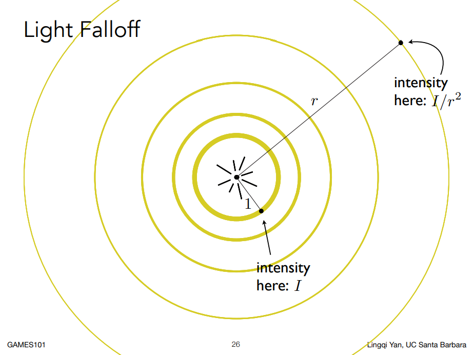

我們認為往各個方向出去的速率是一樣的，因此過了很長時間後能量仍然會集中在一個球殼上，但是由於球殼的半徑變大了，所以單位面積上的能量是會隨著時間變小的，我們定義半徑為 1 時光的強度（光強）為 $I$，透過能量守恆定律，我們可以得知若傳播到距離為 $r$ 的位置，則該點的光強為 $I/r^2$

因此我們得到了第二個關係 — 「著色點和光源的距離」與光強的關係

結合前面的 Lambert's consine law，我們就可以算出漫反射這項共有多少能量了，也就能將物體的明暗給算出來了：

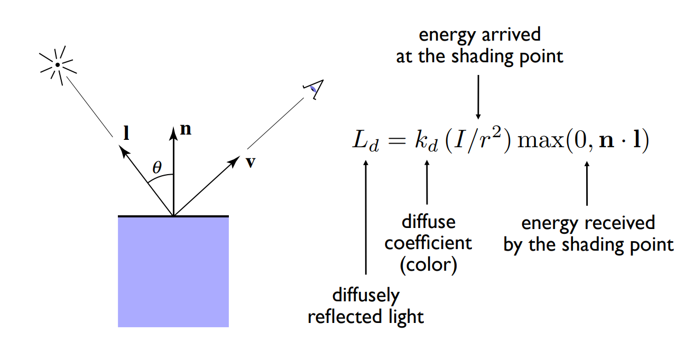

$I/r^2$ 是著色點的光強，而 $n \cdot l$ 為兩向量的夾角，表示可以收到多少比例的能量，其中 $\max$ 的用意是避免內積的結果為負數，因為當其結果為負數時代表光線是從物體表面下方來的，這沒有物理意義，這邊只考慮反射，沒考慮折射

而對於 $k_d$ 項，我們要來思考一下為什麼一個著色點會有顏色，這只有一個可能性，著色點吸收了一部分的能量，接著將不吸收的部分反射了出去，反射出去的光的波長就是我們見到的顏色。 如果不同的著色點有不同的吸收率，那自然就會產生不同的顏色

因此我們利用一個係數 $k_d$ 來描述這個吸收率，如果為值是 1，則代表完全不吸收能量，因此最亮，如果是 0 則相反吸收所有能量，因此會是黑的，如此一來就表現了明暗，或說著色點本身吸收了多少能量：

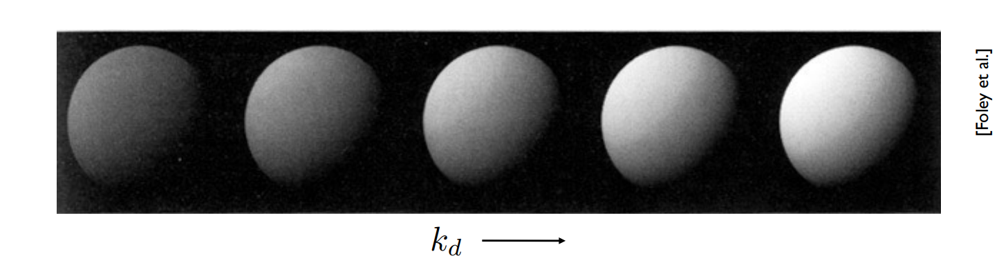

如果把吸收了多少能量這件事用一個向量來表示，我們就可以把它弄成一個有三個元素的向量，代表 RGB，分別都介於 0 到 1 之間，進而定義出顏色

最後再提一件事，漫反射的能量會被均勻的反射到各個不同的方向上去，這代表不管我們從哪個方向觀測它，得到的結果應該要是一模一樣的。 從上方的公式來看也是如此，我們考慮的是光照方向和法向量之間的夾角，完全沒有考慮 $v$ 向量的事，這正是因為漫反射往四面八方反射的能量都是相同的

### 高光（Specular）

高光是在物體的表面比較光滑時，反射方向非常接近鏡面反射的結果。 那如果給我們入射方向，我們自然能算出它的出射方向：

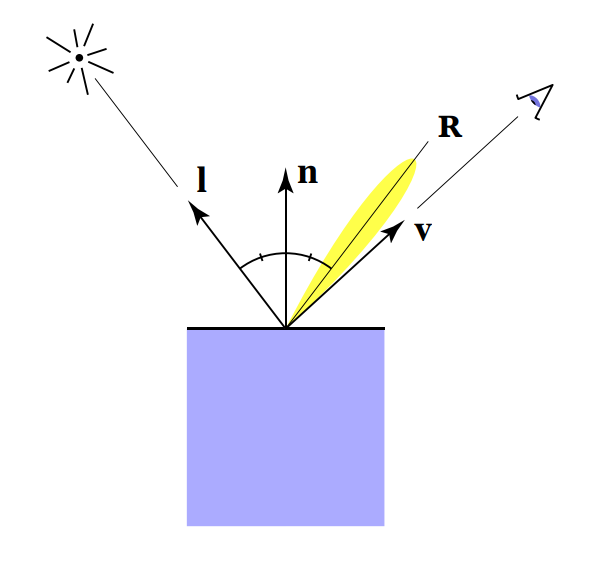

上圖中將反射的出射方向記為 $R$，可見我們只有在觀察方向接近鏡面反射方向的時候，才能夠看見高光，其它時候都看不到。 換句話說 $v$ 和 $R$ 要足夠接近，我們可以利用半程向量（Halfway Vector）來描述這件事情：

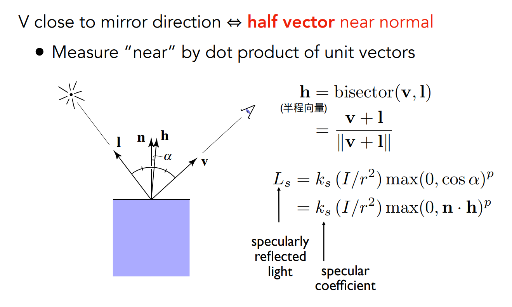

半程向量 $h$ 為入射方向 $l$ 與觀測方向 $v$ 的角平分線向量，要求角平分線很簡單，只要兩個向量加起來即可，根據平行四邊形法則我們知道加出來的方向一定會沿著中間的方向，接著我們再做 normalize，就可以得到半程向量了

當 $v$ 和 $R$ 接近的時候，其實就代表 $h$ 和 $n$ 接近，因此在計算的時候我們就可以不去求 $v$ 和 $R$ 的夾角，而是求 $h$ 與 $n$ 的夾角

::: tip  
你可以不使用 $n$ 與 $h$ 來判斷，而是直接使用 $R$ 與 $v$ 來判斷兩向量是否接近，這個模型則被稱為 Phong Model。 Blinn-Phong 在這裡使用半程向量是一種優化，因為半程向量比較好算，但反射方向 $R$ 不好算出來，計算量會多很多  
:::

而與前面漫反射當中提到的相同，要看兩向量是否足夠接近，用內積即可，如果足夠接近，那結果就接近 1，如果離比較遠就接近 0，同樣地我們會取 $max$，不考慮反方向來的向量。 另外，公式中的 $k_s$ 被稱為鏡面反射係數，由於大家通常認為高光是白色的，因此通常會設為一個較近 1 的值。 通過上圖中的式子就可以得出有多少能量到達了著色點

前面漫反射的公式中我們還考慮到了有多少能量被著色點吸收了，也就是當中的 $n \cdot l$ 項，但在高光這邊沒有，這是因為 Blinn-Phong 是經驗模型，把這部分簡化掉了，這邊關注的主要是我們能否看見高光，而沒有太關心它的亮度

再來，你可能會發現在高光的公式中，cosine 處多了一個指數 $P$，這是為了將能看見高光的範圍縮小，我們看一下它數值上的表現：

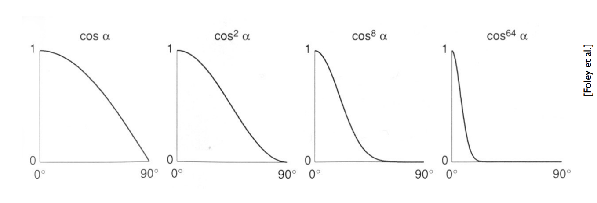

你可以發現在 $P$ 為 1 的情況下，假設角度為 45 度，那其實 $v$ 與 $R$ 就已經離的挺遠的了，但余弦取出來的值還是偏大，用這個值去生成高光的話我們會看到一個超級大的高光，但我們希望高光只集中在一個很小的區域，這代表只要 $v$ 與 $R$ 稍微離的遠一點，$v$ 就不應該被算在高光的範圍裡了，因此透過加上指數 $P$，我們可以讓這個範圍變得更嚴格，隨著次方的上升，當 $P$ 為 64 的時候，你可以看到大概在 20 度的地方基本上我們就看不到高光了

這個 $P$ 通常我們會設成一個在 100 到 200 之間的數字，此時大概 5 度左右就看不到高光了。 我們可以將 $P$ 的效果視覺化出來看一下：

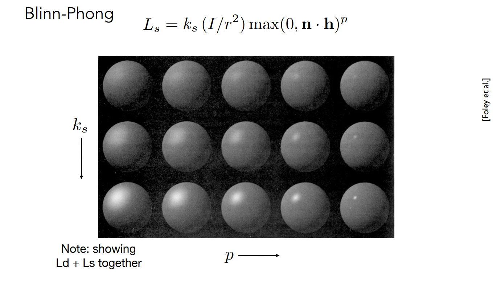

你可以看到 $P$ 越大，能看見高光的角度越少，因此可以控制高光的大小；而當 $k_s$ 越接近 1，鏡面反射的效果就越明顯，高光就越亮（越白）

### 環境光（Ambient）

我們還剩最後一項環境光，之前茶杯的例子中我們說一些沒被光源直接照射的著色點不可能完全是暗的，因為光線會彈射很多次，分散到四面八方去，因此會彈到茶杯背面的那些著色點上，從而讓那些點有有顏色

可想而知這是一個很複雜的計算，為了簡化計算，Blinn-Phong 做了一個大膽的假測，我們認為任何一個點接收到的環境光的強度永遠都是個定值，寫作 $I_A$：

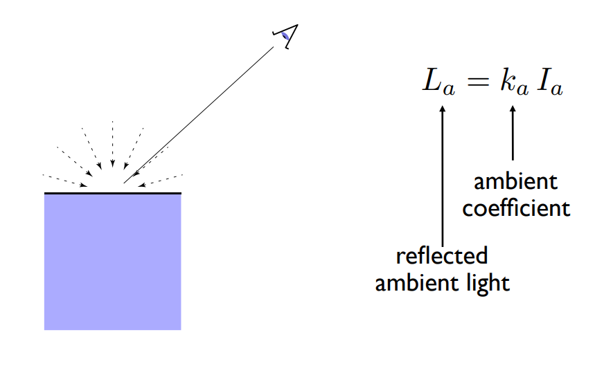

從這個公式你可以發現環境光不講究從哪個地方進來，與 $l$ 無關；再來環境光與觀測的方向也無關，因此與 $v$ 無關；最後它與法向量也無關，因此跟 $n$ 和 $h$ 都無關。 也因此這個公式符合我們剛剛環境光是個定值的假設

環境光的工作在於保證沒有地方完全是黑的，讓你看到的物體有一個常數的顏色，再以公式中的 $k_a$ 用來控制亮度，兩者結合就可以得到環境光

### Blinn-Phong 模型（Blinn-Phong Model）

現在我們將三者加起來就可以得到完整的 Blinn-Phong Model 了：

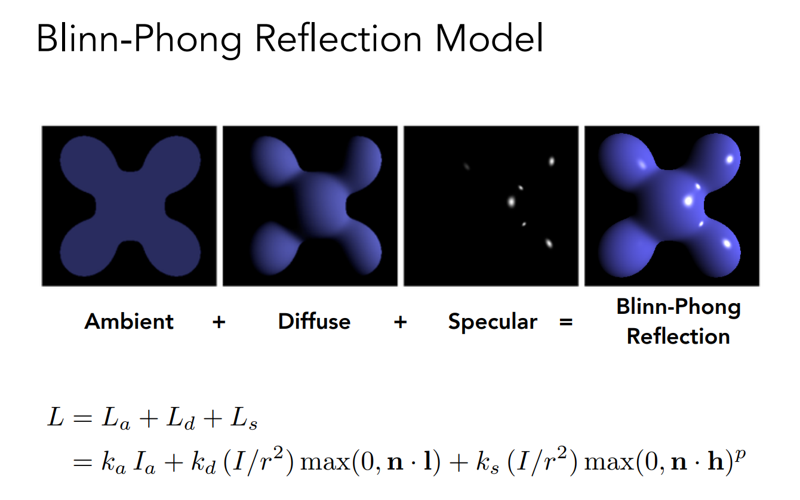

上圖將三個不同的部分視覺化出來了，你可以看見環境光是個常數的顏色，而漫反射項則攜帶了主要的顏色資訊，高光攜帶了鏡面反射的資訊，三者加起來就可以得到上圖最右邊的結果，有點像塑膠玩具，這也是 Blinn-Phong 的特點之一，詳細的原因我們在後面的章節會再回來解釋

::: tip  
由於 Blinn-Phong 是個經驗模型，所以你可以看見有很多東西都被簡化了。 假設一個模型中間有個凹進去的點，那照理說該部分應該會暗一些，但在 Blinn-Phong 的角度就不是如此，由於環境光是個常數，在 Blinn-Phong 中凹進去的部分並不會變暗

再來 Blinn-Phong 也沒有考慮物體到觀察點的距離造成的能量損失，一般來說看一個較遠的物體應該要會比較暗，但在這裡就沒有這種現象

要更精確地描述這些現象，要到後面講 Radiometry 的時候才會解釋了
::: 

::: tip
以大部分的教學來說光照會在 world space 中計算，因此在 Fragment Shader 中物體的座標只會乘上 model transformation，而不會做完完整的 model-view transformation

而由於 model transformation 裡面包含了伸縮，如果它不是做均勻縮放，我們又直接將法線向量乘上 Model matrix 的話，就會破壞法線向量「與表面切平面垂直」的屬性，轉換出來的結果不會垂直於三角形面，導致光照計算失真。 因此在把法線向量傳進 Fragment Shader 的時候我們需要額外做處理，而不會跟模型一樣乘上 model matrix

法線向量會乘上另一種矩陣，這個矩陣被稱為法線矩陣（Normal Matrix），這邊只講結果，他的值是 $(M^{-1})^T$，其中 $M$ 是 model matrix，推導比較多這邊就不講了，查一下應該很多資料可以看，不難找

當然並不是一定要在 world space 內計算光照，也有可能會在 view space 或是 tangent space 裡面計算，甚至還有 Deferred Shading 之類的技術。 但不管如何，在做轉換的時候你最好要清楚自己在算什麼
:::

## 著色頻率（Shading Frequencies）

考慮完了一個最基礎的著色模型，接下來我們要來看著色點要怎麼取，這被稱為著色頻率（Shading Frequencies），看個例子：

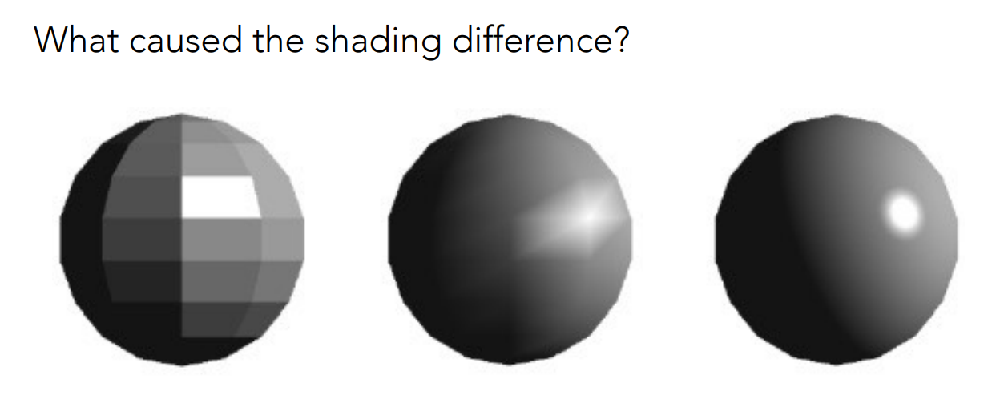

這三個球擁有完全的幾何形狀，也就是說它們的幾何表示在空間中是一模一樣的，由相同的三角形組成。 但你可以很清楚的看到這三個球的顏色不一樣，從色塊的邊界你就可以發現問題，這就是著色頻率

著色頻率考慮我們要將著色應用在哪個部分，最左邊的球我們將著色應用到了一整個四邊形面上，每個面有一個固定的法向量，我們取一個面上的點求出其著色結果後，暴力的認為整個平面都是相同的顏色，也就是一個平面只做一次著色，你可以看見結果並不怎麼好

中間的球考慮了平面的四個頂點，算出每個頂點對應的法向量，接著進行著色，面中間的顏色透過內差法補上，得到的就是該結果，你可以看到結果好了不少

最右邊的球則將著色考慮到了每個像素上，也就與我們最一開始的想法一樣，你可以看見結果非常好，接下來我們來就來做一下正規的定義

### 逐三角形著色（Flat Shading）

flat shading 對應到最左邊的球，將三角形的法向量求出來，這能透過將三角形的兩邊做外積求得。 接著我們根據使用的著色模型，算出一個著色的結果，而對於三角形的內部則沒有著色的變化，因此一個三角形只需要做一次著色：

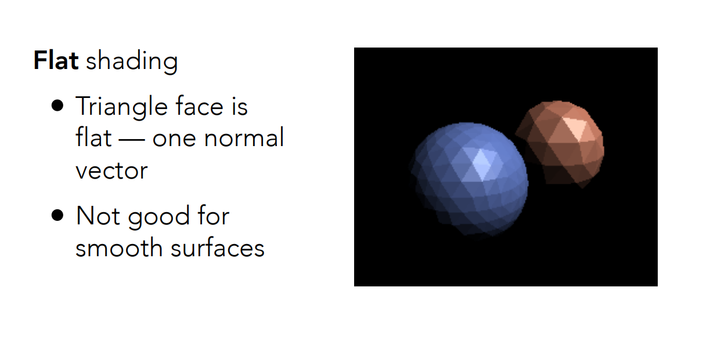

### 逐頂點著色（Gouraud Shading）

第二種方式對應到中間的球，叫做 Gouraud shading，對三角形上的頂點求出法向量，怎麼求我們等等再說，求出法向量後三個頂點各做一次著色，接著用內差將三角形內的顏色補上：

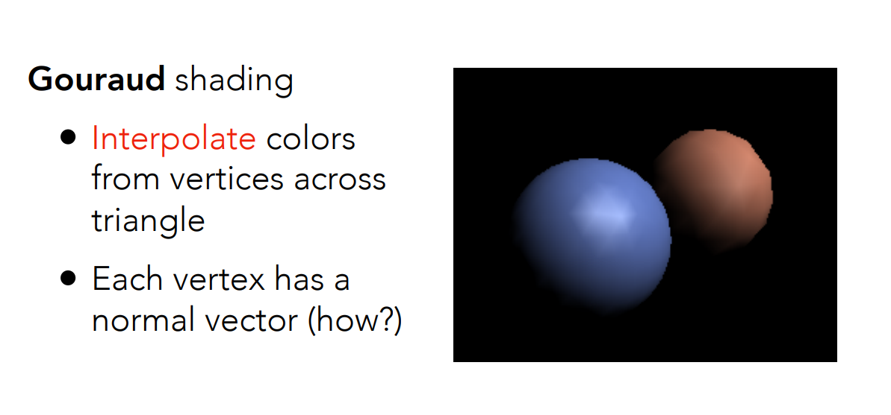

結果比第一種好，但你可以看到當三角形稍微大一點的時候，例如圖中右邊棕色的球，高光可能會消失

### 逐像素著色（Phong Shading）

第三種對應到最右邊的球，叫做 Phong shading，對每一個像素進行一次著色，就可以得到一個相對較好的結果

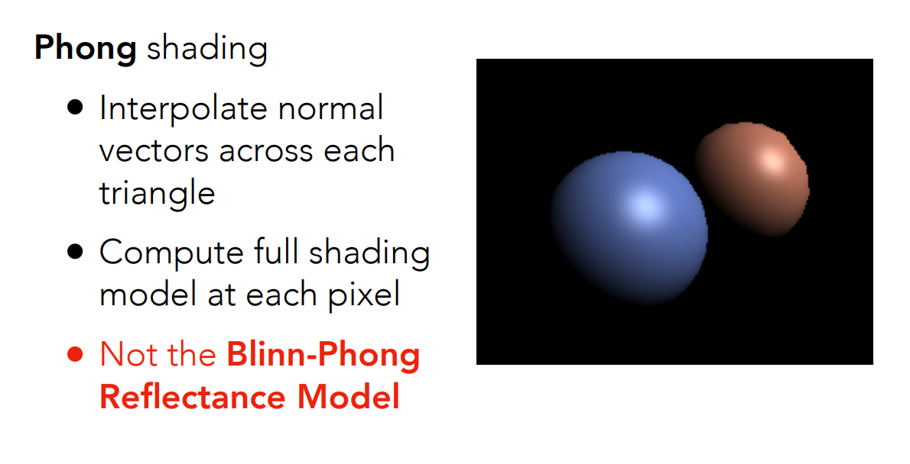

這邊要注意 Phong Shading 與 Blinn-Phong Model 是兩個不同的東西，Phong Shading 指的是著色頻率，Blinn-Phong Model 是著色模型，只是剛好都是由同一個人發明所以名字一樣而已

### 三者比較

實際上要用哪種方法要取決於具體的模型，Flat Shadding 並不一定會比較差，看個比較圖：

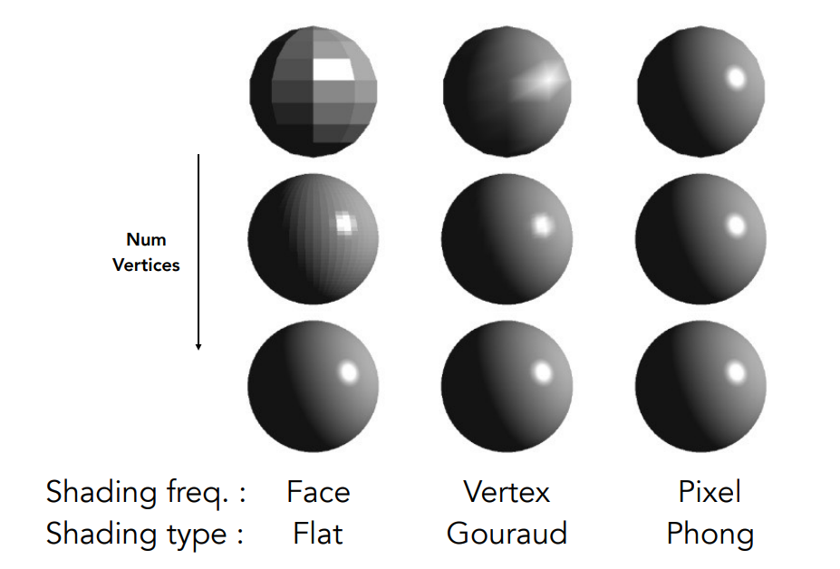

上圖中用的幾何模型都是一樣的，但 row 與 row 之間的三角形數會上升，中間的 row 比第一個 row 用了更多的三角形，也就是說幾何模型本身的面數變多，更光滑了。 你可以看見在幾何足夠複雜的情況下，我們其實可以用相對簡單的著色頻率，結果其實不會差太多

另外，這些方法的成本需要同時考慮模型的面數與像素的數量，並不是說 Phong Shading 開銷就一定比較大。 當你的模型太過複雜，複雜到其面數已經超過了像素的數量，那自然用 Phong Shading 會比較快

### 頂點法向量

#### 逐頂點法向量（Per-Vertex Normal Vectors）

我們還留了一個問題，三角形頂點的法向量怎麼算。 假設在一個理想的情況下，我們知道模型要表達的是一顆球，但實作上是用三角形來表示

那我們就可以知道三角形的頂點其實對應到球上的某一個點，此時就可以利用球的位置算出三角形頂點的法向量，這很好算，只要算出球心連向三角形頂點的向量即可，見圖中右上角部分：

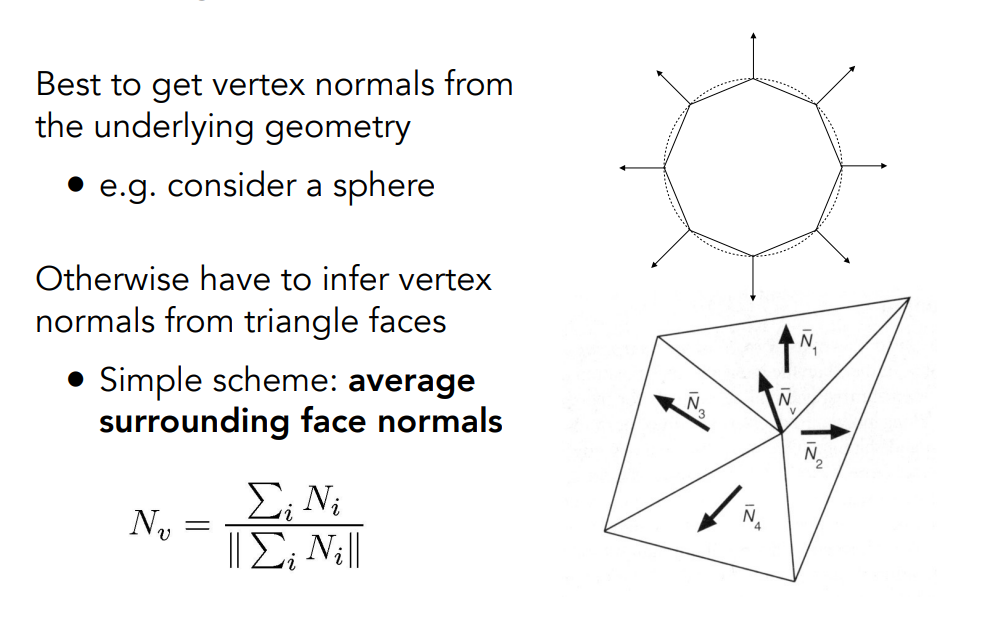

但平常不可能有這麼好的事情，因此人們發明了一種方法，取任何一個頂點，它肯定會和很多個不同的三角形有所關連，例如上圖右下角的部分中，四個三角形共用了一個頂點，那我們就認為這個頂點的法向量是相鄰四個面的法向量的平均

注意在這邊我們不做 normalize，我們希望如果一個三角形越大，那它貢獻的部分就越多，也就是說我們的平均是加權平均，權重以三角形的面積來計算，實務上這的確會帶來更好的結果

這就是我們如何去定義一個以頂點為考量的法向量

#### 逐像素法向量（Per-Pixel Normal Vectors）

另一個是以像素為考量點，定義一個逐像素的法向量。 假設我們已經知道三角形頂點的法向量了，那我們可以透過重心座標來做內差，以得到對應的法向量：

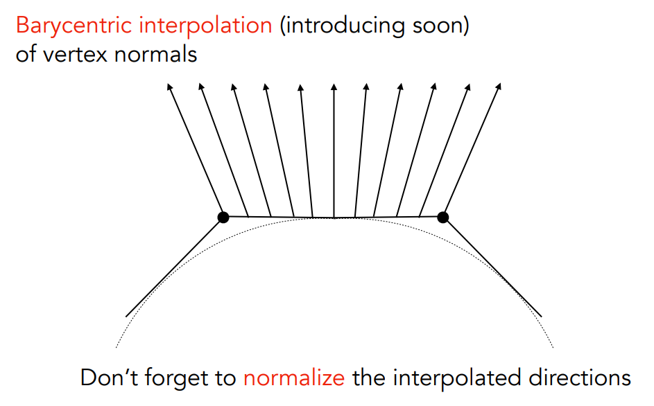

上圖中我們的前提是知道左右兩個頂點的法向量，之後透過內差算出中間這些法向量。 這邊注意就要做 normalize 了，要保證它們長度都是相同的

至於要怎麼做重心座標的內差，我們後面再提

## 紋理（Texture）

### 紋理映射（Texture Mapping）

接下來我們要開始講紋理映射，它想做的事很簡單，看看下圖：

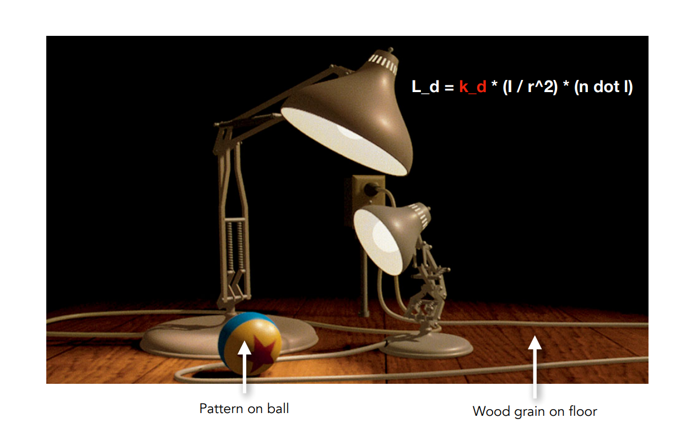

上圖中有兩個檯燈在照亮一個地板和一顆球，對於球，它的著色我們會寫，如果我們認為檯燈的光是一個點光源，這樣無非就是兩個把點光源的貢獻加起來就可以了，但是在那顆球上面，我們可以看到不同的位置有不同的顏色，像是球的一半是藍的一半是黃的，中間還有一個紅色的星星圖案

這些點的區別在於，雖然它們共用了同一個著色模型，但是不同點的漫反射係數不一樣（假設是 Blinn-Phong）。 看另一個例子，以地板來說也是如此，燈光在照地板，在地板上的任何一個點其實都有自己的漫反射係數，這個係數會反映在木頭的紋路上

也就是說我們希望有一個方法，能夠定義對於一個物體，其上面的不同位置的屬性，這就是引入紋理映射的一個基本思路，不過並不是說我們需要完全用它來定義漫反射係數，而是希望能定義不同點有不同屬性

要定義一個點的屬性，首先我們要理解點在哪，我們把屬性定義在物體表面上，那當然點就在物體表面上，但要如何描述物體表面呢? 我們要知道任何一個三維物體，它的表面其實都是二維的，像是地球儀與表面的地圖一樣：

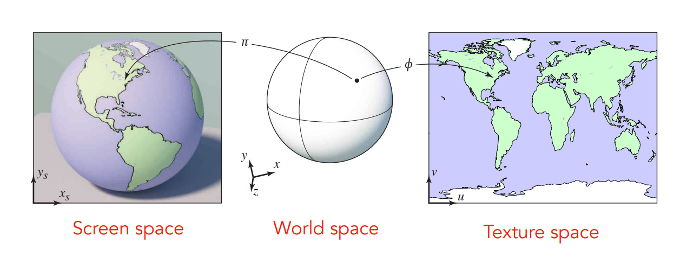

通過這種方式，我們就能將一張二維的圖與一個三維物體的表面建立一個對應關係，這張二維的圖就被我們稱為紋理（圖），紋理圖中的一個像素被稱為 texel。 因此你可以想見我們的目的是把這張二維的紋理想辦法蒙上一個三維物體的表面，過程中我們可以隨意拉伸，或是隨意的撕開紋理圖，這個過程就叫做紋理映射

看下面這個獨眼巨人的例子：

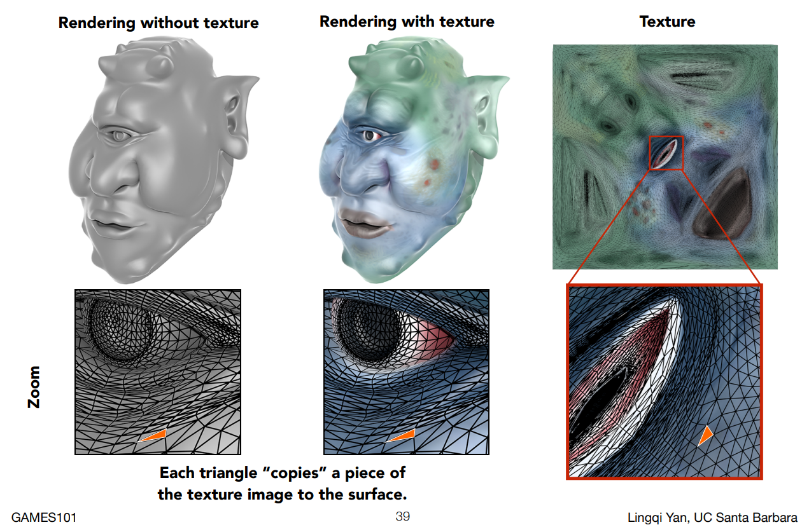

左上圖是我們透過 Blinn-Phong 得到的結果，而中間就是套用了紋理的結果，右上角的是我們的紋理圖。 根據剛才的思路，我們需要想辦法找到一個關係讓三維物體上的每一個點都能對應到紋理圖中的某一個點

因為三維空間中最基本的東西是三角形，因此我們會以三角形為單位在看這個映射關係，你可以看到上圖左下角我們找了一個空間中的三角形，它的確對應到了右下角紋理圖中的一個三角形

至於這個映射關係要怎麼找，有兩種方法，第一種是靠建模的人手動做，在做出模型後，它們會將模型展開，手動貼到紋理圖中的不同位置，一聽工作量就很大，但仍然是個可行的人工方案

第二種是嘗試找到自動化的方法，給我們任何一個模型，我們希望將它展開成一個平面，而且三角形要盡可能的不扭曲，例如原本該三角形在三維空間中很小，我們不希望展開到平面後它突然變得超大。 這種方法是圖學中的一個重大研究方向，叫做參數化（Parameterization），在幾何的部分是一個非常厲害的研究

現在我們先假設已經找到了映射關係，此時三維空間的三角形理應都已經被映射到了二維的紋理圖上，我們是利用三維空間的座標來描述其三角形的，那相對地，對於紋理圖我們就也會需要一組座標系來描述它，讓我們能夠真正表示紋理圖上的點

紋理圖的座標系被稱為紋理座標，通常會用 $u$ 和 $v$ 來表示兩個軸：

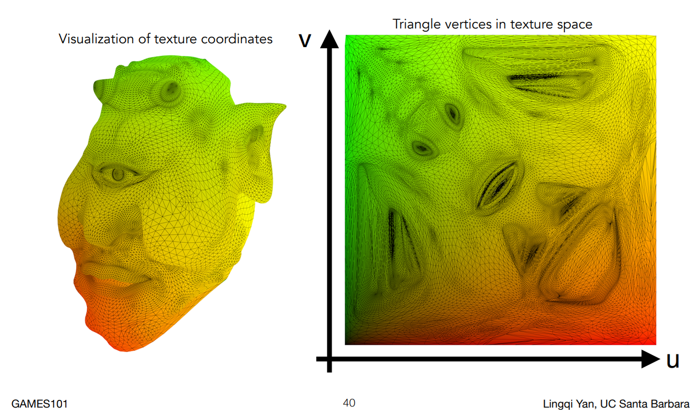

上圖是一個紋理座標視覺化的結果，$u$ 越大則紅色越多，$v$ 越大則綠色越多，因此不同顏色就代表了紋理圖上不同的點，而把紋理映射到三維模型後就是上圖左邊的結果

通常對於一張紋理圖來說，不管你的紋理是不是正方形的，我們都會認為 $u$ 和 $v$ 的範圍介於 0 到 1 之間，這是為了方便，也算是一個習慣

紋理可以應用在各種不同的物體表面，再看個例子：

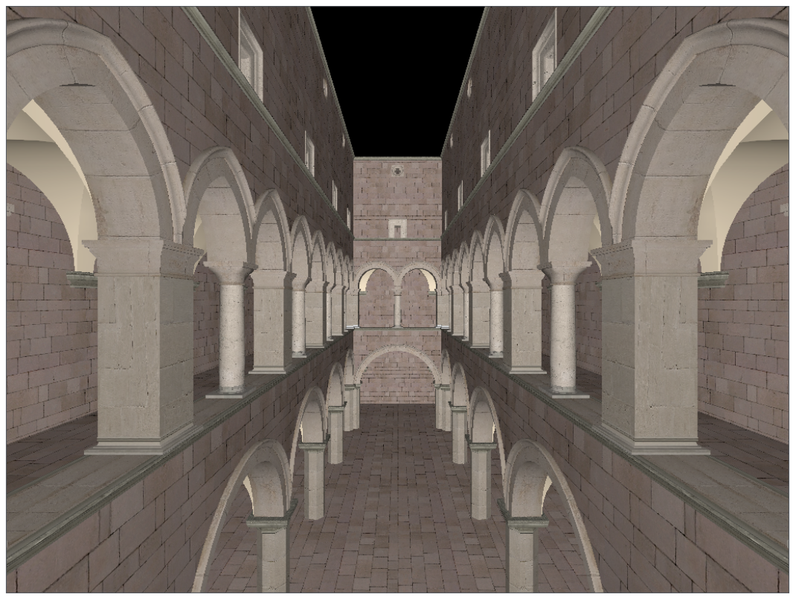

如果我們把它所有點的紋理座標都顯示出來，那會長這樣：

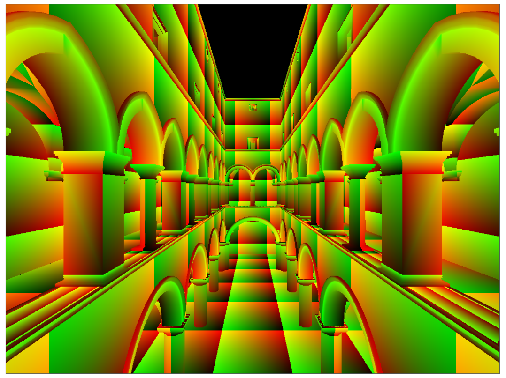

你可以看見座標不斷地從 0 到 1 重複，就好像在貼磁磚一樣，如此一來便可以把整個物體給貼滿，這也告訴我們紋理圖上的點並不需要只被用一次，一個點可以映射到三維空間中的不同位置

上圖中在紋理左右重複的交界處我們可以看到有很明顯的一條交界線，然而在上上張圖內的石頭中我們卻沒有看到這樣的現象，因此如果紋理本身設計的好，那紋理自己在往各方位重複的時候就會無縫銜接，紋理的上下、左右側能接上，這就非常好

這樣的紋理在圖學中被稱為 Tiled Texture，要設計這種紋理是需要各種不同的演算法的，其中一種演算法比較常用的演算法叫 Wang Tiling，這邊就只簡單提一下，不再展開說了

### 重心座標（Barycentric Coordinates）

前面我們知道有很多操作是在三角形的頂點上計算的，而在三角形的內部我們希望它能有個平滑的過度；也就是我們希望只要有頂點屬性，就能夠算出三角形內任何一個點的值。 而這件事能夠利用重心座標做插值來完成，因此我們這邊就把重心座標補一下

假設有一個三角形 $ABC$，那重心座標告訴我們在這個三角形所形成的平面上，任何一個點 $(x,y)$ 都可以表示成三角形 $ABC$ 三個頂點座標的線性組合：

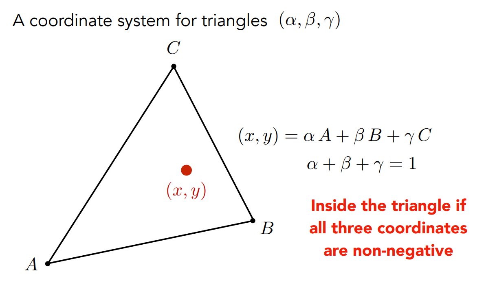

上圖中的 $A$、$B$、$C$ 都是座標，三角形所在平面上的任何一點 $(x,y)$ 都可以用這三個頂點的線性組合表示，其中 $\alpha$、$\beta$、$\gamma$ 加起來要為一，如果要進一步限制點在三角形內，那麼 $\alpha$、$\beta$、$\gamma$ 都必須是非負的

如此一來要描述一個點的位置，只要給我任意三個點 $A$、$B$、$C$，不管是在什麼樣的坐標系裡面，只要這個點在三角形 $ABC$ 所在的平面上，我們都可以通過 $\alpha$、$\beta$、$\gamma$ 這三個數來表示了

接著來看重心座標要怎麼求，更具體的說是 $\alpha$、$\beta$、$\gamma$ 要怎麼求。 這裡重心座標給出了另一個定義，$\alpha$、$\beta$、$\gamma$ 這三個數值是可以通過面積比求出來的：

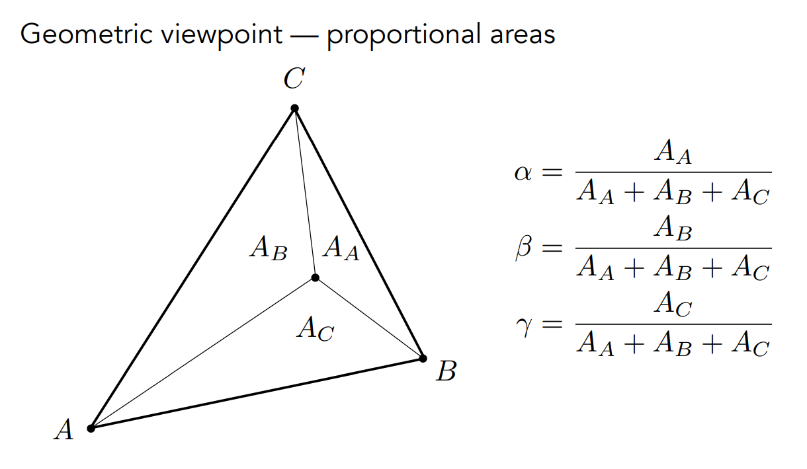

上圖中我們隨意給了一個三角形內的點，並將其與 $A$、$B$、$C$ 都連上線，此時我們會發現每個頂點的對面都會有一個三角形，像是上圖的 $C$ 與 $A_C$ 的關係。 通過這三個三角形，我們就可以通過其面積比算出 $\alpha$、$\beta$、$\gamma$

透過這個方法，我們會發現有個特殊的點，被稱為這個三角形的重心，它有個很好的性質是能將三角形的面積平分為三等份，也因此它的 $\alpha$、$\beta$、$\gamma$ 剛好都是 $\frac{1}{3}$：

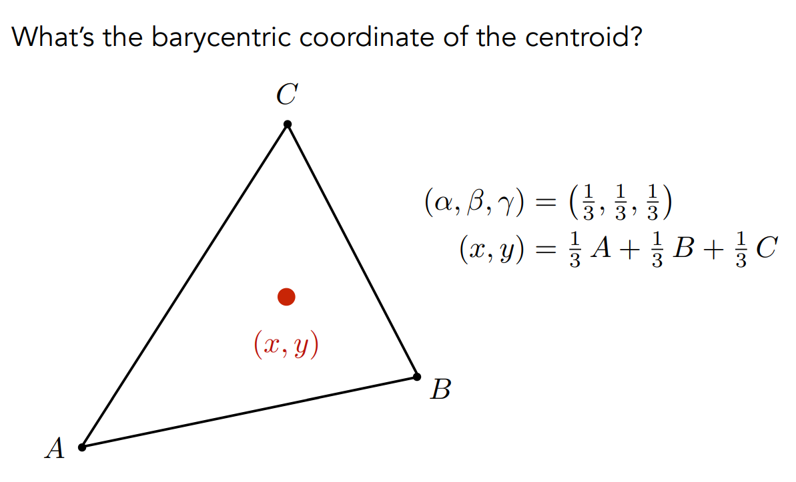

接下來重心座標還有個一般式，但可以不用記它沒關係：

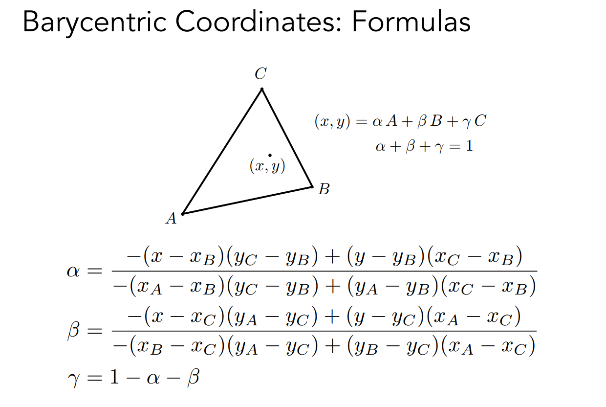

接著我們可以嘗試用重心座標簡單做一些事情，像是求三角形內部的顏色，或是紋理座標、法向量或深度等，都是透過插值來計算的：


包括 Blinn Phong 的 $K_d$ 項也可以這麼算出來，其可能定義在紋理圖中，我們能夠利用三角形三個頂點的 $u,v$ 座標插值算出目標點的 $u,v$ 座標，再利用其座標去查紋理圖，便可找到 $K_d$ 項：

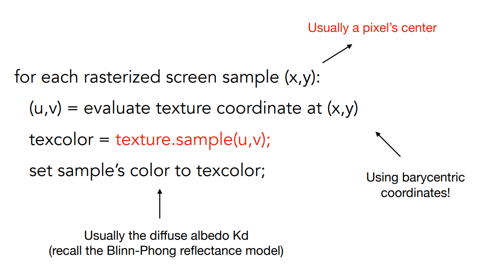

最後有一點，如果大家在讀 OpenGL 之類的文章，可能都會涉及到一個問題，重心座標雖然好用，但在投影變換下我們是不能保證重心座標不變的

繼續以上上圖的三角形為例，我們有目標點 $V$ 的重心座標。 在經過投影變換後這個三角形的形狀會發生變化，此時點 $V$ 經過投影後的位置，與我們在投影後的三角形上用一樣的 $\alpha$、$\beta$、$\gamma$ 算出來的位置可能會不一樣，換句話說 $V$ 經過投影後其 $\alpha$、$\beta$、$\gamma$ 的值可能會變化

因此如果我們想插值三維空間中的一些屬性，然後取某個目標點，我們需要先做插值再做投影，而不能先做投影再做插值。 這在處理深度時特別重要，回想一下光柵化的時候，三角形都已經投影到螢幕上了，它會覆蓋很多像素，自然我們會有像素的中心座標與其對應到三角形的哪個位置

此時我們不能夠利用投影後的三角形頂點的深度做插值，而是要找到像素中心座標對應到原先三維空間中座標，再利用三維空間中三角形的頂點做插值，然後將值放入 Z-buffer，這才是對的。 至於要怎麼把螢幕上的三角形再投影回去三維空間中，只要利用逆變換就可以了

總而言之，只要記得根本原因是重心座標在投影操作下會發生變化即可

### 紋理放大（Texture Magnification）

接下來我們來看一些更深入的問題，首先是紋理的放大，這會發生在紋理太小的情況下，想像一下有一堵牆，牆上有一幅畫，畫的內容我們想要用紋理來操作，但此時畫的分辨率有 4K，紋理卻只有 256x256，就會發生這種情況

這種時候如果我們直接用高分辨率的畫中的點去查紋理座標，會查到一些非整數的座標位置，但在查找時座標需要是整數位置，假設四捨五入為整數，像是 0.4 變為 0，0.6 變為 1，此時畫中一定範圍內的 pixel 便會對應到單一一個 texel，因為紋理太小了

因此如果我們只是對座標做四捨五入，那畫面會變得像下圖最左邊這樣：

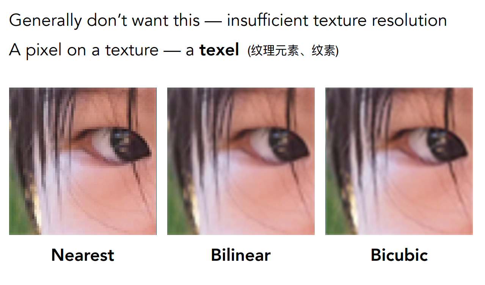

看上去有一個個的格子，這通常不是我們想要的效果，我們希望能有上圖的中間或右邊那樣的效果，模糊一點沒關係，但至少結果稍微連續一點。 因此我們要做的是座標查找的處理，查找時我們會找到非整數的座標，那要如何得到最後的值就是這邊的主題

#### 雙線性插值（Bilinear）與雙三次插值（Bicubic）

首先是雙線性插值（Bilinear）：

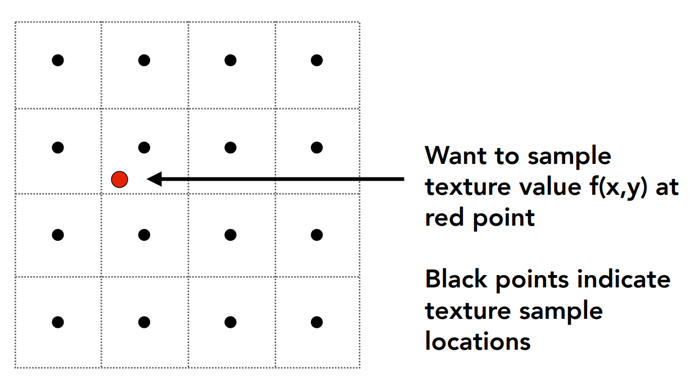

上圖是一個 4x4 texel 的例子，而 pixel 對應到的位置在紅點處，而我們想知道紅點處紋理的值是多少，如果是剛剛的四捨五入，等於就是找最近的 texel，那就會有我們不想要的一塊一塊的結果

要做 Bilinear，首先要找它鄰近的四個點，並將紅點與左下角的偏移量算出來（圖中的 $s$ 與 $t$）：

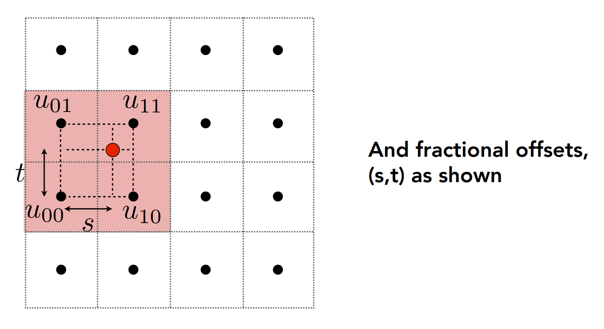

這個 $s$ 和 $t$ 肯定會介於 0 到 1 之間，因為 texel 與 texel 間的距離為 1

接著做 Bilinear 的計算：

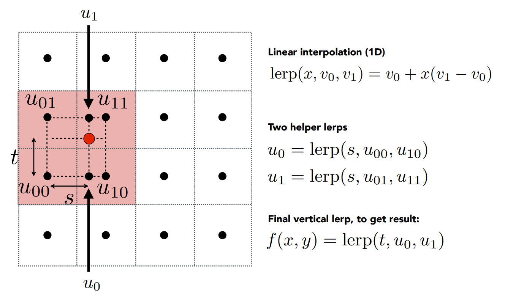

圖中的 $\text{lerp}$ 是線性插值（linear interpolation）的意思，以 $\text{lerp}(x, v_0, v_1)$ 來說，其對 $v_0$ 與 $v_1$ 做插值，$x$ 則是佔 $v$ 軸的比例，因此是一個 0 到 1 之間的值，如果 $x$ 等於 0，則插值結果為 $v_0$，等於 1 則為 $v_1$

以我們的例子來說，我們先在 $v$ 軸上做線性插值，由於有四個點，而四個點各有各的屬性，因此我們將 $u_{01}$ 與 $u_{11}$ 對紅色在上方的投影點 $u_1$ 做一次插值，同理 $u_{01}$ 與 $u_{11}$ 對 $u_0$ 做一次插值

如此一來水平方向的屬性我們就插值完了，得到了兩個水平方向上的屬性，接著我們再將這兩個點對垂直方向的 $u$ 軸做一次線性插值，就可以得到紅點處的屬性了

通過這個方法我們就可以得到在這四個點圍成的區域內的平滑過度值，因此紅點處的屬性考慮了它周圍四個點的屬性，假設其與 $u_{11}$ 靠得很近，那屬性自然會很接近 $u_{11}$，如果是在四個點的中間，那就會很接近四個點的平均

因為水平方向與垂直方向都做了插值，所以叫做雙線性插值，但實際上你可以看到並不只做了兩次，水平方向做了兩次，垂直方向做了一次。 當然你要反過來，垂直方向做兩次，水平方向做一次也是可以的

在一開始的例子中你可以看到它的結果就較為連續，而至於當中的 Bicubic 則會取 16 個點，用三次函數做插值（而非用線性函數），因此運算量較大，但你也可以看到結果比 Bilinear 又更平滑了些

### 紋理縮小（Texture Minification）

下一個問題是紋理太大，因此需要縮小，剛剛我們能透過差值來解決問題，但這邊我們卻沒辦法，而且會引起更多的問題，先來看一個例子：

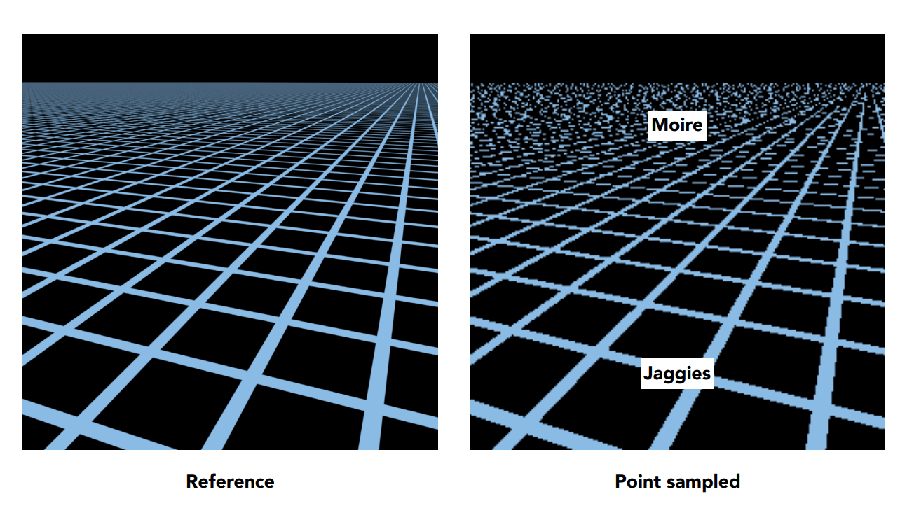

上圖有個平面，平面上貼了一張紋理圖，這個紋理是一堆的格子，接著我們從某個角度看過去，因為有透視投影的關係所以會有近大遠小的效果。 接著我們照著剛剛的方法一樣，求出紋理座標後做插值，此時得到的就是右圖，你會發現有個熟悉的現象出現了 ー 混疊（鋸齒），且越遠越明顯

這是因為對於近處的像素來說，單個像素在紋理上的覆蓋區域其實較小，但在遠處的像素，單個像素就覆蓋了紋理圖中的一大片區域：

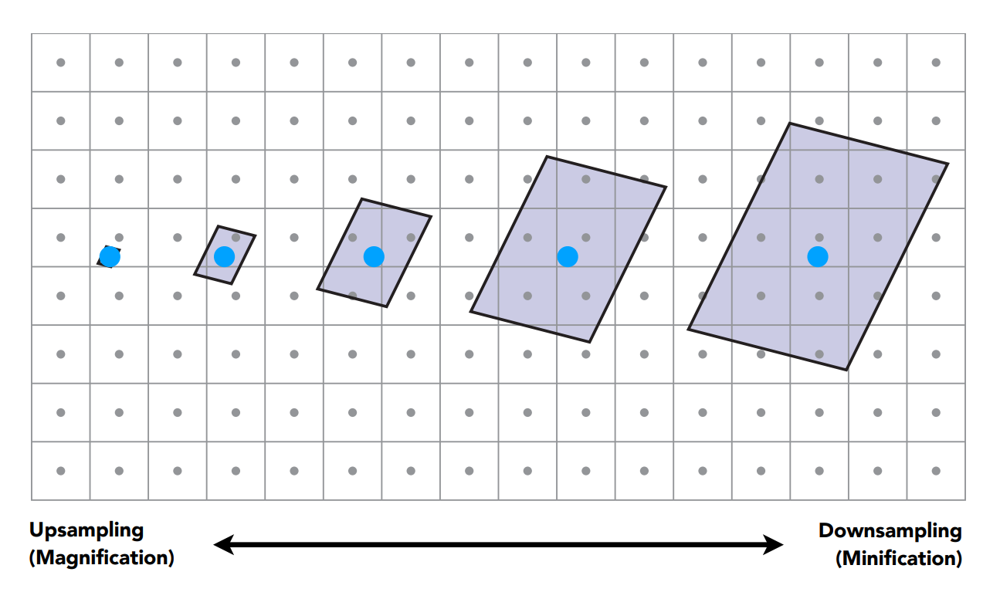

因此螢幕上的像素在紋理圖上覆蓋的區域是各不相同的，對於覆蓋區域較小的像素，我們利用像素中心去查紋理圖，找到的值可以近似的被表示成實際的覆蓋區域沒問題（上圖中最左側的例子）； 但對於覆蓋區域較大的像素，用單一一個中心去代表整塊的平均值，很明顯的就不對了（上圖中最右側的例子）

之前為了解決鋸齒，我們引入了 MSAA，這裡其實也是差不多的概念，我們需要在一個像素內用更多的取樣點去查找紋理座標，下圖是一個像素分 512 個取樣點下去的結果：

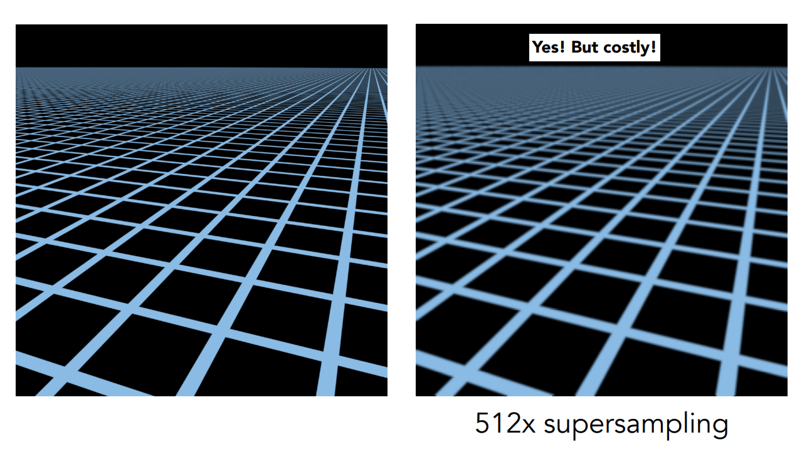

但與前面提到的問題一樣，單個像素要分這麼多取樣點，效能肯定會受到影響，所以我們再回來看看有沒有什麼優化空間。 我們遇到的一樣是混疊問題，也就是取樣頻率跟不上訊號的頻率，當像素在紋理圖內覆蓋範圍過大的時候，整個區域的紋理訊號變化只被一個取樣點取樣了

在紋理這塊我們提供了另一種完全不同的思路，取樣會導致混疊，因此我們就不取樣了。 我們的問題在於要知道紋理中一個覆蓋範圍內的平均值，而這裡的取樣只是為了求平均值的手段，因此我們是可以找到其它手段來求平均值的

#### 多層次紋理（Mipmap）

在資料結構中有個名稱來形容這類問題 ー 點查詢與範圍查詢問題。 點查詢很好理解，就是剛剛講雙線性插值處的問題，給一個點要去查紋理圖中對應的值。 而範圍查詢問題英文叫 range query，給一個「範圍區域」，我們想要馬上知道這個區域內的平均值。 另外，有些範圍查詢並不是要求平均值，而是要找最大最小值的

這在演算法的領域有各種不同的方法在研究它，在圖學中有一個近似方法，它非常快，可以拿來做範圍查詢平均值，叫做 Mipmap，其有三個特點：

1. 快
2. 結果是近似的，也就是說它的範圍查詢結果並不是個準確值
3. 只能用在正方型的區域上

Mipmap 的想法是從一張圖預先生成一系列的圖，看個例子：

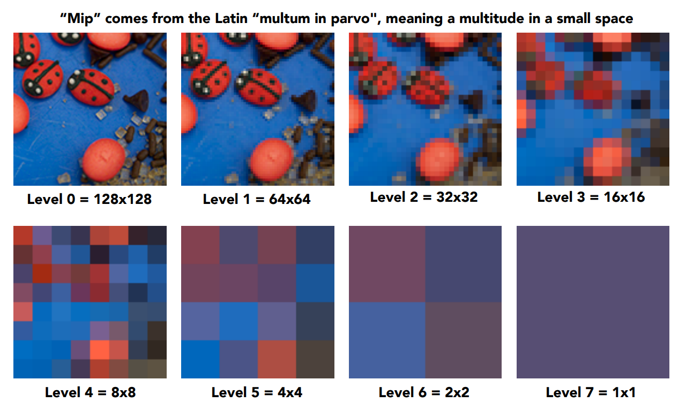

上面中我們把一系列的圖分成了不同的層（Level），每一層的分辨率都是上一層的四分之一倍，因為每次都是把邊長除以二因此總共的層數是以 $log_2$ 計算的，至於儲存空間量大概會多三分之一倍（等比級數和）

於先前一樣，在查詢紋理座標的時候，任何一個像素都可以映射到紋理圖上的一個區域：

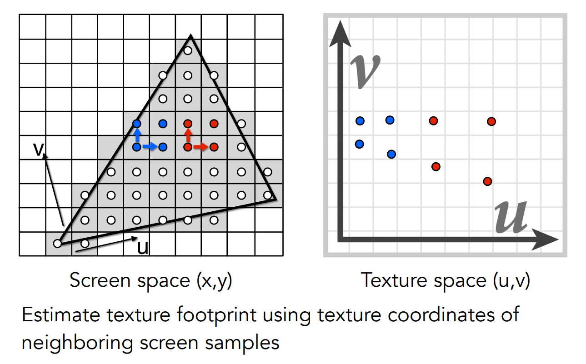

這個區域我們有個近似的算法，假設我們想算上圖中單獨一個紅色像素的區域，我們可以先將四個紅色像素各自的中心，投影到紋理圖後，計算不同點之間的距離

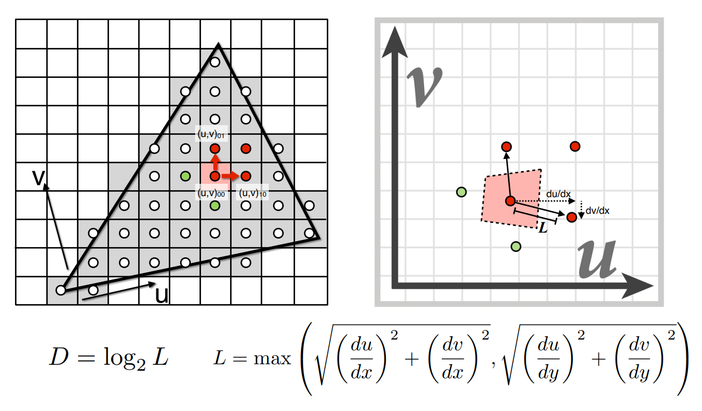

上圖中 $max$ 內取的兩個投影過後的邊長，接著我們取較長的那條來近似一個像素的區域：

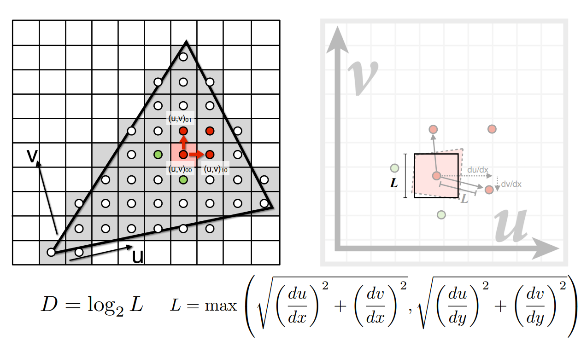

上圖中可以看到一個長度為 $L$ 的正方形，這就是我們最後的近似結果

這裡相當於是在做一個有限差分（finite difference），也就是在算我們於螢幕上的像素中移動一段距離，會在紋理的空間中移動多少距離。 而既然是在做近似，你其實也可以拿一個 pixel 的四個頂點去做一樣的事情，這並不是 Mipmap 的關鍵

我們的關鍵在於拿到紋理圖中一個正方形區域時，它的查詢該怎麼做。 首先我們會利用 $L$ 的長度來去判斷要使用第幾層的紋理圖，假設 $L$ 是 1，那就跟原本的 texel 大小一模一樣，因此使用原先的紋理圖即可

而如果 $L$ 是 4，代表它在第一層紋理圖中佔 16 個 texel，因此在第二層中會佔 4 個 texel，在第三層中會佔 1 個 texel，此時我們查第三層的紋理圖就可以馬上知道平均的結果是多少了。 這就是 Mipmap 聰明的地方了，我們只要直接查詢第 $Dlog_2 L$ 層的紋理圖，就可以馬上求出平均值

但由於層數是離散的，因此查詢的結果也會有之前那種斷層感，視覺化出來的話長這樣，圖中的不同顏色代表不同層的紋理圖：

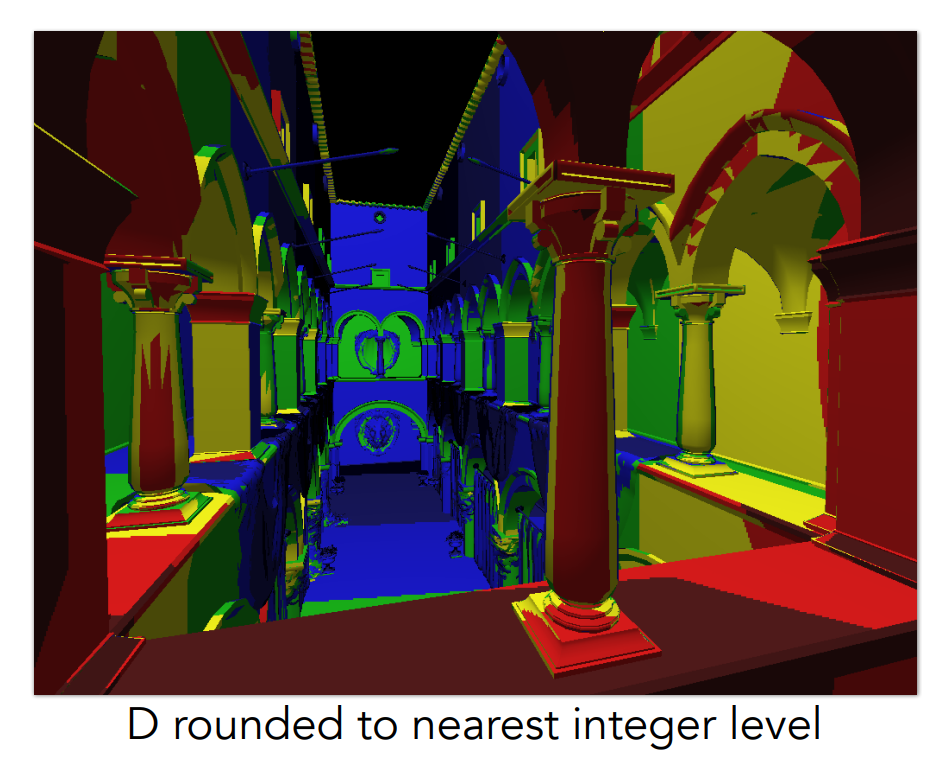

但我們不希望這樣，想要有連續的結果，此時又可以將剛剛的雙線性插值拿過來用了。 假設我們要查第 1.8 層，那就先找第一層，再找第二層，這兩層內部我分別都跟之前一樣，用雙線性插值找出一個結果，接著再把這兩個雙線性插值的結果，利用一次線性插值，將層與層之間的數值給找出來：

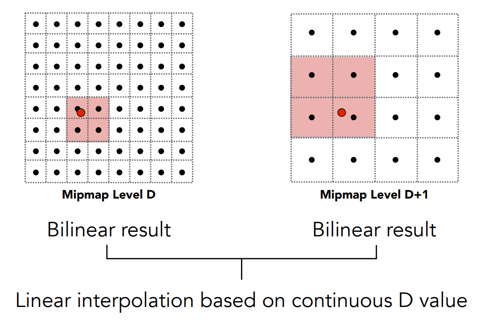

上圖中我們會在第 D 層做一次雙線性插值，在第 D+1 層做一次雙線性插值，接著把這兩個雙線性插值的結果拿出來，再做一次線性插值。 由於總共做了三次不同方向（$u$、$v$ 和 Layer）的插值，因此這被稱為三線性插值，開銷很小，效果又好，因此在圖學中得到了廣泛的應用

這樣一來無論我們就可以計算任意一層，甚至是浮點數層的值了：

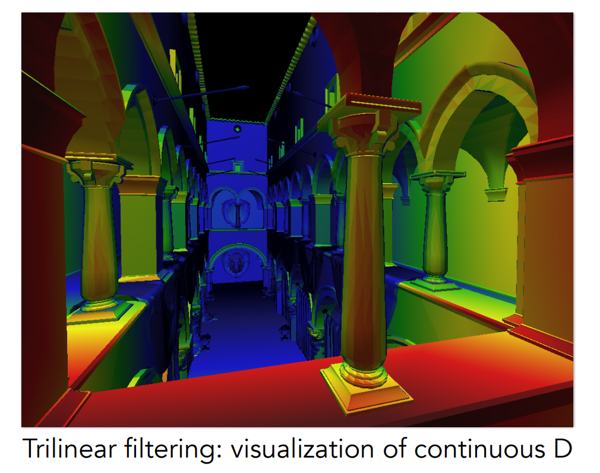

現在就來看看利用 Mipmap 的結果和分 512 個取樣點的結果有什麼差別：

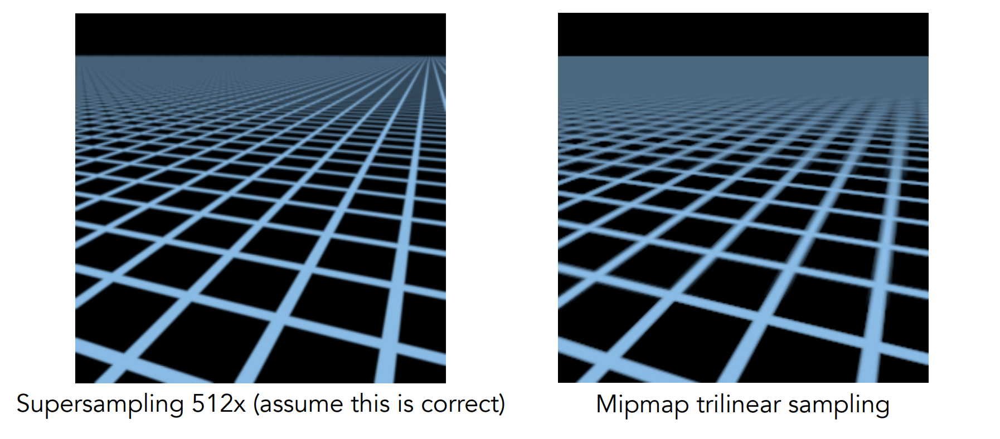

效果不錯，但此時你會發現有個地方不太對，Mipmap 到了遠處的地方它會整個糊掉，這被稱為 overblur。 我們一開始有提到，Mipmap 只能查詢正方形區域的平均，因此在 pixel 映射到紋理圖時我們會將其近似成長度為 $L$ 的正方形，但實際上的像素所佔的區域有可能與該正方形相差很多：

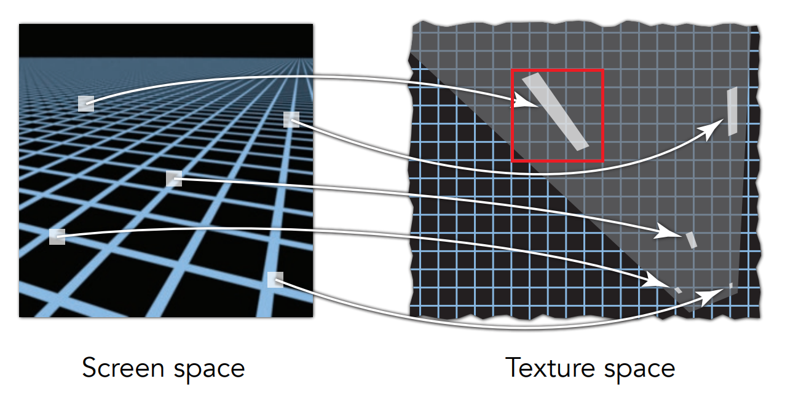

#### 各向異性過濾（Anisotropic Filtering）

上面的問題可以透過各項異性過濾來解決，在剛剛的圖中你可以發現到有些 pixel 對應的區域只有水平方向發生了變化，高度本身與正方形的邊長幾乎一樣

各向異性過濾利用了這種特性，做了更準確的近似，Mipmap 是同時縮小 $u$、$v$ 座標以形成各層的紋理圖，而各向異性過濾則是增加了只縮小了單一軸的紋理圖，因此對於長方形的映射範圍更準，但對於那種斜著的長方形仍然效果不好：

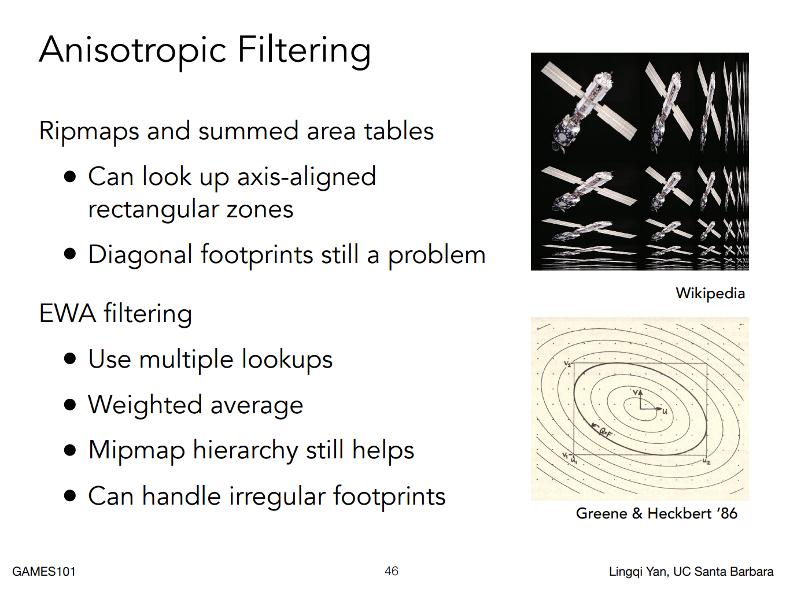

為了適應各種不同的形狀，人們還發明了許多不同的方法，這裡提一個例子叫 EWA 過濾，他的想法是將任意不規則的形狀拆成很多不同的圓形，去覆蓋這個不規則的形狀

上圖中有個橢圓，在 EWA 中可能就會利用三個圓形來去覆蓋這個橢圓因為有三個圓形所以會做三次查詢，這樣多次的查詢自然就可以覆蓋一個不規則的形狀，但自然成本就更高。 對於各向異性過濾來說也是如此，上圖中你可以看到他的空間成本大概會收斂到原本的三倍（也因此你打遊戲時開多少倍的各向異性過濾其實成本不會差多少）

### 紋理的應用（Applications of Textures）

我們前面把紋理當成一張圖片，用它來查詢了各個位置的顏色，但紋理其實也可以儲存其他資料。 因此我們可以把紋理想成一份能夠快速查詢的資料，而 shader 本身會自行決定這些資料代表什麼

#### 環境光映射（Environment Mapping）

我們先看下面這顆反射了周圍環境的球：


球面上的反射包含了來自不同方向的光，此時我們可以用環境貼圖（environment map）記錄這些方向上的光照。 在這裡不會區分某個方向的光是由光源直接發出，還是由牆壁、地面等物體反射而來的，因為這些光都能成為照亮目標物體的入射光

一般的環境貼圖會假設環境位於無限遠處，因此貼圖只會記錄方向，不會記錄光源與物體之間的距離。 因此當我們稍微移動觀察位置時，同一個方向上的光照仍然不會變，例如遠處的天空，移動幾步幾乎不會改變它的方向，此時這個假設就很合理

但如果是像小房間之類的來源，想像房間裡有一顆球：

- 球在房間中央時，窗戶在它的正前方。
- 把球往右移時，窗戶會變成在它的左前方。

此時窗戶來光方向應該要發生改變，但因為用的是環境貼圖，所以仍然會把亮窗記在原本的方向，因此就會產生誤差，不是合理的假設／用途

我們可以把各個方向的光照來源對應到球面上的位置，再把球面展開成二維紋理，就像我們把地球儀展開成世界地圖一樣。 這種方式稱為球面環境映射（spherical environment mapping）：


不過球面展開後，各個區域在平面上的尺度不會完全一致。 下圖靠近上下邊緣的樹木與天空就出現了明顯的拉伸：


這個現象在世界地圖上也可以看到，如果我們用經緯度來展開球面，靠近極點的很小一圈區域仍然會占滿整張圖的寬度，因此極區會被拉開。 因此雖然這種表示能涵蓋所有方向，但等大的紋理區域並不會對應到等大的立體角

後來人們為這個問題想出了一個解法，它還是一樣用一顆球，但我們現在認為這個球有一個包圍盒。 我們原本是用球的表面來紀錄來自任何地方的光線，現在我們連一條球心往目標的射線，讓它繼續走，直到它打到立方體的表面上，這樣就可以將環境光的訊息存在立方體表面上了：


這種表示稱為立方體貼圖（cube map），它會使用六張圖片來對應六個面。 而由於立方體的各個面基本上都是均勻的，因此就比較少會發生扭曲的現象。 但它有其他的問題，在計算光線方向時我們還需要判斷它在哪個立方體的面上，因此需要一些額外的計算，但仍非常快

除了環境光映射，常見的天空盒也是利用 Cube Map 在做的。 下面的教堂範例展示了六個面展開後的樣子：


#### 凹凸貼圖（Bump Mapping）

接下來是另一個應用，叫做凹凸貼圖，類似的還有法向量貼圖。 我們之前用紋理是為了設定 Blinn Phong 裡面的 $K_d$ 項，但紋理也可以定義一些更進階的屬性，以凹凸貼圖來說它會額外定義一個高度的屬性，表示該點要以物理模型的法向量方向再往下或往上走多少：


上圖中的黑線是物理模型原本的位置，而利用凹圖貼圖，我們就可以透過紋理座標來定義三角形內任意點的相對高度，而相對高度一變法向量就會跟著產生變化，因此 Shading 的結果就會有明暗對比，進而在不改變物理模型的情況達到視覺上的凹凸效果，下面是一個例子：


圖中的這顆橘子，其物理模型只是一顆球，因此建模很簡單，可以只用一兩百個三角形表示。 如果我們想利用物理模型來達到圖中的效果，那會需要超級多的三角形，但利用凹凸貼圖我們就可以節省許多三角形

接著來看法向量的變化該如何計算，我們先從一維高度函數的簡化例子開始，看看新的法向量要怎麼算：


假設上圖原本是個平面，因此原先目標點 $p$ 的法向量會是 $(0,1)$，而藍色的波浪線是凹凸貼圖定義出來的，此時若要算任意一個點的法向量，就相當於是要求該點的導數，換句話說就是要求該點切線。 而這個計算很簡單，我們用 $h(p)$ 記錄高度，並用相鄰位置的差分近似斜率，就會得到：

$$
d_p\approx c\,\frac{h(p+\Delta p)-h(p)}{\Delta p}
$$

圖中另外引入了參數 $c$ 來調整高度對表面的影響程度，並把取樣間距簡化成了 $\Delta p=1$。 由於新表面的切線方向是 $(1,d_p)$，我們把它逆時針旋轉 $90$ 度，再正規化，就能得到法向量了：

$$
\mathbf n'=\frac{(-d_p,1)}{\sqrt{d_p^2+1}}
$$

上面的例子是一維的，而在實際的情況下我們有二維的貼圖，因此計算時會變為在求該點的梯度。 假設目標點 $p$ 在 $(u,v)$，我們把高度函數擴充成二維的 $h(u,v)$，並分別沿著兩個紋理方向計算高度變化：

$$
\begin{aligned}
\frac{dp}{du}&\approx c_1\,[h(u+1,v)-h(u,v)]\\
\frac{dp}{dv}&\approx c_2\,[h(u,v+1)-h(u,v)]
\end{aligned}
$$

其中 $u$、$v$ 使用是以相鄰取樣點為單位的座標，而 $c_1$、$c_2$ 會包含高度尺度與取樣間距的影響。 我們如果改用 $[0,1]$ 的紋理座標，還需要把一步改成對應的 texel 間距，並相應調整差分尺度

這邊我們假設法向量是 $(0,0,1)$，在這個局部座標系裡，新表面的兩個切線方向會是 $(1,0,d_u)$ 與 $(0,1,d_v)$。 我們對它們做外積並正規化後，就會得到：

$$
\mathbf n'=\operatorname{normalize}(-\frac{dp}{du}, -\frac{dp}{dv},1)
$$

實際模型的法向量不一定朝向世界座標的正 $z$ 方向，因此我們通常會先在著色點建立局部座標系，將其法向量設為 $(0,0,1)$。 這個座標系會以原法向量為其中一個軸，再配上兩個切線軸使用。 之後當我們在局部算好新的法向量後，就能透過座標變換把它轉回世界座標了

例如，某面牆的法向量朝向了世界的 $+x$：

$$
\mathbf n_{\text{世界}}=(1,0,0).
$$

我們首先在牆上的著色點建立局部座標系，選擇：

- 局部 $z$ 軸：沿著牆的法向量。
- 局部 $x,y$ 軸：沿著牆面的切平面，並且互相垂直。

因為原法向量剛好沿著局部 $z$ 軸，所以它在局部座標中的分量就是：

$$
\mathbf n_{\text{局部}}=(0,0,1).
$$

這個 $(0,0,1)$ 的意思是：「沿局部 $x,y$ 方向都是 $0$，沿局部 $z$ 方向是 $1$」，牆的朝向仍然一樣，改變的是描述方向所用的座標系

接著，如果想讓法向量稍微偏斜，可以先在局部座標中算出新方向，例如：

$$
\mathbf n'_{\text{局部}}=(0.6,0,0.8).
$$

意思是：新方向有 $0.6$ 的分量沿局部 $x$ 軸，$0.8$ 沿局部 $z$ 軸。 假設局部三個軸在世界座標中的方向分別是 $\mathbf t,\mathbf b,\mathbf n$，我們可以把這些分量加起來：

$$
\mathbf n'_{\text{世界}}
=0.6\mathbf t+0\mathbf b+0.8\mathbf n
$$

以此來將其「轉回世界座標」：按照局部三個軸的實際方向，把新的法向量組合出來。 這樣，無論模型表面朝向哪裡，都可以先用「原法向量沿局部 $+z$」的同一套公式來計算了

::: tip  
一維的例子通常會被稱為 Flatland Case，對應到 3D Case  
:::

除了凹凸貼圖，法向量貼圖（normal mapping）也會通過紋理映射的方式定義出法向量，再通過改變其高度的方式來達到其目的。 而這類做法現在有個更現代化一點的方法，叫做位移貼圖（Displacement Mapping）

#### 位移貼圖（Displacement Mapping）

位移貼圖（displacement mapping）的想法與前面類似，都是利用紋理來定義出目標點的相對高度，因此其輸入與前面一樣。 差別在於它會真的去移動幾何位置，而非像法向量貼圖只做了假的移動，看個差異圖：


由於位移貼圖會改變表面形狀，因此它可以讓外輪廓出現凹凸，也能讓凸起部分遮住表面上的其他位置，同時產生對應的陰影。 這些凹圖貼圖都做不到，它沒有改變幾何，所以物體的邊緣仍會維持著原本的輪廓，同時那些虛擬的凸起也不會形成幾何遮擋，所以凸起部分的陰影無法被表現出來

位移貼圖的缺點是它需要足夠細的幾何取樣。 我們如果只移動一個大三角形的三個頂點，就無法表現出三角形內部許多細小的高度變化。 換句話說網格頂點的取樣密度必須能夠跟上高度紋理的變化，三角形頂點之間的間隔需要比紋理變化的頻率還高才行，因此就又會有混疊問題

不過我們也不一定要從一開始就建立一個過於極細的模型，而是可以先保留較粗的網格模型，並在應用位移貼圖的過程中檢測一下三角形夠不夠細，依需求把三角形拆得更小。 這個操作被稱為動態曲面細分（dynamic tessellation），它能讓我們在需要細節的位置增加幾何，並套用位移上去

#### 其他用途（Others）

##### 三維紋理（3D Texture）

再來提一些較瑣碎的東西，首先是三維紋理。 紋理也可以定義在三維空間裡，而不只是定義在物體表面的二維座標上。 我們可以用下面的大理石球來理解這個差別：


我們如果只替球面貼上二維圖片，這張圖就沒有定義球體內部的材料，因此如果將球切開，我們什麼都看不到。 但三維紋理會替空間中的位置提供數值，所以我們把球切開後，仍然可以查詢新截面上的紋理

通常對於大理石這種紋理，我們實際上也不會把三維紋理的每個值都預先存下來，而是會直接使用一個定義在空間中的函數來算出對應的值。 例如課程這裡使用了 Perlin noise，再對雜訊值進行縮放、二值化或其他處理，讓它形成大理石的紋路

Perlin Noise 在圖學中很常被使用，除了三維紋理，像是山脈的起伏高度等也都可以用它來做

三維紋理很常出現在體積算繪（volume rendering）中。 像是醫學裡面有像是核磁共振成像，或者 CT 成像等操作，這類掃描會取得空間中的組織資訊，此時我們可以把各個位置的量測值放進三維資料中，再利用這些資料產生影像：


既然儲存在三維空間中，我們自然也就會將其當作三維紋理在用了。 因此這些例子都讓紋理的意義變得更廣了：紋理可以是一張顏色圖片，也可以是一份高度、法向量或三維量測資料，只要我們能讓 shader 依照用途來解讀取樣結果即可

##### 預先計算的著色（Precomputed Shading）

紋理還可以儲存一些預先算好的著色資訊，下面是一個以環境光遮蔽（ambient occlusion，AO）為目標的例子：


對比最左邊的圖和最右邊的圖，以眉骨為例，眼窩部分會有陰影，這可以用中間的紋理圖來表示，這張紋理圖就叫做環境光遮蔽（Ambient Occlusion）

上面的最左圖是在算 Shading 的結果，由於此時還考慮不到環境光遮蔽的訊息，因此你可以看到最左圖中眼窩部分並沒有陰影，但我們可以先把 Shading 計算的結果寫進另一張紋理圖中

在這個簡化用法中，AO 紋理會以較接近 $1$ 的值表示較開放的區域，以較接近 $0$ 的值表示較受遮蔽的區域。 之後 Shader 只要把原本的著色結果貼上這個紋理，就能快速得到右圖的近似效果了

::: tip  
這裡的貼上其實就是兩者相乘  
:::


## 圖形管線（Graphic Pipeline）

至此我們已經知道給一個幾何模型與著色模型，我們要怎麼得出渲染的結果了。 至此我們可以嘗試把學到目前為止的東西都合在一起，這被稱為 Graphic Pipeline，它描述的是從一個 3D 的場景到其真的變成一張 2D 的圖，到底經過了一系列怎麼樣的過程，每個組件就對應到我們前面的不同章節提到的概念：


所以我們這邊就來做個統整、複習。 我們的輸入都是一系列空間中的點，因此第一步要做投影，將 3D 的點變換到螢幕空間中：


接著透過光柵化，對像素進行取樣，我們可以將其離散為不同的像素，在 OpenGL 內被稱為 fragment，在這步我們要算出不同像素的顏色是什麼：


在計算的過程中我們產生了一系列的像素，此時還需要 Z-Buffer 來判斷其可不可見，當然這步我們可以把它也算到光柵化中，只是這裡分得比較細：


然後便是著色：


在上圖中你會發現一件事，這裡頂點和像素的著色會同時發生，這是因為考慮到有不同的著色頻率，現代的 GPU 會讓這兩個部分變成可編成的，因此你可以在這兩個步驟中寫自己的 code 來控制要用什麼著色頻率。 整個實時渲染就是針對這兩個部分再做文章，通過程式碼來決定頂點和像素要怎麼處理，這些程式碼我們稱其為 shader，負責控制頂點和像素要如何著色

最後還有一部分是紋理（Texture），讓我們可以顯示貼圖：


這就是我們處理從三維場景到最後渲染出一張二維的圖的一個基本操作，而除了前面提到的 Vertex Processing 與 Fragment Processing，其餘的操作都是已經在 GPU 硬體內被寫好的

### 著色器程式（Shader Program）

Shader 本質上是一些能在 GPU 硬體上執行的語言，以 OpenGL 為例，它是一個圖學的 API，你可以用它來寫 shader，對於每個頂點或是像素，它都會執行一次你的 Shader code，因此你不需要有個 for loop，在寫 Shader 時只需要專注在一個頂點或像素即可

專注於頂點的 Shader 被稱為頂點著色器（Vertex Shader），而專注於像素的 Shader 被稱為像素著色器（Fragment Shader），Fragment 也會有人翻成片段，但基本上是同一個意思

現在來看幾個具體的例子，對於 Fragment Shader，它的輸出是一個像素最後的顏色，底下是一個簡單的範例，它用的是 OpenGL 的著色語言，稱為 GLSL：

```glsl
uniform sampler2D myTexture;    // program parameter
uniform vec3 lightDir;    // program parameter
varying vec2 uv;    // per fragment value (interp. by rasterizer)
varying vec3 norm;    // per fragment value (interp. by rasterizer)
void diffuseShader()
{
  vec3 kd;
  kd = texture2d(myTexture, uv); // material color from texture
  kd *= clamp(dot(–lightDir, norm), 0.0, 1.0); // Lambertian shading model
  gl_FragColor = vec4(kd, 1.0); // output fragment color
} 
```

這裡說的是有兩個全域變數 `myTexture` 與 `lightDir`，分別代表紋理和光照方向，也就是說我們認為每一個像素都有一個固定的光照方向。 而 `norm` 代表法向量，它是利用插值算出來的，也就是說對於目標三角形，它可能三個頂點各有不同的法向量，但我們不管，到了這個像素裡面 OpenGL 會自動幫我們插值出它的法向量

由於這份程式碼每個像素都會執行，因此不需要 for loop，每個像素都會執行 `diffuseShader` 這個函式，在當中由於我們假設光照是一個常數，因此只需要將其與法向量做內積，就可以得到 Blinn-Phong 中漫反射的部分。 算出來後再將它賦值給 `gl_FragColor`，表示一個像素的顏色

通過 Shader，我們就可以定義任何一個頂點或像素要怎麼操作了。 如果你實際去學一些圖學的 API，例如 OpenGL、DirectX 或 Vulkan，你會發現我們只需要指定場景中的東西要如何運動、選轉，相機要如何擺放即可，實際的矩陣並不用我們自己寫，這就是因為這些 API 內部都幫我們做好了

## 陰影映射（Shadow Mapping）

我們先前使用 Blinn-Phong 模型時，著色計算只會考慮目前的著色點、光源與相機。 這個局部計算會告訴我們表面在照明下有多亮，但實際情況中場景裡的其他物體也可能會擋住光線，讓這個點無法直接收到光源的光，並產生對應的陰影。 為此，我們還需要判斷光源與著色點之間的可見性：


圖中的陰影能幫助我們判斷球與地板的相對位置，也能表現球與球之間的遮擋關係。 我們在右圖比較難判斷物體離地多遠，左圖的陰影則提供了接觸與空間深度的線索

### 從光源的可見性判斷陰影

這裡我們用的是最簡單的 Shadow Mapping 方法。 它的核心概念是：對於相機看得到的表面點，如果光源也看得到它，這個點就能接收該光源的直接照明。 如果相機看得到它，但光源看不到它，那就表示有其他表面擋在兩者之間，因此這個點會落在該光源造成的陰影裡

我們可以把這個關係寫成可見性函數。 假設點光源的位置為 $\mathbf{l}$，著色點為 $\mathbf{p}$，可見性會是：

$$
V(\mathbf{p},\mathbf{l})=
\begin{cases}
1, & \text{the light sees the point},\\
0, & \text{the light is occluded}.
\end{cases}
$$

之後我們會將直接照明的計算會多乘上這個可見性。 對單一光源而言，我們可以把原本直接照明的結果記成 $L_{\mathrm{direct}}$，加入陰影後的結果則為 $V L_{\mathrm{direct}}$

### 兩趟算繪流程

Shadow Mapping 會先從光源的位置對場景做一次算繪，接著再從相機位置做第二次算繪。 第一趟會記錄光源看得到的最近深度，第二趟則會把相機看得到的表面點轉回光源視角，然後再比較它們的深度

在這個例子中，我們會採用「數值越小越靠近光源」的深度約定

#### 第一趟（Pass 1）：從光源建立深度圖

我們可以在光源的位置放一台虛擬相機，並讓它朝向需要處理的場景。 這台相機會執行一次光柵化與深度測試，為每個取樣位置保留最近的可見表面


我們在這一趟只需要深度，不需要計算表面顏色。 這個階段我們會從光源視角繪製一張深度圖，稱為 shadow map，其會把各個投影位置的最近深度記下來。 圖中的前方表面會擋住後方表面，所以同一方向只會留下光源最先看見的位置

我們若把 shadow map 上的座標記為 $(u,v)$，則對應的位置會保存：

$$
D_{\mathrm{light}}(u,v)=\min_{\mathbf{x}\mapsto(u,v)}d_{\mathrm{light}}(\mathbf{x}).
$$

這裡的 $d_{\mathrm{light}}$ 代表光源視角採用的深度值，映射符號表示表面點投影到了哪一個影像位置

#### 第二趟（Pass 2）：從相機算繪並查詢陰影圖（Shadow Map）

我們接著會對相機本身，照平常的流程算繪場景。 相機的深度測試會決定它在目標像素上是看見了哪個表面點，這個表面點接著會接受陰影測試


假設相機看到的點為 $\mathbf{p}$，我們會去計算，如果從光源的角度看，這個三維點 $\mathbf p$ 落在了第一趟那張深度圖的哪個位置。 如果這個點的深度等於 shadow map 記錄的深度，那光源最先看見的表面就是這個點。 因此，這個點會通過陰影測試，並接收直接照明：


如果這個點的深度大於 shadow map 記錄的深度，那表示較近的表面擋住了光源。 因此雖然相機可以看的到這個點，但它卻會落在陰影裡：


我們可以把理想情況下的測試寫成以下形式：

$$
V(\mathbf{p},\mathbf{l})=
\begin{cases}
1, & d_{\mathrm{light}}(\mathbf{p})\leq D_{\mathrm{light}}(u,v),\\
0, & d_{\mathrm{light}}(\mathbf{p})>D_{\mathrm{light}}(u,v).
\end{cases}
$$

在這個過程中我們需要比較兩筆深度：

- 儲存在 shadow map 裡的深度：從光源視角看，某個影像位置上最近表面的深度
- 著色的表面點所算出的深度：表面點 $\mathbf p$，在同一個光源視角下的深度

第二趟雖然是從相機視角算繪的畫面，但陰影判斷仍然會使用光源視角的資料，相機只負責決定畫面中看見了哪些表面點

對每個待測點 $\mathbf p$，我們會先利用它的三維位置，計算它在光源視角下的投影座標 $(u,v)$ 與自身深度 $d_p$。接著，我們會再用 $(u,v)$ 查詢第一趟產生的 shadow map，讀取該位置最近表面的深度 $D$，再比較兩者，以判斷待測點是否有被遮擋

### 球體場景的完整例子

以前面的球體場景為例。 第一趟的虛擬相機位在左上方光源的位置，所以它看到的球體排列會與真正相機看到的排列不同：


我們接著把這個視角下的深度保存成 shadow map，裡面的深度可以用灰階來視覺化出來：


第二趟的相機會看見不同的球面與地板位置。 我們逐點投影回 shadow map 後，就會得到下圖的可見性結果，其中綠色表示目前的深度比較認為光源看得到該點，其他區域則表示陰影：


### 陰影映射（Shadow Mapping）的誤差與成本

#### 浮點精度與深度偏移量

在上圖可以看到在球和地板上有一些零碎的黑點或條紋，這類現象被稱為 shadow acne，也就是錯誤的自我遮蔽。 這是因為 Shadow map 的解析度有限，每個像素只存了一個深度，但第二趟的表面取樣位置未必剛好與第一趟相同，可能會在同一像素內的不同點上，再加上數值精度的誤差，整個加起來就可能會導致待測深度稍微大於查到的深度

例如，本來沒有遮擋，比較結果卻是：

$$
D=0.500000,
\quad
d_p=0.500001.
$$

如果程式嚴格使用「$d_p>D$ 就是陰影」，那這個微小的差異也會讓測試失敗，進而讓某些點沒通過測試，導致表面出現斑點

一個簡單的處理方式是加入一個很小的深度偏移量（depth bias）$\varepsilon$。 我們只有在待測點比記錄深度還深了超過 $\varepsilon$ 時，才會把它判成陰影：

$$
\text{shadowed}\iff
d_{\mathrm{light}}(\mathbf{p})>D_{\mathrm{light}}(u,v)+\varepsilon.
$$

這個偏移量會容許少量的深度差，但它也會改變遮擋判斷的門檻。 太小的偏移量仍可能會留下雜點，但太大的偏移量又可能會把0原本確實受到遮擋的點誤判成可見得。 因此，bias 只能緩和誤差，單一常數無法完整解決所有幾何與視角下的精度問題

另外，Shadow map 本身是一張有限解析度的圖，所以它只能保存有限數量的深度取樣。 如果相機的影像很細緻，但 shadow map 很粗，許多畫面像素就可能會查到同一個 shadow map texel，陰影邊界也會呈現大塊的階梯狀鋸齒

如果我們去提高 shadow map 的解析度，每個 texel 覆蓋的區域就會變小，因此陰影就可以保留更多細節下來。 代價是更大的深度圖、更多儲存空間，以及第一趟算繪的額外工作

### 硬陰影（Hard Shadows）與軟陰影（Soft Shadows）

點光源只會提供一個光源位置，因此表面點對它的可見性只會是零或一。 可見區域與不可見區域之間會形成明確的分界，這類陰影被稱為硬陰影。 如果光源具有面積，那表面點就可能只會看見光源的一部分，陰影也就會出現漸變，這被稱為軟陰影

軟陰影（soft shadow）會反映光源大小與遮擋物、接收表面之間的相對位置，你可以看見圖中下半部分的陰影在物體接觸地面的附近比較銳利，在離開接觸位置較遠的地方則比較柔和：


#### 本影（Umbra）與半影（Penumbra）

這種現象的成因和本影與半影有關。 我們可以從著色點往光源看，將可見情形分成三種：

- 本影（umbra）中的點會完全看不到光源，因此它收不到這個光源的直接照明
- 半影（penumbra）中的點會看見光源的一部分，因此它仍然會接收到部分直接照明
- 陰影外的點會看見完整的光源，因此遮擋物不會削減這個光源對它的照明


圖中的太陽具有一定大小，因此月球可能只能擋住觀察者視野中的部分太陽。 我們如果站在本影內，就會看不見太陽的發光表面； 如果站在半影內，則仍然能看見其中的一部分。 面積光源與一般物體也會形成同樣的幾何關係

因此，軟陰影會隨光源的可見部分而連續變化。 基本的 Shadow Mapping 只從一個光源視點記錄最近深度，它直接描述的是點光源的二元可見性。 面積光源需要考慮不同發光位置的遮擋情形，在之後做光線追蹤與光照積分時我們會再繼續來看這些問題
