# The rendering pipeline in OpenGL

## Background 與 big picture

### 本文使用的符號與寫法

後面的 rendering pipeline 會同時使用幾何名稱、位置向量、矩陣、純量與程式識別字。 為了讓符號的外觀直接反映它代表的資料種類，本文採用下列慣例：

- $A$、$B$、$C$ 與 $I$ 等大寫斜體字母：用來命名幾何點或頂點。 頂點序列需要編號時，則使用 $V_0$、$V_1$ 等名稱
- 粗體小寫的 $\mathbf{p}$：表示位置向量。 例如 $\mathbf{p}_A$ 是頂點 $A$ 的位置，$\mathbf{p}_{\mathrm{camera}}$ 是相機的位置。 小節已經固定座標空間時可以省略空間下標，需要追蹤同一個位置如何轉換時，則使用 $\mathbf{p}_{\mathrm{object}}$ 與 $\mathbf{p}_{\mathrm{clip}}$ 等名稱
- 其他粗體小寫字母：表示一般向量。 符號上方的帽號表示它已正規化成單位向量，例如 $\hat{\mathbf{g}}$ 是相機的單位 gaze direction
- $M$、$T$、$R$ 與 $S$ 等大寫字母：表示矩陣。 $M_{\mathrm{model}}$ 表示完整的 model matrix，$T_{\mathrm{model}}$、$R_{\mathrm{model}}$ 與 $S_{\mathrm{model}}$ 則分別表示組成它的平移、旋轉與縮放矩陣
- $x_c$、$w_c$、$t$ 與 $\lambda_A$ 等普通斜體字母：表示座標分量、距離、參數或權重等純量。 `object`、`clip`、`ndc` 與 `left` 等完整描述詞放入數學下標時使用直立體，例如 $\mathbf{p}_{\mathrm{ndc}}$ 與 $d_{\mathrm{left}}$
- $\mathrm{color}_A$ 與 $\mathrm{uv}_A$：表示頂點 $A$ 攜帶的 RGBA 色彩與 UV。 這類完整名稱使用直立體，下標中的 $A$ 仍是前述頂點名稱
- 矩陣與二維網格的方向：由上往下排列的一組元素稱為行（column），由左往右排列的一組元素稱為列（row）。 分量由上往下排列的向量稱為行向量（column vector）
- `gl_Position`、`reciprocal_w` 與 `hipegl_draw_desc` 等程式識別字：使用等寬字體。 公式若直接引用程式欄位，也會沿用相同寫法

因此，$A$ 指的是一個頂點的名稱，$\mathbf{p}_A$ 才是用數值表示的頂點位置。 同樣地，$\mathbf{p}_{\mathrm{clip}}$ 中的小寫粗體 $\mathbf{p}$ 表示位置向量，而 $M_{\mathrm{MVP}}$ 中的大寫 `P` 是 projection 的縮寫，兩者代表不同概念

### 座標轉換需要的數學背景：齊次座標與矩陣

幾何資料在不同座標系統之間移動時，會反覆經過縮放、旋轉與平移。 如果每一種操作都採用不同的表示方式，會使我們難以組合轉換順序，也不容易算出返回原座標系統的操作。 齊次座標會替位置增加一個分量，讓我們能把這些轉換都寫成矩陣乘法。 後續只要沿著矩陣的乘法順序，就能追蹤一個點轉換的過程了

#### 平移需要超出線性轉換的表示能力

縮放、反射、斜切（shear）與繞原點旋轉等操作都可以寫成二維矩陣乘上一個位置的形式。 我們需要先確認這種表示法能涵蓋哪些操作，才能看出平移為何需要另一種表示方式。 假設點的位置為 $\mathbf{p}=(x,y)^{\mathrm{T}}$，一般的二維線性轉換可寫成：

$$
\mathbf{p}'
=M_{\mathrm{linear}}\mathbf{p}
=
\begin{bmatrix}
a & b\\
c & d
\end{bmatrix}
\begin{bmatrix}
x\\
y
\end{bmatrix}
$$

其中線性轉換會把原點留在原點，因為：

$$
M_{\mathrm{linear}}
\begin{bmatrix}
0\\
0
\end{bmatrix}
=
\begin{bmatrix}
0\\
0
\end{bmatrix}
$$

平移則會把每個點加上同一個位移向量 $\mathbf{t}=(t_x,t_y)^{\mathrm{T}}$：

$$
\mathbf{p}'
=\mathbf{p}+\mathbf{t}
=
\begin{bmatrix}
x+t_x\\
y+t_y
\end{bmatrix}
$$

因此只要 $\mathbf{t}\neq\mathbf{0}$，原點就會移到 $\mathbf{t}$

然而，任何 $2\times2$ 的線性轉換矩陣都無法單獨表示這個操作。 若要維持二維座標，那完整形式只能寫成「矩陣乘法再加位移」：

$$
\mathbf{p}'=M_{\mathrm{linear}}\mathbf{p}+\mathbf{t}
$$

為了讓平移也能進入矩陣乘法，我們會替二維位置增加第三個分量。 這種表示方式稱為齊次座標（homogeneous coordinates）

#### 齊次座標以 $w$ 區分點與向量

增加第三個分量後，我們需要保留點與方向向量的差異。 平移應該改變點的位置，但不應改變只描述方向與長度的向量。 齊次座標利用了 $w$ 分量來表達這項差異，二維點 $\mathbf{p}$ 與二維向量 $\mathbf{v}$ 分別寫成：

$$
\mathbf{p}_h=
\begin{bmatrix}
x\\
y\\
1
\end{bmatrix},
\quad
\mathbf{v}_h=
\begin{bmatrix}
v_x\\
v_y\\
0
\end{bmatrix}
$$

本文使用行向量，因此矩陣會乘在點或向量的左側。 平移矩陣作用於點時，最右行會加入 $t_x$ 與 $t_y$：

$$
T(\mathbf{t})\mathbf{p}_h
=
\begin{bmatrix}
1 & 0 & t_x\\
0 & 1 & t_y\\
0 & 0 & 1
\end{bmatrix}
\begin{bmatrix}
x\\
y\\
1
\end{bmatrix}
=
\begin{bmatrix}
x+t_x\\
y+t_y\\
1
\end{bmatrix}
$$

同一個矩陣作用於向量時，$w=0$ 會消去最右行中的平移量：

$$
T(\mathbf{t})\mathbf{v}_h
=
\begin{bmatrix}
1 & 0 & t_x\\
0 & 1 & t_y\\
0 & 0 & 1
\end{bmatrix}
\begin{bmatrix}
v_x\\
v_y\\
0
\end{bmatrix}
=
\begin{bmatrix}
v_x\\
v_y\\
0
\end{bmatrix}
$$

另外，齊次點的 $w$ 不必永遠等於 $1$。 只要 $w\neq0$，齊次位置：

$$
\mathbf{p}_h=
\begin{bmatrix}
x_h\\
y_h\\
w
\end{bmatrix}
$$

就會對應到下列二維位置：

$$
\mathbf{p}=
\begin{bmatrix}
x_h/w\\
y_h/w
\end{bmatrix}
$$

當 $w\neq0$ 時，我們可以將齊次座標的每個分量都除以 $w$。 除法完成後，最後一個分量會變成 $1$，其餘分量就是這個位置的一般座標。 例如齊次位置：

$$
\mathbf{p}_h=
\begin{bmatrix}
4\\
2\\
2
\end{bmatrix}
$$

將三個分量都除以 $w=2$ 後會得到：

$$
\begin{bmatrix}
2\\
1\\
1
\end{bmatrix}
$$

因此，它代表的二維位置是 $\mathbf{p}=(2,1)^{\mathrm{T}}$。 由於齊次位置 $(2,1,1)^{\mathrm{T}}$ 與 $(4,2,2)^{\mathrm{T}}$ 分別除以自己的 $w$ 後會得到相同結果，所以兩者代表同一個二維位置。 當 $w=0$ 時，就無法用這個方式轉換成一般位置。 如前所述，本文使用 $w=0$ 表示方向向量

這個設計也讓點與向量的基本運算能保留著正確的資料種類。 若點使用 $w=1$，向量使用 $w=0$，則：

$$
\begin{aligned}
\mathbf{v}_{1,h}+\mathbf{v}_{2,h} &\text{ 的 }w=0,\\
\mathbf{p}_{1,h}-\mathbf{p}_{2,h} &\text{ 的 }w=0,\\
\mathbf{p}_h+\mathbf{v}_h &\text{ 的 }w=1.
\end{aligned}
$$

也就是說：

- 向量 + 向量：仍然是向量
- 點 - 點：結果為向量
- 點 + 向量：結果為點

一般仿射幾何並未將「點加點」定義成合法運算。 若要由多個位置算出另一個位置，較清楚的寫法是使用仿射組合（affine combination）。 仿射組合會替每個輸入位置指定一個權重，而且依定義，所有權重的總和必須是 $1$。 輸出位置是每個輸入位置乘上各自權重後的總和

以下兩個例子都使用相同的輸入位置：

$$
\mathbf{p}_1=
\begin{bmatrix}
2\\
2
\end{bmatrix},
\quad
\mathbf{p}_2=
\begin{bmatrix}
6\\
4
\end{bmatrix}
$$

第一個例子的兩個權重分別是 $\frac{1}{2}$ 與 $\frac{1}{2}$：

$$
\begin{aligned}
\mathbf{p}_{\mathrm{mid}}
&=\frac{1}{2}\mathbf{p}_1+\frac{1}{2}\mathbf{p}_2\\
&=\frac{1}{2}
\begin{bmatrix}
2\\
2
\end{bmatrix}
+\frac{1}{2}
\begin{bmatrix}
6\\
4
\end{bmatrix}\\
&=
\begin{bmatrix}
4\\
3
\end{bmatrix}
\end{aligned}
$$

因此，輸出位置是 $(4,3)^{\mathrm{T}}$，也就是 $\mathbf{p}_1$ 與 $\mathbf{p}_2$ 的中點

第二個例子的兩個權重分別是 $\frac{1}{4}$ 與 $\frac{3}{4}$：

$$
\begin{aligned}
\mathbf{p}_{\mathrm{weighted}}
&=\frac{1}{4}\mathbf{p}_1+\frac{3}{4}\mathbf{p}_2\\
&=\frac{1}{4}
\begin{bmatrix}
2\\
2
\end{bmatrix}
+\frac{3}{4}
\begin{bmatrix}
6\\
4
\end{bmatrix}\\
&=
\begin{bmatrix}
5\\
7/2
\end{bmatrix}
\end{aligned}
$$

因此，輸出位置是 $(5,7/2)^{\mathrm{T}}$。 $\mathbf{p}_2$ 的權重較大，所以輸出位置也比較靠近 $\mathbf{p}_2$

另外，前面提到的齊次座標相加，也可以用第一個例子來理解。 兩筆 $w=1$ 的齊次座標相加後會得到：

$$
\begin{bmatrix}
2\\
2\\
1
\end{bmatrix}
+
\begin{bmatrix}
6\\
4\\
1
\end{bmatrix}
=
\begin{bmatrix}
8\\
6\\
2
\end{bmatrix}
$$

將所有分量除以結果的 $w=2$，就會得到 $(4,3,1)^{\mathrm{T}}$。 這等同於將兩個原始係數 $1$ 分別除以總和 $2$，所以兩個位置的權重都會變成 $\frac{1}{2}$，輸出便是兩點的中點

#### affine transformation：統一表示線性轉換與平移

有了齊次座標後，我們可以把原本分開的線性轉換與平移放進同一個運算，這被稱為仿射轉換（affine transformation），其會先對位置套用線性轉換，再加入位移向量：

$$
\mathbf{p}'=M_{\mathrm{linear}}\mathbf{p}+\mathbf{t}
$$

在齊次座標中，這樣的操作可以直接寫成一個 $3\times3$ 矩陣：

$$
\mathbf{p}_h'
=M_{\mathrm{affine}}\mathbf{p}_h
=
\begin{bmatrix}
a & b & t_x\\
c & d & t_y\\
0 & 0 & 1
\end{bmatrix}
\begin{bmatrix}
x\\
y\\
1
\end{bmatrix}
$$

矩陣左上角的 $2\times2$ 區塊負責縮放、旋轉、反射或斜切，最右行負責平移。 常用的二維縮放矩陣為：

$$
S(s_x,s_y)
=
\begin{bmatrix}
s_x & 0 & 0\\
0 & s_y & 0\\
0 & 0 & 1
\end{bmatrix}
$$

採用行向量與逆時針正角度時，繞原點旋轉的矩陣為：

$$
R(\theta)
=
\begin{bmatrix}
\cos\theta & -\sin\theta & 0\\
\sin\theta & \cos\theta & 0\\
0 & 0 & 1
\end{bmatrix}
$$

平移矩陣則為：

$$
T(\mathbf{t})
=
\begin{bmatrix}
1 & 0 & t_x\\
0 & 1 & t_y\\
0 & 0 & 1
\end{bmatrix}
$$

這三種矩陣具有相同尺寸，因此可以直接相乘。 反射與斜切也只需要替換左上角的線性轉換區塊即可

#### inverse transformation：沿相反方向轉換座標

前面介紹的縮放矩陣 $S$、旋轉矩陣 $R$、平移矩陣 $T$，以及由它們組合而成的仿射矩陣，都能把轉換前的位置映射到轉換後的位置。 本節我們會使用 $M$ 作為通用符號，表示其中任一個矩陣或組合結果：

$$
\mathbf{p}_{\mathrm{after}}
=M\mathbf{p}_{\mathrm{before}}
$$

圖形管線有時也需要沿相反方向轉換座標，例如後面的 view transformation 就會用到這項能力。 此時場景記錄的是相機位於何處以及面向哪裡，但算繪時我們需要反過來求出其他位置相對於相機的座標。 這種取消原轉換並沿相反方向還原座標的操作稱為逆轉換（inverse transformation）。 此時我們擁有的是轉換後的位置 $\mathbf{p}_{\mathrm{after}}$，並且需要找回同一個位置在轉換前使用的座標

若一項轉換沒有遺失位置資訊，而且每個輸出位置都能唯一對應回一個輸入位置，我們就稱其矩陣可逆。 能夠取消 $M$ 所做轉換的矩陣稱為 $M$ 的逆矩陣，記作 $M^{-1}$，它滿足下列關係：

$$
M^{-1}M=I
$$

其中 $I$ 是不會改變位置的單位矩陣。 因此，假設正向轉換為 $\mathbf{p}_{\mathrm{after}}=M\mathbf{p}_{\mathrm{before}}$，那此時我們便能在等式兩側的左邊乘上 $M^{-1}$：

$$
\begin{aligned}
M^{-1}\mathbf{p}_{\mathrm{after}}
&=M^{-1}M\mathbf{p}_{\mathrm{before}}\\
&=I\mathbf{p}_{\mathrm{before}}\\
&=\mathbf{p}_{\mathrm{before}}
\end{aligned}
$$

也就是說，先用 $M$ 完成正向轉換，再用 $M^{-1}$ 沿相反方向轉換，就會回到原本的座標

平移的逆操作是朝相反方向平移，因此：

$$
T(\mathbf{t})^{-1}=T(-\mathbf{t})
$$

例如位移向量為 $\mathbf{t}=(2,3)^{\mathrm{T}}$ 時，矩陣 $T(\mathbf{t})$ 與其逆矩陣為：

$$
T(\mathbf{t})=
\begin{bmatrix}
1 & 0 & 2\\
0 & 1 & 3\\
0 & 0 & 1
\end{bmatrix},
\quad
T(\mathbf{t})^{-1}=
\begin{bmatrix}
1 & 0 & -2\\
0 & 1 & -3\\
0 & 0 & 1
\end{bmatrix}
$$

點 $\mathbf{p}_h=(1,1,1)^{\mathrm{T}}$ 經過 $T(\mathbf{t})$ 後成為 $\mathbf{p}_h'=(3,4,1)^{\mathrm{T}}$，再乘上 $T(\mathbf{t})^{-1}$ 就會回到 $\mathbf{p}_h$。 在這個例子中，正向轉換會向右移動 $2$ 並向上移動 $3$，逆轉換則是向左移動 $2$ 並向下移動 $3$

旋轉矩陣中的各個行向量彼此正交且長度為 $1$，因此旋轉矩陣是正交矩陣（orthogonal matrix）。 它的逆矩陣同時也是轉置矩陣與反向旋轉矩陣：

$$
R(\theta)^{-1}=R(\theta)^{\mathrm{T}}=R(-\theta)
$$

也就是說，沿用本文的二維齊次座標，旋轉 $\theta$ 的矩陣為：

$$
R(\theta)
=
\begin{bmatrix}
\cos\theta & -\sin\theta & 0\\
\sin\theta & \cos\theta & 0\\
0 & 0 & 1
\end{bmatrix}
$$

將旋轉角度改成 $-\theta$ 時，$\cos(-\theta)=\cos\theta$，而 $\sin(-\theta)=-\sin\theta$，因此：

$$
\begin{aligned}
R(-\theta)
&=
\begin{bmatrix}
\cos(-\theta) & -\sin(-\theta) & 0\\
\sin(-\theta) & \cos(-\theta) & 0\\
0 & 0 & 1
\end{bmatrix}\\
&=
\begin{bmatrix}
\cos\theta & \sin\theta & 0\\
-\sin\theta & \cos\theta & 0\\
0 & 0 & 1
\end{bmatrix}
\end{aligned}
$$

$R(-\theta)$ 會沿相反方向旋轉相同角度。 它的矩陣內容也正好等於 $R(\theta)$ 的轉置，因此可以取消 $R(\theta)$ 做過的旋轉

縮放只有在每個縮放係數都不等於 $0$ 時可逆。 如果某一軸的縮放係數是 $0$，該軸上的所有位置都會重疊，原本的座標資訊也會消失，因此無法唯一還原。 更一般地說，仿射矩陣只有在左上角的線性轉換區塊可逆時才有逆矩陣

#### transformation composition：合併多個轉換並保留操作順序

前面分別介紹了縮放、旋轉與平移，但實際擺放一個物件時，通常需要讓同一個位置連續經過多項轉換。 為了看清楚要如何組合這些矩陣，本節先設定一項具體任務：將物件調整成指定大小、轉成指定朝向，最後放到指定位置。 這三個動作依序對應到了縮放矩陣 $S$、旋轉矩陣 $R$ 與平移矩陣 $T$

第一步先縮放原始位置：

$$
\mathbf{p}_{\mathrm{scaled}}=S(s_x,s_y)\mathbf{p}_h
$$

第二步將縮放後的位置交給旋轉矩陣：

$$
\mathbf{p}_{\mathrm{rotated}}=R(\theta)\mathbf{p}_{\mathrm{scaled}}
$$

第三步再平移旋轉後的位置：

$$
\mathbf{p}_h'=T(\mathbf{t})\mathbf{p}_{\mathrm{rotated}}
$$

將前兩步的輸出依序代入下一步，就會得到：

$$
\mathbf{p}_h'
=T(\mathbf{t})\bigl(R(\theta)(S(s_x,s_y)\mathbf{p}_h)\bigr)
$$

由於本文使用行向量，並將矩陣寫在向量左側，因此最靠近 $\mathbf{p}_h$ 的 $S$ 最先作用，接著是 $R$，最左側的 $T$ 最後作用。 由於矩陣乘法具有結合律，所以我們可以將三個矩陣預先組合起來：

$$
\begin{aligned}
\mathbf{p}_h'
&=T(\mathbf{t})R(\theta)S(s_x,s_y)\mathbf{p}_h\\
&=M_{\mathrm{combined}}\mathbf{p}_h \\
&\Rightarrow M_{\mathrm{combined}}=T(\mathbf{t})R(\theta)S(s_x,s_y)
\end{aligned}
$$

更一般地說，若一個位置依序經過 $M_1$、$M_2$ 與 $M_3$，就可以寫成：

$$
\mathbf{p}_h'
=M_3\bigl(M_2(M_1\mathbf{p}_h)\bigr)
=(M_3M_2M_1)\mathbf{p}_h
$$

矩陣乘法通常不具有交換律，交換兩個矩陣往往會得到不同結果。 下面的例子要把左側圖形旋轉 $45^\circ$，再沿 x 軸向右平移一個單位，得到右側的目標位置：

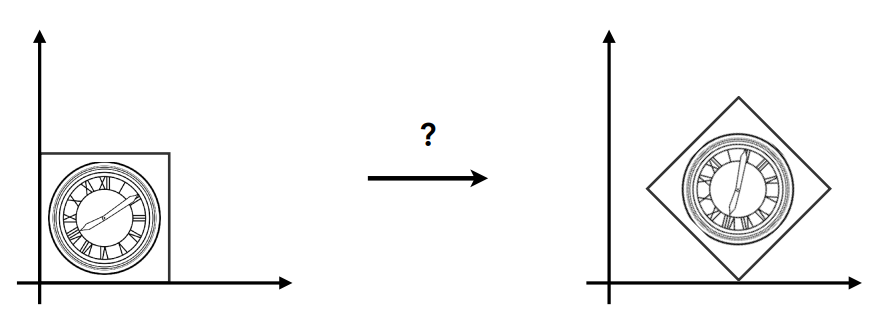

如果先平移再旋轉，位移後的位置也會繞原點旋轉。 對行向量而言，這個順序會寫成 $R(45^\circ)T((1,0)^{\mathrm{T}})\mathbf{p}_h$，結果如下：

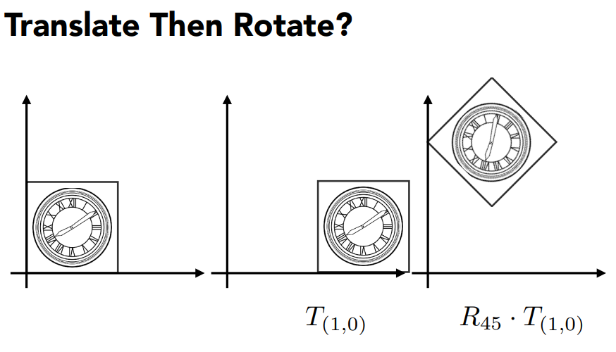

因此如果要得到目標位置，我們得先讓圖形繞原點旋轉，再沿 x 軸向右平移。 這個順序會寫成 $T((1,0)^{\mathrm{T}})R(45^\circ)\mathbf{p}_h$：

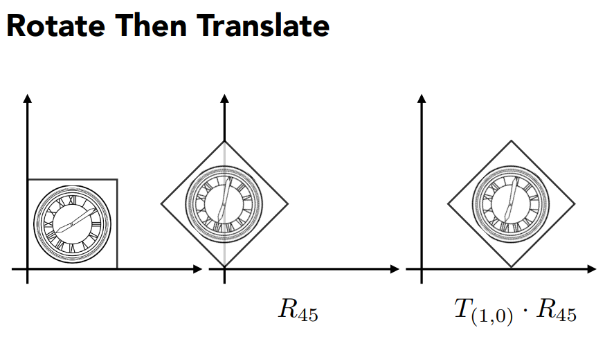

三張圖顯示了矩陣順序會直接改變幾何結果。 兩種順序都能預先合併成單一矩陣，但合併後的矩陣內容並不相同

旋轉矩陣預設會以原點為中心。 若要讓圖形繞指定位置 $C$ 旋轉，我們需要先把 $C$ 移到原點，執行旋轉後再把它移回原位。 下圖以 $\mathbf{c}=(c_x,c_y)^{\mathrm{T}}$ 表示原點到旋轉中心的位移：

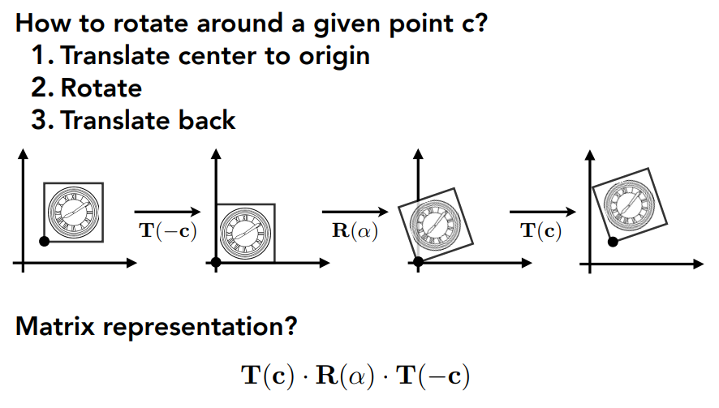

依行向量的右至左作用順序，完整矩陣為：

$$
\mathbf{p}_h'
=T(\mathbf{c})R(\theta)T(-\mathbf{c})\mathbf{p}_h
$$

最右側的 $T(-\mathbf{c})$ 會先作用，使位置 $C$ 在旋轉前暫時落在原點。 旋轉完成後，最左側的 $T(\mathbf{c})$ 再把它移回原本的位置，因此旋轉中心本身保持不動

#### 三維齊次座標與 $4\times4$ transformation matrices

三維幾何還要處理 z 座標，因此需要把相同的點、向量、平移與矩陣組合規則延伸到三維。 三維點 $\mathbf{p}$ 與向量 $\mathbf{v}$ 的齊次表示各有四個分量：

$$
\mathbf{p}_h=
\begin{bmatrix}
x\\
y\\
z\\
1
\end{bmatrix},
\quad
\mathbf{v}_h=
\begin{bmatrix}
v_x\\
v_y\\
v_z\\
0
\end{bmatrix}
$$

一般的齊次位置 $\mathbf{p}_h=(x_h,y_h,z_h,w)^{\mathrm{T}}$ 在 $w\neq0$ 時，對應到的三維位置為：

$$
\mathbf{p}=
\begin{bmatrix}
x_h/w\\
y_h/w\\
z_h/w
\end{bmatrix}
$$

三維縮放需要分別指定三個軸的倍率：

$$
S(s_x,s_y,s_z)
=
\begin{bmatrix}
s_x & 0 & 0 & 0\\
0 & s_y & 0 & 0\\
0 & 0 & s_z & 0\\
0 & 0 & 0 & 1
\end{bmatrix}
$$

三維平移會把位移向量 $\mathbf{t}=(t_x,t_y,t_z)^{\mathrm{T}}$ 放入矩陣最右行：

$$
T(\mathbf{t})
=
\begin{bmatrix}
1 & 0 & 0 & t_x\\
0 & 1 & 0 & t_y\\
0 & 0 & 1 & t_z\\
0 & 0 & 0 & 1
\end{bmatrix}
$$

一般的三維仿射轉換會把任意 $3\times3$ 的線性轉換與三維平移放進同一個 $4\times4$ 矩陣：

$$
\mathbf{p}_h'
=M_{\mathrm{affine}}\mathbf{p}_h
=
\begin{bmatrix}
a & b & c & t_x\\
d & e & f & t_y\\
g & h & i & t_z\\
0 & 0 & 0 & 1
\end{bmatrix}
\begin{bmatrix}
x\\
y\\
z\\
1
\end{bmatrix}
$$

最後還需要分別繞三個座標軸旋轉。 在右手座標系統與行向量的慣例下，正角度依右手定則決定。 繞 x 軸旋轉的矩陣為：

$$
R_x(\alpha)
=
\begin{bmatrix}
1 & 0 & 0 & 0\\
0 & \cos\alpha & -\sin\alpha & 0\\
0 & \sin\alpha & \cos\alpha & 0\\
0 & 0 & 0 & 1
\end{bmatrix}
$$

繞 y 軸旋轉的矩陣為：

$$
R_y(\alpha)
=
\begin{bmatrix}
\cos\alpha & 0 & \sin\alpha & 0\\
0 & 1 & 0 & 0\\
-\sin\alpha & 0 & \cos\alpha & 0\\
0 & 0 & 0 & 1
\end{bmatrix}
$$

繞 z 軸旋轉的矩陣為：

$$
R_z(\alpha)
=
\begin{bmatrix}
\cos\alpha & -\sin\alpha & 0 & 0\\
\sin\alpha & \cos\alpha & 0 & 0\\
0 & 0 & 1 & 0\\
0 & 0 & 0 & 1
\end{bmatrix}
$$

這些 $4\times4$ 會矩陣沿用二維情況的所有規則，它們可以依右至左的作用順序組合，可逆的時候也能以逆矩陣返回轉換前的位置。 仿射轉換會讓一般點維持 $w=1$、方向向量維持 $w=0$。 投影轉換則可能產生其他 $w$，管線必須先保留完整的齊次位置來完成裁切，直到透視除法階段才將前三個分量除以 $w$

後面我們在講 model、view 與 projection transformations 時會直接使用這套表示法。 Model 與 view 會使用前述的仿射矩陣，projection 則會利用齊次位置的 $w$ 來保存投影所需的資訊

## 一筆 draw call 如何走過 rendering pipeline

前面的軟體分層我們說明了一筆 draw call 會由哪些元件接手，但這筆 draw call 內的資料要如何從頂點變成像素，則需要由 rendering pipeline 來定義。 這裡我們會採用教學上的邏輯順序來寫，但實務上 driver 與 GPU 可以自行合併或重排部分工作，只要最後 OpenGL 對外的外顯行為正確即可

完整的管線如下，每個階段都會接收前一階段的結果，並補上下一階段所需的資訊：

```callgraph
[一般 rendering pipeline：從頂點資料到畫面緩衝區]
=================================================
頂點／索引資料
  │
  ↓
頂點處理（vertex processing）
  ├─ 將 object-space 座標轉成 clip-space 座標
  ├─ 產生色彩、UV 等頂點屬性
  │
  ↓
圖元組合（primitive assembly）
  ├─ 依圖元類型將頂點組成三角形
  │
  ↓
裁切（clipping）
  ├─ 留下可見範圍內的幾何形狀
  │
  ↓
透視除法（clip-space → NDC）
  ├─ 以 clip-space w 計算正規化裝置座標
  │
  ↓
視埠轉換（NDC → screen-space 座標）
  ├─ 產生 screen-space x／y 與深度 z
  │
  ↓
三角形覆蓋判定（triangle coverage）
  ├─ 找出三角形會影響的像素
  │
  ↓
重心座標內插（barycentric interpolation）
  ├─ 算出每個像素相對於三個頂點的權重
  │
  ↓
片段著色（fragment shading）
  ├─ 由頂點色彩或紋理產生候選顏色
  │
  ↓
逐片段操作（per-fragment operations）
  ├─ 執行深度測試等輸出合併規則
  │
  ↓
畫面緩衝區寫入（framebuffer write）
  ├─ 保存最後通過測試的色彩與深度
  │
  ↓
RGB／深度影像
```

上面的 callgraph 提供了階段順序。 下圖則將圖形管線概括成了五個大階段，並在相鄰階段之間標出了資料流的形態：

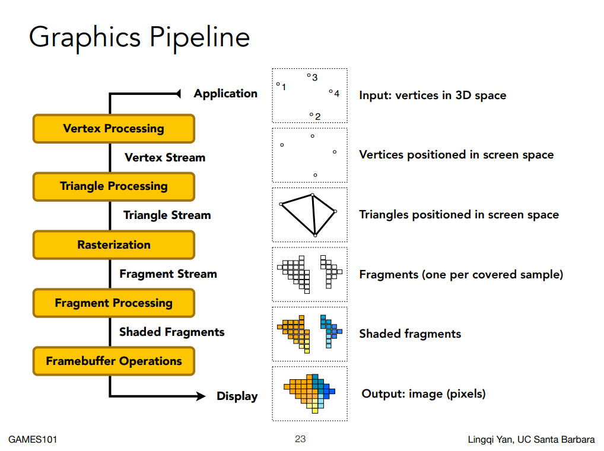

其中：

- `Vertex Processing`：接收 Application 提供的頂點資料，決定本次要處理的頂點，再逐一執行頂點著色器，最後交出包含 clip-space 位置與頂點屬性的 vertex stream
- `Triangle / Primitive Processing`：從 vertex stream 取得頂點，依輸入模式組成圖元，接著完成 clipping、perspective divide 與 viewport transform，再交出位於 screen-space 的 primitive stream
- `Rasterization`：判斷每個三角形在各像素內涵蓋哪些 sample，並為每個至少涵蓋一個 sample 的像素產生一筆 fragment。 若像素內有多個 samples，這筆 fragment 會以 coverage mask 的每個 bit 記錄一個 sample 的涵蓋結果
- `Fragment Processing`：使用內插後的屬性與紋理等輸入計算片段顏色，交出 shaded fragments
- `Framebuffer Operations`：對著色完成的片段執行深度、模板與混色等操作，最後更新輸出影像中的像素

本文沿用了這五個大階段來作為 H3，並將前面 callgraph 中的細部步驟放進了對應的 H4：

- `Vertex Processing`：包含頂點／索引資料與頂點處理，最後產生 clip-space 位置及頂點的 RGBA、UV 等資料
- `Triangle / Primitive Processing`：包含圖元組合、裁切、透視除法與視埠轉換，最後產生位於 screen-space 的圖元
- `Rasterization`：包含三角形覆蓋判定與重心座標內插，將 screen-space 圖元轉換成片段資料與內插權重
- `Fragment Processing`：對應片段著色，負責產生片段的候選顏色
- `Framebuffer Operations`：包含逐片段的操作與畫面緩衝區的寫入，負責測試片段並更新最後的色彩與深度

圖中使用「Vertices positioned in screen space」概括了頂點處理後的結果。 但我們後續的解說會明確保留 clip-space 這個中間座標系統，再於 `Triangle / Primitive Processing` 中依序說明裁切、透視除法與視埠轉換。 兩種畫法採用的分組只是粒度不同，其底層描述的是同一條圖形管線

我們後面會用 11 個 H4 來追蹤一筆索引式三角形的 draw call。 這個三角形的其中一個頂點會落在右裁切平面外，因此我們可以一路觀察頂點與索引如何形成圖元、MVP transformation 如何產生 clip-space 位置、clipping 如何建立新頂點，以及同一批資料如何繼續變成 NDC、screen-space 座標、片段、候選顏色與深度。 後半段我們會使用 $8 \times 8$ viewport 來顯示完整的 coverage mask，並固定追蹤像素 $(5,4)$，讓每一階段的輸出都能直接成為下一階段的輸入

### Vertex Processing：從頂點輸入產生 clip-space 資料

Vertex Processing 周圍的工作會先決定這筆 draw call 要取用哪些頂點，以及每筆頂點記錄中的欄位要如何解讀。 接著我們會對取出的頂點逐一執行頂點著色器內的操作，將 object-space 位置轉換成 clip-space 位置，並產生後續階段需要的色彩與 UV

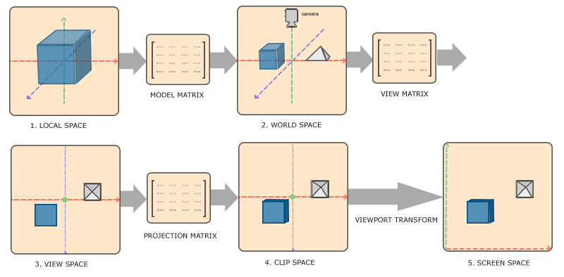

下面兩個 H4 會分別展開輸入資料與逐頂點的運算

#### vertex / index data：決定要處理哪些頂點

Application 提交 draw call 前，會先準備幾何資源與解讀規則。 圖形 API 整理這些狀態後，圖形管線會取得兩類輸入：

1. 頂點緩衝區及其欄位格式：用來找出每個頂點的位置、色彩與 UV
   - 頂點緩衝區：保存的是一串原始位元組
   - 欄位格式：是一組解讀規則。 它會描述 position、color 與 UV 各有幾個分量、每個分量使用什麼資料型態、是否需要正規化、欄位在一筆頂點記錄中的 byte offset，以及相鄰兩筆記錄之間的 stride
2. 索引緩衝區及 draw call 參數：用來決定這次要取用哪些頂點，以及如何將它們組成圖元
   - 索引緩衝區：保存的是一串頂點編號。 圖形管線會依序讀取這些編號，再到頂點緩衝區取得對應的頂點資料，因此同一筆頂點資料可以被多個圖元重複使用
   - draw call 的參數：會指定圖元輸入模式、索引數量、每個索引的資料型態，以及從索引緩衝區哪一個 byte offset 開始讀取。 圖形管線會依照這些參數解讀索引，並將取出的頂點組成點、線段或三角形

先看第一類輸入。 一筆頂點記錄代表的是「其中一個頂點所對應到的一筆資料」，具體排列可能會像這樣：

```cpp
struct ExampleVertex {
    float position[3]; // 3 × 4 bytes
    float color[4];    // 4 × 4 bytes
    float uv[2];       // 2 × 4 bytes
};
```

`ExampleVertex` 以 `position`、`color` 與 `uv` 分別保存位置、RGBA 色彩與紋理座標。 圖形 API 還需要替每個欄位描述 shader input location、分量數、資料型態、正規化方式、stride 與 byte offset 的資訊，圖形管線才能把原始位元組還原成正確的數值

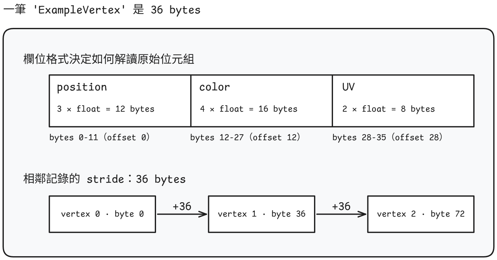

這張圖強調欄位格式是讀取原始位元組時的解讀規則。 以上例來說，三個欄位可整理成：

- `position`：位於 location 0，包含 3 個 float32 分量，byte offset 為 0
- `color`：位於 location 1，包含 4 個 float32 分量，byte offset 為 12
- `uv`：位於 location 2，包含 2 個 float32 分量，byte offset 為 28

三個欄位共用了 36-byte 的 stride，表示相鄰兩筆頂點記錄的起點相隔 36 bytes

OpenGL 可以用 `glVertexAttribPointer()` 提供這些規則，其他圖形 API 也會提供等價的頂點輸入描述。 這些欄位設定會把頂點緩衝區中的原始位元組對應到位置、顏色與 UV。 因此若要讀取第 i 筆頂點，可以先算：

$$
\mathrm{vertex\_address}(i)
=\mathrm{buffer\_base}+i\times36
$$

再加上各欄位的 offset 來讀取對應的資料：

$$
\begin{aligned}
\mathrm{position\_address}(i)&=\mathrm{vertex\_address}(i)+0,\\
\mathrm{color\_address}(i)&=\mathrm{vertex\_address}(i)+12,\\
\mathrm{uv\_address}(i)&=\mathrm{vertex\_address}(i)+28.
\end{aligned}
$$

到這裡我們已經說明了該如何解讀第一類輸入中的頂點資料，接著來看第二類輸入會如何決定這次要取用哪些資料。 假設索引緩衝區保存以下六個 `uint32_t` 頂點編號：

```cpp
const uint32_t indices[] = {0, 1, 2, 2, 1, 3};
```

Application 可以使用下列 draw call 來提交這六個索引：

```cpp
glDrawElements(GL_TRIANGLES, index_count,
               GL_UNSIGNED_INT, nullptr);
```

四個參數用來補齊解讀索引所需的資訊：

- `GL_TRIANGLES`：指定三角形輸入模式，圖元組合階段會將每三個索引所對應的頂點組成一個三角形
- `index_count`：指定要讀取多少個索引，在這個例子中是 `6`
- `GL_UNSIGNED_INT`：指定每個索引是 32-bit 無號整數，與索引緩衝區中的 `uint32_t` 相符
- `nullptr`：表示從目前索引緩衝區的 byte offset 0 開始讀取

圖形管線因此會按照 `vertex 0 → 1 → 2 → 2 → 1 → 3` 的順序取得頂點記錄，圖元組合階段再將它們組成兩個三角形：

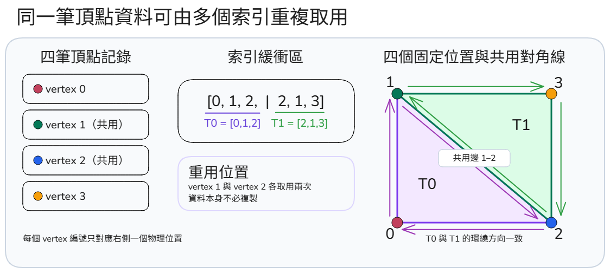

上例的頂點 1 與頂點 2 同時屬於兩個三角形。 索引緩衝區只會保存頂點編號，不會複製整筆頂點資料。 因此它只需要再次引用相同編號，就能重複使用既有的頂點記錄了。 接下來的共用範例會將相同的讀取規則套用到一個三角形

##### 共用範例：頂點與索引指出原始三角形

我們的共用範例會從三筆 `ExampleVertex` 的記錄開始。 頂點 $A$、$B$ 與 $C$ 分別帶有 object-space 位置、RGBA 色彩與 UV：

```cpp
const ExampleVertex vertices[] = {
    {{-1.0f, -1.0f,  0.0f}, {1.0f, 0.0f, 0.0f, 1.0f}, {0.0f, 0.0f}}, // A
    {{ 3.0f, -1.0f,  0.0f}, {0.0f, 1.0f, 0.0f, 1.0f}, {1.0f, 0.0f}}, // B
    {{ 0.0f,  3.0f, -1.0f}, {0.0f, 0.0f, 1.0f, 1.0f}, {0.0f, 1.0f}}, // C
};

const uint32_t indices[] = {0, 1, 2};
glDrawElements(GL_TRIANGLES, 3, GL_UNSIGNED_INT, nullptr);
```

`GL_TRIANGLES` 與索引序列 `[0, 1, 2]` 表示這筆 draw call 只會建立一個三角形。 輸入階段會先依索引取回 $A$、$B$、$C$ 三筆記錄，再依欄位格式把每筆記錄拆成 position、color 與 UV。 此時位置仍在 object-space 中：

$$
\begin{aligned}
\mathbf{p}_{A,\mathrm{object}} &= (-1,-1,0,1), \\
\mathbf{p}_{B,\mathrm{object}} &= ( 3,-1,0,1), \\
\mathbf{p}_{C,\mathrm{object}} &= ( 0, 3,-1,1).
\end{aligned}
$$

`ExampleVertex` 的 `position` 原本只有 $x$、$y$、$z$。 進入 vertex processing 後，頂點著色器會再補上第四個分量 $1$，形成可參與矩陣運算的齊次座標。 因此，頂點／索引輸入階段會依 $A \to B \to C$ 的順序輸出三筆頂點資料。 每筆資料包含 object-space 位置、RGBA 色彩與 UV。 這批資料會成為下一個 vertex processing 階段的輸入，由頂點著色器逐筆讀取

#### vertex processing：執行 vertex shader，產生 clip-space 頂點

上一個管線階段我們已經依索引順序取回了頂點 $A$、$B$ 與 $C$。 每筆資料都包含 object-space 位置、RGBA 色彩與 UV，但這些位置現在還都是以模型各自的原點與座標軸為基準，所以我們沒辦法直接用這些座標來判斷它們會出現在相機畫面的哪裡

如一開始所述，整個 rendering pipeline 的目標是將 3D 模型轉成 2D 影像。 過程中頂點處理階段會先將每筆頂點的位置轉成 clip-space 座標，後續的圖元處理再執行裁切、透視除法與視埠轉換。 本節我們先專注在第一段，並說清楚頂點處理與頂點著色器分別代表什麼

##### vertex processing 是管線階段，vertex shader 是其中執行的程式

在本文的管線劃分中，頂點處理（vertex processing）是一個邏輯階段，主要工作是針對每個被取用的頂點執行一次使用者提供的頂點著色器（vertex shader）

圖形管線實作會在頂點處理階段，依目前綁定的頂點資料與 program state，準備頂點著色器所需的輸入、啟動每次頂點著色器執行，並接收它產生的 `gl_Position`、色彩與 UV 等資料。 而頂點著色器內部會去描述單一頂點要如何使用這些輸入來計算輸出

頂點著色器在執行時會讀取兩種輸入資料：

- 頂點屬性：輸入階段會依 vertex buffer、頂點欄位格式與索引，找出目前頂點記錄內的 position、RGBA 與 UV，再依 input location 將這些數值送到頂點著色器對應的輸入變數
  - 註：不同頂點通常會取得不同的屬性值
- uniform 參數：由 Application 負責設定這些值，OpenGL 會將它們保存在提交 draw call 時由 `glUseProgram()` 綁定的 OpenGL program object 中
  - 在同一筆 draw call 中，頂點著色器每次執行時都會讀取相同的 uniform 值，例如 model、view 與 projection matrices

GLSL 預先定義了名為 `gl_Position` 的 `vec4` 輸出變數。 頂點著色器會將目前頂點的 homogeneous clip-space 位置 $(x_c,y_c,z_c,w_c)$ 寫入這個變數，供後續管線執行圖元組合、裁切與透視除法。 它也能產生色彩、UV 與法線等使用者自訂資料，讓後續管線將它們帶到片段著色器

例如，下列頂點著色器會將輸入位置乘上 MVP matrix，再把得到的 clip-space 位置寫入 `gl_Position`：

```glsl
layout(location = 0) in vec3 in_position;
uniform mat4 mvp;

void main()
{
    gl_Position = mvp * vec4(in_position, 1.0);
}
```

其中 `in_position` 與 `mvp` 都是使用者撰寫 shader 時自行定義的變數：

- `in_position` 的值來自 vertex buffer 中的 position 欄位，Application 會透過 `glVertexAttribPointer()` 將這個欄位接到頂點著色器的 input location
- `mvp` 的值則是 Application 計算好的 MVP matrix，並透過 `glUniformMatrix4fv()` 傳入頂點著色器

下面是一個簡單的 Application 端範例，示範如何將這兩類資料傳入頂點著色器。 這裡沿用了前一個 H4 的 `ExampleVertex` 與 vertex buffer，只保留和 `in_position`、`mvp` 直接相關的呼叫：

```cpp
glBindBuffer(GL_ARRAY_BUFFER, vertex_buffer);
glVertexAttribPointer(
    0, 3, GL_FLOAT, GL_FALSE,
    sizeof(ExampleVertex),
    reinterpret_cast<void *>(
        offsetof(ExampleVertex, position)));
glEnableVertexAttribArray(0);

const glm::mat4 mvp = projection * view * model;

glUseProgram(program);
const GLint mvp_location =
    glGetUniformLocation(program, "mvp");
glUniformMatrix4fv(mvp_location, 1, GL_FALSE,
                   glm::value_ptr(mvp));
```

可以看到，`glVertexAttribPointer()` 會利用 location 0，將 `ExampleVertex::position` 對應到 shader 的 `in_position`

Application 接著會將 model、view 與 projection matrices 相乘，算出 `mvp`，再以 `glGetUniformLocation()` 找到同名的 uniform，並透過 `glUniformMatrix4fv()` 傳入矩陣內容

頂點著色器執行後，會將 `mvp` 與 `in_position` 相乘，再把得到的四個分量寫入 `gl_Position`

MVP transformation 是產生 `gl_Position` 的常見方式。 OpenGL 的 API 契約只有要求最後一個啟用的頂點處理著色器要交出合法的 clip-space 位置，不會自動替 Application 建立或套用 model、view 與 projection matrices

本文範例採用了常見的做法。 Application 會先建立 model、view 與 projection matrices，將三者相乘成一個 MVP matrix，再以 uniform 傳入頂點著色器。 頂點著色器接著會使用這個矩陣轉換輸入位置

另一種做法是由 Application 將三個矩陣分別傳入頂點著色器，再由頂點著色器按照 projection、view 與 model 的順序完成矩陣乘法：

```glsl
uniform mat4 model;
uniform mat4 view;
uniform mat4 projection;

void main()
{
    gl_Position = projection * view * model
                * vec4(in_position, 1.0);
}
```

這兩種做法的差別，在於三個矩陣是在 Application 端先合併，還是在頂點著色器中保持分開。 它們最後都會產生 homogeneous clip-space 位置，並寫入 `gl_Position`

最後，完整的 OpenGL 管線還能另外再啟用曲面細分著色器（tessellation shader）與幾何著色器（geometry shader）。 前者能把由多個控制點描述的曲面區塊切成較小圖元； 後者則能以整個輸入圖元為單位來產生、修改或捨棄圖元。 但這些暫時不在本文的討論範圍內

##### 從 object-space 走到 clip-space

MVP transformation 會讓同一個頂點依序經過四個座標空間：

- object-space：以模型自身的原點與座標軸為基準，用來描述頂點位於模型內的哪個位置
- world-space：讓所有模型與其他物件共用同一套座標基準，因此可以表示彼此的相對位置
- view-space：以相機的位置與朝向為基準，表示頂點位於相機的哪個方向，以及離相機多遠
- clip-space：保存 projection transformation 產生的四維齊次位置 $(x_c,y_c,z_c,w_c)$，供後續 clipping 與 perspective divide 使用

前面我們已經說明了如何把 3D 點寫成四維齊次座標，以及如何組合 $4\times4$ matrices。 現在我們要將同一套數學放進管線，來描述 MVP Transformation，整個轉換可以寫成三個階段：

$$
\mathbf{p}_{\mathrm{object}}
\xrightarrow{M_{\mathrm{model}}}
\mathbf{p}_{\mathrm{world}}
\xrightarrow{M_{\mathrm{view}}}
\mathbf{p}_{\mathrm{view}}
\xrightarrow{M_{\mathrm{projection}}}
\mathbf{p}_{\mathrm{clip}}
$$

下圖將這四個空間與後續的 NDC、screen-space 座標一起放了進來。 本節的頂點著色器只負責了圖中的前四個座標空間，輸出會停在 clip-space

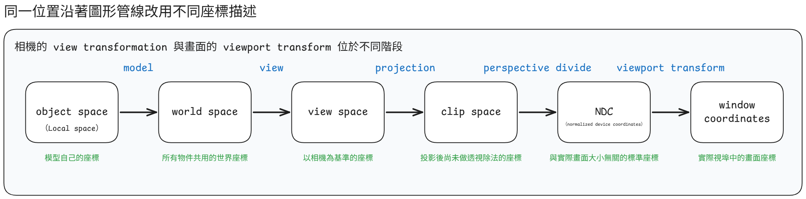

圖中的後兩個座標空間要等後續管線階段才會產生：

- NDC：perspective divide 會將 clip-space 的 $x_c$、$y_c$ 與 $z_c$ 分別除以 $w_c$，把可見範圍轉成與實際畫面大小無關的標準座標
  - 在 OpenGL 的 NDC 中，位於可見範圍內的 $x_{\mathrm{ndc}}$、$y_{\mathrm{ndc}}$ 與 $z_{\mathrm{ndc}}$ 都會處於 $[-1, 1]$ 之間
- screen-space 座標：viewport transform 會將 NDC 映射到指定視埠，產生以畫面位置表示的 $x$、$y$，以及供深度測試使用的 screen-space 深度 $z$

因此，頂點處理的位置輸出是 $\mathbf{p}_{\mathrm{clip}}$，不是 NDC 或 pixel 座標。 RGBA 與 UV 仍與各自的頂點相連，一起交給下一個圖元處理階段

##### model transformation：決定模型在世界中的大小、朝向與位置

模型檔案通常是以自己的原點與座標軸來保存頂點資訊的，但一個 3D 世界內可能同時會放入桌子、機器手臂與多個物件。 若每個模型都停留在自己的 object-space，我們就無法用同一套座標來比較它們的位置了

因此整個轉換的第一步是 Model transformation，它用來算出模型在共同的 world-space 中有多大、朝向哪裡，以及放在哪裡

本文我們會讓 object-space 中的點依序經過縮放、旋轉與平移來作為例子。 首先我們先做縮放：

$$
\mathbf{p}_{\mathrm{scaled}}
=S_{\mathrm{model}}\mathbf{p}_{\mathrm{object}}.
$$

再繞模型原點旋轉：

$$
\mathbf{p}_{\mathrm{rotated}}
=R_{\mathrm{model}}\mathbf{p}_{\mathrm{scaled}}.
$$

最後平移到 world-space 中的指定位置：

$$
\mathbf{p}_{\mathrm{world}}
=T_{\mathrm{model}}\mathbf{p}_{\mathrm{rotated}}.
$$

將前兩式逐步代入最後一式，就能得到：

$$
\begin{aligned}
\mathbf{p}_{\mathrm{world}}
&=T_{\mathrm{model}}
  R_{\mathrm{model}}
  S_{\mathrm{model}}
  \mathbf{p}_{\mathrm{object}} \\
&=M_{\mathrm{model}}\mathbf{p}_{\mathrm{object}}\end{aligned}
$$

因此我們可得：

$$
M_{\mathrm{model}}
=T_{\mathrm{model}}
 R_{\mathrm{model}}
 S_{\mathrm{model}}.
$$

前面我們已經講過三維縮放、旋轉與平移矩陣的形式了。 將其代入後，合併後的 model matrix 會有下列形式：

$$
M_{\mathrm{model}}
=
\begin{bmatrix}
m_{00} & m_{01} & m_{02} & t_x \\
m_{10} & m_{11} & m_{12} & t_y \\
m_{20} & m_{21} & m_{22} & t_z \\
0      & 0      & 0      & 1
\end{bmatrix}
$$

左上角的 $3\times3$ 區域是縮放與旋轉合成後的線性轉換，最右行的 $(t_x,t_y,t_z)$ 則是模型在 world-space 中的位移

下圖以同一個三角形顯示了三個操作的分工：縮放改變它相對於模型原點的大小，旋轉改變朝向，平移最後決定它位於 world-space 的哪裡

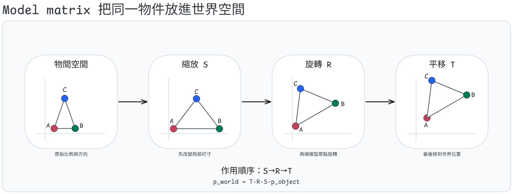

由於本文將行向量放在最右邊，矩陣會由右往左作用。 因此圖中的 $T_{\mathrm{model}}R_{\mathrm{model}}S_{\mathrm{model}}$ 代表著先縮放、再旋轉，最後做平移

下列 GLM 程式會先用不改變輸入座標的單位矩陣（identity matrix）來初始化 `matrix`，再逐次把平移、繞 x／y／z 軸旋轉與縮放矩陣等操作接到右側。 因此，`matrix` 的內容會按照下列順序累積：

$$
I
\longrightarrow T
\longrightarrow T R_x
\longrightarrow T R_x R_y
\longrightarrow T R_x R_y R_z
\longrightarrow T R_x R_y R_z S.
$$

因此函式最後傳回的 model matrix 為 $M_{\mathrm{model}}=T R_x R_y R_z S$。 當它真正作用在右側的 object-space 頂點時，最靠近頂點的矩陣會最先作用上去：

$$
\mathbf{p}_{\mathrm{world}}
=T R_x R_y R_z S\mathbf{p}_{\mathrm{object}}.
$$

換句話說，雖然程式碼組合矩陣的順序是平移、$R_x$、$R_y$、$R_z$ 與縮放，但頂點實際經歷的順序是縮放、$R_z$、$R_y$、$R_x$ 再平移

下面的程式碼用來展示上述矩陣組合順序。 它會讀取模型的 `position`、`rotationDeg` 與 `scale`，從單位矩陣開始依序組合 $T R_x R_y R_z S$，再回傳後續頂點處理時要使用的 model matrix：

```cpp
glm::mat4 GameObject::calculateTransformMatrix_() const
{
    glm::mat4 matrix{1.0f};

    matrix = glm::translate(matrix, position);
    matrix = glm::rotate(matrix, glm::radians(rotationDeg.x),
                         glm::vec3(1, 0, 0));
    matrix = glm::rotate(matrix, glm::radians(rotationDeg.y),
                         glm::vec3(0, 1, 0));
    matrix = glm::rotate(matrix, glm::radians(rotationDeg.z),
                         glm::vec3(0, 0, 1));
    matrix = glm::scale(matrix, scale);

    return matrix;
}
```

##### view transformation：建立以相機為基準的座標系統

前面 Model transformation 已經幫我們把所有的物件都放進了共同的 world-space，而下一個階段我們想知道的是「從目前相機看出去，每個頂點位於哪個方向與距離」。 因此該階段做的 View transformation 會把 world-space 的位置改寫成 view-space 中的位置

建立這項轉換需要知道相機的位置與朝向。 Application 中負責管理相機的程式碼可能直接保存方向向量，也可能保存相機的注視目標或旋轉資訊。 無論採用哪一種表示方式，在建立 View matrix 前都需要取得本文使用的三項資料：

- 相機位置向量 $\mathbf{p}_{\mathrm{camera}}$：指出相機位於 world-space 中的哪裡
- gaze direction $\hat{\mathbf{g}}$：是相機向前看的單位向量
- up direction $\hat{\mathbf{u}}$：是相機朝上的單位向量，並與 gaze direction 垂直。 兩者會一起描述相機的朝向，並決定畫面如何傾斜

由於只要相機與物體的相對位置相同，最後看到的結果就會相同，因此 View transformation 不必真的在數學中搬動相機，它可以固定相機，再把整個世界朝相反方向移動與旋轉。 本文採用 $+X\times+Y=+Z$ 的右手座標慣例來把相機放到原點，使它看向 $-Z$，並以 $+Y$ 作為上方

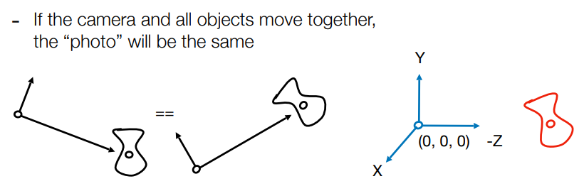

上圖左側展示了兩種等價的配置。 雖然相機與物體在 world-space 中的位置不同，但兩者的相對位置與方向保持不變，因此從相機看見的畫面也會相同。 而 View transformation 會利用這項關係，把 world-space 的頂點轉換到右側所示的 standard view-space，使相機位於原點、看向 $-Z$，並將上方與 $+Y$ 對齊

要做到這件事，我們需要算出能將相機移到原點並對齊指定方向的平移與旋轉操作，並將它們組合成 View matrix，再用這個矩陣轉換所有的 world-space 頂點，讓其進到 view-space

假設相機位於 $\mathbf{p}_{\mathrm{camera}}=(x_{\mathrm{camera}}, y_{\mathrm{camera}}, z_{\mathrm{camera}})$，我們首先需要將它移到原點，其所需的平移量為 $-\mathbf{p}_{\mathrm{camera}}$。 因此，我們會將每個 world-space 的頂點都減去 $\mathbf{p}_{\mathrm{camera}}$，這等同於將相機與所有頂點一起平移 $-\mathbf{p}_{\mathrm{camera}}$：

$$
T_{\mathrm{view}}
=
\begin{bmatrix}
1 & 0 & 0 & -x_{\mathrm{camera}} \\
0 & 1 & 0 & -y_{\mathrm{camera}} \\
0 & 0 & 1 & -z_{\mathrm{camera}} \\
0 & 0 & 0 & 1
\end{bmatrix}
$$

接著我們需要把相機原本的座標軸對齊到 standard view-space。 下圖左側的 $\mathbf{p}_{\mathrm{camera}}$ 表示相機在 world-space 中的位置，$\hat{\mathbf{r}}$、$\hat{\mathbf{u}}$ 與 $\hat{\mathbf{g}}$ 則分別表示相機的 right、up 與 gaze directions

因此 View transformation 具體來說會將 $\mathbf{p}_{\mathrm{camera}}$ 移到原點，並把這三個方向分別對齊 standard view-space 的 $+X$、$+Y$ 與 $-Z$ 軸

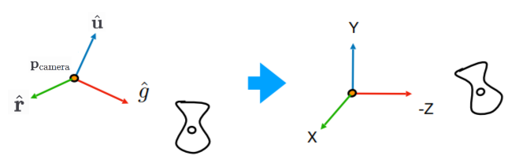

一開始 Application 會先從相機狀態取得或算出 gaze direction $\hat{\mathbf{g}}$ 與 up direction $\hat{\mathbf{u}}$，再以兩者的外積求得相機的 right direction $\hat{\mathbf{r}}$：

$$
\hat{\mathbf{r}}
= \operatorname{normalize}
  (\hat{\mathbf{g}} \times \hat{\mathbf{u}})
$$

在推導旋轉矩陣 $R_{\mathrm{view}}$ 時，我們可以先省略齊次座標的第四個分量，只看負責旋轉的 $3\times3$ 區域。 $\hat{\mathbf{r}}$、$\hat{\mathbf{u}}$ 與 $\hat{\mathbf{g}}$ 分別是相機的 right、up 與 gaze directions。 $R_{\mathrm{view}}$ 必須同時完成下列三項轉換：

$$
R_{\mathrm{view}}\hat{\mathbf{r}}
=
\begin{bmatrix}1\\0\\0\end{bmatrix},
\quad
R_{\mathrm{view}}\hat{\mathbf{u}}
=
\begin{bmatrix}0\\1\\0\end{bmatrix},
\quad
R_{\mathrm{view}}\hat{\mathbf{g}}
=
\begin{bmatrix}0\\0\\-1\end{bmatrix}
$$

接下來我們希望用一個矩陣等式同時表示上方的三項轉換，達到乘上 $R_{\mathrm{view}}$ 就能將相機的 right direction、up direction 與 gaze direction，分別轉成 standard view-space 的 $+X$、$+Y$ 與 $-Z$ 軸的目的

為了讓合併後的矩陣等式更容易求解，我們會先讓第三個輸出也對應 standard view-space 的正向座標軸。 由於 standard view-space 的相機朝向 $-Z$，因此相機的 $+Z$ 方向會指向 gaze direction 的反方向 $-\hat{\mathbf{g}}$。 如此一來，同一組轉換關係便可以改寫成：

$$
R_{\mathrm{view}}\hat{\mathbf{r}}
=
\begin{bmatrix}1\\0\\0\end{bmatrix},
\quad
R_{\mathrm{view}}\hat{\mathbf{u}}
=
\begin{bmatrix}0\\1\\0\end{bmatrix},
\quad
R_{\mathrm{view}}(-\hat{\mathbf{g}})
=
\begin{bmatrix}0\\0\\1\end{bmatrix}
$$

接著，為了將這三個等式合併成一個矩陣等式，我們可以先將三個輸入方向 $\hat{\mathbf{r}}$、$\hat{\mathbf{u}}$ 與 $-\hat{\mathbf{g}}$ 作為三個直行來組成輔助矩陣 $B_{\mathrm{camera}}$：

$$
B_{\mathrm{camera}}
=
\begin{bmatrix}
r_x & u_x & -g_x \\
r_y & u_y & -g_y \\
r_z & u_z & -g_z
\end{bmatrix}
$$

當 $R_{\mathrm{view}}$ 從左側乘上 $B_{\mathrm{camera}}$ 時，矩陣乘法會分別轉換它的三個直行。 乘積的三個直行依序是 $R_{\mathrm{view}}\hat{\mathbf{r}}$、$R_{\mathrm{view}}\hat{\mathbf{u}}$ 與 $R_{\mathrm{view}}(-\hat{\mathbf{g}})$，也就是 $+X$、$+Y$ 與 $+Z$ 軸。 將這三個標準座標軸排成矩陣後，便會得到 $3\times3$ 單位矩陣 $I_3$：

$$
R_{\mathrm{view}}B_{\mathrm{camera}}
=
\begin{bmatrix}
1 & 0 & 0 \\
0 & 1 & 0 \\
0 & 0 & 1
\end{bmatrix}
=I_3
$$

同時由於它是單位矩陣，所以我們可以知道：

1. 這同時也是將 $+X$、$+Y$ 與 $+Z$ 三個標準座標軸排成直行後自然得到的結果
2. $R_{\mathrm{view}}$ 是 $B_{\mathrm{camera}}$ 的逆矩陣：
  $$
  R_{\mathrm{view}}
  =B_{\mathrm{camera}}^{-1}
  $$

接著我們需要實際寫出 $R_{\mathrm{view}}$ 的矩陣內容。 在開始推導前，我們先用一個具體的 $3\times3$ 矩陣，看它的三個直行分別代表什麼。 當這個矩陣乘上 $+X$ 的標準軸向量時：

$$
\begin{bmatrix}
a_{11} & a_{12} & a_{13} \\
a_{21} & a_{22} & a_{23} \\
a_{31} & a_{32} & a_{33}
\end{bmatrix}
\begin{bmatrix}1\\0\\0\end{bmatrix}
=
\begin{bmatrix}a_{11}\\a_{21}\\a_{31}\end{bmatrix}
$$

運算結果 $[a_{11},a_{21},a_{31}]^{\mathrm{T}}$ 正好是原矩陣的第一個直行。 同理，乘上 $+Y$ 與 $+Z$ 的標準軸向量時，會分別取出第二個與第三個直行：

$$
\begin{bmatrix}
a_{11} & a_{12} & a_{13} \\
a_{21} & a_{22} & a_{23} \\
a_{31} & a_{32} & a_{33}
\end{bmatrix}
\begin{bmatrix}0\\1\\0\end{bmatrix}
=
\begin{bmatrix}a_{12}\\a_{22}\\a_{32}\end{bmatrix},
\quad
\begin{bmatrix}
a_{11} & a_{12} & a_{13} \\
a_{21} & a_{22} & a_{23} \\
a_{31} & a_{32} & a_{33}
\end{bmatrix}
\begin{bmatrix}0\\0\\1\end{bmatrix}
=
\begin{bmatrix}a_{13}\\a_{23}\\a_{33}\end{bmatrix}
$$

這三個結果顯示，矩陣的第一、第二與第三個直行，分別是 $+X$、$+Y$ 與 $+Z$ 三個標準軸向量經過矩陣後的輸出。 若要將一個方向向量直接填入矩陣的第 $i$ 個直行，這個方向就必須是第 $i$ 個標準軸向量經過矩陣轉換後的輸出

接著我們來看 $R_{\mathrm{view}}$ 的內容。 在接下來的推導中，我們會把 View transformation 實際需要的轉換稱為正方向，它會將 world-space 中的相機座標軸轉成 standard view-space 的標準座標軸。 相反地，從 standard view-space 的標準座標軸轉回 world-space 中的相機座標軸，則稱為反方向。 因此這裡的正、反描述的是座標轉換的流程，並非指順時針或逆時針旋轉

把前面說明的直行規則套回 $R_{\mathrm{view}}$，正方向的旋轉需要滿足三個條件：

$$
R_{\mathrm{view}}\hat{\mathbf{r}}
=\begin{bmatrix}1\\0\\0\end{bmatrix},
\quad
R_{\mathrm{view}}\hat{\mathbf{u}}
=\begin{bmatrix}0\\1\\0\end{bmatrix},
\quad
R_{\mathrm{view}}(-\hat{\mathbf{g}})
=\begin{bmatrix}0\\0\\1\end{bmatrix}
$$

也就是說，$\hat{\mathbf{r}}$、$\hat{\mathbf{u}}$ 與 $-\hat{\mathbf{g}}$ 是送入 $R_{\mathrm{view}}$ 的三個輸入，而三個標準軸向量則是轉換後的輸出。 若暫時以 $v_{ij}$ 表示 $R_{\mathrm{view}}$ 中尚未求出的元素，這三個條件可以合併寫成：

$$
\underbrace{
\begin{bmatrix}
v_{11} & v_{12} & v_{13} \\
v_{21} & v_{22} & v_{23} \\
v_{31} & v_{32} & v_{33}
\end{bmatrix}
}_{R_{\mathrm{view}}}
\underbrace{
\begin{bmatrix}
r_x & u_x & -g_x \\
r_y & u_y & -g_y \\
r_z & u_z & -g_z
\end{bmatrix}
}_{B_{\mathrm{camera}}}
=
\begin{bmatrix}
1 & 0 & 0 \\
0 & 1 & 0 \\
0 & 0 & 1
\end{bmatrix}
$$

若要由這個等式求出左側第一個矩陣的九個元素，就需要在等式兩側從右邊乘上 $B_{\mathrm{camera}}^{-1}$：

$$
R_{\mathrm{view}}
B_{\mathrm{camera}}
B_{\mathrm{camera}}^{-1}
=
I_3 B_{\mathrm{camera}}^{-1}
$$

由於 $B_{\mathrm{camera}}B_{\mathrm{camera}}^{-1}=I_3$，因此可得：

$$
R_{\mathrm{view}}
=B_{\mathrm{camera}}^{-1}
$$

如果直接將三個已知方向填入 $R_{\mathrm{view}}$ 的三個直行，寫出的矩陣會是 $B_{\mathrm{camera}}$，而非 $R_{\mathrm{view}}$。 根據前面說明的直行規則，$B_{\mathrm{camera}}$ 執行的是下列轉換：

$$
B_{\mathrm{camera}}
\begin{bmatrix}1\\0\\0\end{bmatrix}
=\hat{\mathbf{r}},
\quad
B_{\mathrm{camera}}
\begin{bmatrix}0\\1\\0\end{bmatrix}
=\hat{\mathbf{u}},
\quad
B_{\mathrm{camera}}
\begin{bmatrix}0\\0\\1\end{bmatrix}
=-\hat{\mathbf{g}}
$$

而這剛好是從三個標準軸方向來轉回三個相機方向的操作，恰好與 $R_{\mathrm{view}}$ 的正方向相反。 因此，雖然我們無法直接將已知的相機方向填入 $R_{\mathrm{view}}$，卻可以用它們來直接建立 $R_{\mathrm{view}}^{-1}$。 所以通常在推導這個矩陣內容時，我們會改從反方向的 $R_{\mathrm{view}}^{-1}$ 開始

接下來我們要把這個反方向的旋轉寫成作用於齊次座標的 $4\times4$ 矩陣。 前面的推導暫時省略了齊次座標的第四個分量，因此只得到下列 $3\times3$ 區域：

$$
B_{\mathrm{camera}}
=
\begin{bmatrix}
r_x & u_x & -g_x \\
r_y & u_y & -g_y \\
r_z & u_z & -g_z
\end{bmatrix}
$$

在齊次座標中，方向向量的第四個分量是 $0$。 因此，standard view-space 的三個標準軸方向及其經過 $R_{\mathrm{view}}^{-1}$ 旋轉後的結果，可以完整寫成：

$$
R_{\mathrm{view}}^{-1}
\begin{bmatrix}1\\0\\0\\0\end{bmatrix}
=
\begin{bmatrix}r_x\\r_y\\r_z\\0\end{bmatrix},
\quad
R_{\mathrm{view}}^{-1}
\begin{bmatrix}0\\1\\0\\0\end{bmatrix}
=
\begin{bmatrix}u_x\\u_y\\u_z\\0\end{bmatrix},
\quad
R_{\mathrm{view}}^{-1}
\begin{bmatrix}0\\0\\1\\0\end{bmatrix}
=
\begin{bmatrix}-g_x\\-g_y\\-g_z\\0\end{bmatrix}
$$

這個矩陣只負責旋轉，不會平移原點，因此還需要滿足：

$$
R_{\mathrm{view}}^{-1}
\begin{bmatrix}0\\0\\0\\1\end{bmatrix}
=
\begin{bmatrix}0\\0\\0\\1\end{bmatrix}
$$

上面四個輸入都只有一個分量是 $1$，其餘分量是 $0$。 矩陣乘上它們時，會分別取出第一、第二、第三與第四個直行。 因此，將等號右側的四個輸出依序排成直行，就能得到完整的 $R_{\mathrm{view}}^{-1}$：

$$
R_{\mathrm{view}}^{-1}
=
\left[
\begin{array}{c|c|c|c}
r_x & u_x & -g_x & 0 \\
r_y & u_y & -g_y & 0 \\
r_z & u_z & -g_z & 0 \\
0   & 0   & 0    & 1
\end{array}
\right]
=
\begin{bmatrix}
r_x & u_x & -g_x & 0 \\
r_y & u_y & -g_y & 0 \\
r_z & u_z & -g_z & 0 \\
0   & 0   & 0    & 1
\end{bmatrix}
$$

$R_{\mathrm{view}}^{-1}$ 是從 view-space 轉到 world-space 的旋轉矩陣，但 View transformation 需要的是從 world-space 轉到 view-space 的 $R_{\mathrm{view}}$，因此我們還要將這項旋轉反轉回來

其中由於 $\hat{\mathbf{r}}$、$\hat{\mathbf{u}}$ 與 $-\hat{\mathbf{g}}$ 都是長度為 $1$ 且彼此垂直的方向，因此 $R_{\mathrm{view}}^{-1}$ 是正交矩陣。 正交矩陣的逆矩陣等於轉置矩陣，所以只要交換矩陣的直行與橫列，就能得到 $R_{\mathrm{view}}$：

$$
R_{\mathrm{view}}
= \left(R_{\mathrm{view}}^{-1}\right)^{-1}
= \left(R_{\mathrm{view}}^{-1}\right)^{\mathrm{T}}
=
\begin{bmatrix}
r_x  & r_y  & r_z  & 0 \\
u_x  & u_y  & u_z  & 0 \\
-g_x & -g_y & -g_z & 0 \\
0    & 0    & 0    & 1
\end{bmatrix}
$$

最後，我們要把前面的平移與旋轉合併成 View matrix。 本文使用直行向量，因此最靠近頂點的 $T_{\mathrm{view}}$ 會先作用，把所有 world-space 頂點平移 $-\mathbf{p}_{\mathrm{camera}}$。 接著 $R_{\mathrm{view}}$ 會把平移後的座標軸旋轉到 standard view-space 的方向。 所以兩個矩陣的組合順序是：

$$
\begin{aligned}
M_{\mathrm{view}}
&=R_{\mathrm{view}}T_{\mathrm{view}} \\
&=
\begin{bmatrix}
r_x  & r_y  & r_z  & 0 \\
u_x  & u_y  & u_z  & 0 \\
-g_x & -g_y & -g_z & 0 \\
0    & 0    & 0    & 1
\end{bmatrix}
\begin{bmatrix}
1 & 0 & 0 & -x_{\mathrm{camera}} \\
0 & 1 & 0 & -y_{\mathrm{camera}} \\
0 & 0 & 1 & -z_{\mathrm{camera}} \\
0 & 0 & 0 & 1
\end{bmatrix}
\end{aligned}
$$

因此完整的 View matrix 為：

$$
M_{\mathrm{view}}
=
\begin{bmatrix}
r_x  & r_y  & r_z  & -\hat{\mathbf{r}} \cdot \mathbf{p}_{\mathrm{camera}} \\
u_x  & u_y  & u_z  & -\hat{\mathbf{u}} \cdot \mathbf{p}_{\mathrm{camera}} \\
-g_x & -g_y & -g_z &  \hat{\mathbf{g}} \cdot \mathbf{p}_{\mathrm{camera}} \\
0    & 0    & 0    & 1
\end{bmatrix}
$$

前三列分別算出了世界位置沿相機右方、上方與後方座標軸的分量，最右行則抵消了相機在 world-space 中的位置。 套用後便可以得到 view-space 中的位置了：

$$
\mathbf{p}_{\mathrm{view}}
= M_{\mathrm{view}}\mathbf{p}_{\mathrm{world}}
$$

程式也常會預先計算好 $M_{\mathrm{view}}M_{\mathrm{model}}$，並把組合結果稱為 model-view matrix，用來指這兩個矩陣的乘積

##### projection transformation：準備可以裁切與投影的齊次位置

前面 View transformation 的過程我們已經把所有的頂點位置改寫成了以相機為基準的 view-space 座標，而下一個階段我們想要做的事是「將相機可以看見的 3D 範圍投影到 2D 畫面，同時保留各頂點的前後深度」。 這會由 Projection transformation 負責

Projection transformation 會把 view-space 的位置轉換成四維的 clip-space 位置，讓後續管線能利用這四個分量先執行 clipping，再透過 perspective divide 得到投影後的座標

投影方式取決於我們希望距離要如何影響畫面中物體的大小。 下圖比較了正交投影與透視投影對相同立方體產生的視覺結果

）](./assets/perspective-vs-orthographic-projection.png)

- 正交投影（orthographic projection）：投影射線互相平行，物體大小不隨距離改變，原本平行的線在投影後仍會保持平行
- 透視投影（perspective projection）：投影射線從相機位置向外展開，較近的物體看起來較大，延伸到遠方的平行線也可能在影像上逐漸靠攏

兩種方式都會保留深度，也都會輸出供後續裁切時使用的 $\mathbf{p}_{\mathrm{clip}}$

現在讓我們先從正交投影開始。 當我們不希望物體投影後的大小隨距離改變時，會使用正交投影。 這項轉換會接收 view-space 的位置，並把相機能看見的長方體範圍映射到 OpenGL 的標準裁切立方體內：

$$
\mathbf{p}_{\mathrm{view}}
=(x_v,y_v,z_v,1)
\xrightarrow{M_{\mathrm{ortho}}}
\mathbf{p}_{\mathrm{clip}}
=(x_c,y_c,z_c,1)
$$

前面的 View transformation 已經將相機移至原點並看向 $-Z$ 了。 我們現在以 $l$、$r$ 表示長方體的左、右邊界，以 $b$、$t$ 表示下、上邊界，再以正數 $n$、$f$ 表示近平面與遠平面到相機的距離。 由於相機看向 $-Z$，近、遠平面在 view-space 中的 z 座標分別為 $-n$ 與 $-f$，其中 $0<n<f$

我們希望正交投影矩陣完成下列邊界映射：

$$
\begin{aligned}
x_v=l &\longrightarrow x_c=-1,
&\quad x_v=r &\longrightarrow x_c=1, \\
y_v=b &\longrightarrow y_c=-1,
&y_v=t &\longrightarrow y_c=1, \\
z_v=-n &\longrightarrow z_c=-1,
&z_v=-f &\longrightarrow z_c=1
\end{aligned}
$$

因此，只要輸入頂點位於原始長方體內，輸出的 $x_c$、$y_c$ 與 $z_c$ 就會落在 $[-1,1]$ 當中，其中 $x_c$ 與 $y_c$ 為後續投影到 2D 畫面時所需的位置資訊，$z_c$ 則保留近平面到遠平面之間的深度資訊

為了做出這項映射，我們會先將長方體中心平移到原點，再將三個邊的範圍縮放到 $[-1,1]$：

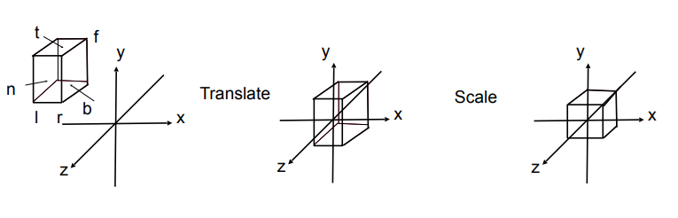

長方體的中心是：

$$
\left(
\frac{r+l}{2},
\frac{t+b}{2},
-\frac{n+f}{2}
\right)
$$

因此平移矩陣為：

$$
T_{\mathrm{ortho}}
=
\begin{bmatrix}
1 & 0 & 0 & -\frac{r+l}{2} \\
0 & 1 & 0 & -\frac{t+b}{2} \\
0 & 0 & 1 &  \frac{n+f}{2} \\
0 & 0 & 0 & 1
\end{bmatrix}
$$

平移後，長方體在 x、y 與 z 三個方向的長度分別是 $r-l$、$t-b$ 與 $f-n$。 目標立方體在每一軸的長度都是 $2$，所以縮放矩陣是：

$$
S_{\mathrm{ortho}}
=
\begin{bmatrix}
\frac{2}{r-l} & 0 & 0 & 0 \\
0 & \frac{2}{t-b} & 0 & 0 \\
0 & 0 & -\frac{2}{f-n} & 0 \\
0 & 0 & 0 & 1
\end{bmatrix}
$$

其中 z 軸需要另外反轉方向。 在 view-space 中，近平面與遠平面的 z 座標分別是 $-n$ 與 $-f$。 經過 $T_{\mathrm{ortho}}$ 平移後，兩者會變成：

$$
z_{\mathrm{near}}'
=-n+\frac{n+f}{2}
=\frac{f-n}{2},
\quad
z_{\mathrm{far}}'
=-f+\frac{n+f}{2}
=-\frac{f-n}{2}
$$

此時近平面的 z 是正值，遠平面的 z 則是負值。 為了將它們依序映射到 clip-space 的 $-1$ 與 $1$，z 軸的縮放係數必須帶有負號：

$$
z_{\mathrm{clip,near}}
=\frac{f-n}{2}
 \left(-\frac{2}{f-n}\right)
=-1
$$

$$
z_{\mathrm{clip,far}}
=-\frac{f-n}{2}
 \left(-\frac{2}{f-n}\right)
=1
$$

由於正交投影會讓 $w_c=1$，因此這兩個 clip-space 深度經過後續的 perspective divide 後不會改變，並會分別成為 $z_{\mathrm{ndc}}=-1$ 與 $z_{\mathrm{ndc}}=1$

將前面的平移與縮放合併後可得：

$$
\begin{aligned}
M_{\mathrm{ortho}}
&= S_{\mathrm{ortho}}T_{\mathrm{ortho}} \\
&=
\begin{bmatrix}
\frac{2}{r-l} & 0 & 0 & -\frac{r+l}{r-l} \\
0 & \frac{2}{t-b} & 0 & -\frac{t+b}{t-b} \\
0 & 0 & -\frac{2}{f-n} & -\frac{f+n}{f-n} \\
0 & 0 & 0 & 1
\end{bmatrix}.
\end{aligned}
$$

實際使用時，Application 會先決定正交相機要保留的 view-space 長方體，再將它的六個邊界傳給矩陣函式。 例如，下列程式碼將左右邊界設為 $l=-4$ 與 $r=4$，上下邊界設為 $b=-3$ 與 $t=3$，並將近平面、遠平面到相機的距離分別設為 $n=1$ 與 $f=9$：

```cpp
const glm::mat4 projection = glm::ortho(
    -4.0f, 4.0f,  // l, r
    -3.0f, 3.0f,  // b, t
     1.0f, 9.0f); // n, f
```

相機在 view-space 中看向 $-Z$，因此這組參數保留的範圍為：

$$
-4\le x_v\le4,
\quad
-3\le y_v\le3,
\quad
-9\le z_v\le-1
$$

將這些數值代入剛才推導的公式，可以得到：

$$
M_{\mathrm{ortho}}
=
\begin{bmatrix}
\frac{1}{4} & 0 & 0 & 0 \\
0 & \frac{1}{3} & 0 & 0 \\
0 & 0 & -\frac{1}{4} & -\frac{5}{4} \\
0 & 0 & 0 & 1
\end{bmatrix}
$$

因此像是近平面的右上角與遠平面的左下角會分別映射到標準裁切範圍的兩個角落：

$$
\begin{aligned}
(4,3,-1,1)&\longrightarrow(1,1,-1,1),\\
(-4,-3,-9,1)&\longrightarrow(-1,-1,1,1)
\end{aligned}
$$

現在讓我們接著來看透視投影。 當我們希望畫面呈現與真實相機相似的近大遠小效果時，會使用透視投影。 這項轉換會接收 view-space 的位置，並把相機能看見的 frustum 映射到 OpenGL 的標準裁切範圍內：

$$
\mathbf{p}_{\mathrm{view}}
=(x_v,y_v,z_v,1)
\xrightarrow{M_{\mathrm{perspective}}}
\mathbf{p}_{\mathrm{clip}}
=(x_c,y_c,z_c,w_c)
$$

與正交投影不同，透視投影會把頂點的 view-space 深度資訊編碼到 $w_c$ 中。 因此，透視投影的輸出會使用 $x_c$ 與 $y_c$ 表示橫向與縱向的投影資訊，使用 $z_c$ 保留前後深度，再以 $w_c$ 保存投影結果與 view-space 深度之間的關係。 這四個分量會共同構成目前頂點的 clip-space 位置

透視投影的可見範圍會從相機向外展開成 frustum，超出這個範圍的部分則會在下一個 clipping 階段處理。 為了建立投影矩陣，我們需要先用參數描述這個 frustum 的形狀，常見的表示方式有下列兩種

第一種是直接使用 $l$、$r$、$b$、$t$、$n$ 與 $f$ 的邊界形式。 由於 $n$ 與 $f$ 是近平面和遠平面到相機的距離（$0<n<f$），因此 frustum 的 view-space 深度範圍為：

$$
-f\le z_v\le -n
$$

$l$、$r$、$b$ 與 $t$ 則定義了近平面在 $z_v=-n$ 時的矩形範圍：

$$
l\le x_v\le r,
\quad
b\le y_v\le t
$$

frustum 的四個側面會從相機原點延伸並穿過這個矩形的四條邊。 因此，根據相似三角形，遠平面在 $z_v=-f$ 時的範圍會擴大為：

$$
\frac{f}{n}l\le x_v\le\frac{f}{n}r,
\quad
\frac{f}{n}b\le y_v\le\frac{f}{n}t
$$

這種形式能直接指定不對稱的 frustum。 例如，$l\ne-r$ 時，近平面的中心就不會位於相機的視線軸上

第二種是較接近一般相機設定的對稱形式，使用了垂直視角 $\theta_y$、aspect ratio $a$、近平面距離 $n$ 與遠平面距離 $f$。 這種形式假設 frustum 以相機的 $-Z$ 軸為中心，因此具有 $l=-r$ 與 $b=-t$ 的特性

其中垂直視角（vertical field of view，vertical FOV）$\theta_y$ 描述相機沿垂直方向能看見的完整角度，決定了 frustum 在垂直方向張開多大。 搭配近平面距離 $n$ 使用後，可以求出近平面的上、下邊界 $t$ 與 $b$。 而 aspect ratio 則用來描述可見範圍的寬高比例。 將其搭配上 FOV，我們便可以求出左、右邊界 $l$ 與 $r$ 了

下圖是 vertical FOV 與 aspect ratio 的示意圖：

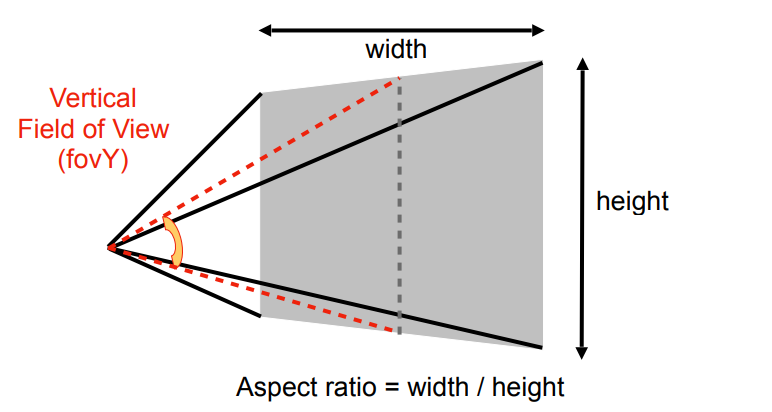

我們可以把透視投影理解成兩個動作：

1. 把 frustum 擠壓成與正交投影相同的長方體
2. 使用 $M_{\mathrm{ortho}}$ 將長方體正規化

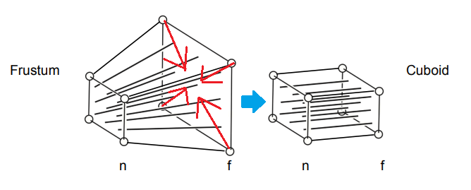

擠壓時需要維持三項關係：

- 近平面上的 x 與 y 不變
- 所有深度切面中心的 x、y 不變
- 近平面與遠平面的 z 仍分別是 $-n$ 與 $-f$

前兩項會形成 x、y 方向的限制條件，我們可以用相似三角形推導對應的縮放關係。 第三項則會形成 z 方向的兩個邊界條件，後面會用來推導控制深度的係數

現在我們先來看 x 與 y 的部分，找出 frustum 中不同深度的截面應該如何縮放。 假設 view-space 中有一個位於相機前方的齊次位置：

$$
\mathbf{p}_{\mathrm{view}}
=(x_v,y_v,z_v,1),
\quad z_v<0
$$

從原點的相機出發，穿過這個 3D 點的射線可以寫成：

$$
\mathbf{r}(\lambda)
=\lambda(x_v,y_v,z_v)
$$

因為近平面位於 $z_v=-n$，所以射線與近平面相交時，$\lambda$ 必須滿足：

$$
\lambda z_v=-n
$$

由於 $z_v<0$ 且 $n>0$，我們可以得到一個正的縮放比例：

$$
\lambda=-\frac{n}{z_v}
$$

將這個比例乘回原本的 x 與 y，可以先算出交點的前兩個分量：

$$
x'=-\frac{n}{z_v}x_v,
\quad
y'=-\frac{n}{z_v}y_v
$$

由於交點位於近平面，它的第三個分量必須是 $z'=-n$。 因此，將 $\lambda=-n/z_v$ 乘回原本位置的三個分量後，完整的交點為：

$$
\begin{aligned}
\mathbf{p}'
&=\lambda(x_v,y_v,z_v) \\
&=-\frac{n}{z_v}(x_v,y_v,z_v) \\
&=\left(
-\frac{n}{z_v}x_v,
-\frac{n}{z_v}y_v,
-n
\right).
\end{aligned}
$$

下圖從側面畫出了相機、原本的點與近平面交點：

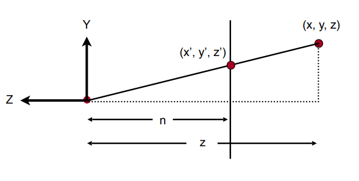

例如，令近平面距離為 $n=1$，並取 view-space 齊次位置：

$$
\mathbf{p}_{\mathrm{view}}=(2,1,-4,1)
$$

射線抵達近平面時的縮放比例與交點為：

$$
\lambda=-\frac{1}{-4}=\frac{1}{4}
$$

$$
\mathbf{p}'
=\frac{1}{4}(2,1,-4)
=\left(\frac{1}{2},\frac{1}{4},-1\right)
$$

因此，原本位於 $(2,1)$ 的橫向位置會縮到近平面上的 $(\frac{1}{2},\frac{1}{4})$

現在我們要把這項幾何關係寫成矩陣。 剛才推導時我們把 $x'$ 與 $y'$ 都除以了該頂點的 $-z_v$，但一般的 $4\times4$ 矩陣乘法只能計算各分量的線性組合，無法直接執行這種除法。 為了將除法留到後續處理，我們要先將近平面交點補成齊次座標：

$$
\mathbf{p}'_h
=\left(
-\frac{n}{z_v}x_v,
-\frac{n}{z_v}y_v,
-n,
1
\right)
$$

因為 $-z_v>0$，所以可以將上式的四個分量都乘以 $-z_v$：

$$
\mathbf{p}'_h
\sim
\begin{bmatrix}
nx_v \\
ny_v \\
nz_v \\
-z_v
\end{bmatrix}
$$

以前面的數值為例，這項等價關係為：

$$
\left(\frac{1}{2},\frac{1}{4},-1,1\right)
\sim
(2,1,-4,4)
$$

在這組表示方式中，前兩個分量保存了還原原本 x 與 y 所需的分子，第四個分量則保存了共同的分母 $-z_v$。 但是，如果第三個分量也直接使用 $nz_v$，除以 $-z_v$ 後，每個點的 z 都會變成 $-n$，原本的深度便會消失

因此這裡我們只會沿用第一、第二與第四個分量的結果，而第三個分量我們會將其改寫成 $\alpha z_v+\beta$。 $\alpha$ 與 $\beta$ 是接下來要利用近平面與遠平面求出的係數。 為了和最後的 clip-space 座標區分，讓我們先將這組中間的齊次座標記為：

$$
\mathbf{p}_s^h
=(x_s^h,y_s^h,z_s^h,w_s)
$$

於是擠壓的操作（squeeze matrix）可以寫成：

$$
M_{\mathrm{squeeze}}
=
\begin{bmatrix}
n & 0 & 0 & 0 \\
0 & n & 0 & 0 \\
0 & 0 & \alpha & \beta \\
0 & 0 & -1 & 0
\end{bmatrix}
$$

驗證一下，將它乘上 view-space 的位置後，可以得到：

$$
\mathbf{p}_s^h
=M_{\mathrm{squeeze}}
\begin{bmatrix}
x_v \\
y_v \\
z_v \\
1
\end{bmatrix}
=
\begin{bmatrix}
nx_v \\
ny_v \\
\alpha z_v+\beta \\
-z_v
\end{bmatrix}
$$

將這組中間齊次座標除以 $w_s=-z_v$ 後，x、y 與 z 分別會成為：

$$
\begin{aligned}
x_s
&=\frac{x_s^h}{w_s}
=-\frac{n}{z_v}x_v, \\
y_s
&=\frac{y_s^h}{w_s}
=-\frac{n}{z_v}y_v, \\
z_{\mathrm{squeezed}}
&=\frac{z_s^h}{w_s}
=\frac{\alpha z_v+\beta}{-z_v}.
\end{aligned}
$$

也就是說：

$$
\frac{\mathbf{p}_s^h}{w_s}
=
\begin{bmatrix}
x_s \\
y_s \\
z_{\mathrm{squeezed}} \\
1
\end{bmatrix}
=
\begin{bmatrix}
-\frac{n}{z_v}x_v \\
-\frac{n}{z_v}y_v \\
\frac{\alpha z_v+\beta}{-z_v} \\
1
\end{bmatrix}
$$

其中 x 與 y 正好符合前面由近平面交點得到的結果，整個向量的最後一個也回到了 $1$，因此這就是該點位於擠壓後長方體中的位置座標

接下來我們需要利用深度邊界來求出第三個分量中的 $\alpha$ 與 $\beta$。 這會需要用到剛剛的第三個條件：近平面與遠平面在擠壓前後仍然是 $z=-n$ 與 $z=-f$。 將近平面的 $z_v=-n$ 代入上式，可得：

$$
\frac{-\alpha n+\beta}{n}=-n
\quad\Longrightarrow\quad
-\alpha n+\beta=-n^2
$$

將遠平面的 $z_v=-f$ 代入，則會得到：

$$
\frac{-\alpha f+\beta}{f}=-f
\quad\Longrightarrow\quad
-\alpha f+\beta=-f^2
$$

將兩個等式相減，可以消去 $\beta$：

$$
\alpha(f-n)
=f^2-n^2
=(f-n)(f+n)
$$

因為 $f>n$，所以 $f-n\ne0$，兩邊可以同除以 $f-n$：

$$
\alpha=f+n
$$

再把 $\alpha=f+n$ 代回近平面的等式：

$$
-(f+n)n+\beta=-n^2
\quad\Longrightarrow\quad
\beta=fn
$$

因此，完整的 squeeze matrix 為：

$$
M_{\mathrm{squeeze}}
=
\begin{bmatrix}
n & 0 & 0 & 0 \\
0 & n & 0 & 0 \\
0 & 0 & n+f & nf \\
0 & 0 & -1 & 0
\end{bmatrix}
$$

這個矩陣輸出的中間齊次座標除以 $w_s$ 後形式如下：

$$
\frac{\mathbf{p}_s^h}{w_s}
=\frac{1}{-z_v}
\begin{bmatrix}
nx_v \\
ny_v \\
(n+f)z_v+nf \\
-z_v
\end{bmatrix}
=
\begin{bmatrix}
-\frac{n}{z_v}x_v \\
-\frac{n}{z_v}y_v \\
\frac{(n+f)z_v+nf}{-z_v} \\
1
\end{bmatrix}
$$

因此各個深度截面的 x、y 範圍會縮到近平面矩形的大小，近平面與遠平面的 z 則會繼續保持為 $-n$ 與 $-f$

例如，若沿用 $n=1$ 的位置 $(2,1,-4,1)$，並令 $f=9$，矩陣乘法會得到：

$$
M_{\mathrm{squeeze}}
\begin{bmatrix}
2 \\
1 \\
-4 \\
1
\end{bmatrix}
=
\begin{bmatrix}
2 \\
1 \\
-31 \\
4
\end{bmatrix}
$$

將前三個分量除以最後的 $4$ 之後，x 與 y 正好是前面算出的 $1/2$ 與 $1/4$，而 z 則是位於 $-9$ 與 $-1$ 之間的 $-31/4$。 這也顯示 squeeze matrix 保留了可供後續深度處理的前後關係，並沒有把每個點都移到近平面

至此，我們就成功把 frustum 擠壓成一個長方體了：


但是現在這個長方體仍使用著原本的 $l$、$r$、$b$、$t$、$n$ 與 $f$ 範圍，還沒有做正規化來映射到標準裁切範圍。 因此接下來我們需要套用前面已經推導完成的 $M_{\mathrm{ortho}}$，將這個長方體正規化到 OpenGL 的標準裁切範圍。 之後將 $M_{\mathrm{squeeze}}$ 與 $M_{\mathrm{ortho}}$ 合起來，我們便完成了整個的透視投影轉換，其矩陣記作 $M_{\mathrm{perspective}}$：

$$
M_{\mathrm{perspective}}
=M_{\mathrm{ortho}}M_{\mathrm{squeeze}}
$$

前面為了確認 $M_{\mathrm{squeeze}}$ 的幾何效果，我們曾將中間齊次座標 $\mathbf{p}_s^h$ 除以 $w_s$，把它改寫成長方體中的位置 $(x_s,y_s,z_{\mathrm{squeezed}},1)$

但實際計算時，$M_{\mathrm{ortho}}$ 可以直接接收 $M_{\mathrm{squeeze}}$ 產生的齊次座標，不需要在兩個矩陣之間執行該除法。 原因如下：

$$
\mathbf{p}_s^h
=w_s
\begin{bmatrix}
x_s \\
y_s \\
z_{\mathrm{squeezed}} \\
1
\end{bmatrix}
$$

所以矩陣乘法的線性關係會保留這個共同的 $w_s$：

$$
M_{\mathrm{ortho}}\mathbf{p}_s^h
=w_s M_{\mathrm{ortho}}
\begin{bmatrix}
x_s \\
y_s \\
z_{\mathrm{squeezed}} \\
1
\end{bmatrix}
$$

因此，雖然時我們的步驟是「先擠壓，再做正交投影」。 但實際使用時，我們會預先計算好兩個矩陣的乘積。 頂點著色器只需使用組合完成的 $M_{\mathrm{perspective}}$ 轉換 view-space 位置即可

完成矩陣乘法後，我們就得到了 OpenGL 的一般透視投影矩陣：

$$
\begin{aligned}
M_{\mathrm{perspective}}
&=M_{\mathrm{ortho}}M_{\mathrm{squeeze}} \\
&=
\begin{bmatrix}
\frac{2}{r-l} & 0 & 0 & -\frac{r+l}{r-l} \\
0 & \frac{2}{t-b} & 0 & -\frac{t+b}{t-b} \\
0 & 0 & -\frac{2}{f-n} & -\frac{f+n}{f-n} \\
0 & 0 & 0 & 1
\end{bmatrix}
\begin{bmatrix}
n & 0 & 0 & 0 \\
0 & n & 0 & 0 \\
0 & 0 & n+f & nf \\
0 & 0 & -1 & 0
\end{bmatrix} \\
&=
\begin{bmatrix}
\frac{2n}{r-l} & 0 & \frac{r+l}{r-l} & 0 \\
0 & \frac{2n}{t-b} & \frac{t+b}{t-b} & 0 \\
0 & 0 & -\frac{f+n}{f-n} & -\frac{2fn}{f-n} \\
0 & 0 & -1 & 0
\end{bmatrix}
\end{aligned}
$$

這邊我們直接使用了 $l$、$r$、$b$ 與 $t$ 來描述近平面的四個邊界，並以 $n$ 與 $f$ 描述近、遠平面距離。 但實際設定相機時，Application 通常會提供 vertical FOV $\theta_y$、aspect ratio $a$、近平面距離 $n$ 與遠平面距離 $f$。 其中 $\theta_y$、$a$ 與 $n$ 用來決定近平面的四個邊界，$f$ 則用來決定 frustum 延伸到多遠

其中，近平面位於 $z_v=-n$，其矩形中心是 $(0,0,-n)$，上邊界的 y 座標為 $t$，下邊界的 y 座標為 $b$，右邊界的 x 座標為 $r$，左邊界的 x 座標為 $l$。 這個矩形在 x 方向以 $x_v=0$ 對稱，在 y 方向則以 $y_v=0$ 對稱，因此：

$$
b=-t,
\quad
l=-r
$$

接下來我們要利用 vertical FOV $\theta_y$ 與近平面距離 $n$，求出近平面的上邊界 $t$ 與下邊界 $b$。 我們先處理垂直方向，在 $x_v=0$ 的垂直截面中，從相機位置連到近平面上、下邊界中點的兩條射線會夾出完整的 vertical FOV $\theta_y$。 對稱關係會讓視線軸平分這個角度，因此視線軸和上方射線之間的角度是 $\theta_y/2$：

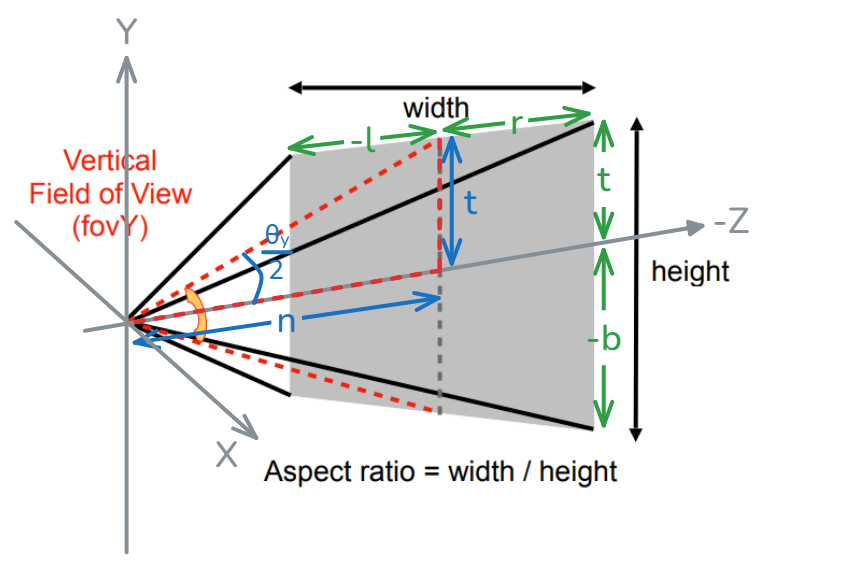

從這個垂直截面觀察時，相機位置、近平面中心與上邊界中點會形成直角三角形。 其中鄰邊是近平 $n$，對邊是近平面中心到上邊界中點的距離 $t$，所以：

$$
\tan\left(\frac{\theta_y}{2}\right)
=\frac{t}{n}
$$

等式兩邊同乘 $n$，便可以求出上邊界：

$$
t=n\tan\left(\frac{\theta_y}{2}\right)
$$

下邊界和上邊界以 x 軸對稱，因此：

$$
b=-t
$$

接著處理水平方向。 Aspect ratio $a$ 描述目標 viewport 的寬高比例。 為了避免投影結果被橫向或縱向拉伸，frustum 中與近平面平行的矩形截面也會採用相同的比例。 我們可以直接在近平面計算這個比例，它的寬度是 $r-l$，高度則是 $t-b$，所以：

$$
a=\frac{r-l}{t-b}
$$

將對稱關係 $l=-r$ 與 $b=-t$ 代入後，可以得到：

$$
a
=\frac{r-(-r)}{t-(-t)}
=\frac{2r}{2t}
=\frac{r}{t}
$$

因此右邊界與左邊界分別是：

$$
r=at,
\quad
l=-r
$$

至此，四個邊界就都能由 vertical FOV、aspect ratio 與近平面距離求出來了：

$$
\begin{aligned}
t&=n\tan\left(\frac{\theta_y}{2}\right), \\
b&=-t, \\
r&=at, \\
l&=-r.
\end{aligned}
$$

現在回到一般透視投影矩陣中。 它的 x 與 y 縮放係數中會重複出現 $1/\tan(\theta_y/2)$，我們先把這個值縮寫為 $s$：

$$
s
=\frac{1}{\tan(\theta_y/2)}
$$

根據剛才的 $t=n\tan(\theta_y/2)$，它也可以寫成：

$$
s=\frac{n}{t}
$$

對稱 frustum 的高度為 $t-b=2t$，所以一般矩陣中的 y 軸縮放係數可以化簡為：

$$
\frac{2n}{t-b}
=\frac{2n}{2t}
=\frac{n}{t}
=s
$$

寬度則是 $r-l=2r$。 再利用 $r=at$，x 軸縮放係數可以化簡為：

$$
\frac{2n}{r-l}
=\frac{2n}{2r}
=\frac{n}{r}
=\frac{n}{at}
=\frac{s}{a}
$$

一般矩陣中還有兩個用來處理不對稱邊界的偏移項。 由於對稱 frustum 具有 $l=-r$ 與 $b=-t$，因此它們都會變成 $0$：

$$
\frac{r+l}{r-l}
=\frac{r-r}{2r}
=0,
\quad
\frac{t+b}{t-b}
=\frac{t-t}{2t}
=0
$$

將這些結果代回一般形式後，projection matrix 可以簡化成程式庫常見的形式：

$$
M_{\mathrm{perspective}}
=
\begin{bmatrix}
\frac{s}{a} & 0 & 0 & 0 \\
0 & s & 0 & 0 \\
0 & 0 & -\frac{f+n}{f-n} & -\frac{2fn}{f-n} \\
0 & 0 & -1 & 0
\end{bmatrix}
$$

這個矩陣乘上 view-space 位置 $(x_v,y_v,z_v,1)$ 後，最後一列會產生：

$$
w_c=-z_v
$$

因此，$w_c$ 是頂點著色器執行 projection transformation 時，由 view-space 的 z 座標計算出的 clip-space 第四個分量。 後續的 perspective divide 會使用它還原前面推導出的透視縮放關係

正交投影矩陣的最後一列則會讓 $w_c$ 維持為 $1$。 因此後續即使執行相同的除法，x 與 y 也不會因為頂點距離相機較遠而縮小

##### 組合 MVP matrix，並由 vertex shader 交出結果

到這裡，Model、view 與 projection transformations 已分別回答了「模型位於世界何處」、「相機如何觀察世界」，以及「可見的 3D 範圍如何轉成 clip-space」。 實際使用時，$M_{\mathrm{projection}}$ 可以是 $M_{\mathrm{ortho}}$ 或 $M_{\mathrm{perspective}}$。 三個矩陣也可以預先組合成一個 MVP matrix：

$$
M_{\mathrm{MVP}}
= M_{\mathrm{projection}}
  M_{\mathrm{view}}
  M_{\mathrm{model}}
$$

由於矩陣會從右往左作用，所以 object-space 的點會先進入 world-space，再進入 view-space，最後才得到 clip-space 的位置：

$$
\mathbf{p}_{\mathrm{clip}}
= M_{\mathrm{MVP}}\mathbf{p}_{\mathrm{object}}
$$

Application 可以在提交 draw call 前先建立好三個矩陣，將它們相乘後再上傳給 OpenGL program。 下例的 GLM 片段示範了實際使用時會如何傳遞相機與投影等參數：

```cpp
const glm::mat4 model = object.calculateTransformMatrix_();
const glm::mat4 view = glm::lookAt(
    cameraPosition,
    cameraPosition + gazeDirection,
    upDirection);
const glm::mat4 projection = glm::perspective(
    glm::radians(fovYDegrees),
    static_cast<float>(viewportWidth) /
        static_cast<float>(viewportHeight),
    nearDistance,
    farDistance);
const glm::mat4 mvp = projection * view * model;

glUniformMatrix4fv(mvpLocation, 1, GL_FALSE,
                   glm::value_ptr(mvp));
```

`glm::lookAt()` 會從相機位置、目標位置與 up direction 建立 $M_{\mathrm{view}}$。 `glm::perspective()` 則由垂直 FOV、aspect ratio、near 與 far distances 建立 $M_{\mathrm{projection}}$。 這裡的 `viewportWidth / viewportHeight` 必須使用浮點除法，才能得到正確的 aspect ratio

下例的頂點著色器除了計算 clip-space 位置，也會算出目前頂點的 RGBA 色彩與 UV：

```glsl
#version 330 core
layout(location = 0) in vec3 in_position;
layout(location = 1) in vec4 in_color;
layout(location = 2) in vec2 in_uv;

uniform mat4 mvp;
out vec4 vertex_color;
out vec2 vertex_uv;

void main()
{
    gl_Position = mvp * vec4(in_position, 1.0);
    vertex_color = in_color;
    vertex_uv = in_uv;
}
```

`gl_Position` 是這個頂點的 clip-space 位置：

$$
\mathrm{gl\_Position} = (x_c, y_c, z_c, w_c)
$$

其中 $w_c$ 用來在後面的透視除法中產生近大遠小的效果。 `vertex_color` 與 `vertex_uv` 分別保存了頂點著色器為目前頂點算出的 RGBA 色彩與 UV

等光柵化器開始處理由三個頂點組成的三角形時，它會為每個片段內插這些值，再將內插的結果交給片段著色器。 這類從頂點著色器傳往後續著色階段的資料稱為 varyings

頂點著色器每次只會處理一筆頂點。 執行完成後，每個頂點就都填好了 clip-space 位置、RGBA 色彩與 UV 等資料，圖形管線的下一階段會依 draw call 指定的輸入模式將多筆頂點組成圖元

##### 共用範例：MVP 產生三筆 clip-space 頂點

現在讓我們回到前面的共用範例，vertex / index data 階段已經依照索引 `[0, 1, 2]`，取回了 $A$、$B$ 與 $C$ 三筆 `ExampleVertex` 記錄。 目前準備交給頂點著色器的資料為：

- $A$：object-space 位置為 $(-1,-1,0)$，RGBA 為紅色 $(1,0,0,1)$，UV 為 $(0,0)$
- $B$：object-space 位置為 $(3,-1,0)$，RGBA 為綠色 $(0,1,0,1)$，UV 為 $(1,0)$
- $C$：object-space 位置為 $(0,3,-1)$，RGBA 為藍色 $(0,0,1,1)$，UV 為 $(0,1)$

另外，在目前的頂點處理階段，頂點著色器除了每個頂點各自的位置、RGBA 與 UV 以外，還會需要這筆 draw call 內三個頂點共用的 MVP matrix，才能將每個頂點的 object-space 位置轉換成 clip-space 位置

為了建立這個 MVP matrix，共用範例會把模型沿 world-space 的 $-Z$ 方向移動 $1$，並把相機放在 world-space 的 $(0,0,1)$、朝 $-Z$ 方向觀察。 因此 Model matrix 與 view matrix 都會沿 z 軸平移 $-1$：

$$
M_{\mathrm{model}}
=
\begin{bmatrix}
1&0&0&0\\
0&1&0&0\\
0&0&1&-1\\
0&0&0&1
\end{bmatrix},
\quad
M_{\mathrm{view}}
=
\begin{bmatrix}
1&0&0&0\\
0&1&0&0\\
0&0&1&-1\\
0&0&0&1
\end{bmatrix}.
$$

Projection 使用垂直 FOV $90^\circ$、aspect ratio $1$、近平面距離 $n=1$ 與遠平面距離 $f=9$。 對應的 OpenGL perspective projection matrix 是：

$$
M_{\mathrm{projection}}
=
\begin{bmatrix}
1&0&0&0\\
0&1&0&0\\
0&0&-\frac{5}{4}&-\frac{9}{4}\\
0&0&-1&0
\end{bmatrix}.
$$

將這三個矩陣預先相乘，可以得到這次頂點著色器使用的 MVP matrix：

$$
\begin{aligned}
M_{\mathrm{MVP}}
&= M_{\mathrm{projection}}M_{\mathrm{view}}M_{\mathrm{model}} \\
&=
\begin{bmatrix}
1&0&0&0\\
0&1&0&0\\
0&0&-\frac{5}{4}&\frac{1}{4}\\
0&0&-1&2
\end{bmatrix}.
\end{aligned}
$$

三筆 object-space 位置會依序經過 world-space、view-space 與 clip-space，得到下列座標：

$$
\begin{aligned}
\mathbf{p}_{A,\mathrm{object}}=(-1,-1,0,1)
&\to \mathbf{p}_{A,\mathrm{world}}=(-1,-1,-1,1) \\
&\to \mathbf{p}_{A,\mathrm{view}}=(-1,-1,-2,1) \\
&\to \mathbf{p}_{A,\mathrm{clip}}=\left(-1,-1,\frac14,2\right), \\
\mathbf{p}_{B,\mathrm{object}}=(3,-1,0,1)
&\to \mathbf{p}_{B,\mathrm{world}}=(3,-1,-1,1) \\
&\to \mathbf{p}_{B,\mathrm{view}}=(3,-1,-2,1) \\
&\to \mathbf{p}_{B,\mathrm{clip}}=\left(3,-1,\frac14,2\right), \\
\mathbf{p}_{C,\mathrm{object}}=(0,3,-1,1)
&\to \mathbf{p}_{C,\mathrm{world}}=(0,3,-2,1) \\
&\to \mathbf{p}_{C,\mathrm{view}}=(0,3,-3,1) \\
&\to \mathbf{p}_{C,\mathrm{clip}}=\left(0,3,\frac32,3\right).
\end{aligned}
$$

圖中前兩個圖框的 x-y 輪廓相同，z 則從 object-space 座標改成在 view-space 中沿相機座標軸量出的帶符號座標。 本文相機朝 $-Z$ 觀看，因此相機前方的 $z_v<0$，而 $-z_v$ 才是沿視線軸量出的正向深度。 clip-space 圖框會在 $(x_c,w_c)$ 平面檢查右裁切平面，$B$ 的 $x_c=3$ 大於 $w_c=2$，下一節必須先裁切它，不能直接進行透視除法

這個頂點著色器只轉換位置，RGBA 與 UV 會直接傳到後續階段。 頂點處理因此交出三筆 clip-space 位置、各自原有的紅綠藍色彩，以及 $(0,0)$、$(1,0)$ 與 $(0,1)$ UV

### Triangle / Primitive Processing：把 clip-space 頂點轉成可供光柵化的 screen-space 圖元

上一節我們從三筆 object-space 頂點的位置、RGBA 與 UV，以及這筆 draw call 共用的 MVP matrix 出發，並將這些資料交給頂點處理階段。 頂點處理階段執行頂點著色器後，我們便成功將各頂點的位置轉換成 clip-space 座標，並將 RGBA 與 UV 一同傳給後續階段了

接下來我們要把這些處理完成但仍彼此分離的頂點，逐步轉成光柵化器能夠處理的 screen-space 圖元

圖元組合（primitive assembly）會先依 draw call 指定的輸入模式，決定哪些頂點共同形成一個點、線段或三角形。 組成圖元後，我們才有完整的幾何形狀可以判斷它是否落在相機的可見範圍內。 如果圖元穿過了可見範圍的邊界，clipping 會在 homogeneous clip-space 中把不可見的外側部分裁掉，並在交界處建立新的頂點

完成 clipping 後，為了讓光柵化器知道圖元位於畫面中的什麼位置，我們需要將留下的 clip-space 頂點轉成 screen-space 座標。 但此時 clip-space 的位置仍使用四維齊次座標，無法直接對應實際視埠中的位置。 所以管線會先透過 perspective divide 將它們轉成 NDC，使可見範圍落入標準座標區間，再由 viewport transform 根據視埠的位置與大小映射到 screen-space

完成這四個步驟後，這個階段會輸出位於連續 screen-space 座標中的點、線段或三角形，本文接下來會固定追蹤三角形路徑。 每筆輸出頂點都會包含 screen-space 的 x、y 與深度 z，以及對應的 RGBA 與 UV。 管線在執行 perspective divide 時也會保留每個頂點的 $1/w_c$，供後續內插階段修正透視投影造成的 UV 非線性變化，避免紋理產生扭曲

許多以三角形為主的架構圖會將這一連串工作標成 `Triangle Processing`，更一般的名稱則是 `Primitive Processing`。 下面四個 H4 我們會依 primitive assembly、clipping、perspective divide 與 viewport transform 的順序，分別說明各階段會接收什麼資料、如何處理，以及會把什麼結果交給下一個階段

#### primitive assembly：把頂點連成三角形

上一階段我們已經分別算出了每個頂點的 clip-space 位置、RGBA 色彩與 UV。 接下來我們要依 draw call 指定的輸入模式，判斷哪些頂點共同描述了同一個幾何單位，並保留這些頂點的先後順序。 圖元組合階段會根據輸入模式解讀頂點序列，建立類型與頂點順序都明確的圖元

圖元（primitive）是這項分組工作交出的基本幾何單位。 可以直接進入 rasterization 的基本圖元包括點、線段與三角形。 其內部會保留著頂點原有的 clip-space 位置、RGBA 與 UV

以本文前面使用的 `glDrawElements()` 為例，第一個引數會替這筆 draw call 指定輸入模式，告訴圖元組合階段該如何解讀索引。 下圖上方先用六個索引展示 `triangle list` 每三個索引組成一個三角形的規則，下方再把固定的索引序列 `[0, 1, 2, 3]` 套用到七種 OpenGL 輸入模式，比較同一批頂點如何形成不同的點、線段或三角形圖元

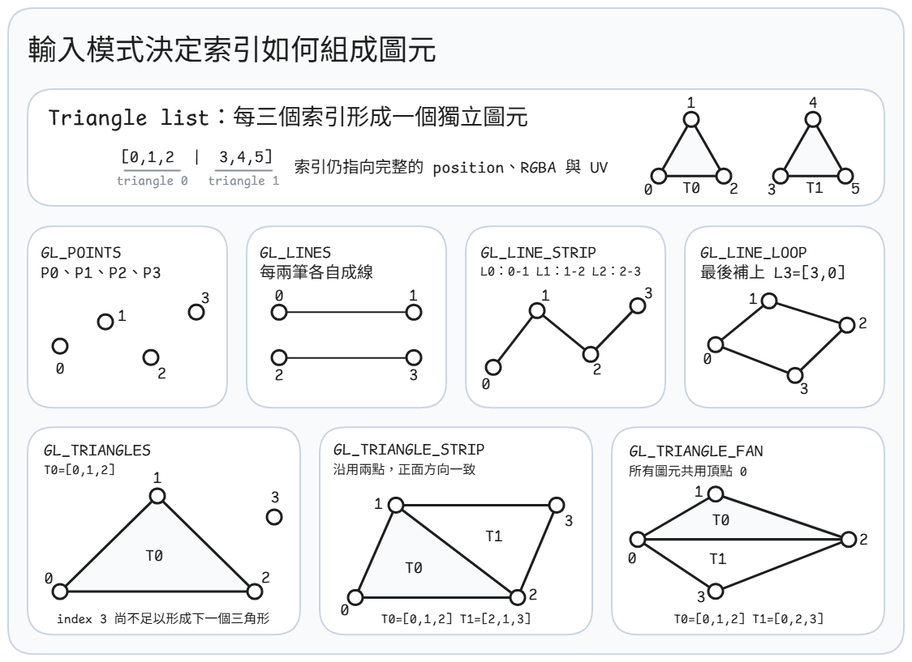

圖中下方七個圖框都從相同的 `[0, 1, 2, 3]` 索引順序出發。 輸入模式只會改變分組與頂點重用方式，索引所指向的 position、RGBA 與 UV 不會跟著改變

最上方我們先以 `triangle list` 介紹了最直接的三角形輸入方式，在 OpenGL 中這會對應到 `GL_TRIANGLES`。 由於本文使用索引式的 draw call，圖元組合階段會依序讀取索引，每三個索引組成一個三角形

以第一個三角形為例，索引 `0`、`1` 與 `2` 會取得三筆已完成頂點著色的資料。 圖元組合會將它們依這個順序放在一起，以形成第一個三角形圖元。 其中圖元類型 `triangle` 來自這筆 draw call 的輸入模式，圖元的頂點順序則由三筆頂點的先後次序來決定

在 `triangle list` 中，每一組三個索引都會獨立形成一個圖元。 這裡的「獨立」表示下一個圖元會從新的一組索引開始，不會自動沿用前一組的頂點。 不同組仍然可以重複使用相同的索引，藉此共用同一筆頂點資料

管線還需要保留圖元中的頂點順序，讓後續階段能夠判斷三角形的正面與背面，並以一致的方向計算各條邊。 例如 `vertex 0 → vertex 1 → vertex 2` 與 `vertex 0 → vertex 2 → vertex 1` 使用了相同的三筆頂點，卻具有了相反的環繞方向（winding）。 因此，圖元組合不能只保存三個頂點形成的集合，還必須保留它們的先後順序

三角形在概念上還具有三條邊與內部區域，但通常我們不需要另外保存這些資訊。 圖元組合完成時，三角形圖元直接提供的資訊只有：

- 目前的圖元類型
- 有順序的三筆頂點
- 每筆頂點的 clip-space 位置、RGBA 色彩與 UV

圖中的幾種常見模式會將同一串索引組合成下列結果：

- `GL_POINTS`：將每個索引對應的頂點各自建立成一個點圖元
  - 結果：`point 0`、`point 1`、`point 2` 與 `point 3`
- `GL_LINES`：每兩個頂點建立一條互相獨立的線段
  - 結果：`line (0, 1)` 與 `line (2, 3)`，兩條線段之間不會自動相連
- `GL_LINE_STRIP`：依序連接相鄰頂點，讓下一條線段重複使用上一條線段的終點
  - 結果：`line (0, 1)`、`line (1, 2)` 與 `line (2, 3)`，三條線段會形成一條連續折線
- `GL_LINE_LOOP`：先採用 line strip 的方式連接相鄰頂點，再補上最後一個頂點到第一個頂點的線段
  - 結果：`line (0, 1)`、`line (1, 2)`、`line (2, 3)` 與 `line (3, 0)`，最後會形成封閉線圈
- `GL_TRIANGLE_STRIP`：先用前三個頂點建立第一個三角形，之後每增加一個頂點，就和前面的兩個頂點建立下一個三角形
  - 結果：`triangle (0, 1, 2)` 與 `triangle (2, 1, 3)`。 第二個三角形會調整前兩個頂點的順序，使相鄰三角形維持一致的環繞方向
- `GL_TRIANGLE_FAN`：固定以第一個頂點作為共用錨點，再將後續每一對相鄰頂點與這個錨點組成三角形
  - 結果：`triangle (0, 1, 2)` 與 `triangle (0, 2, 3)`，頂點 `0` 會出現在每個三角形中。 另外雖然頂點 `2` 在這個範例中也被兩個相鄰三角形共用了，但加入更多頂點後，後續三角形仍會固定使用頂點 `0`，不會繼續使用頂點 `2`

OpenGL 也提供了 `GL_PATCHES`，能將一組控制點（control points）交給曲面細分（tessellation）階段。 曲面細分可以依著色器規則增加頂點並建立更細緻的幾何形狀，最後同樣會產生點、線段或三角形，供後續 rasterization 使用。 不過本文沒有啟用 tessellation，因此接下來我們只會追蹤由上述輸入模式直接建立的基本圖元

這些輸入模式會使用不同的頂點分組與重用規則，組合完成後則統一交出點、線段或三角形等基本圖元。 一筆 draw call 只會指定一種輸入模式，Application 若要改用另一種模式，就需要再提交一筆 draw call

本文後面會固定沿用 `GL_TRIANGLES` 的例子。 因此圖元組合完成後，每個三角形都帶有三筆頂點的 clip-space 位置、RGBA 色彩與 UV。 下一個裁切階段會利用這些資料來判斷三角形有多少部分位於可見範圍內

##### 共用範例：三筆頂點組成一個三角形圖元

這個範例用來展示圖元組合要如何將頂點處理交出的個別頂點，轉成 clipping 可以接收的三角形圖元。 共用範例的輸入模式是 `GL_TRIANGLES`，索引序列則是 `[0, 1, 2]`。 圖元組合會依這個順序，將三筆頂點資料建立成三角形 $ABC$：

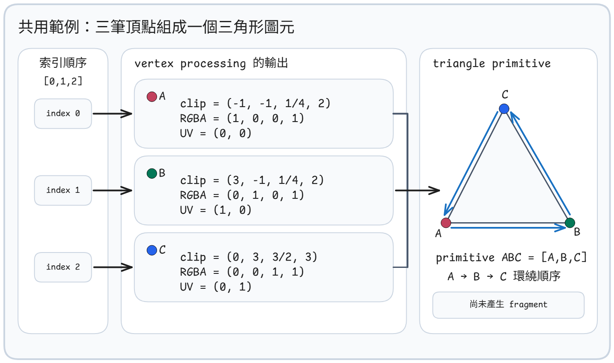

圖中的三條有向邊只用來標示 $A \to B \to C$ 的環繞順序，不是另外保存的資料。 圖元組合需要取得三筆已完成頂點著色的資料、輸入模式與索引順序，才能找出 $A$、$B$ 與 $C$，並把三者依原有順序交給 clipping

#### clipping：留下可見範圍內的三角形

上一階段我們已經建立了三角形圖元，每個頂點都帶有 clip-space 位置、RGBA 色彩與 UV。 接下來為了讓可見的幾何形狀安全地進入透視除法，我們需要找出三角形位於相機可見範圍內的部分。 有些三角形完全位於範圍內或範圍外，有些則會穿過可見範圍的邊界。 裁切（clipping）會在做透視除法之前分辨這些情況，並保留可見的部分

當三角形穿過邊界時，我們仍要保留位於可見範圍內的區域。 假設其中兩個頂點位於範圍內、第三個頂點位於範圍外，如果我們只丟掉了外側頂點，那就會遺失兩條邊與邊界相交的位置。 因此，裁切階段會在這些交界處建立新頂點，再以原頂點與新頂點圍出可見部分：

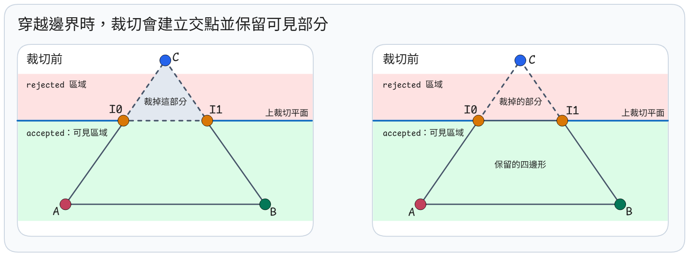

圖中的藍線是上裁切平面。 $A$ 與 $B$ 位於可見區域，$C$ 位於外側。 三角形的兩條邊與裁切平面相交後，管線會建立新的頂點 $I_0$ 與 $I_1$，最後保留由 $A$、$B$、$I_1$ 與 $I_0$ 圍成的可見部分

OpenGL 會在 homogeneous clip-space 中執行這項工作，目標是找出「完成透視除法後仍位於可見範圍內的部分」。 要理解這個目標，我們需要先知道下一階段使用的座標系統

透視除法的目的是把 clip-space 位置轉成正規化裝置座標（normalized device coordinates，NDC）。 由於 NDC 尚未使用畫面緩衝區中的實際像素座標，所以透視除法會先以相同的標準範圍來表示可見位置，與後續視埠的具體寬度與高度無關

本文固定採用 OpenGL 預設的 NDC 深度範圍慣例（negative-one-to-one depth convention），也就是 NDC 的 z 可見範圍和 x、y 一樣都是 $[-1,1]$。 因此，只有 x、y 與 z 都落在 $[-1,1]$ 內的頂點，才會位於 NDC 的標準可見範圍中：

$$
-1 \le x_{\mathrm{ndc}} \le 1, \quad
-1 \le y_{\mathrm{ndc}} \le 1, \quad
-1 \le z_{\mathrm{ndc}} \le 1
$$

但在目前的裁切階段，頂點仍位於 homogeneous clip-space，其位置具有四個分量：

$$
\mathbf{p}_{\mathrm{clip}} = (x_c, y_c, z_c, w_c)
$$

在下一階段我們會以 $w_c$ 執行透視除法，以 x 軸為例，這會做 $x_{\mathrm{ndc}} = x_c / w_c$。 對本文採用的標準透視投影，位於相機前方且能完成透視除法的有效頂點會滿足 $w_c=-z_v>0$ 這個條件。 在這個情境下，我們可以把 NDC 的 x 軸範圍改寫成 clip-space 內的條件：

$$
-1 \le x_{\mathrm{ndc}} = \frac{x_c}{w_c} \le 1
\quad\Longleftrightarrow\quad
-w_c \le x_c \le w_c
$$

這裡我們先只用透視除法來說明裁切條件中的 $w_c$ 從哪裡來，實際的透視除法會留到下一個 H4。 對 y 軸與 z 軸做相同的改寫後，裁切階段最後需要同時檢查：

$$
-w_c \le x_c \le w_c, \quad
-w_c \le y_c \le w_c, \quad
-w_c \le z_c \le w_c
$$

例如 $w_c = 2$ 時，$x_c$ 的可見範圍是 $[-2, 2]$。 若目標頂點的 $x_c = 1$，則其做完透視除法後會得到 $x_{\mathrm{ndc}} = 1 / 2 = 0.5$，$x_c = 2$ 則會得到 $x_{\mathrm{ndc}} = 1$，正好落在 NDC 的右邊界

由於每一組不等式都有較小值與較大值兩個邊界，因此三個座標軸總共會形成六個裁切平面：

$$
\begin{aligned}
x_c = -w_c &\text{：左平面}, & x_c = w_c &\text{：右平面}, \\
y_c = -w_c &\text{：下平面}, & y_c = w_c &\text{：上平面}, \\
z_c = -w_c &\text{：近平面}, & z_c = w_c &\text{：遠平面}.
\end{aligned}
$$

為了讓六個平面共用同一套內外判定方式，並讓判定值之後能沿三角形的邊內插來求交點，我們要把每個平面的內側條件都改寫成「某個判定值大於或等於 $0$」的形式。 以左平面為例，頂點位於內側表示 $x_c \ge -w_c$。 移項後可以得到：

$$
x_c + w_c \ge 0
$$

因此我們可以定義 $d_{\mathrm{left}} = x_c + w_c$。 只要 $d_{\mathrm{left}} \ge 0$，頂點就會位於左平面的內側或平面上。 右平面的內側條件 $x_c \le w_c$ 也可以移項成：

$$
w_c - x_c \ge 0
$$

因此右平面的判定值是 $d_{\mathrm{right}} = w_c - x_c$。 另外四個平面也使用相同方式，最後我們能得到：

$$
\begin{aligned}
d_{\mathrm{left}}   &= x_c + w_c, &
d_{\mathrm{right}}  &= w_c - x_c, \\
d_{\mathrm{bottom}} &= y_c + w_c, &
d_{\mathrm{top}}    &= w_c - y_c, \\
d_{\mathrm{near}}   &= z_c + w_c, &
d_{\mathrm{far}}    &= w_c - z_c.
\end{aligned}
$$

這裡的 $d$ 是帶有正負號的平面判定值。 對某一個平面而言：

$$
\begin{cases}
d > 0 ： \text{頂點位於平面內側}, \\
d = 0 ： \text{頂點位於平面上}, \\
d < 0 ： \text{頂點位於平面外側}.
\end{cases}
$$

下圖彙整了剛才推導的六個平面條件與六個判定值。 左側列出每個平面的公式，右側則固定一個正的 $w_c$，顯示這些條件在三維切片中圍出的範圍：

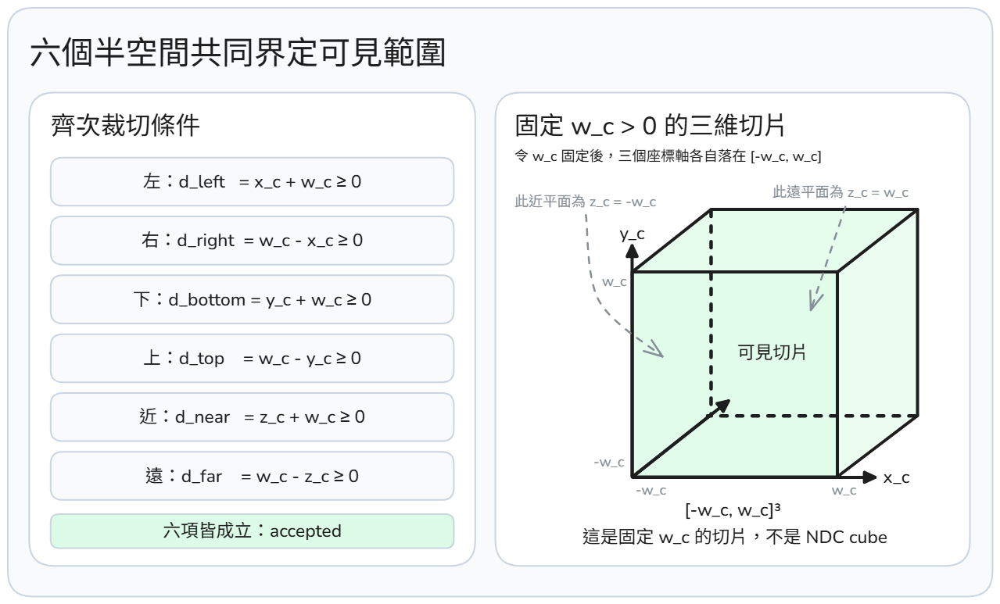

圖中右側的立方體是固定某個 $w_c$ 後得到的切片示意圖。 當 $w_c$ 改變時，$[-w_c,w_c]^3$ 的尺度也會跟著改變，因此整個四維 homogeneous clip-space 不能直接視為 NDC 立方體

以 $w_c = 2$ 的左右平面為例：

- 當 $x_c = -1.5$ 時，$d_{\mathrm{left}} = 0.5$ 且 $d_{\mathrm{right}} = 3.5$，所以頂點同時位於左右平面的內側
- 當 $x_c = -2$ 時，$d_{\mathrm{left}} = 0$，所以頂點正好位於左平面上
- 當 $x_c = -2.5$ 時，$d_{\mathrm{left}} = -0.5$，所以頂點位於左平面外側
- 當 $x_c = 2.5$ 時，$d_{\mathrm{right}} = -0.5$，所以頂點位於右平面外側

一個頂點必須對六個平面都得到 $d \ge 0$，才位於完整的可見範圍內

因此，裁切階段我們可以先快速判斷三角形：

- 若三個頂點對六個平面的判定值都大於或等於 $0$，則保留原三角形
- 若三個頂點對同一個平面的判定值都小於 $0$，則捨棄整個三角形
- 其餘情況表示三角形可能穿過邊界，不能直接保留或捨棄

對於穿過邊界的情況，裁切階段會先把三角形視為由三個頂點組成的多邊形，再依序以六個平面裁切目前留下的多邊形。 為了建立邊界上的新頂點，我們需要先算出多邊形的邊與裁切平面的交點

以下使用大寫的 $A$、$B$ 與 $C$ 作為頂點名稱，並使用粗體小寫的 $\mathbf{p}_A$、$\mathbf{p}_B$ 與 $\mathbf{p}_C$ 表示這些頂點的位置向量。 假設多邊形的一條有向邊從頂點 $A$ 走到頂點 $B$，我們可以用參數 $t$ 來表示這條邊上的位置：

$$
\mathbf{p}(t)
= \mathbf{p}_A + t(\mathbf{p}_B - \mathbf{p}_A),
\quad 0 \le t \le 1
$$

當 $t$ 從 $0$ 增加到 $1$ 時，$\mathbf{p}(t)$ 會從 $\mathbf{p}_A$ 沿著邊移動到 $\mathbf{p}_B$。 接著，為了判斷邊上任一位置 $\mathbf{p}(t)$ 位於裁切平面的哪一側，我們會將這個位置代入該平面的判定式 $d(\mathbf{p})$。 先將邊的兩個端點代入，可以得到：

$$
d_A \equiv d(\mathbf{p}_A),
\quad
d_B \equiv d(\mathbf{p}_B)
$$

其中 $d_A$ 是頂點 $A$ 的平面判定值，$d_B$ 是頂點 $B$ 的平面判定值。 假設 $A$ 與 $B$ 位於裁切平面的兩側，那 $d_A$ 與 $d_B$ 的值就會變得一正一負。 由於裁切平面判定式是頂點座標的線性函數，將 $\mathbf{p}(t)$ 代入後，它的判定值也會使用同一個 $t$ 從 $d_A$ 線性變化到 $d_B$：

$$
d(t)
\equiv d\bigl(\mathbf{p}(t)\bigr)
=(1-t)d_A+t d_B
$$

如此一來，我們就可以用 $d(t)$ 的正負號來判斷邊上位置 $\mathbf{p}(t)$ 位於裁切平面的哪一側了：

- $d(t)>0$：$\mathbf{p}(t)$ 位於裁切平面的內側
- $d(t)<0$：$\mathbf{p}(t)$ 位於裁切平面的外側
- $d(t)=0$：$\mathbf{p}(t)$ 正好位於裁切平面上

而由於交點正好位於裁切平面上，因此我們要找出使 $d(t)=0$ 的 $t$。 將這個條件代入上式並解出 $t$：

$$
\begin{aligned}
0&=(1-t)d_A+t d_B \\
 &=d_A+t(d_B-d_A), \\
t&=\frac{d_A}{d_A-d_B}.
\end{aligned}
$$

將 $t$ 代回 $\mathbf{p}(t)$，就能得到位於裁切平面上的新頂點位置了。 由於後續階段需要接收完整的頂點，而且新裁切邊的顏色與紋理必須延續原三角形的變化，因此我們還要為交點建立對應的 RGBA 與 UV。 這些資料的建立方式取決於 shader 指定的內插規則

本文的 `vertex_color` 與 `vertex_uv` 採用 GLSL 的預設內插規則。 在這項規則下，$t$ 表示交點位於原 clip-space 內的邊 $A\to B$ 的比例，所以位置、RGBA 與 UV 都會使用同一個 $t$ 沿原邊建立：

$$
\begin{aligned}
\mathbf{p}_{\mathrm{intersection}}
  &= \mathbf{p}_A + t(\mathbf{p}_B - \mathbf{p}_A), \\
\mathrm{color}_{\mathrm{intersection}}
  &= \mathrm{color}_A + t(\mathrm{color}_B - \mathrm{color}_A), \\
\mathrm{uv}_{\mathrm{intersection}}
  &= \mathrm{uv}_A + t(\mathrm{uv}_B - \mathrm{uv}_A).
\end{aligned}
$$

其他內插規則會使用不同方式處理裁切產生的新頂點。 為了先專注在交點本身，本節後續公式與共用範例都會沿用上述預設規則。 各種內插規則的名稱、目的與裁切行為會在 barycentric interpolation H4 一節中一併說明

例如一條邊穿過了右裁切平面 $x_c = w_c$：

$$
\begin{aligned}
\mathbf{p}_A &= (0.5, 0, 0, 1), \quad d_A = 1 - 0.5 = 0.5, \\
\mathbf{p}_B &= (1.5, 0, 0, 1), \quad d_B = 1 - 1.5 = -0.5, \\
\end{aligned}
$$

將 $d_A$ 與 $d_B$ 代入交點公式，可以先求得 $t$，再得到交點位置：

$$
\begin{aligned}
t &= \frac{0.5}{0.5 - (-0.5)} = 0.5, \\
\mathbf{p}_{\mathrm{intersection}}
  &= \mathbf{p}_A + 0.5(\mathbf{p}_B - \mathbf{p}_A) \\
  &= (1.0, 0, 0, 1).
\end{aligned}
$$

新的交點 $\mathbf{p}_{\mathrm{intersection}}$ 會正好位於右裁切平面上。 如果頂點 $A$ 的 RGBA 色彩是紅色 $(1, 0, 0, 1)$，UV 為 $(0, 0)$，頂點 $B$ 的 RGBA 色彩是藍色 $(0, 0, 1, 1)$，UV 為 $(1, 0)$，那麼新頂點會取得兩者中間的屬性：

$$
\mathrm{color}_{\mathrm{intersection}} = (0.5, 0, 0.5, 1), \quad
\mathrm{uv}_{\mathrm{intersection}} = (0.5, 0)
$$

算出邊界交點後，我們還要拿每條有向邊的原頂點與新交點組合成新的多邊形。 對某一個平面處理多邊形的有向邊 $A \to B$ 時，下列四種規則會依兩端的內外狀態建立新的頂點序列：

- $A$ 與 $B$ 都在內側時，輸出 $B$
- $A$ 在內側、$B$ 在外側時，只輸出交點
- $A$ 在外側、$B$ 在內側時，先輸出交點，再輸出 $B$
- $A$ 與 $B$ 都在外側時，不輸出任何頂點

每處理完一個平面，輸出的頂點序列都會成為下一個平面的輸入。 六個平面都處理完成後，結果可能是：

- 空集合
- 未改動的原三角形
- 由原頂點與新交點構成，但仍只有三個頂點的三角形
- 具有四個以上頂點的可見多邊形

處理完六個平面後，我們還需要把留下的多邊形交回三角形路徑。 每個裁切平面只會保留平面內側的空間。 由於三角形是凸形，而凸形和這類半空間的交集仍會是凸形，因此非空結果會是一個凸多邊形。 這裡的「凸」表示任取多邊形內的兩個位置，連接它們的整條線段都不會離開多邊形。 這項性質也能確保我們從其中一個頂點向其他非相鄰頂點連線時，分割線仍留在多邊形內，因而可以安全地將結果重新拆成三角形

空集合表示整個圖元不可見。 非空結果若只有三個頂點，可以直接作為三角形繼續處理。 頂點超過三個時，後續 rasterization 必須能處理這個凸多邊形，常見作法之一是重新拆成三角形。 為了讓本文繼續沿用三角形路徑追蹤資料，以下會採用這種作法

在幾何形狀剛好落在邊界上的退化情況中，結果也可能只剩點或線段。 這類結果的面積為 $0$，不能形成可填滿的三角形區域，因此下一個 rasterization 階段不會將它們視為一般三角形繼續處理

為了具體說明重新三角化，本文選擇以第一個頂點為共用頂點，使用 triangle fan 將四邊形拆成：

$$
\begin{aligned}
\text{可見多邊形} &= [V_0, V_1, V_2, V_3], \\
\text{triangle 0} &= [V_0, V_1, V_2], \\
\text{triangle 1} &= [V_0, V_2, V_3].
\end{aligned}
$$

裁切完成後，每個輸出的三角形都會位於 clip-space 的可見範圍內，新增的頂點也會具有對應的 clip-space 位置、RGBA 色彩與 UV。 下一階段我們會對這些位置執行透視除法

##### 共用範例：右裁切平面產生兩個交點與兩個三角形

這個範例我們要找出三角形 $ABC$ 與右裁切平面的兩個交點，再將留下的可見四邊形重新拆成下一階段可以接收的兩個三角形。 前面的圖元組合範例已經將索引 `[0, 1, 2]` 指向的三筆頂點組成了有順序的三角形圖元 $[A,B,C]$。 因此，裁切階段在這裡收到的輸入是：

- 圖元類型與頂點順序：三角形 $A\to B\to C$
- 頂點 $A$：clip-space 位置為 $\left(-1,-1,\frac14,2\right)$，RGBA 為紅色 $(1,0,0,1)$，UV 為 $(0,0)$
- 頂點 $B$：clip-space 位置為 $\left(3,-1,\frac14,2\right)$，RGBA 為綠色 $(0,1,0,1)$，UV 為 $(1,0)$
- 頂點 $C$：clip-space 位置為 $\left(0,3,\frac32,3\right)$，RGBA 為藍色 $(0,0,1,1)$，UV 為 $(0,1)$

下圖同時呈現原三角形、兩個交點、裁切後的四邊形與重新三角化結果，方便核對新頂點的順序：

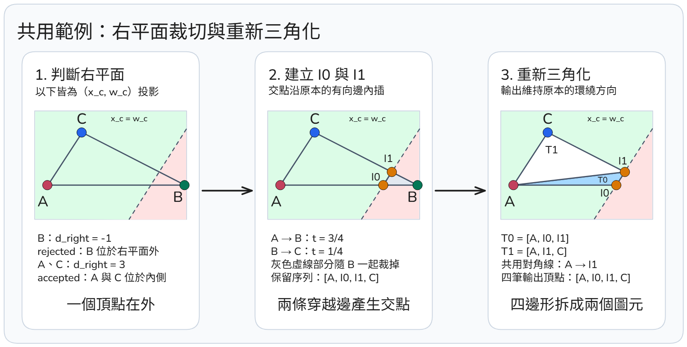

從這三筆 clip-space 位置可以看出，原三角形只有頂點 $B$ 超出右裁切平面。 因此，我們先將三筆位置代入 $d_{\mathrm{right}}=w_c-x_c$，判斷每個頂點位於平面的哪一側：

$$
\begin{aligned}
d_A &= 2-(-1)=3, \\
d_B &= 2-3=-1, \\
d_C &= 3-0=3.
\end{aligned}
$$

$A$ 與 $C$ 的判定值為正，表示它們位於右平面內側。 而因為 $B$ 的判定值為負，因此 $A\to B$ 與 $B\to C$ 兩條邊都會穿過右平面 $x_c=w_c$

沿 $A\to B$ 建立第一個交點時，內插參數為：

$$
t_{A\to B}
= \frac{d_A}{d_A-d_B}
= \frac{3}{3-(-1)}
= \frac34.
$$

將相同的 $t_{A\to B}$ 套用到位置、色彩與 UV，得到交點 $I_0$：

$$
\begin{aligned}
\mathbf{p}_{I_0,\mathrm{clip}}
&= \mathbf{p}_{A,\mathrm{clip}}
 + \frac34\left(\mathbf{p}_{B,\mathrm{clip}}-\mathbf{p}_{A,\mathrm{clip}}\right) \\
&= \left(-1,-1,\frac14,2\right)
 + \frac34\left[
     \left(3,-1,\frac14,2\right)
     -\left(-1,-1,\frac14,2\right)
   \right] \\
&= \left(-1,-1,\frac14,2\right)
 + \frac34\left(4,0,0,0\right) \\
&= \left(-1+3,-1+0,\frac14+0,2+0\right) \\
&= \left(2,-1,\frac14,2\right), \\[6pt]
\mathrm{color}_{I_0}
&= \mathrm{color}_A
 + \frac34\left(\mathrm{color}_B-\mathrm{color}_A\right) \\
&= (1,0,0,1)
 + \frac34\left[(0,1,0,1)-(1,0,0,1)\right] \\
&= (1,0,0,1)+\frac34(-1,1,0,0) \\
&= \left(1-\frac34,0+\frac34,0+0,1+0\right) \\
&= \left(\frac14,\frac34,0,1\right), \\[6pt]
\mathrm{uv}_{I_0}
&= \mathrm{uv}_A
 + \frac34\left(\mathrm{uv}_B-\mathrm{uv}_A\right) \\
&= (0,0)+\frac34\left[(1,0)-(0,0)\right] \\
&= (0,0)+\frac34(1,0) \\
&= \left(0+\frac34,0+0\right) \\
&= \left(\frac34,0\right).
\end{aligned}
$$

沿 $B\to C$ 建立第二個交點時，內插參數為：

$$
t_{B\to C}
= \frac{d_B}{d_B-d_C}
= \frac{-1}{-1-3}
= \frac14.
$$

第二個交點 $I_1$ 因而是：

$$
\begin{aligned}
\mathbf{p}_{I_1,\mathrm{clip}}
&= \mathbf{p}_{B,\mathrm{clip}}
 + \frac14\left(\mathbf{p}_{C,\mathrm{clip}}-\mathbf{p}_{B,\mathrm{clip}}\right) \\
&= \left(3,-1,\frac14,2\right)
 + \frac14\left[
     \left(0,3,\frac32,3\right)
     -\left(3,-1,\frac14,2\right)
   \right] \\
&= \left(3,-1,\frac14,2\right)
 + \frac14\left(-3,4,\frac54,1\right) \\
&= \left(3-\frac34,-1+1,\frac14+\frac{5}{16},2+\frac14\right) \\
&= \left(\frac94,0,\frac{9}{16},\frac94\right), \\[6pt]
\mathrm{color}_{I_1}
&= \mathrm{color}_B
 + \frac14\left(\mathrm{color}_C-\mathrm{color}_B\right) \\
&= (0,1,0,1)
 + \frac14\left[(0,0,1,1)-(0,1,0,1)\right] \\
&= (0,1,0,1)+\frac14(0,-1,1,0) \\
&= \left(0+0,1-\frac14,0+\frac14,1+0\right) \\
&= \left(0,\frac34,\frac14,1\right), \\[6pt]
\mathrm{uv}_{I_1}
&= \mathrm{uv}_B
 + \frac14\left(\mathrm{uv}_C-\mathrm{uv}_B\right) \\
&= (1,0)+\frac14\left[(0,1)-(1,0)\right] \\
&= (1,0)+\frac14(-1,1) \\
&= \left(1-\frac14,0+\frac14\right) \\
&= \left(\frac34,\frac14\right).
\end{aligned}
$$

兩個交點都符合 $x_c=w_c$，都位於右裁切平面上。 裁切後保留下來的是四邊形 $[A,I_0,I_1,C]$。 為了讓後續章節能沿同一組頂點與索引追蹤數值，本文選擇以 $A$ 為共用頂點，把四邊形拆成兩個三角形：

$$
T_0=[A,I_0,I_1],
\quad
T_1=[A,I_1,C].
$$

$I_0$ 與 $I_1$ 沿原本的兩條有向邊插入，因此可見多邊形仍延續 $A \to B \to C$ 的環繞方向。 圖中的 $A \to I_1$ 只是重新三角化時加入的分割線

若依序將四筆不重複的頂點編為 $0=A$、$1=I_0$、$2=I_1$ 與 $3=C$，後續便可用索引 `[0, 1, 2, 0, 2, 3]` 來表示這兩個三角形。 這四筆 clip-space 位置及其 RGBA 與 UV，會一起交給透視除法

#### perspective divide：把 clip-space 轉成 NDC

裁切階段我們已經算出位於可見範圍內的 clip-space 三角形，而且每個頂點都保留著 $(x_c,y_c,z_c,w_c)$ 四個位置分量。 接下來我們需要把這些齊次位置改寫成統一的三維座標，才能再依 viewport 大小把它映射到畫面上。 透視除法（perspective divide）會將前三個分量分別除以 $w_c$，產生正規化裝置座標（normalized device coordinates，NDC）：

$$
\begin{aligned}
x_{\mathrm{ndc}} &= \frac{x_c}{w_c}, \\
y_{\mathrm{ndc}} &= \frac{y_c}{w_c}, \\
z_{\mathrm{ndc}} &= \frac{z_c}{w_c}.
\end{aligned}
$$

因為不可見的部分已經在前一階段被裁掉了，所以留下的頂點經過透視除法後，$x$、$y$ 與 $z$ 三個 OpenGL NDC 座標分量都會落在 $[-1,1]$ 中。 這三組範圍共同形成了下列的標準立方體：

$$
x_{\mathrm{ndc}},\ y_{\mathrm{ndc}},\ z_{\mathrm{ndc}} \in [-1, 1]
$$

其中 x 與 y 表示頂點在標準可見範圍內的水平與垂直位置，z 則用來在後續深度比較時表達前後關係。 對透視投影而言，除以 $w_c$ 也會讓相同大小的遠處物體在 NDC 中占用較小的寬度與高度，形成近大遠小的投影結果

為了先只觀察水平方向的變化，下圖從四維 clip-space 位置中取出了 $(w_c,x_c)$ 兩個分量，畫成了一張側視圖。 兩條線段具有相同的 $x_c\in[-1,1]$，但分別位於 $w_c=2$ 與 $w_c=4$。 對本文使用的 perspective projection matrix 而言，$w_c=-z_v$，所以較大的正 $w_c$ 代表頂點離相機較遠。 圖中的射線會將兩條線段投向 $w_c=1$ 的 NDC 表示，用來示範除法會如何改變投影尺寸：

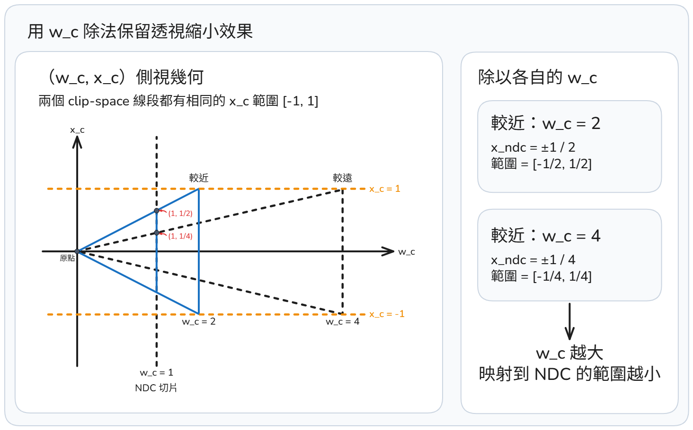

同樣的 $x_c$ 範圍除以較大的 $w_c$ 後，會覆蓋較短的 NDC 區間，因此遠處物體會得到較小的投影尺寸

這個階段會產生尚未套用 viewport 寬度、高度與像素座標的 NDC。 在將這批位置交給視埠轉換前，我們另外再補充一下為何裁切會位於透視除法之前

##### 為什麼不能直接先做完 perspective divide 再做 clipping？

這是我當初在看時想到的疑問：你做 clipping 時明明就是用 NDC 座標在判斷要裁切的範圍的，那為什麼不先做完 perspective divide 再做 clipping？

前一節從 NDC 的標準可見範圍推導出了六個 clip-space 裁切條件。 兩組條件描述的是同一個可見邊界，而裁切階段實際接收的是圖元的 clip-space 位置

若要先執行 perspective divide，再於 NDC 中裁切，裁切階段仍然需要完成兩項工作：

- 找出圖元與 NDC 可見邊界的交點位置
- 為每個交點建立完整的新頂點，包含位置以及對應的 UV 等頂點資料

第一項工作可以直接使用 NDC 位置。 第二項工作還需要知道交點位於原 clip-space 邊上的比例，才能按照原本的內插規則算出 UV 等資料

由於透視除法產生的 NDC 位置只包含 $x_c/w_c$、$y_c/w_c$ 與 $z_c/w_c$ 三個比值，沒有包含原本的 $w_c$。 當邊上兩端的 $w_c$ 不同時，透視除法會改變交點在線段上的比例，因此管線必須另外保留兩端原本的 $w_c$，才能從 NDC 中的比例換回 clip-space 中的比例

以下用一組具體數值來觀察這項差異。 假設兩個端點的 $(x_c,w_c)$ 分別是：

$$
(x_{c,A},w_{c,A})=(0,1),
\quad
(x_{c,B},w_{c,B})=(4,2)
$$

右裁切平面滿足 $x_c=w_c$。 以 $t$ 表示交點位於原 clip-space 邊上的比例，沿這條邊移動時：

$$
x_c(t)=4t,
\quad
w_c(t)=1+t
$$

因此交點在 clip-space 邊上的比例是：

$$
4t=1+t
\quad\Longrightarrow\quad
t=\frac13
$$

如果先對兩個端點執行透視除法，它們的 NDC x 座標則會是 $0$ 與 $2$。 若以 $\tau$ 表示交點在這條 NDC 線段上的比例，右邊界 $x_{\mathrm{ndc}}=1$ 會得到：

$$
(1-\tau)\cdot0+\tau\cdot2=1
\quad\Longrightarrow\quad
\tau=\frac12
$$

可以看見同一個交點在 clip-space 邊上的比例是 $t=1/3$，在 NDC 線段上的比例卻是 $\tau=1/2$。 裁切建立的交點不只需要位置，也要取得對應的頂點資料。 以本文採用預設內插規則的 UV 為例，假設頂點 $A$ 與頂點 $B$ 的 u 座標分別是 $0$ 與 $1$，使用原 clip-space 參數 $t$ 會得到：

$$
u_I
=(1-t)\cdot0+t\cdot1
=\frac13
$$

若改用 NDC 線段上的 $\tau$ 直接做線性內插，則會錯誤地得到：

$$
u_I'
=(1-\tau)\cdot0+\tau\cdot1
=\frac12
$$

但如果管線另外保留了邊上兩端的 $w_c$，就能將 $\tau$ 換回原 clip-space 邊上的 $t$：

$$
t
=\frac{\tau w_{c,A}}
       {(1-\tau)w_{c,B}+\tau w_{c,A}}
$$

將 $\tau=1/2$、$w_{c,A}=1$ 與 $w_{c,B}=2$ 代入後，會還原出 $t=1/3$，接著便能用這個比例算出正確的 UV。 因此，當整個圖元都位於 $w_c>0$ 的區域，而且管線保留了這些資料時，就能在 NDC 中完成裁切

不過一般 rendering pipeline 還必須處理穿過 $w_c=0$ 的圖元。 對 clip-space 邊上的位置而言，$w_c$ 會依原邊參數 $t$ 線性變化：

$$
w_c(t)
=(1-t)w_{c,A}+t w_{c,B}
$$

如果 $w_{c,A}>0$ 且 $w_{c,B}<0$，那麼這條邊會在下列位置經過 $w_c=0$：

$$
t_0
=\frac{w_{c,A}}{w_{c,A}-w_{c,B}},
\quad
0<t_0<1
$$

透視除法無法在 $t_0$ 計算 $x_c/w_c$、$y_c/w_c$ 與 $z_c/w_c$。 因此，穿過 $w_c=0$ 的邊無法先變成一條完整且有限的 NDC 線段，再以一般線段的方式接受裁切

在本文使用的標準透視投影矩陣中，$w_c$ 保存的是頂點沿相機視線軸的前後位置。 它和 view-space 的 z 座標具有下列關係：

$$
w_c=-z_v
$$

由於相機位於 view-space 原點並看向 $-Z$，因此 $w_c$ 的正負號會對應到：

- $z_v<0$、$w_c>0$：頂點位於相機前方
- $z_v=0$、$w_c=0$：頂點位於相機所在的平面
- $z_v>0$、$w_c<0$：頂點位於相機後方

例如一條邊的兩端分別具有 $z_{v,A}=-1$ 與 $z_{v,B}=1$，投影後便會得到 $w_{c,A}=1$ 與 $w_{c,B}=-1$。 走到邊的中點 $t=1/2$ 時，$z_v(t)=0$ 且 $w_c(t)=0$，所以這條邊會在相機所在的平面穿過無法執行透視除法的位置。 近平面則位於 $z_v=-n$，對應的 $w_c=n>0$

而相較之下，此時的 clip-space 位置與平面判定值仍然有限，管線可以先在 homogeneous clip-space 中截斷圖元，再讓留下且具有有效 $w_c$ 的頂點執行透視除法

前面我們提的一般 rendering pipeline 的做法會先在 homogeneous clip-space 中裁切。 這個順序能在除法前處理好穿過 $w_c=0$ 的圖元，也能依各項頂點資料的內插規則建立正確的交點資料。 管線確定可見部分後，才會對留下且具有有效 $w_c$ 的頂點執行透視除法。 若實作選擇在 NDC 中完成部分裁切，就必須保留原本的 $w_c$，並執行上述參數換算

簡單來說，這兩種順序的差別是：

- 先在 homogeneous clip-space 中裁切：可以直接處理穿過 $w_c=0$ 的圖元，並使用 clip-space 邊上的比例建立完整的新頂點
- 先轉成 NDC 再裁切：圖元必須位於 $w_c>0$ 的區域，而且管線需要在 NDC 的階段額外再保留原本的 $w_c$，以利用它換算交點的頂點資料

##### 共用範例：四筆 clip-space 頂點轉成 NDC

前一節的裁切範例中我們移除了三角形 $ABC$ 超出右裁切平面的部分，並建立了兩個交點 $I_0$ 與 $I_1$，接著再將留下的四邊形拆成了三角形 $T_0=[A,I_0,I_1]$ 與 $T_1=[A,I_1,C]$。 因此，進入這個階段時，我們手上有兩個三角形的頂點順序，以及四筆不重複的頂點資料。 若沿用上一節的頂點編號，這組順序可以寫成索引 `[0, 1, 2, 0, 2, 3]`，四筆頂點資料則是：

- 頂點 $A$：clip-space 位置為 $\left(-1,-1,\frac14,2\right)$，RGBA 為 $(1,0,0,1)$，UV 為 $(0,0)$
- 頂點 $I_0$：clip-space 位置為 $\left(2,-1,\frac14,2\right)$，RGBA 為 $\left(\frac14,\frac34,0,1\right)$，UV 為 $\left(\frac34,0\right)$
- 頂點 $I_1$：clip-space 位置為 $\left(\frac94,0,\frac{9}{16},\frac94\right)$，RGBA 為 $\left(0,\frac34,\frac14,1\right)$，UV 為 $\left(\frac34,\frac14\right)$
- 頂點 $C$：clip-space 位置為 $\left(0,3,\frac32,3\right)$，RGBA 為 $(0,0,1,1)$，UV 為 $(0,1)$

接下來為了把這四筆頂點交給 viewport transform，我們需要將每筆 clip-space 位置轉成 NDC 位置。 透視除法會將每筆位置的 x、y 與 z 分別除以該頂點自己的 $w_c$，三角形的頂點順序、RGBA 與 UV 則保持不變。 同時，管線還會算出並保存 $\rho=1/w_c$，供後續內插使用，讓它繼續與對應的頂點保持關聯：

$$
\begin{aligned}
\mathbf{p}_{A,\mathrm{ndc}}
&= \left(-\frac12,-\frac12,\frac18\right),
& \rho_A&=\frac12, \\
\mathbf{p}_{I_0,\mathrm{ndc}}
&= \left(1,-\frac12,\frac18\right),
& \rho_{I_0}&=\frac12, \\
\mathbf{p}_{I_1,\mathrm{ndc}}
&= \left(1,0,\frac14\right),
& \rho_{I_1}&=\frac49, \\
\mathbf{p}_{C,\mathrm{ndc}}
&= \left(0,1,\frac12\right),
& \rho_C&=\frac13.
\end{aligned}
$$

例如 $I_1$ 的 x 與 z 分量會算成：

$$
x_{I_1,\mathrm{ndc}}
= \frac{9/4}{9/4}=1,
\quad
z_{I_1,\mathrm{ndc}}
= \frac{9/16}{9/4}=\frac14.
$$

由於 $I_0$ 與 $I_1$ 的 $x_{\mathrm{ndc}}=1$，因此仍位於 NDC 的右邊界。 這個階段交給視埠轉換的資料，是四筆 NDC 位置，以及仍與各頂點保持關聯的 $\rho$、RGBA 與 UV。 下圖我們逐筆對齊了這些輸入與輸出，以方便確認每個頂點使用的是自己的 $w_c$：

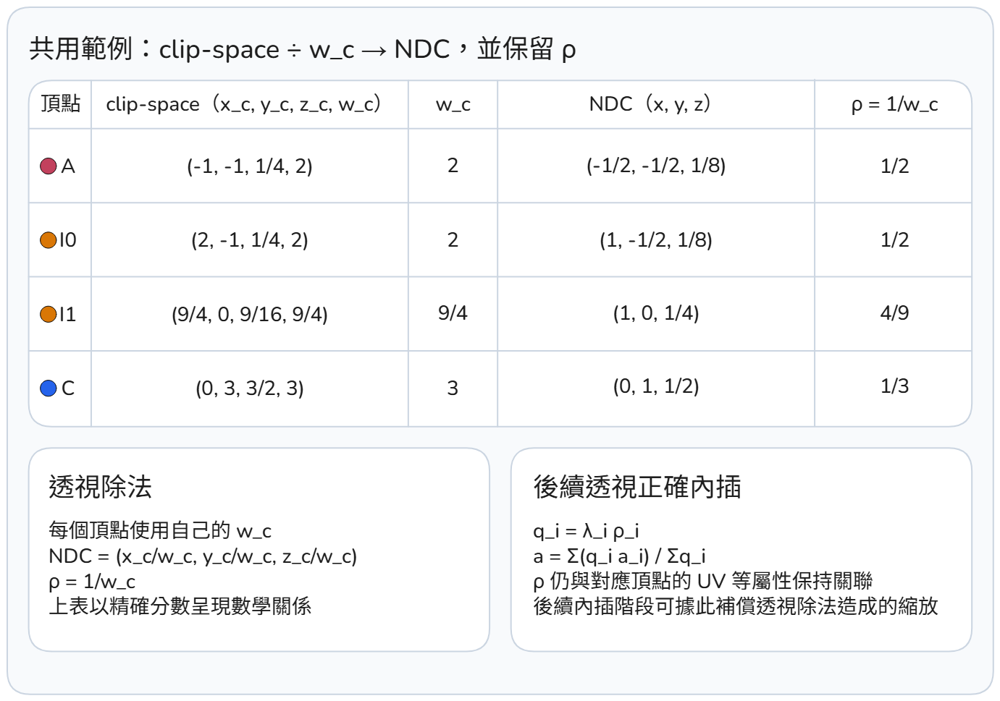

圖中我們以精確分數銜接了裁切與視埠轉換。 實作時選用的浮點數、定點數與捨入方式，都需要維持這裡描述的座標關係並產生符合圖形 API 的結果

#### viewport transform：把 NDC 映射到 screen-space 座標

Perspective divide 階段的輸出為 NDC 位置，以及仍與頂點相連的 $\rho$、RGBA 與 UV。 接下來為了讓 rasterizer 知道每個頂點位於目前視埠的什麼位置，以及具有多少深度，我們需要將 NDC 映射到 screen-space

在這個階段，OpenGL context 所設定的 viewport 矩形會提供輸出區域的起點、寬度與高度，depth range 則會指定後續 depth test 使用的深度範圍。 視埠轉換（viewport transform）會依這兩項狀態，將 NDC 的 x、y 與 z 轉成連續的 screen-space x、y 與深度

為了用一個運算表示上述映射，我們會將視埠轉換寫成一個 $4\times4$ 矩陣，並記作 $M_{\mathrm{viewport}}$。 這個矩陣包含縮放與平移兩個步驟。 縮放會將 NDC 的 x、y 與 z 範圍調整成視埠的寬度、高度與深度範圍的跨度，平移則會將調整後的範圍移到視埠與深度範圍指定的位置

接下來我們要推導 $M_{\mathrm{viewport}}$ 中的縮放與平移係數。 為此，我們先來確認它在完整的座標轉換流程中會接收哪一種座標，以及要輸出哪一種座標。 前面 MVP transformation 中的 $M_{\mathrm{view}}$ 會依相機位置與方向，將 world-space 位置轉成 view-space 位置。 經過 projection transformation、clipping 與 perspective divide 後，$M_{\mathrm{viewport}}$ 會接收該 NDC 位置，並將它映射到 screen-space：

$$
\begin{aligned}
\mathbf{p}_{\mathrm{world}}
&\xrightarrow{M_{\mathrm{view}}}
\mathbf{p}_{\mathrm{view}}, \\
\mathbf{p}_{\mathrm{view}}
&\xrightarrow{M_{\mathrm{projection}}}
\mathbf{p}_{\mathrm{clip}}, \\
\mathbf{p}_{\mathrm{clip}}
&\xrightarrow{\text{clipping 保留或建立}}
\mathbf{p}_{\mathrm{clip,visible}}, \\
\mathbf{p}_{\mathrm{clip,visible}}
&\xrightarrow{\mathrm{perspective\ divide}}
\mathbf{p}_{\mathrm{ndc}}, \\
\mathbf{p}_{\mathrm{ndc}}
&\xrightarrow{M_{\mathrm{viewport}}}
\mathbf{p}_{\mathrm{window}}.
\end{aligned}
$$

其中 clipping 會以整個圖元為單位來判斷可見範圍。 $\mathbf{p}_{\mathrm{clip,visible}}$ 可能是保留下來的原頂點，也可能是圖元與裁切平面相交時建立的新頂點。 Perspective divide 與 viewport transform 會接著逐一轉換這些可見頂點

為了展開 x 與 y 的映射公式，我們先確定兩邊使用的座標範圍。 NDC 以固定的標準範圍表示左、右、上與下，screen-space 則以實際視埠建立連續座標系。 本文沿用了 OpenGL 的左下角原點慣例，向右是 $+x$，向上是 $+y$

假設視埠左下角是 $(x_0, y_0)$，寬度與高度分別是 $w_{\mathrm{viewport}}$、$h_{\mathrm{viewport}}$，而且使用 OpenGL 預設的 $[0, 1]$ depth range。 為了讓 $M_{\mathrm{viewport}}$ 能夠同時表示縮放與平移，我們會先在三維 NDC 位置後補上第四個分量 $1$，建立供矩陣運算使用的齊次表示：

$$
\mathbf{p}_{\mathrm{ndc}}^h
=
\begin{bmatrix}
x_{\mathrm{ndc}} \\
y_{\mathrm{ndc}} \\
z_{\mathrm{ndc}} \\
1
\end{bmatrix}
$$

現在我們要將 NDC 的 x 與 y 從無單位的 $[-1,1]$ 範圍，映射到 viewport 的連續 screen-space 座標。 根據前面定義的 viewport 位置與大小，x 的目標範圍是 $[x_0,x_0+w_{\mathrm{viewport}}]$，y 的目標範圍則是 $[y_0,y_0+h_{\mathrm{viewport}}]$。 所以當 $x_0=y_0=0$ 時，目標區域就是 $[0,w_{\mathrm{viewport}}]\times[0,h_{\mathrm{viewport}}]$

要推導這項映射，我們先將 x 方向的轉換寫成「縮放後再平移」的一次函數：

$$
x_{\mathrm{window}}
=a_x x_{\mathrm{ndc}}+b_x
$$

NDC 的左邊界 $x_{\mathrm{ndc}}=-1$ 要對應到 viewport 左邊界 $x_0$，右邊界 $x_{\mathrm{ndc}}=1$ 則要對應到 $x_0+w_{\mathrm{viewport}}$。 因此 $a_x$ 與 $b_x$ 必須滿足：

$$
\begin{aligned}
-a_x+b_x &= x_0, \\
 a_x+b_x &= x_0+w_{\mathrm{viewport}}.
\end{aligned}
$$

將第二式減去第一式，可以解出縮放係數 $a_x$。 將兩式相加，則可以解出平移量 $b_x$：

$$
\begin{aligned}
2a_x
&=w_{\mathrm{viewport}}
&\Longrightarrow\quad
a_x&=\frac{w_{\mathrm{viewport}}}{2}, \\
2b_x
&=2x_0+w_{\mathrm{viewport}}
&\Longrightarrow\quad
b_x&=x_0+\frac{w_{\mathrm{viewport}}}{2}.
\end{aligned}
$$

y 方向使用相同的方法，將 $[-1,1]$ 的兩個端點分別對應到 $y_0$ 與 $y_0+h_{\mathrm{viewport}}$：

$$
\begin{aligned}
-a_y+b_y &= y_0, \\
 a_y+b_y &= y_0+h_{\mathrm{viewport}}
\end{aligned}
\quad\Longrightarrow\quad
a_y=\frac{h_{\mathrm{viewport}}}{2},
\quad
b_y=y_0+\frac{h_{\mathrm{viewport}}}{2}.
$$

深度方向則要把 $z_{\mathrm{ndc}}\in[-1,1]$ 映射到預設的 screen-space depth range $[0,1]$。 將 $z_{\mathrm{window}}=a_z z_{\mathrm{ndc}}+b_z$ 的兩個端點代入後會得到：

$$
\begin{aligned}
-a_z+b_z &= 0, \\
 a_z+b_z &= 1,
\end{aligned}
\quad\Longrightarrow\quad
a_z=\frac12,
\quad
b_z=\frac12.
$$

將這三組縮放係數與平移量分別放入矩陣的前三列，便能得到我們的 $M_{\mathrm{viewport}}$ 了：

$$
\mathbf{p}_{\mathrm{window}}^h
=M_{\mathrm{viewport}}\mathbf{p}_{\mathrm{ndc}}^h,
\quad
M_{\mathrm{viewport}}
=
\begin{bmatrix}
\frac{w_{\mathrm{viewport}}}{2} & 0 & 0 & x_0+\frac{w_{\mathrm{viewport}}}{2} \\
0 & \frac{h_{\mathrm{viewport}}}{2} & 0 & y_0+\frac{h_{\mathrm{viewport}}}{2} \\
0 & 0 & \frac{1}{2} & \frac{1}{2} \\
0 & 0 & 0 & 1
\end{bmatrix}.
$$

把矩陣的前兩列展開後，就是所謂的視埠轉換公式：

$$
\begin{aligned}
x_{\mathrm{window}}
  &= x_0 + \frac{x_{\mathrm{ndc}} + 1}{2}w_{\mathrm{viewport}}, \\
y_{\mathrm{window}}
  &= y_0 + \frac{y_{\mathrm{ndc}} + 1}{2}h_{\mathrm{viewport}}.
\end{aligned}
$$

假設視埠從 $(0, 0)$ 開始，大小是 $800 \times 600$：

$$
\begin{aligned}
\mathrm{NDC}\ (-1,-1) &\longrightarrow \mathrm{window}\ (0,0), \\
\mathrm{NDC}\ (0,0)   &\longrightarrow \mathrm{window}\ (400,300), \\
\mathrm{NDC}\ (1,1)   &\longrightarrow \mathrm{window}\ (800,600).
\end{aligned}
$$

下圖我們以 $W$ 與 $H$ 來簡寫了 viewport 的寬度與高度，並將數值範例設為 $x_0=y_0=0$、$W=H=4$。 我們會追蹤 NDC 位置 $(-0.25,-0.25)$，觀察視埠轉換如何將它映射到連續的 OpenGL screen-space：

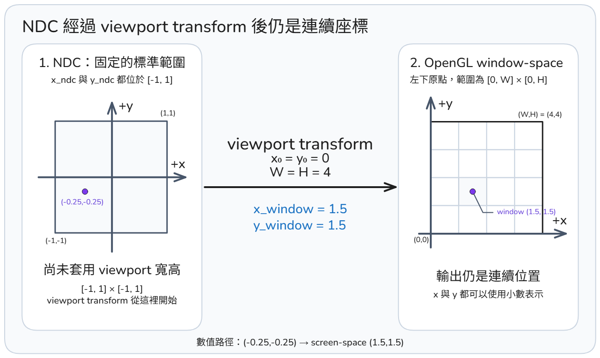

將這組數值代入視埠轉換公式，可以得到：

$$
\begin{aligned}
x_{\mathrm{window}}
  &= 0 + \frac{-0.25+1}{2}\times4
   = 1.5, \\
y_{\mathrm{window}}
  &= 0 + \frac{-0.25+1}{2}\times4
   = 1.5.
\end{aligned}
$$

$M_{\mathrm{viewport}}$ 的第三列則是前面由兩個端點解出的 $z_{\mathrm{window}}=(z_{\mathrm{ndc}}+1)/2$。 它會產生後續 depth test 要使用的 screen-space 深度，在本文採用的深度規則中，$0$ 對應近平面，$1$ 對應遠平面

綜上所述，完成視埠轉換後，我們會輸出具有 screen-space x、y 與深度 z 的頂點。 每個頂點原有的 $\rho$、RGBA 與 UV 仍會保留下來，供 rasterization 與後續著色階段使用

##### 共用範例：NDC 頂點映射到 $8\times8$ viewport

前一節執行完透視除法後，我們成功將裁切後的四筆頂點 $A$、$I_0$、$I_1$ 與 $C$ 轉成了下列 NDC 位置：

$$
\begin{aligned}
\mathbf{p}_{A,\mathrm{ndc}}
&= \left(-\frac12,-\frac12,\frac18\right), \\
\mathbf{p}_{I_0,\mathrm{ndc}}
&= \left(1,-\frac12,\frac18\right), \\
\mathbf{p}_{I_1,\mathrm{ndc}}
&= \left(1,0,\frac14\right), \\
\mathbf{p}_{C,\mathrm{ndc}}
&= \left(0,1,\frac12\right).
\end{aligned}
$$

頂點順序仍由索引 `[0, 1, 2, 0, 2, 3]` 指定，對應 $T_0=[A,I_0,I_1]$ 與 $T_1=[A,I_1,C]$。 每筆頂點的 $\rho$、RGBA 與 UV 也仍與各自的 NDC 位置保持關聯

接下來，我們要讓 rasterizer 知道這兩個三角形位於輸出影像中的哪個位置，因此需要將 NDC 位置映射到共用範例的 viewport。 這個 viewport 的左下角為 $(0,0)$、大小為 $8\times8$，depth range 則為 $[0,1]$

這個階段會使用前面推導完的視埠轉換公式：

$$
\begin{aligned}
x_{\mathrm{window}}
&=x_0+\frac{x_{\mathrm{ndc}}+1}{2}w_{\mathrm{viewport}}, \\
y_{\mathrm{window}}
&=y_0+\frac{y_{\mathrm{ndc}}+1}{2}h_{\mathrm{viewport}}, \\
z_{\mathrm{window}}
&=\frac{z_{\mathrm{ndc}}+1}{2}.
\end{aligned}
$$

將 $x_0=y_0=0$ 與 $w_{\mathrm{viewport}}=h_{\mathrm{viewport}}=8$ 代入前兩式，並沿用 $[0,1]$ depth range 對應的第三式後，我們可以得到：

$$
x_{\mathrm{window}}=4(x_{\mathrm{ndc}}+1),
\quad
y_{\mathrm{window}}=4(y_{\mathrm{ndc}}+1),
\quad
z_{\mathrm{window}}=\frac{z_{\mathrm{ndc}}+1}{2}.
$$

以頂點 $A$ 為例。 它的 NDC 位置為：

$$
\mathbf{p}_{A,\mathrm{ndc}}
=\left(-\frac12,-\frac12,\frac18\right).
$$

將三個分量分別代入視埠轉換公式後，可以得到：

$$
\begin{aligned}
x_{A,\mathrm{window}}
&=4\left(-\frac12+1\right)=2, \\
y_{A,\mathrm{window}}
&=4\left(-\frac12+1\right)=2, \\
z_{A,\mathrm{window}}
&=\frac{\frac18+1}{2}=\frac{9}{16}.
\end{aligned}
$$

因此，頂點 $A$ 的 screen-space 位置為：

$$
\mathbf{p}_{A,\mathrm{window}}
=\left(2,2,\frac{9}{16}\right).
$$

對其餘三筆頂點也套用上相同的方法來計算，結果為：

$$
\begin{aligned}
\mathbf{p}_{I_0,\mathrm{window}}
&= \left(8,2,\frac{9}{16}\right), \\
\mathbf{p}_{I_1,\mathrm{window}}
&= \left(8,4,\frac58\right), \\
\mathbf{p}_{C,\mathrm{window}}
&= \left(4,8,\frac34\right).
\end{aligned}
$$

到這裡，我們就取得了兩個三角形的 OpenGL screen-space 座標：

$$
T_0=[(2,2),(8,2),(8,4)],
\quad
T_1=[(2,2),(8,4),(4,8)].
$$

視埠轉換會把這四筆描述三角形 $T_0$ 與 $T_1$ 的資料，也就是 OpenGL screen-space 位置，連同其各自的 $\rho$、RGBA 與 UV，以及索引 `[0, 1, 2, 0, 2, 3]` 交給 rasterization。 下圖我們將四筆輸出頂點與兩個三角形放進了 $8\times8$ viewport：

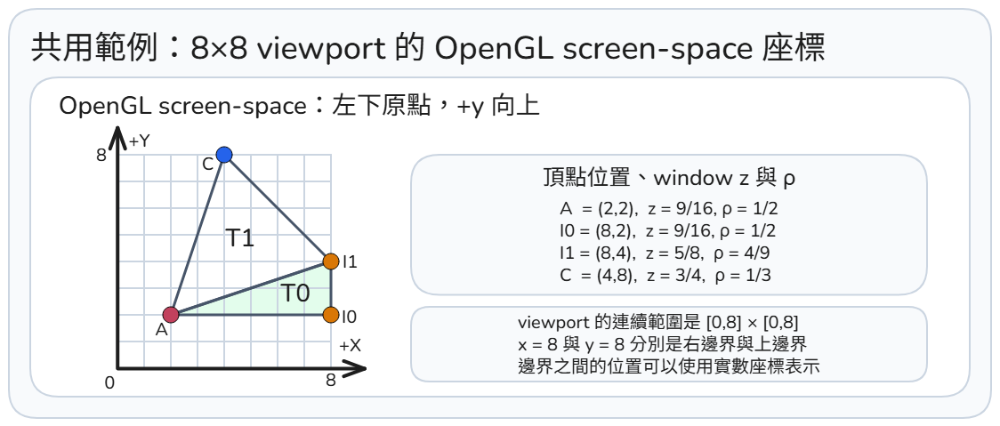

### Rasterization：從 screen-space 圖元產生片段資料

做完前一節的圖元處理後，我們手上會有位於 screen-space 座標中的三角形，以及每筆頂點的 screen-space 深度、$\rho$、RGBA 與 UV。 接下來我們要找出這個三角形會影響離散影像中的哪些位置，並為每個位置準備後續著色所需的資料。 這項工作會由光柵化（rasterization）完成

它的輸出影像會由一格一格的像素（pixel）組成，每個像素都是影像網格中以整數座標 $(i,j)$ 編號的一個格子。 但前面三角形在描述形狀時使用的是連續座標，因此 rasterizer 必須決定三角形涵蓋了每個像素內的哪些位置。 為此，它會在每個像素內設定一個或多個取樣位置（sample position），每個位置都會對應一個 sample。 取樣位置是執行幾何判定時使用的座標，sample 則是這個座標所對應的取樣單位，用來保存涵蓋判定及後續處理的結果

每個像素包含多少個 sample，取決於目前使用的取樣模式。 如果每個像素只有一個 sample，這種設定稱為 `single-sample` 模式。 如果每個像素具有多個 sample，則稱為 `multisample` 模式。 後者會分別判斷每個 sample 的取樣位置是否被三角形涵蓋，並將判定結果記錄在對應的 sample 中，因此能更細緻地表示三角形只涵蓋像素一部分的情況

本文的共用範例採用 `single-sample`，並將唯一一個 sample 的取樣位置設在像素中心。 下圖會先以 OpenGL screen-space 的 y 軸向上座標，解釋像素索引、像素邊界與中心取樣位置的關係：

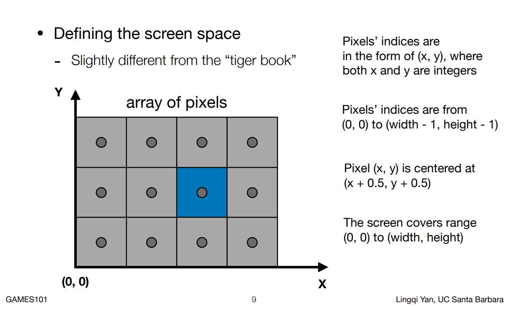

圖中的每個像素都以一組整數 $(i,j)$ 作為索引。 在這套座標中，x 每相差 $1$ 個 screen-space 座標單位，就表示水平方向相隔一個像素的寬度，而 y 每相差 $1$ 個單位，則表示垂直方向相隔一個像素的高度。 因此，像素 $(i,j)$ 的左、右邊界分別位於 $x=i$ 與 $x=i+1$，下、上邊界則分別位於 $y=j$ 與 $y=j+1$，中心取樣位置位於 $(i+0.5,j+0.5)$

在檢查各個 sample 的取樣位置以前，管線還可以先使用三個 screen-space 頂點的環繞方向，來判斷目前正在處理的三角形圖元是正面圖元還是背面圖元。 若 Application 不希望繪製某個朝向，就可以啟用面剔除（face culling），讓該方向的三角形不再進入 coverage。 本文的共用範例沿用 OpenGL 預設狀態，不會啟用面剔除，因此兩種朝向都能繼續處理

此外，triangle coverage 的目標是找出哪些 sample 的取樣位置落在三角形的二維內部，因此三個頂點必須能在 screen-space 中圍出具有面積的區域。 三個頂點若發生了共線或重合，圍出的面積便是 $0$。 這種圖元稱為退化三角形（degenerate triangle），不會像一般三角形一樣產生被涵蓋的 sample

找出被三角形涵蓋的 sample 後，我們還需要算出每個 sample 的 RGBA、UV 與候選 screen-space 深度，才能準備後續著色所需的資料。 為此，rasterizer 會接著執行 barycentric interpolation，在目標內插位置算出三個重心權重，再依各項頂點資料的內插規則產生結果

到這裡，rasterizer 已經知道三角形涵蓋了該像素內的哪些 samples，也已經算出了後續處理這些 samples 時要使用的 RGBA、UV 與候選 screen-space 深度。 接著 rasterizer 會把這些資料整理成一筆片段（fragment）。 就本文追蹤的資料而言，每筆片段會包含：

- 片段的 screen-space x、y 位置，以及目前圖元在該像素產生的 coverage mask
- 該位置的候選 screen-space 深度
- 由三筆頂點內插而來的 RGBA 與 UV，這些資料會成為 fragment shader 的輸入

片段是之後可能寫入像素的候選資料，一個三角形在一個像素內只會產生一筆 fragment，而如果有兩個三角形都涵蓋了某個像素，那該像素就會有兩個對應的 fragment，之後我們會再透過一系列的規則來決定最終要用哪個 fragment 的內容來寫入該像素

當同一個三角形在同一個像素內涵蓋多個 samples 時，這些結果會記錄在同一筆 fragment 的 coverage mask 中，其中每個 bit 對應一個 sample。 當多個三角形同時覆蓋同一個像素時，rasterizer 會分別為它們產生各自的片段，因此一個像素可以有多筆候選資料。 光柵化產生這些片段後會再將它們交給後續管線繼續處理，後續的階段會再將其輸出為實際要寫入像素的資料

下面兩個 H4 會依序展開 triangle coverage 與 barycentric interpolation，並明確列出兩者各自使用與交出的資料

#### triangle coverage：找出三角形會影響的像素

Triangle coverage 的目標是利用三筆頂點的 screen-space x 與 y 座標界定三角形邊界，再按照上一段介紹的取樣位置配置（sample pattern），取得每個 sample 的取樣位置，並判斷其中哪些 sample 被三角形涵蓋。 只有被涵蓋的 sample 才需要繼續做內插與著色

為此，rasterizer 會逐一確認每個 sample 的取樣位置是位於三角形的內部、外部，還是剛好落在邊上。 位於內部時，對應的 sample 會記為被三角形涵蓋。 位於外部時，該 sample 則不會繼續處理。 對於剛好落在邊上的取樣位置，rasterizer 還需要根據邊的方向，決定對應的 sample 是否歸屬於目前的三角形

Application 會透過畫面緩衝區與相關 API 狀態選擇 single-sample 或 multisample，以及每個像素內的 sample 數量。 各個 sample 的取樣位置則由圖形 API 與實作規則決定

Triangle coverage 會判斷同一個像素內的每個 sample 是否有被三角形涵蓋，再將這些布林結果依 sample index 記錄成一筆 coverage mask。 下一個 barycentric interpolation 的階段會逐一處理被涵蓋的 sample，使用對應的取樣位置與三筆頂點資料算出 RGBA、UV 與深度

本文的共用範例只檢查一個 sample，並將它的取樣位置設在像素中心。 因此，triangle coverage 對每個像素要回答的問題是「這個 sample 的取樣位置是否位於三角形內？」

假設目標像素為 $(10, 20)$，光柵化器會先檢查它的中心。 這裡我們將實際採用的取樣位置記為 $\mathbf{p}_{\mathrm{sample}}$：

$$
\mathbf{p}_{\mathrm{sample}} = (10.5, 20.5)
$$

接著我們要判斷這個取樣位置是否位於三角形內。 以下將它命名為點 $P$，其位置向量就是 $\mathbf{p}_{\mathrm{sample}}$。 判斷時，我們會沿著 $A\to B\to C$ 的頂點順序，分別檢查 $P$ 是位於這三條有向邊的內側還是外側

先以有向邊 $A\to B$ 為例。 第三個頂點 $C$ 所在的一側就是這條邊的三角形內側，因此我們的第一個目標是判斷 $P$ 與 $C$ 是否位於直線 $AB$ 的同一側。 Triangle coverage 只需要比較 x 與 y，不會使用頂點的 screen-space 深度。 因此，在接下來的二維內外判定中，我們會暫時忽略深度，將兩條邊的向量都寫成 z 分量為 $0$ 的三維向量：

$$
\overrightarrow{AB}
=\left(x_B-x_A,\ y_B-y_A,\ 0\right),
\quad
\overrightarrow{AC}
=\left(x_C-x_A,\ y_C-y_A,\ 0\right)
$$

接著，我們利用這兩個向量的外積來建立一個可供後續比較的三角形法向量。 對任意兩個向量 $\mathbf{u}=(u_x,u_y,u_z)$ 與 $\mathbf{v}=(v_x,v_y,v_z)$ 而言，外積的三個分量為：

$$
\mathbf{u}\times\mathbf{v}
=\left(
u_yv_z-u_zv_y,
u_zv_x-u_xv_z,
u_xv_y-u_yv_x
\right)
$$

將 $\overrightarrow{AB}$ 與 $\overrightarrow{AC}$ 代入後，可以得到：

$$
\mathbf{n}
=\overrightarrow{AB}\times\overrightarrow{AC}
=\left(
0,\ 0,\
(x_B-x_A)(y_C-y_A)
-(y_B-y_A)(x_C-x_A)
\right)
$$

從算式可以直接看到，$\mathbf{n}$ 的 x 與 y 分量都是 $0$，只有 z 分量可能不為 $0$。 但由於前面已排除了退化的三角形，所以這個 z 分量不會是 $0$。 它大於 $0$ 時，$\mathbf{n}$ 會指向 $+Z$，小於 $0$ 時則會指向 $-Z$。 這個正負號取決於 $A\to B\to C$ 的頂點順序，用來記錄頂點 $C$ 位於直線 $AB$ 的哪一側。 例如將 $B$ 與 $C$ 的順序交換後，外積便會變成 $\overrightarrow{AC}\times\overrightarrow{AB}=-\mathbf{n}$

接下來我們要以同一條邊 $AB$ 測試點 $P$，看看它是否與 $C$ 位於直線 $AB$ 的同一側。 為此，我們還要建立從 $A$ 指向 $P$ 的向量 $\overrightarrow{AP}$，再計算：

$$
\overrightarrow{AB}\times\overrightarrow{AP}
$$

這個測試向量是利用已知的 $A$、$B$ 與 $P$ 算出來的結果。 它和 $\mathbf{n}=\overrightarrow{AB}\times\overrightarrow{AC}$ 都以 $\overrightarrow{AB}$ 作為第一個向量。 因此，只要比較兩個外積向量的方向，就能知道 $P$ 與 $C$ 是否位於直線 $AB$ 的同一側了

為了將同向、反向與零向量這三種結果轉成一個可以比較正負號的數值，我們會計算測試向量與基準法向量 $\mathbf{n}$ 的內積，並將結果記為 $s_{AB}(P)$：

$$
s_{AB}(P)
=\left(\overrightarrow{AB}\times\overrightarrow{AP}\right)
 \cdot\mathbf{n}
$$

兩個向量的內積可以寫成：

$$
\mathbf{a}\cdot\mathbf{b}
=\lVert\mathbf{a}\rVert
 \lVert\mathbf{b}\rVert
 \cos\theta
$$

其中 $\theta$ 是兩個向量的夾角。 兩個非零向量同向時，$\theta=0$ 且 $\cos\theta=1$，因此內積大於 $0$。 兩者反向時，$\theta=\pi$ 且 $\cos\theta=-1$，因此內積小於 $0$。 如果測試向量是零向量，內積便等於 $0$

如此一來：

- $s_{AB}(P)>0$：兩個外積向量同向。 這表示從 $\overrightarrow{AB}$ 轉向 $\overrightarrow{AP}$ 和轉向 $\overrightarrow{AC}$ 的方向相同，因此 $P$ 與 $C$ 位於直線 $AB$ 的同一側，也就是 $P$ 位於有向邊 $A\to B$ 的三角形內側
- $s_{AB}(P)<0$：兩個外積向量方向不同。 這表示兩次轉向的方向相反，因此 $P$ 與 $C$ 位於直線 $AB$ 的不同側，也就是 $P$ 位於這條邊的三角形外側
- $s_{AB}(P)=0$：$\overrightarrow{AB}\times\overrightarrow{AP}$ 是零向量，表示 $\overrightarrow{AB}$ 與 $\overrightarrow{AP}$ 平行，因此 $P$ 位於無限延伸的直線 $AB$ 上

下圖將相同的向量關係套用到了三角形的三條有向邊上，合併起來就可以判斷點 $P$ 是位於三角形的內部還是外部了：

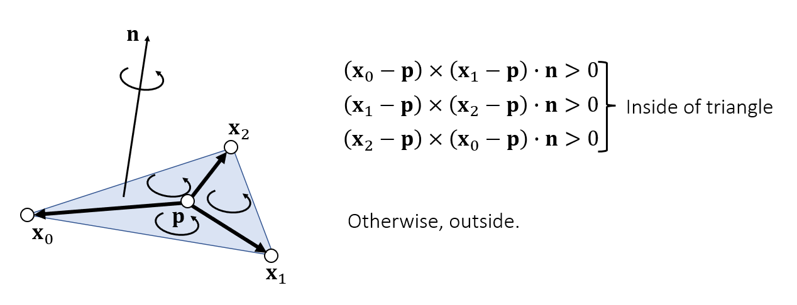

前面我們利用了外積與內積來說明了如何判斷點 $P$ 是位於三角形的內部還是外部。 但由於 Rasterizer 需要對許多 sample 的取樣位置來重複執行這項判定，因此我們需要將前面的向量運算展開成一個只使用 screen-space x 與 y 座標的純量公式。 這樣只要將取樣位置代入公式，就能得到一個數值來判斷它位於有向邊的哪一側了

先以有向邊 $A\to B$ 與待判定位置 $P$ 為例。 已知兩個端點的位置為 $\mathbf{p}_A=(x_A,y_A)$ 與 $\mathbf{p}_B=(x_B,y_B)$，待判定位置為 $\mathbf{p}=(x,y)$，因此兩個向量可以寫成：

$$
\begin{aligned}
\overrightarrow{AB}
&=\left(x_B-x_A,\ y_B-y_A,\ 0\right), \\
\overrightarrow{AP}
&=\left(x-x_A,\ y-y_A,\ 0\right).
\end{aligned}
$$

將 $\overrightarrow{AB}$ 與 $\overrightarrow{AP}$ 代入外積公式後，可以得到：

$$
\begin{aligned}
\overrightarrow{AB}\times\overrightarrow{AP}
&=\left(x_B-x_A,\ y_B-y_A,\ 0\right)
  \times
  \left(x-x_A,\ y-y_A,\ 0\right) \\
&=\left(
0,
0,
(x_B-x_A)(y-y_A)
-(y_B-y_A)(x-x_A)
\right).
\end{aligned}
$$

與前面一樣，由於外積的 x 與 y 分量都是 $0$，因此在判斷 $P$ 位於有向邊哪一側時，只需要專注於 z 分量即可。 為此，我們替這個純量定義了一個函數，稱為邊緣函數（edge function）：

$$
E(\mathbf{p}_A,\mathbf{p}_B,\mathbf{p})
=(x_B-x_A)(y-y_A)-(y_B-y_A)(x-x_A).
$$

邊緣函數會為一條有向邊與一個待判定位置輸出一個帶正負號的純量。 在本文使用的 y-up 座標中，這個數值具有下列意義：

- $E(\mathbf{p}_A,\mathbf{p}_B,\mathbf{p})>0$：$P$ 位於有向邊 $A\to B$ 的左側
- $E(\mathbf{p}_A,\mathbf{p}_B,\mathbf{p})<0$：$P$ 位於有向邊 $A\to B$ 的右側
- $E(\mathbf{p}_A,\mathbf{p}_B,\mathbf{p})=0$：$P$ 位於無限延伸的直線 $AB$ 上

邊緣函數的絕對值也和三角形面積有固定關係。 為了看出這項關係，我們可以用 $2\times2$ 的行列式（determinant）來表示同一個邊緣函數。 一般的 $2\times2$ 行列式會依下式展開：

$$
\det
\begin{bmatrix}
a & b \\
c & d
\end{bmatrix}
=ad-bc
$$

將 $\overrightarrow{AB}$ 的 x 與 y 分量放入第一行，再將 $\overrightarrow{AP}$ 的 x 與 y 分量放入第二行，便會得到：

$$
\begin{aligned}
E(\mathbf{p}_A,\mathbf{p}_B,\mathbf{p})
&=
\det
\begin{bmatrix}
x_B-x_A & x-x_A \\
y_B-y_A & y-y_A
\end{bmatrix}
\\
&=(x_B-x_A)(y-y_A)
 -(x-x_A)(y_B-y_A).
\end{aligned}
$$

前面我們知道 $\overrightarrow{AB}\times\overrightarrow{AP}=(0,0,E(\mathbf{p}_A,\mathbf{p}_B,\mathbf{p}))$，而由於這個外積向量只有 z 分量，所以它的長度就是該分量的絕對值。 假設 $\theta$ 表示 $\overrightarrow{AB}$ 與 $\overrightarrow{AP}$ 的夾角，那我們可以將這項關係寫成：

$$
\begin{aligned}
\left\lVert
\overrightarrow{AB}\times\overrightarrow{AP}
\right\rVert
&=\left|E(\mathbf{p}_A,\mathbf{p}_B,\mathbf{p})\right| \\
&=\left\lVert\overrightarrow{AB}\right\rVert
 \left\lVert\overrightarrow{AP}\right\rVert
 \left|\sin\theta\right| \\
&=2\operatorname{Area}(\triangle ABP).
\end{aligned}
$$

後兩個等號是因為 $\left\lVert\overrightarrow{AB}\right\rVert\left\lVert\overrightarrow{AP}\right\rVert\left|\sin\theta\right|$ 為兩個向量圍成的平行四邊形面積，而三角形 $ABP$ 的面積是它的一半。 將待判定位置 $P$ 換成頂點 $C$ 後，我們會得到一個只取決於三角形三個頂點的數值。 本文將它記為有向雙倍面積 $\mathrm{A}_2$：

$$
\mathrm{A}_2
=E(\mathbf{p}_A,\mathbf{p}_B,\mathbf{p}_C)
$$

在 y-up 座標中，$\mathrm{A}_2>0$ 表示 $A\to B\to C$ 採逆時針順序，$\mathrm{A}_2<0$ 則表示採順時針順序。 $\mathrm{A}_2=0$ 代表三個頂點共線，形成前面已經排除的退化三角形

將邊緣函數與 $\mathrm{A}_2$ 代回前面的內積判定後，可以得到：

$$
\begin{aligned}
s_{AB}(P)
&=\left(\overrightarrow{AB}\times\overrightarrow{AP}\right)
  \cdot\mathbf{n} \\
&=\left(0,0,E(\mathbf{p}_A,\mathbf{p}_B,\mathbf{p})\right)
  \cdot\left(0,0,\mathrm{A}_2\right) \\
&=E(\mathbf{p}_A,\mathbf{p}_B,\mathbf{p})\mathrm{A}_2.
\end{aligned}
$$

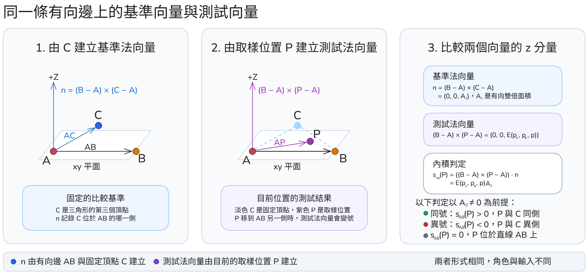

由於 $s_{AB}(P)$ 是 $E(\mathbf{p}_A,\mathbf{p}_B,\mathbf{p})$ 與 $\mathrm{A}_2$ 的乘積，只要比較這兩個值是否同號，就能取得前面內積判定的結果了，不必為每個取樣位置再次計算與 $\mathbf{n}$ 的內積。 Triangle coverage 會對三條有向邊分別計算：

$$
\begin{aligned}
E_{AB}(\mathbf{p}_{\mathrm{sample}})
&=E(\mathbf{p}_A,\mathbf{p}_B,\mathbf{p}_{\mathrm{sample}}), \\
E_{BC}(\mathbf{p}_{\mathrm{sample}})
&=E(\mathbf{p}_B,\mathbf{p}_C,\mathbf{p}_{\mathrm{sample}}), \\
E_{CA}(\mathbf{p}_{\mathrm{sample}})
&=E(\mathbf{p}_C,\mathbf{p}_A,\mathbf{p}_{\mathrm{sample}}).
\end{aligned}
$$

- 如果三個邊緣函數值都與 $\mathrm{A}_2$ 同號，則取樣位置位於三角形內部
- 如果有一個以上的值與 $\mathrm{A}_2$ 異號，則取樣位置位於三角形外部
- 如果沒有任何一個值與 $\mathrm{A}_2$ 異號，但有一個以上的值等於 $0$，則取樣位置位於三角形邊界上，還需要決定對應的 sample 是否歸屬於目前的三角形

##### top-left rule：決定共享邊上的 sample 歸屬

兩個相鄰三角形共同使用的線段稱為共享邊。 當某個 sample 的取樣位置剛好落在共享邊上時，我們需要決定它要由哪一個三角形涵蓋。 如果兩個三角形都將它算在內，rasterizer 會為同一個 sample 產生兩筆候選片段。 如果兩邊都不將它算在內，接縫處則不會產生任何片段

要達成這個目標，我們需要讓共享邊兩側的三角形得到相反的涵蓋結果。 然而，當取樣位置位於共享邊上時，兩個三角形對該線段算出的邊緣函數值都會是 $0$。 這個結果只能告訴我們取樣位置位於邊界上，無法決定它應該歸屬於哪一側。 因此圖形 API 會規定一套用在邊界判定上的規則，本文採用的是 top-left rule，這項規則會將三角形的上邊與左邊納入涵蓋範圍，並排除下邊與右邊

接下來我們要把這四種邊直接寫成 rasterizer 可以計算的代數條件。 本文使用 y-up 座標，並將三角形的三個頂點 $\mathbf{p}_0$、$\mathbf{p}_1$ 與 $\mathbf{p}_2$ 按照逆時針順序排列：

$$
\mathbf{p}_0=(x_0,y_0),
\quad
\mathbf{p}_1=(x_1,y_1),
\quad
\mathbf{p}_2=(x_2,y_2).
$$

沿著 $\mathbf{p}_0\to\mathbf{p}_1\to\mathbf{p}_2\to\mathbf{p}_0$ 走過三角形邊界，可以得到三條有向邊：

$$
\begin{aligned}
\mathbf{e}_0
&=\mathbf{p}_1-\mathbf{p}_0
=(x_1-x_0,\ y_1-y_0), \\
\mathbf{e}_1
&=\mathbf{p}_2-\mathbf{p}_1
=(x_2-x_1,\ y_2-y_1), \\
\mathbf{e}_2
&=\mathbf{p}_0-\mathbf{p}_2
=(x_0-x_2,\ y_0-y_2).
\end{aligned}
$$

我們可以任取一條從 $\mathbf{p}_i=(x_i,y_i)$ 指向 $\mathbf{p}_j=(x_j,y_j)$ 的邊，並將它的兩個分量記為：

$$
\mathbf{e}_{ij}
=\mathbf{p}_j-\mathbf{p}_i
=(\Delta x_{ij},\Delta y_{ij}),
\quad
\Delta x_{ij}=x_j-x_i,
\quad
\Delta y_{ij}=y_j-y_i.
$$

將這兩個分量代入前面的邊緣函數後，可以得到：

$$
\begin{aligned}
E_{ij}(\mathbf{p})
&=E(\mathbf{p}_i,\mathbf{p}_j,\mathbf{p}) \\
&=(x_j-x_i)(y-y_i)-(y_j-y_i)(x-x_i) \\
&=\Delta x_{ij}(y-y_i)-\Delta y_{ij}(x-x_i).
\end{aligned}
$$

現在我們取邊上的一點 $\mathbf{q}$，這代表 $E_{ij}(\mathbf{q})=0$。 再令 $\varepsilon>0$，分別將 $\mathbf{q}$ 往 $+x$ 與 $+y$ 移動 $\varepsilon$，此時其邊緣函數值為：

$$
\begin{aligned}
E_{ij}\left(\mathbf{q}+(\varepsilon,0)\right)
&=-\Delta y_{ij}\varepsilon, \\
E_{ij}\left(\mathbf{q}+(0,\varepsilon)\right)
&=\Delta x_{ij}\varepsilon.
\end{aligned}
$$

由於逆時針三角形的內部滿足 $E_{ij}>0$，因此我們可以根據上式來判斷三角形內部位於這條邊的哪個方向，並將四種邊寫成下列條件：

$$
\begin{aligned}
\text{左邊：}
&\Delta y_{ij}<0,
&\text{內部位於邊的 }+x\text{ 方向}, \\
\text{右邊：}
&\Delta y_{ij}>0,
&\text{內部位於邊的 }-x\text{ 方向}, \\
\text{上邊：}
&\Delta y_{ij}=0\ \land\ \Delta x_{ij}<0,
&\text{內部位於邊的 }-y\text{ 方向}, \\
\text{下邊：}
&\Delta y_{ij}=0\ \land\ \Delta x_{ij}>0,
&\text{內部位於邊的 }+y\text{ 方向}.
\end{aligned}
$$

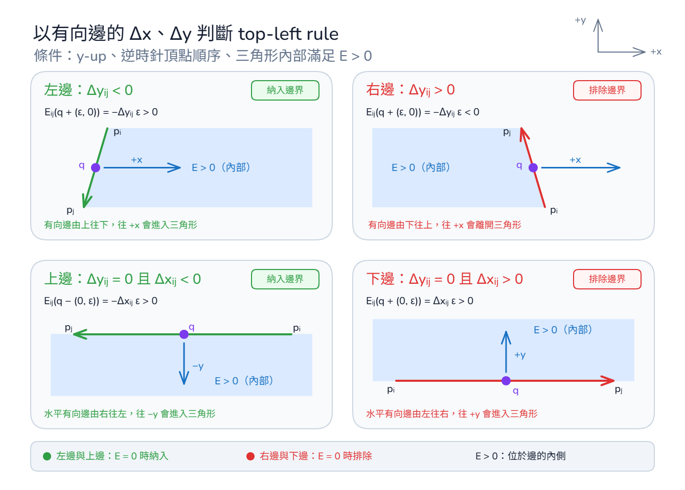

Top-left rule 會納入左邊與上邊，因此如果一個取樣位置要通過某條有向邊的涵蓋判定，必須滿足下面其中一個條件：

- 取樣位置位於有向邊的內側，此時邊緣函數值會大於 $0$：
    $$
    E_{ij}(\mathbf{p}_{\mathrm{sample}})>0
    $$
- 取樣位置正好位於有向邊上，而且該邊是 top-left rule 會納入的左邊或上邊：
    $$
    E_{ij}(\mathbf{p}_{\mathrm{sample}})=0
    \ \land\
    \left[
    \Delta y_{ij}<0
    \ \lor\
    (\Delta y_{ij}=0\land\Delta x_{ij}<0)
    \right]
    $$

如果兩個相鄰三角形採用一致的頂點順序，它們會以相反方向走過共享邊：

- 對非水平共享邊而言，其中一個方向的 $\Delta y$ 會小於 $0$，另一個方向的 $\Delta y$ 則會大於 $0$
- 對水平共享邊而言，其中一個方向的 $\Delta x$ 會小於 $0$，另一個方向的 $\Delta x$ 則會大於 $0$

如此一來，共享邊上的 sample 就只會讓其中一個三角形的涵蓋判定成立了

##### 共用範例：兩個三角形覆蓋哪些像素

前一節的視埠轉換已經將 $A$、$I_0$、$I_1$ 與 $C$ 映射到了 $8\times8$ viewport 的連續 OpenGL screen-space 座標中，並得到了下列兩個三角形：

$$
T_0=[A,I_0,I_1]=[(2,2),(8,2),(8,4)],
$$

$$
T_1=[A,I_1,C]=[(2,2),(8,4),(4,8)].
$$

接下來我們要利用邊緣函數與 top-left rule，判斷每個像素中心是否有被這兩個三角形涵蓋，並產生完整的 coverage mask。 首先，將兩組頂點代入有向雙倍面積公式：

$$
\begin{aligned}
\mathrm{A}_{2,T_0}
&=E\left((2,2),(8,2),(8,4)\right)
=12, \\
\mathrm{A}_{2,T_1}
&=E\left((2,2),(8,4),(4,8)\right)
=32.
\end{aligned}
$$

兩個結果都大於 $0$，表示 $T_0$ 與 $T_1$ 在目前的 y-up 座標中都採用逆時針的頂點順序，因此可以直接使用前面推導的判定式。 兩個三角形共同使用線段 $AI_1$，但 $T_0$ 會沿 $I_1\to A$ 走過它，$T_1$ 則會沿相反的 $A\to I_1$ 走過它

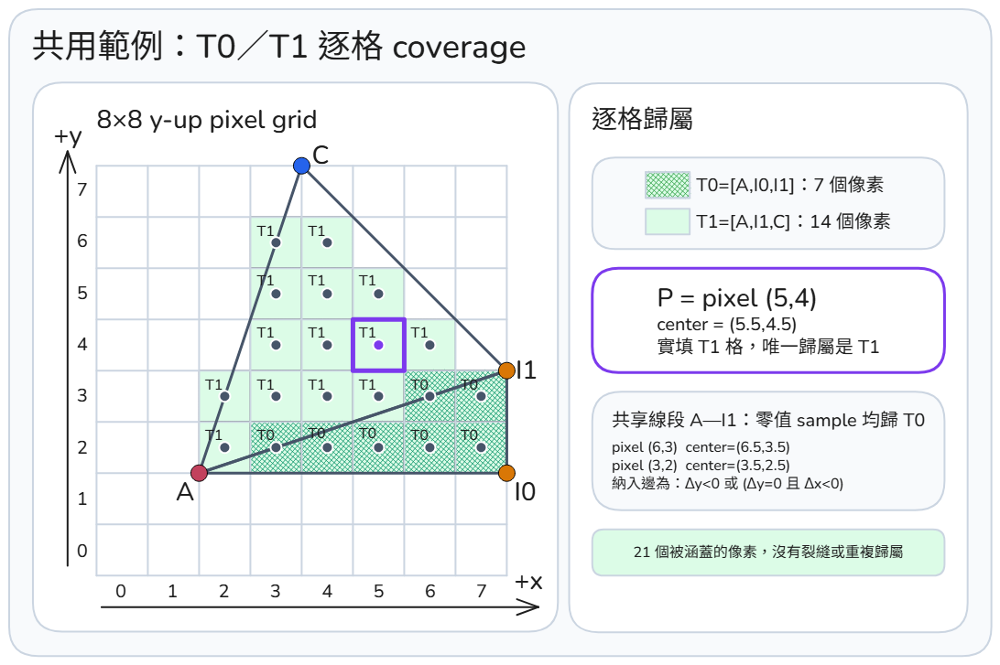

我們先以共享線段 $AI_1$ 穿過的像素 $(3,2)$ 為例。 這個像素的取樣位置是：

$$
\mathbf{p}_{\mathrm{edge}}=(3.5,2.5).
$$

這個位置可以由 $A$ 沿著線段 $AI_1$ 前進四分之一得到，因此它確實位於共享邊上：

$$
\begin{aligned}
\mathbf{p}_{\mathrm{edge}}
&=\mathbf{p}_A
  +\frac14\left(\mathbf{p}_{I_1}-\mathbf{p}_A\right) \\
&=(2,2)
  +\frac14\left((8,4)-(2,2)\right) \\
&=(3.5,2.5).
\end{aligned}
$$

接下來讓我們把 $\mathbf{p}_{\mathrm{edge}}$ 代入前面推導的涵蓋判定式。 對 $T_0$ 而言，共享邊的方向是 $I_1\to A$。 將兩個端點與取樣位置代入邊緣函數後，可以得到：

$$
\begin{aligned}
E(\mathbf{p}_{I_1},\mathbf{p}_A,\mathbf{p}_{\mathrm{edge}})
&=(x_A-x_{I_1})(y_{\mathrm{edge}}-y_{I_1})
  -(y_A-y_{I_1})(x_{\mathrm{edge}}-x_{I_1}) \\
&=(2-8)(2.5-4)-(2-4)(3.5-8) \\
&=0.
\end{aligned}
$$

這條有向邊的 $\Delta x=-6$、$\Delta y=-2$。 將這兩個分量與 $E=0$ 代入完整的判定式後，可以得到：

$$
\begin{aligned}
&E>0
\lor
\left(E=0\land\left[\Delta y<0
\lor(\Delta y=0\land\Delta x<0)\right]\right) \\
&=(0>0)
\lor
\left(0=0\land\left[(-2<0)
\lor(-2=0\land-6<0)\right]\right) \\
&=\mathrm{true}.
\end{aligned}
$$

對 $T_1$ 而言，同一條共享邊的方向則是 $A\to I_1$：

$$
\begin{aligned}
E(\mathbf{p}_A,\mathbf{p}_{I_1},\mathbf{p}_{\mathrm{edge}})
&=(x_{I_1}-x_A)(y_{\mathrm{edge}}-y_A)
  -(y_{I_1}-y_A)(x_{\mathrm{edge}}-x_A) \\
&=(8-2)(2.5-2)-(4-2)(3.5-2) \\
&=0.
\end{aligned}
$$

過程中可以看見這個方向的 $\Delta x=6$、$\Delta y=2$。 將它們與 $E=0$ 代入相同的判定式後，可以得到：

$$
\begin{aligned}
&E>0
\lor
\left(E=0\land\left[\Delta y<0
\lor(\Delta y=0\land\Delta x<0)\right]\right) \\
&=(0>0)
\lor
\left(0=0\land\left[(2<0)
\lor(2=0\land6<0)\right]\right) \\
&=\mathrm{false}.
\end{aligned}
$$

雖然兩個三角形在共享邊上都算出了 $E=0$，但只有 $T_0$ 的 $I_1\to A$ 符合 top-left rule。 這個取樣位置對 $T_0$ 的另外兩條邊還會得到 $E=3$ 與 $E=9$，因此三條邊的涵蓋判定全部成立。 對 $T_1$ 來說，其另外兩條邊雖然會得到 $E=24$ 與 $E=8$，但因為共享邊的涵蓋判定不成立，所以這個 sample 最後只歸屬於 $T_0$

本節的共同範例中，判定結果共有二十一個被涵蓋的像素，其中 $T_0$ 涵蓋七個，$T_1$ 涵蓋十四個。 共享線段 $AI_1$ 也會穿過像素 $(6,3)$ 的中心，這個位置會經過相同的判定而歸屬於 $T_0$

後續範例我們會固定追蹤圖中以 $P$ 標出的像素 $(5,4)$。 光柵化器使用的中心取樣位置是：

$$
\mathbf{p}_{\mathrm{sample}}=(5.5,4.5).
$$

涵蓋判定階段已經確認像素中心的 sample 被 $T_1$ 涵蓋。 共用範例接下來會繼續追蹤這個 sample

#### barycentric interpolation：算出三個頂點的權重

經過三角形涵蓋判定的過程後，我們已經找出了一個被涵蓋的 sample，並輸出了它的取樣位置、三角形的三筆頂點與三個邊緣函數值。 接下來我們要算出這個 sample 應從每個頂點取得多少 RGBA、UV 與深度。 為此，重心座標內插會先將邊緣函數描述的幾何關係正規化成三個重心權重，再依每項資料的內插規則產生片段著色器輸入與預設的候選 screen-space 深度

##### 由邊緣函數算出重心權重

以下會沿用 $\mathbf{p}_{\mathrm{sample}}$ 來表示實際採用的取樣位置。 在本文的 single-sample 範例中，它就是像素中心。 為了算出每個頂點的權重，我們會比較原三角形與三個子三角形的面積。 先令原三角形 $ABC$ 的有向雙倍面積為 $\mathrm{A}_2=E(\mathbf{p}_A,\mathbf{p}_B,\mathbf{p}_C)>0$

以頂點 $A$ 為例，它的對邊是 $BC$。 而取樣位置 $\mathbf{p}_{\mathrm{sample}}$ 與 $B$、$C$ 會形成一個子三角形 $BCP$，其有向雙倍面積除以 $\mathrm{A}_2$，便是頂點 $A$ 的權重 $\lambda_A$。 同理，頂點 $B$ 的權重會使用子三角形 $CAP$，頂點 $C$ 的權重則使用子三角形 $ABP$。 因此，三個權重可以寫成：

$$
\begin{aligned}
e_A &= E(\mathbf{p}_B,\mathbf{p}_C,\mathbf{p}_{\mathrm{sample}}),
& \lambda_A &= \frac{e_A}{\mathrm{A}_2}, \\
e_B &= E(\mathbf{p}_C,\mathbf{p}_A,\mathbf{p}_{\mathrm{sample}}),
& \lambda_B &= \frac{e_B}{\mathrm{A}_2}, \\
e_C &= E(\mathbf{p}_A,\mathbf{p}_B,\mathbf{p}_{\mathrm{sample}}),
& \lambda_C &= \frac{e_C}{\mathrm{A}_2}.
\end{aligned}
$$

公式中的 $e_A$、$e_B$ 與 $e_C$ 分別是子三角形 $BCP$、$CAP$ 與 $ABP$ 的有向雙倍面積。 將它們各自除以原三角形的有向雙倍面積，便能得到三個頂點的權重

這三個除法可以直接用面積比例理解。 下圖把取樣位置與三個頂點相連，將原三角形分成了三個子三角形：


圖中的 $\alpha$、$\beta$ 與 $\gamma$ 對應到了本文的 $\lambda_A$、$\lambda_B$ 與 $\lambda_C$。 三塊子三角形會拼回原三角形，因此：

$$
\lambda_A + \lambda_B + \lambda_C = 1
$$

由於每個 $\lambda$ 都是對應子三角形與原三角形的面積比，因此它們就是這個取樣位置對頂點 $A$、$B$ 與 $C$ 的 screen-space 幾何權重

##### 依內插規則產生 shader inputs

接下來我們要依資料指定的內插規則，使用這三個權重與頂點 $A$、$B$ 與 $C$ 保存的資料，算出目前取樣位置所需的 fragment shader inputs

RGBA、UV 與材質編號通常會需要不同的計算規則，例如 UV 通常需要沿著投影前的模型表面變化； 用來描述畫面效果的色彩或距離可能要在 screen-space 中線性變化； 材質編號等離散資料則要讓整個圖元共用同一筆值。 GLSL 會在 vertex shader output 與對應的 fragment shader input 前加上內插限定詞（interpolation qualifier），指定 rasterizer 要採用哪一種計算規則

對應的 shader 介面可以寫成：

```glsl
// Vertex shader outputs
smooth out vec2 surface_uv;
noperspective out vec4 screen_color;
flat out int material_id;
```

```glsl
// Fragment shader inputs
smooth in vec2 surface_uv;
noperspective in vec4 screen_color;
flat in int material_id;
```

在這個 GLSL 3.30 範例中，每組 output 與 input 都會使用相同的限定詞。 以下會依序說明三種限定詞是如何使用重心權重或頂點資料產生結果的

先從 `noperspective` 開始。 這項規則的目標是讓資料在 screen-space 內呈線性變化。 由於三個 $\lambda$ 本來就是根據 screen-space 位置算出的權重，因此 rasterizer 會直接用它們來混合三筆頂點的資料

令 $a_A$、$a_B$ 與 $a_C$ 分別表示介面變數 $a$ 在頂點 $A$、$B$ 與 $C$ 保存的值，那麼目前取樣位置取得的結果為：

$$
a_{\mathrm{noperspective}}
=\lambda_Aa_A+\lambda_Ba_B+\lambda_Ca_C.
$$

下圖用頂點色彩呈現了這個加權過程。 圖中的 $V_A$、$V_B$ 與 $V_C$ 代表三筆頂點資料，$V$ 則是三個 $\lambda$ 直接混合後得到的結果：

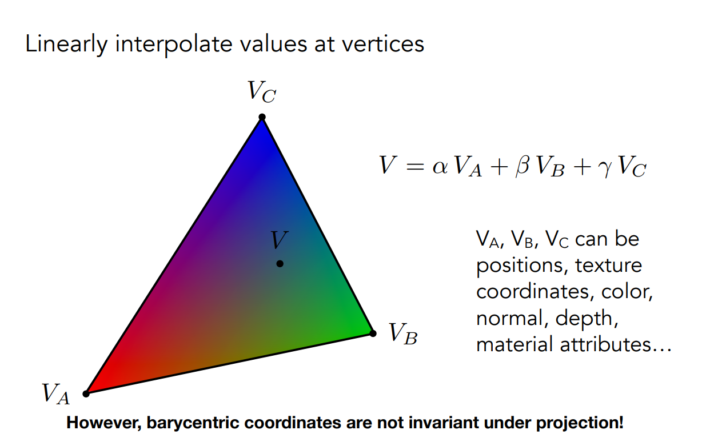

`smooth` 用於 UV 等要延續模型表面變化的資料。 當三個頂點的 $w_c$ 不同時，screen-space 中的幾何比例和投影前的模型表面上的比例也會不同。 因此 Rasterizer 需要先依每個頂點的 $w_c$ 調整三個 $\lambda$，再用調整後的比例混合頂點資料

前面的 perspective divide 已經替每筆頂點保留了 $\rho_i=1/w_{c,i}$。 我們先將每個 screen-space 的權重乘上對應頂點的 $\rho_i$：

$$
q_A=\lambda_A\rho_A,
\quad
q_B=\lambda_B\rho_B,
\quad
q_C=\lambda_C\rho_C.
$$

為了讓這三個權重再次形成總和為 $1$ 的比例，我們先求出它們的總和：

$$
Q=q_A+q_B+q_C
$$

接著將每個 $q$ 除以 $Q$，得到總和為 $1$ 的新權重：

$$
\widetilde{\lambda}_A=\frac{q_A}{Q},
\quad
\widetilde{\lambda}_B=\frac{q_B}{Q},
\quad
\widetilde{\lambda}_C=\frac{q_C}{Q}.
$$

最後以這三個新權重來混合頂點 $A$、$B$ 與 $C$ 保存的值：

$$
\begin{aligned}
a_{\mathrm{smooth}}
&=\widetilde{\lambda}_Aa_A
 +\widetilde{\lambda}_Ba_B
 +\widetilde{\lambda}_Ca_C \\
&=\frac{q_Aa_A+q_Ba_B+q_Ca_C}{Q}.
\end{aligned}
$$

這種先以 $1/w_c$ 調整 screen-space 權重，再將它們重新正規化的做法稱為透視正確內插（perspective-correct interpolation）。 下圖將同一張棋盤格紋理與同一組頂點 UV 映射到了相同的 screen-space 三角形，以比較直接使用 $\lambda$ 與先依 $w_c$ 調整權重的結果：

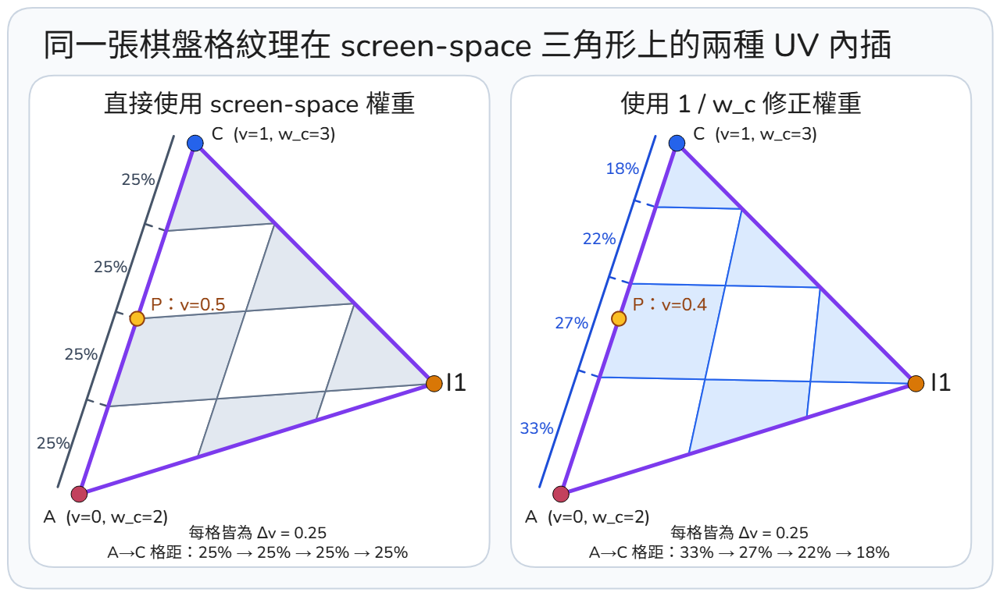

左側使用了 `noperspective`，所以格線會沿 screen-space 線性排列。 右側使用預設的是 `smooth`，格線間距會反映三筆頂點原有的 clip-space $w_c$，因而呈現模型表面經過透視投影後的變化

`flat` 則比較特別，主要用在與材質有關的情境。 材質編號是用來選擇材質資料的離散索引，如果我們直接對不同頂點的材質編號進行加權混合，其結果可能是小數，也可能會指向另一筆無關的材質資料，因此整個圖元內的材質編號必須相同。 GLSL 使用 `flat` 這個內插限定詞來完成這項工作，套用 `flat` 後，OpenGL 會從原圖元選出一個頂點作為資料來源，並將該頂點的值提供給這個圖元產生的所有片段。 這個來源頂點被稱為 provoking vertex

假設三角形的頂點順序是 $A\to B\to C$，三筆頂點的材質編號依序為 $2$、$5$ 與 $9$。 對 `GL_TRIANGLES` 而言，OpenGL 預設的 `GL_LAST_VERTEX_CONVENTION` 會選擇 $C$ 作為 provoking vertex，因此整個三角形都會使用材質編號 $9$

若要改由第一筆頂點提供資料，可以在繪製前設定：

```cpp
glProvokingVertex(GL_FIRST_VERTEX_CONVENTION);
```

這項設定會讓 $A$ 成為 provoking vertex，整個三角形因而都會使用材質編號 $2$。 將這個關係一般化成介面變數 $a$ 後，每個取樣位置所使用的值可以統一寫為：

$$
a_{\mathrm{flat}}=a_A.
$$

`flat` 在這裡固定的是材質編號，因此 UV、法向量、頂點色彩與光照計算所需的其他資料仍會依各自的內插規則在三角形內變化，所以使用同一個材質編號的片段還是可以產生不同的色彩。 但如果同一個三角形內需要混合多種材質，那可以由每個頂點另外再提供各材質的混合權重，rasterizer 會在三角形裡面內插這些權重，fragment shader 再依權重混合各材質的參數或紋理結果，以達到目的

##### multisample 時要在哪個位置計算 shader inputs

在前面的 single-sample 共用範例中，我們將唯一的取樣位置與內插位置都設在像素中心。 但 Multisample 會在同一個像素內配置多個取樣位置，每個位置的 screen-space 座標都不同，代入邊緣函數後也會得到不同的重心權重。 因此在 Coverage 判定找出被三角形涵蓋的取樣位置後，barycentric interpolation 還需要再從像素內選定計算 shader inputs 的位置

這個過程會依序做出兩項決定：

1. 決定在哪個位置計算重心權重。 本文將 coverage 判定所檢查的位置稱為取樣位置（sample position），記為 $\mathbf{p}_{\mathrm{sample}}$。 計算 shader inputs 時實際代入邊緣函數的位置則稱為內插位置（interpolation position），記為 $\mathbf{p}_{\mathrm{interp}}$。 選定 $\mathbf{p}_{\mathrm{interp}}$ 後，rasterizer 會計算：

   $$
   \begin{aligned}
   \lambda_A(\mathbf{p}_{\mathrm{interp}})
   &=\frac{E(\mathbf{p}_B,\mathbf{p}_C,\mathbf{p}_{\mathrm{interp}})}{\mathrm{A}_2}, \\
   \lambda_B(\mathbf{p}_{\mathrm{interp}})
   &=\frac{E(\mathbf{p}_C,\mathbf{p}_A,\mathbf{p}_{\mathrm{interp}})}{\mathrm{A}_2}, \\
   \lambda_C(\mathbf{p}_{\mathrm{interp}})
   &=\frac{E(\mathbf{p}_A,\mathbf{p}_B,\mathbf{p}_{\mathrm{interp}})}{\mathrm{A}_2}.
   \end{aligned}
   $$

   內插位置改變時，三個邊緣函數值與重心權重也會跟著改變。 GLSL 提供了 `centroid` 與 `sample` 這兩個輔助儲存限定詞（auxiliary storage qualifier）來控制 $\mathbf{p}_{\mathrm{interp}}$ 應該要選在哪裡，以及同一個像素要使用幾個內插位置

2. 決定如何使用重心權重混合頂點資料。 取得三個 $\lambda$ 後，`noperspective` 會直接使用它們混合頂點資料。 `smooth` 則會先以各頂點的 $\rho_i=1/w_{c,i}$ 調整三個 $\lambda$，再使用重新正規化後的 $\widetilde{\lambda}_i$ 混合資料：

   $$
   \begin{aligned}
   a_{\mathrm{noperspective}}
   &=\lambda_Aa_A+\lambda_Ba_B+\lambda_Ca_C, \\
   \widetilde{\lambda}_i
   &=\frac{\lambda_i\rho_i}
           {\lambda_A\rho_A+\lambda_B\rho_B+\lambda_C\rho_C}, \\
   a_{\mathrm{smooth}}
   &=\widetilde{\lambda}_Aa_A
     +\widetilde{\lambda}_Ba_B
     +\widetilde{\lambda}_Ca_C.
   \end{aligned}
   $$

   `smooth` 與 `noperspective` 控制的是這項加權規則。 因此，像 `smooth centroid` 這樣的宣告具有兩層資訊：`centroid` 先決定 $\mathbf{p}_{\mathrm{interp}}$，`smooth` 再決定如何使用該位置算出的三個重心權重

在 multisample 像素的邊界附近，三角形可能只會涵蓋其中一部分取樣位置。 然而只要 Rasterizer 有找到至少一個被涵蓋的取樣位置，就會為這個像素產生片段。 因此其選出的內插位置可能會落在三角形涵蓋範圍之外，使其中一個以上的重心權重小於 $0$。 此時依這組權重算出的 UV 或色彩會沿著三角形內的數值變化向外延伸，也就是變成了用外插（extrapolation）來計算

為了讓 shader 指定內插位置的選擇方式，GLSL 提供了 `centroid` 與 `sample` 這兩個輔助儲存限定詞。 它們會寫在 shader 介面變數的 `in` 與 `out` 宣告中，用來控制 multisample 情境下的內插位置與計算頻率。 以下為了方便對照，三組範例都讓 vertex shader output 與 fragment shader input 採用了相同的限定詞：

```glsl
// 一般內插
smooth out vec2 surface_uv; // Vertex shader
smooth in vec2 surface_uv;  // Fragment shader

// centroid 內插
smooth centroid out vec2 surface_uv; // Vertex shader
smooth centroid in vec2 surface_uv;  // Fragment shader

// sample 內插（GLSL 4.00 以上）
smooth sample out vec2 surface_uv; // Vertex shader
smooth sample in vec2 surface_uv;  // Fragment shader
```

這三組宣告都使用了 `smooth` 的加權規則，現在讓我們來看一下它們是如何選擇內插位置的。 假設一個像素內有四個取樣位置 $\mathbf{q}_0$、$\mathbf{q}_1$、$\mathbf{q}_2$ 與 $\mathbf{q}_3$，其中三角形只涵蓋了 $\mathbf{q}_0$ 與 $\mathbf{q}_1$，則這四個位置的 coverage mask 是 $[1,1,0,0]$，每個 bit 依序對應道一個取樣位置，並記錄在同一筆 fragment 中：

- `smooth`：rasterizer 可以在像素範圍內選擇一個 $\mathbf{p}_{\mathrm{interp}}$，並在該處計算三個重心權重。 接著再套用 `smooth` 的加權規則，算出一組可供 $\mathbf{q}_0$ 與 $\mathbf{q}_1$ 共用的 `surface_uv`
- `smooth centroid`：`centroid` 會將 $\mathbf{p}_{\mathrm{interp}}$ 限制在像素範圍與三角形涵蓋範圍的交集內。 rasterizer 會在該處計算一組重心權重，再套用 `smooth` 的加權規則，算出一組可供 $\mathbf{q}_0$ 與 $\mathbf{q}_1$ 共用的 `surface_uv`
- `smooth sample`：`sample` 會先將 $\mathbf{q}_0$ 作為 $\mathbf{p}_{\mathrm{interp}}$，算出第一組重心權重與 `surface_uv`，再將 $\mathbf{q}_1$ 作為 $\mathbf{p}_{\mathrm{interp}}$，算出第二組重心權重與 `surface_uv`。 fragment shader 也會分別為 $\mathbf{q}_0$ 與 $\mathbf{q}_1$ 執行一次

如果宣告改成 `noperspective centroid` 或 `noperspective sample`，`centroid` 與 `sample` 所選擇的內插位置會相同，但第二個步驟會改為直接使用三個 $\lambda$ 混合頂點資料

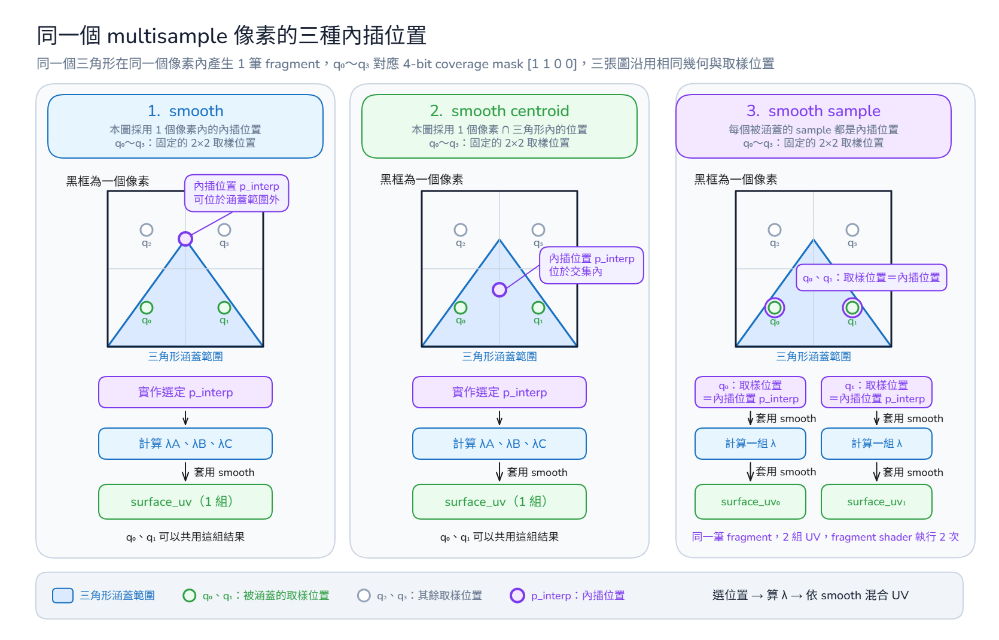

##### 以重心權重產生候選深度

Barycentric interpolation 除了產生 shader inputs，也會替目前的取樣位置算出後續 depth test 時使用的預設候選深度。 目前三筆頂點的 screen-space z 已經都包含了投影、透視除法與 viewport transform 的結果，因此 rasterizer 會直接使用 screen-space 的重心權重，讓深度沿三角形所在的平面線性變化：

$$
z_{\mathrm{candidate}}
=\lambda_Az_A+\lambda_Bz_B+\lambda_Cz_C.
$$

這項計算會為每個被涵蓋的取樣位置準備一筆候選 screen-space 深度

##### 共用範例：算出像素 $(5,4)$ 的內插資料

現在回到共用範例。 為了替像素 $(5,4)$ 產生 RGBA、UV 與候選深度，我們要以它的取樣位置和 $T_1=[A,I_1,C]$ 的三筆頂點資料計算內插結果。 前面 Triangle coverage 階段已經確認這個像素的中心 sample 會被 $T_1$ 涵蓋，因此這次內插會直接使用下列輸入：

- 取樣資料：
  - 像素索引為 $(5,4)$
  - 取樣位置與內插位置都是 $\mathbf{p}_{\mathrm{sample}}=\mathbf{p}_{\mathrm{interp}}=(11/2,9/2)$
  - coverage mask 為 $[1]$。 唯一的 bit 對應到像素中心的 sample，其值為 $1$，表示這個 sample 被 $T_1$ 涵蓋
- 頂點 $A$：
  - screen-space 位置為 $(2,2)$
  - 深度為 $9/16$
  - RGBA 為 $(1,0,0,1)$
  - UV 為 $(0,0)$
  - $\rho_A=1/2$
- 頂點 $I_1$：
  - screen-space 位置為 $(8,4)$
  - 深度為 $5/8$
  - RGBA 為 $(0,3/4,1/4,1)$
  - UV 為 $(3/4,1/4)$
  - $\rho_{I_1}=4/9$
- 頂點 $C$：
  - screen-space 位置為 $(4,8)$
  - 深度為 $3/4$
  - RGBA 為 $(0,0,1,1)$
  - UV 為 $(0,1)$
  - $\rho_C=1/3$
- 內插規則：RGBA 與 UV 都採用預設的 `smooth`

$T_1$ 在 OpenGL y-up 座標中採用的是逆時針的頂點順序。 由於計算重心權重時只需要三筆頂點與 sample 的 x、y，因此我們可以先從上述輸入取出下列位置：

$$
\begin{aligned}
\mathbf{p}_A&=(2,2), &
\mathbf{p}_{I_1}&=(8,4), &
\mathbf{p}_C&=(4,8), &
\mathbf{p}_{\mathrm{sample}}&=\left(\frac{11}{2},\frac92\right).
\end{aligned}
$$

三角形的有向雙倍面積定義為 $\mathrm{A}_{2,T_1}=E(\mathbf{p}_A,\mathbf{p}_{I_1},\mathbf{p}_C)$。 將邊緣函數先展開成代數形式，再代入三筆頂點的位置後，我們可以得到：

$$
\begin{aligned}
\mathrm{A}_{2,T_1}
&=(x_{I_1}-x_A)(y_C-y_A)
  -(y_{I_1}-y_A)(x_C-x_A) \\
&=(8-2)(8-2)-(4-2)(4-2) \\
&=32.
\end{aligned}
$$

而三個重心權重的分子分別為：

$$
\begin{aligned}
e_A
&=E(\mathbf{p}_{I_1},\mathbf{p}_C,\mathbf{p}_{\mathrm{sample}}) \\
&=(x_C-x_{I_1})(y_{\mathrm{sample}}-y_{I_1})
  -(y_C-y_{I_1})(x_{\mathrm{sample}}-x_{I_1}) \\
&=(4-8)\left(\frac92-4\right)
  -(8-4)\left(\frac{11}{2}-8\right) \\
&=8, \\[0.75em]
e_{I_1}
&=E(\mathbf{p}_C,\mathbf{p}_A,\mathbf{p}_{\mathrm{sample}}) \\
&=(x_A-x_C)(y_{\mathrm{sample}}-y_C)
  -(y_A-y_C)(x_{\mathrm{sample}}-x_C) \\
&=(2-4)\left(\frac92-8\right)
  -(2-8)\left(\frac{11}{2}-4\right) \\
&=16, \\[0.75em]
e_C
&=E(\mathbf{p}_A,\mathbf{p}_{I_1},\mathbf{p}_{\mathrm{sample}}) \\
&=(x_{I_1}-x_A)(y_{\mathrm{sample}}-y_A)
  -(y_{I_1}-y_A)(x_{\mathrm{sample}}-x_A) \\
&=(8-2)\left(\frac92-2\right)
  -(4-2)\left(\frac{11}{2}-2\right) \\
&=8.
\end{aligned}
$$

將這三個邊緣函數值分別除以雙倍面積 $32$ 後，就能得到重心權重了：

$$
\lambda_A=\frac{8}{32}=\frac14,
\quad
\lambda_{I_1}=\frac{16}{32}=\frac12,
\quad
\lambda_C=\frac{8}{32}=\frac14.
$$

下圖整理了三條對邊、邊緣函數值與重心權重：

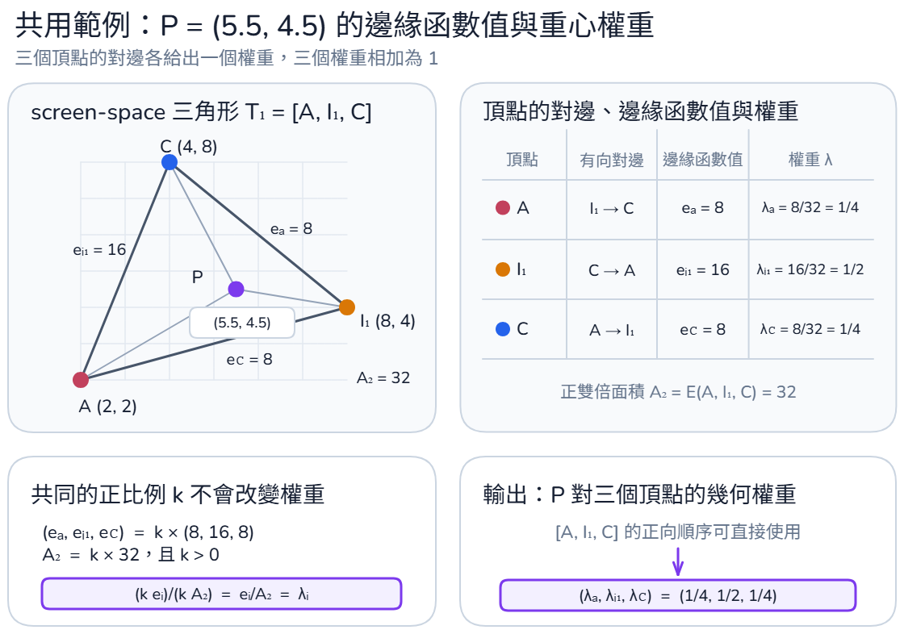

同時縮放邊緣函數值與雙倍面積並不會改變重心權重，也不會改變有向面積的正負號。 左下角我們用了正比例係數 $k$ 來表示了這個縮放關係，由於在計算權重時分子與分母都會同乘 $k$，因此這個係數會被消去掉：

$$
\frac{k e_i}{k\mathrm{A}_2}
=\frac{e_i}{\mathrm{A}_2}
=\lambda_i.
$$

現在讓我們來看 UV、色彩與深度計算，我們會繼續使用這組重心權重：

$$
\left(\lambda_A,\lambda_{I_1},\lambda_C\right)
=\left(\frac14,\frac12,\frac14\right).
$$

首先來計算 fragment shader 實際收到的 UV。 共用範例使用預設的 `smooth`，因此還需要三筆頂點的 UV 與 $\rho$：

$$
\begin{aligned}
(\mathrm{uv}_A,\rho_A)&=\left((0,0),\frac12\right), \\
(\mathrm{uv}_{I_1},\rho_{I_1})&=\left(\left(\frac34,\frac14\right),\frac49\right), \\
(\mathrm{uv}_C,\rho_C)&=\left((0,1),\frac13\right).
\end{aligned}
$$

依 $\rho$ 調整後的三個暫時權重及其總和為：

$$
q_A=\frac18,
\quad
q_{I_1}=\frac29,
\quad
q_C=\frac1{12},
\quad
Q=\frac{31}{72}.
$$

因此，fragment shader 收到的 UV 為：

$$
\begin{aligned}
u
&=\frac{\frac18(0)+\frac29\left(\frac34\right)+\frac1{12}(0)}{31/72} \\
&=\frac{12}{31}, \\
v
&=\frac{\frac18(0)+\frac29\left(\frac14\right)+\frac1{12}(1)}{31/72} \\
&=\frac{10}{31}.
\end{aligned}
$$

頂點色彩也採用了預設的 `smooth`。 同一組暫時權重會將 $A$ 的紅色 $(1,0,0,1)$、$I_1$ 的色彩 $(0,3/4,1/4,1)$，以及 $C$ 的藍色 $(0,0,1,1)$ 內插成：

$$
\mathrm{color}_{\mathrm{smooth}}
=\left(\frac9{31},\frac{12}{31},\frac{10}{31},1\right).
$$

最後再使用 screen-space 重心權重產生候選深度。 三筆頂點的 screen-space 深度分別是：

$$
z_A=\frac{9}{16},
\quad
z_{I_1}=\frac58,
\quad
z_C=\frac34.
$$

將它們代入候選深度公式，可以得到：

$$
\begin{aligned}
z_{\mathrm{candidate}}
&=\frac14\left(\frac{9}{16}\right)
+\frac12\left(\frac58\right)
+\frac14\left(\frac34\right) \\
&=\frac{41}{64} \\
&=0.640625.
\end{aligned}
$$

為了將 triangle coverage 與 barycentric interpolation 的結果交給後續管線，rasterizer 會把像素與取樣位置、coverage mask、shader inputs 及候選深度整理成一筆 fragment。 共用範例得到的資料如下：

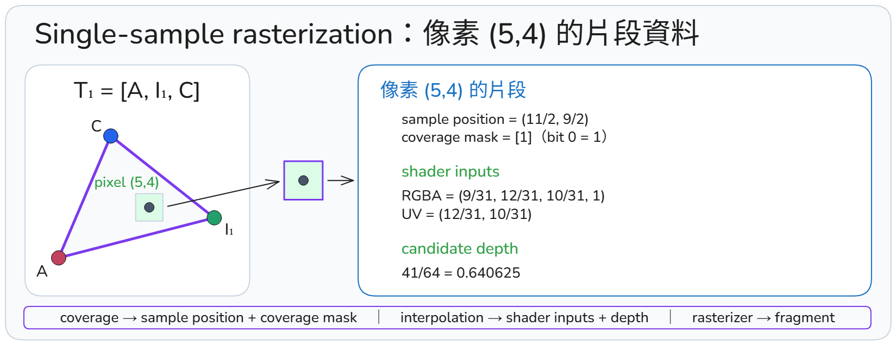

這筆 fragment 包含：

- 像素索引 $(5,4)$
- 取樣位置 $(11/2,9/2)$
- coverage mask $[1]$
- UV $(12/31,10/31)$
- RGBA $(9/31,12/31,10/31,1)$
- 候選深度 $41/64$

Rasterizer 會以相同方式處理三角形涵蓋的其他像素，並為各個像素整理出對應的 fragment

### Fragment Processing：篩選片段並產生候選顏色與深度

光柵化完成後，我們會拿到一系列 fragments。 每筆 fragment 會對應到一個像素，並記錄「該像素內有哪些 samples 被目標圖元涵蓋了」、「內插完成的 shader inputs」與「光柵化器算出的 screen-space 深度」等資訊

Fragment Processing 的目標是先篩選這些 fragments 中仍需處理的 samples，再替它們算出要交給 Framebuffer Operations 的候選顏色與候選深度。 在執行 fragment shader 前，OpenGL 會依序處理 pixel ownership、scissor 與 multisample fragment operations，藉此決定是否要繼續處理這筆 fragment，以及其中的哪些 samples 資訊是有效的：

- Pixel ownership test：當繪製目標是視窗系統提供的 default framebuffer 時，視窗系統會先判定目前位置是否屬於這個 OpenGL drawable，再將結果提供給 OpenGL
  - 如果目標位置不屬於該 drawable，那就不會繼續處理該位置了
    - 這可能會發生在目標視窗被另一個視窗遮住之類的情況
  - 繪製目標若是 Off-Screen framebuffer object（FBO），這項測試會直接通過
- Scissor test：繪製狀態可以指定一個 screen-space 的矩形，將後續處理限制在該矩形內。 啟用這項測試後，OpenGL 會將 fragment 的位置與這個矩形比較，並排除位於該矩形之外的 fragment
- Multisample fragment operations：在 multisample framebuffer 中，coverage mask 的每個位元分別對應到了目標像素內的一個 sample。 這組操作會再依 multisample state 來清除其中不需要繼續處理的位元，形成這筆 fragment 目前的 sample mask

sample mask 與 coverage mask 兩者都以一個 bit 對應像素內的一個 sample，但其描述的是不同階段的結果：

- coverage mask：Triangle coverage 根據幾何邊界算出的結果，記錄哪些 samples 被三角形涵蓋
- sample mask：將 coverage mask 套用 shader 執行前的 multisample state 後，目前仍需交給 fragment shading 的 samples

例如，一個像素有四個 samples：

$$
\text{coverage mask}=[1,1,0,0]
$$

這代表三角形涵蓋 sample 0 與 sample 1。 接著假設 Application 又提供了下列遮罩：

$$
[1,0,1,0]
$$

則逐位元 AND 後我們可以得到：

$$
\begin{aligned}
\text{sample mask}
&=[1,1,0,0]\mathbin{\&}[1,0,1,0]\\
&=[1,0,0,0]
\end{aligned}
$$

完成這些判定後，sample mask 中數值為 1 的位元會指出仍需處理的 samples，之後那些至少保留了一個 sample 的 fragment 會繼續進倒 fragment shading 的階段

因此以這個例子來說，這裡最後只會繼續處理 sample 0

#### fragment shading：產生候選顏色與候選深度

為了依材質、紋理與畫面位置算出 fragment 要提交的顏色，fragment shading 會執行目前選用的 fragment shader。 管線每執行一次 fragment shader，就會建立一次 fragment shader invocation

一次 invocation 負責的 sample 數量會依 framebuffer 的取樣模式與 shader 的執行頻率而定：

- Single-sample framebuffer 的 fragment 只有一個 sample，因此只會執行一次 fragment shader
- Multisample framebuffer 中，一次 invocation 可以負責一個或多個仍有效的 samples，同一次執行算出的輸出會套用到這些 samples 上
- 啟用逐 sample shading 後，管線會為每個仍有效的 sample 分別執行 fragment shader，讓各個 sample 取得自己的輸出

每次 invocation 會取得 rasterizer 內插完成的 interface inputs（RGBA 與 UV）。 它也可以讀取 uniforms 與目前繪製狀態綁定的紋理資料。 而當 Shader 需要目前 invocation 的畫面位置與深度時，則可以直接讀取 GLSL 的內建輸入 `gl_FragCoord`，其有四個分量：

- x 與 y 是這次 invocation 在 screen-space 中的位置
  - 本文沿用了 OpenGL 的預設座標慣例：drawable 的左下角是 $(0,0)$，x 向右增加，y 向上增加
  - 若像素索引為 $(i,j)$，該像素的中心位於 screen-space 座標 $(i+0.5,j+0.5)$
    - 在本文的 single-sample 情境中，`gl_FragCoord.xy` 就是這個中心位置
- z 是 rasterizer 為這個位置算出的 screen-space 深度
- w 是這個位置的 $1/w_c$。 它由三筆頂點的 $\rho_i=1/w_{c,i}$ 依 screen-space 重心權重進行仿射內插

對三角形 $ABC$ 而言，假設 `gl_FragCoord` 所在位置的重心權重是 $\lambda_A$、$\lambda_B$ 與 $\lambda_C$，則：

$$
\mathrm{gl\_FragCoord.w}
=\lambda_A\rho_A+\lambda_B\rho_B+\lambda_C\rho_C,
\quad
\rho_i=\frac{1}{w_{c,i}}.
$$

為了將 fragment shader 產生的顏色保存成繪製結果，我們需要一個能依畫面位置記錄色彩值的儲存空間。 在 OpenGL 中，色彩影像會承擔這項工作。 色彩影像、color attachment 與 fragment shader invocation 的關係如下：

- 色彩影像是一張完整的影像儲存空間。 以 $800\times600$ 的 single-sample 色彩影像為例，它會包含 $800\times600$ 個像素位置，每個位置保存一筆色彩
- Framebuffer 會透過一個或多個 color attachments 連接色彩影像，並記錄每個 attachment 對應到哪張影像
  - 為了將每筆候選顏色送往正確的色彩影像，OpenGL 需要知道 fragment shader 的每筆輸出要送到 framebuffer 的哪個 color attachment
  - Fragment shader 會用 output location 編號各筆輸出，而 framebuffer 則可能同時連接著多個 color attachments
  - Draw-buffer state 會負責記錄每個 output location 應送往哪個 color attachment
- 每次 fragment shader invocation 會處理目前 fragment 對應的畫面位置，並透過 `out` 變數交出一筆或多筆色彩值。 這些值會成為後續附件更新的輸入，因此本文稱它們為候選顏色

為了讓 fragment shader 將算出的 RGBA 交回管線，GLSL 會使用以 `out` 宣告的變數保存這筆結果。 下列宣告會建立一個名為 `fragment_color` 的色彩輸出變數：

```glsl
layout(location = 0) out vec4 fragment_color;
```

`vec4` 會保存 4 個浮點數，在這個輸出中分別代表了 R、G、B 與 A。 `layout(location = 0)` 會將 `fragment_color` 指定為 fragment color output location 0。 後續的對應關係是：

$$
\begin{aligned}
\mathrm{fragment\_color}
&\longrightarrow
\text{output location 0}\\
&\longrightarrow
\text{draw-buffer state 為 output 0 指定的 color attachment}\\
&\longrightarrow
\text{色彩影像}
\text{（texture image 或 renderbuffer image）}
\end{aligned}
$$

若同一次的繪製需要更新多張色彩影像，shader 可以宣告多個 `out` 變數，並替它們指定不同的 output locations。 每個 output location 會依 draw-buffer state 中對應的路由找到一個 color attachment，framebuffer 則會記錄該 attachment 實際連接的影像儲存空間。 另外，如果同一次的 invocation 負責了多個 samples，則這些 samples 會共用這次 invocation 交出的候選顏色

葉片或柵欄等材質常常會用紋理的 alpha 來標示透明部位。 如果 shader 對目標 fragment 做取樣後得到的 alpha 低於了門檻值，那 shader 可以執行 GLSL 的 `discard` statement，以直接終止目前的 invocation。 如此一來，這次 invocation 的 shader outputs 便不會交給後續的 Framebuffer Operations 了。 如果該 invocation 負責了多個 samples，那這些 samples 也全都不會收到這次 invocation 的 shader outputs

後續的 depth test 會逐 sample 比較新的深度與 depth attachment 已經保存的深度，因此每個要接受測試的 sample 都需要一筆候選深度。 前面的 barycentric interpolation 已經根據目標 sample 的重心權重算出了它的深度。 Fragment shader 可以透過 `gl_FragCoord.z` 讀取這個值，接著管線也會將它作為預設候選深度。 Shader 若需要依自身的計算改變深度，可以將新值寫入內建輸出 `gl_FragDepth`

GLSL 會在編譯時去確認 shader 的程式碼中是否存在對 `gl_FragDepth` 的寫入敘述，如果有，那我們就稱這個 shader 具有「靜態寫入（statically assign）」`gl_FragDepth` 的條件。 即使該敘述位於某個動態期間可能不會進入的條件分支也算，例如：

```glsl
if (use_custom_depth) {
    gl_FragDepth = 0.4;
}
```

這段程式就符合靜態寫入 `gl_FragDepth` 的條件

由於這段程式碼已經構成了靜態寫入，因此每次正常結束的 invocation 都必須在實際走過的分支中為 `gl_FragDepth` 賦值，透過 `return` 結束的分支也包含在內

以上例來說，當 `use_custom_depth` 為 `true` 時，候選深度為 $0.4$。 而當它為 `false` 時，由於該次 invocation 會沿著未賦值的分支正常結束，因此這次 invocation 的候選深度是未定義值，也不會改用 `gl_FragCoord.z`

執行 `discard` 的分支會直接終止該次 invocation 並丟棄目前片段。 這次 invocation 不會交出候選深度，因此該分支不需要為 `gl_FragDepth` 賦值

##### 以 UV 讀取紋理顏色

已內插的 UV 會指出紋理中的相對位置。 為了將這個位置轉成 fragment 的候選顏色，fragment shader 還需要取得該位置所保存的資料，這會需要指定紋理影像與取樣設定

紋理影像的實際資料會保存在 texture object 中。 為了讓 shader 在 draw call 執行時選擇要使用的 texture object，OpenGL 需要一組具有整數編號的綁定位置。 這些位置稱為紋理影像單元（texture image unit），每個單元都能記錄目前綁定的二維 texture object，取樣時我們可以藉由單元編號來找到這個 object 與目前有效的取樣設定

UV 提供的是紋理中的連續座標。 為了將這個座標轉成一筆確定的取樣結果，取樣流程需要知道座標超出紋理範圍時的處理方式，以及從多個相鄰資料格選取資料的方法。 前者會由紋理環繞模式來處理超出範圍的座標，後者則由過濾方式與 LOD 等設定來決定該如何選取或混合鄰近資料

Texture object 會保存紋理影像資料，也會保存一套過濾方式、紋理環繞模式與 LOD 等取樣設定。 為了讓同一張紋理影像可以搭配另一套取樣方式，OpenGL 也提供了專門保存取樣設定的 sampler object。 一個紋理影像單元可以同時綁定以下兩種物件：

- texture object：提供紋理影像資料，以及自身保存的取樣設定
- sampler object：選用的物件，用來提供一套獨立的取樣設定

當紋理影像單元有綁定 sampler object 時，雖然紋理影像仍由 texture object 提供，但取樣流程使用的取樣方式會由 sampler object 決定。 本文的共用範例會直接採用 texture object 自身保存的取樣設定，因此紋理影像單元只需要綁定 texture object

以本文使用的二維紋理為例，每個紋理影像單元都會記錄一個目前綁定的二維 texture object。 OpenGL 可以同時使用多個單元，例如讓單元 0 綁定 texture object A、單元 1 綁定 texture object B

GLSL 提供了內建函式 `texture()` 來執行紋理取樣。 這個函式需要取得兩項資訊：

1. 一組 UV 取樣座標
2. 要使用的紋理影像單元

GLSL 會用 sampler uniform 保存紋理影像單元的編號。 對二維紋理而言，shader 會以 `sampler2D` 宣告這項 uniform，再將它與 UV 一起傳入 `texture()`。 `texture()` 會從指定單元取得二維 texture object 與取樣設定，並傳回取樣得到的 RGBA。 下方的共用範例會用一段完整的 fragment shader 展開這項流程

對 `sampler2D` 而言，`texture()` 會將連續的正規化 UV 解讀為紋理中的相對位置。 $u=0$ 到 $u=1$ 會橫跨整張紋理，$v=0$ 到 $v=1$ 則會縱向橫跨整張紋理。 紋理影像會以二維網格來保存紋理資料，我們通常將一格資料稱作紋理元素（texel），用來保存著一筆色彩或其他格式的資料

為了將連續的 UV 轉成一筆確定的取樣結果，取樣流程需要處理紋理邊界，並決定要從哪些 texels 取得資料。 前者會由紋理環繞模式（texture wrap mode）負責，後者則由過濾模式（filtering mode）負責

OpenGL 提供了多種紋理環繞模式，分別會以不同方式處理紋理邊界。 本文的共用範例將 $4\times4$ 的紋理當成了一張不重複鋪排的影像，因此會使用 `clamp-to-edge` 模式，讓超出範圍的座標停留在紋理邊緣。 為了比較需要重複鋪排同一張紋理的情況，下面也會介紹 `repeat`：

- `clamp-to-edge`：將超出範圍的座標限制在紋理邊界，使邊界外的取樣繼續使用最接近的邊緣 texels
- `repeat`：OpenGL 的預設環繞模式，讓座標週期性地繞回紋理另一側，例如 $u=1.2$ 與 $u=0.2$ 會落在相同的水平位置。 常用於地板、牆面等需要重複鋪排的紋理

OpenGL 也提供了多種過濾模式，用來決定如何從鄰近的 texels 取得顏色。 這邊我們簡單介紹兩種常見的模式：

- `nearest`：選擇最接近目前取樣位置的一個 texel，因此邊界清楚，但放大時容易看見方格
- `linear`：在二維紋理中讀取取樣位置周圍的四個 texels，先沿一個方向內插兩組結果，再沿另一個方向內插，得到雙線性過濾結果

以寬度為 $W$、高度為 $H$ 的二維紋理為例，texel $(i,j)$ 的中心位於正規化座標 $((i+0.5)/W,(j+0.5)/H)$。 紋理環繞模式會先把原始 UV 整理成可取樣的 $(u',v')$，`nearest` 再選擇中心最接近這個位置的 texel。 在本文採用的 `nearest` 與 `clamp-to-edge` 情境中，可以用下式取得 texel 索引：

$$
i=\min\left(\left\lfloor u'W\right\rfloor,W-1\right),
\quad
j=\min\left(\left\lfloor v'H\right\rfloor,H-1\right).
$$

這裡的 $\min$ 會讓剛好位於上界的 $u'=1$ 或 $v'=1$ 留在最後一個 texel。 由於共用範例使用的是 $4\times4$ 紋理，所以 $u$ 與 $v$ 方向各有 4 個紋理元素。 在每個方向上，$[0,1)$ 的正規化座標會被分成四段，依序對應到索引 $0$ 至 $3$。 因此將 $u'$ 與 $v'$ 各乘上 $4$ 再向下取整，便能得到座標所在範圍的紋理元素索引了

紋理縮小時，一個 screen-space 像素所對應的紋理範圍可能會包含許多來源 texels，直接從原始尺寸的影像選值容易造成閃爍與鋸齒。 為了提供更接近目前縮小比例的資料，mipmap 會替同一張紋理準備一系列逐層縮小的影像。 縮小過濾模式可以指定使用 mipmap。 此時紋理取樣流程會依目前的縮小程度選擇一個層級，或混合兩個相鄰層級的結果

##### 共用範例：以內插 UV 取得候選顏色

上一個共用範例完成了 rasterization 對像素 $(5,4)$ 的處理。 當時由 Triangle coverage 先確認了 $T_1=[A,I_1,C]$ 涵蓋該像素的中心 sample，接著再由 barycentric interpolation 算出這個位置的重心權重、RGBA、UV 與候選 screen-space 深度，最後由 rasterizer 將結果整理成一筆 fragment

因此在進入 Fragment Processing 時，我們手上會有這筆 fragment 及其包含的資料：

- 片段來源：三角形 $T_1=[A,I_1,C]$ 在像素 $(5,4)$ 產生的 fragment
- 取樣位置與內插位置：兩者都是像素中心 $(11/2,9/2)$
- coverage mask：$[1]$。 唯一的位元為 $1$，表示中心 sample 被 $T_1$ 涵蓋
- 內插完成的 shader inputs：
  - RGBA 為 $(9/31,12/31,10/31,1)$
  - UV 為 $(12/31,10/31)$
- 候選 screen-space 深度：$41/64$

現在我們要執行 fragment shader，使用內插後的 UV 從紋理取得 RGBA，並將這筆 RGBA 交給管線作為候選顏色。 候選深度則沿用 rasterizer 算出的 $41/64$

為了執行這項工作，Application 需要在提交 draw call 前選用包含 fragment shader 的 OpenGL program object，並準備好 shader 需要的紋理資源與取樣狀態。 本例使用的 fragment shader 如下：

```glsl
#version 330 core
in vec2 vertex_uv;

uniform sampler2D color_texture;
layout(location = 0) out vec4 fragment_color;

void main()
{
    fragment_color = texture(color_texture, vertex_uv);
}
```

這段程式會從 `vertex_uv` 取得目前 fragment 的 UV。 `color_texture` 保存 Application 指定的紋理影像單元編號，`texture()` 會使用這兩項資料執行紋理取樣。 取樣得到的 RGBA 會寫入 `fragment_color`，成為 fragment color output location 0 的候選顏色

本例由 Application 準備的紋理資源與取樣狀態如下：

- 紋理影像單元：單元 0 綁定一個二維 texture object，sampler uniform `color_texture` 的值也設為 $0$
- 紋理影像：texture object 內含一張 $4\times4$ 的影像，而且只有一個 mipmap 層級
  - Internal format 為 `GL_RGBA8`
  - 每個紋理元素會用 4 個介於 $0$ 到 $255$ 的 8-bit 無號整數，分別保存 R、G、B 與 A
  - `sampler2D` 取樣時會將每個整數除以 $255$，轉成 $[0,1]$ 內的浮點數
- 紋理內容：整數索引 $(x,y)$ 所指向的紋理元素保存位元組 $\mathrm{texel}(x,y)=(64x,64y,32,255)$
- 紋理取樣狀態：放大與縮小過濾都使用 `nearest`，$u$ 與 $v$ 方向的紋理環繞模式都使用 `clamp-to-edge`

下例的 Application 程式碼會建立上述的紋理資源與取樣狀態。 這裡的 `program` 是已經連結好前述 fragment shader 的 OpenGL program object：

```cpp
GLubyte texture_data[4][4][4] = {};

for (int y = 0; y < 4; ++y) {
    for (int x = 0; x < 4; ++x) {
        texture_data[y][x][0] = static_cast<GLubyte>(64 * x);
        texture_data[y][x][1] = static_cast<GLubyte>(64 * y);
        texture_data[y][x][2] = 32;
        texture_data[y][x][3] = 255;
    }
}

GLuint color_texture_object = 0;
glGenTextures(1, &color_texture_object);

glActiveTexture(GL_TEXTURE0);
glBindTexture(GL_TEXTURE_2D, color_texture_object);

glTexImage2D(
    GL_TEXTURE_2D,
    0,
    GL_RGBA8,
    4,
    4,
    0,
    GL_RGBA,
    GL_UNSIGNED_BYTE,
    texture_data
);

glTexParameteri(GL_TEXTURE_2D, GL_TEXTURE_MIN_FILTER, GL_NEAREST);
glTexParameteri(GL_TEXTURE_2D, GL_TEXTURE_MAG_FILTER, GL_NEAREST);
glTexParameteri(GL_TEXTURE_2D, GL_TEXTURE_WRAP_S, GL_CLAMP_TO_EDGE);
glTexParameteri(GL_TEXTURE_2D, GL_TEXTURE_WRAP_T, GL_CLAMP_TO_EDGE);

glUseProgram(program);
GLint color_texture_location =
    glGetUniformLocation(program, "color_texture");
glUniform1i(color_texture_location, 0);
```

此範例的兩層迴圈會走訪 $4\times4$ 紋理中的所有 16 個 texels。 每走到索引 $(x,y)$，就依下列規則設定該 texel 的 RGBA：

$$
\mathrm{texel}(x,y)
=
(\underbrace{64x}_{R},
 \underbrace{64y}_{G},
 \underbrace{32}_{B},
 \underbrace{255}_{A})
$$

這組數字是共用範例刻意設定的紋理內容，由 Application 寫入。 設計目的如下：

- R 使用 $64x$：每往右一格，紅色增加 64
- G 使用 $64y$：每往上一格，綠色增加 64
- B 固定為 32
- A 固定為 255，代表完全不透明

例如：

$$
\begin{aligned}
\mathrm{texel}(0,0)&=(0,0,32,255),\\
\mathrm{texel}(1,0)&=(64,0,32,255),\\
\mathrm{texel}(0,1)&=(0,64,32,255),\\
\mathrm{texel}(3,3)&=(192,192,32,255).
\end{aligned}
$$

因此 x 越大則紅色分量越高，y 越大則綠色分量越高。 藍色固定為 32，透明度固定為 255。 這樣每一列與每一行就都會有容易辨認的顏色數值，方便我們後面確認 UV 最後選中了哪一個紋理元素

接著 `glTexImage2D()` 會為目前綁定的 texture object 建立一張 $4\times4$ 紋理影像，並把 `texture_data` 中的 16 個 texels 複製進去，相關屬性與對應的意義為：

- mipmap 層級 0：紋理原本的完整尺寸，也就是 $4\times4$
- `GL_RGBA8`：每個 texel 使用 R、G、B、A 四個通道，每個通道占 8 bits

取得 UV 後，OpenGL 還需要知道如何選擇 texel。 例子中的四次 `glTexParameteri()` 呼叫分別設定了：

- 縮小紋理時使用 `nearest`
- 放大紋理時使用 `nearest`
- u 方向超出紋理範圍時使用 `clamp-to-edge`
- v 方向超出紋理範圍時使用 `clamp-to-edge`

接著後面幾行程式碼的作用是：

1. `glActiveTexture(GL_TEXTURE0)`
   - 將紋理影像單元 0 設為目前操作的單元
2. `glBindTexture(GL_TEXTURE_2D, color_texture_object)`
   - 將 `color_texture_object` 綁定到目前的單元 0
3. `glUniform1i(color_texture_location, 0)`
   - 將數值 `0` 寫入 sampler uniform `color_texture`，告訴 shader 使用紋理影像單元 0

這段是在建立 fragment shader 與 texture object 之間的連接。 OpenGL 會使用「紋理影像單元」作為兩者的中間位置：

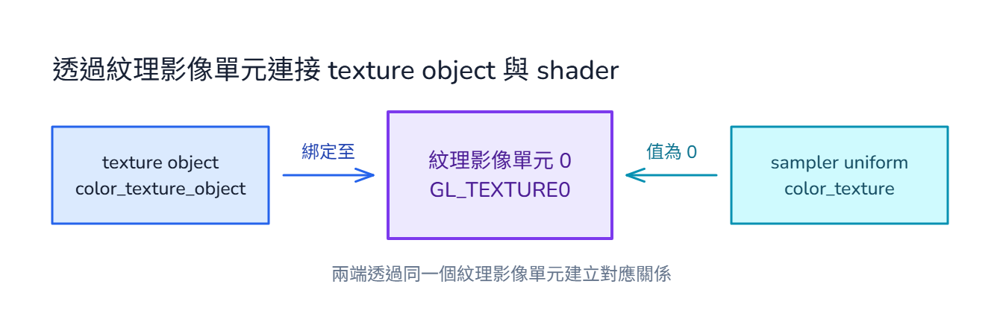

因此 shader 程式在執行：

```glsl
texture(color_texture, vertex_uv)
```

時，`color_texture` 便有辦法引導 `texture()` 找到單元 0 綁定的二維 texture object，`vertex_uv` 則指定要在這張紋理的哪個位置取樣。 本例的取樣設定保存在了 texture object 中，所以取樣時也會套用先前設定的 `nearest` 與 `clamp-to-edge`

在執行 fragment shader 之前，會先做幾項檢查：

- `pixel ownership test`：確認 fragment 對應的像素可以由目前的 OpenGL drawable 更新
- `scissor test`：確認像素是否位於 Application 指定的裁切矩形內
  - 本例沒有開啟此項測試
- `multisample fragment operations`：更新 coverage mask，決定其中哪些 samples 繼續處理

由於共用範例使用 single-sample，因此像素 $(5,4)$ 只有一個 sample。 前面的 triangle coverage 已經確認了它有被三角形涵蓋，所以初始 coverage mask 是 $[1]$，因此整個檢查的流程為：

1. coverage mask [1]
2. pixel ownership test 通過
3. scissor test 關閉，因此保留
4. multisample operations 沒有清除這個 sample
5. 交給 fragment shader 的遮罩仍為 [1]
6. 執行一次 fragment shader

開始執行這次的 fragment shader 時，rasterizer 會將內插 UV $(12/31,10/31)$ 接到 shader input `vertex_uv`，並把取樣位置、候選深度與內插後的 $1/w_c$ 組成內建輸入 `gl_FragCoord`。 為了展開 `gl_FragCoord.w` 的數值計算，我們還會沿用上一階段得到的下列中間值：

- screen-space 重心權重：$(\lambda_A,\lambda_{I_1},\lambda_C)=(1/4,1/2,1/4)$
- 三筆頂點的倒數齊次座標：$(\rho_A,\rho_{I_1},\rho_C)=(1/2,4/9,1/3)$

接下來我們會先算出 `gl_FragCoord` 的具體內容，再讓 fragment shader 使用 `vertex_uv` 找出紋理中的確切紋理元素

由於本文使用 single-sample framebuffer，因此這次 invocation 的 screen-space 位置就是像素 $(5,4)$ 的中心。 將像素索引代入 $(i+0.5,j+0.5)$ 後，可以得到：

$$
\begin{aligned}
\mathrm{gl\_FragCoord.x}
&=5+0.5
=\frac{11}{2}, \\
\mathrm{gl\_FragCoord.y}
&=4+0.5
=\frac{9}{2}.
\end{aligned}
$$

接著將上面列出的重心權重與三筆頂點的 $\rho$ 代入 `gl_FragCoord.w` 的內插公式：

$$
\begin{aligned}
\mathrm{gl\_FragCoord.w}
&=\lambda_A\rho_A
+\lambda_{I_1}\rho_{I_1}
+\lambda_C\rho_C \\
&=\frac14\left(\frac12\right)
+\frac12\left(\frac49\right)
+\frac14\left(\frac13\right) \\
&=\frac{31}{72}.
\end{aligned}
$$

加上 rasterizer 已算出的 screen-space 深度 $41/64$，整組內建輸入就是：

$$
\mathrm{gl\_FragCoord}
=\left(\frac{11}{2},\frac92,\frac{41}{64},\frac{31}{72}\right).
$$

另外我們將前面輸入的正規化 UV $(u,v)=(12/31,10/31)$ 乘上紋理寬高並向下取整後，就可以得到對應的整數 texel 索引了：

$$
\begin{aligned}
x_{\mathrm{texel}}
&=\left\lfloor uW\right\rfloor \\
&=\left\lfloor\frac{12}{31}\times4\right\rfloor \\
&=1, \\
y_{\mathrm{texel}}
&=\left\lfloor vH\right\rfloor \\
&=\left\lfloor\frac{10}{31}\times4\right\rfloor \\
&=1.
\end{aligned}
$$

下圖在 $4\times4$ 的 texel 網格上畫出了這次的 UV 映射。 紋理座標以左下角為 $(0,0)$，$u$ 向右增加，$v$ 向上增加。 `nearest` 最後會選中 texel $(1,1)$：

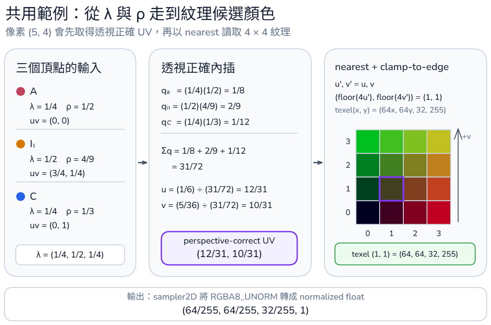

Texel $(1,1)$ 保存的 RGBA 位元組是 $(64,64,32,255)$。 `texture()` 依 `GL_RGBA8` 的正規化規則將每個通道除以 $255$ 後，傳回的浮點顏色為：

$$
\mathbf{c}_{\mathrm{candidate}}
=\left(\frac{64}{255},\frac{64}{255},\frac{32}{255},1\right).
$$

因此這次 fragment shader invocation 會交出候選顏色 $\left(64/255,64/255,32/255,1\right)$。 候選深度則採用 rasterizer 產生的 $41/64$，sample mask 仍為 $[1]$。 這三筆資料會一起交給下一個 Framebuffer Operations 階段

### Framebuffer Operations：測試片段並更新輸出影像

Framebuffer Operations 的目標是決定目標 sample 的候選顏色與候選深度能否用來更新 framebuffer。 新的 fragment 到達時，Framebuffer Operations 會把它帶來的資料，與 framebuffer 在同一個像素、同一個 sample 已保存的資料進行比較，再決定是否要更新

具體來說：

- `sample mask` 會指出這筆 fragment 中有哪些 samples 需要處理
- 對每個有效的 sample，fragment 會提供候選顏色與候選深度
- Framebuffer 內的 color、depth 與 stencil attachments 則保存著該位置原有的資料
- 管線會執行 stencil test 與 depth test，並依兩項測試的結果更新 stencil 值。 同時通過兩項測試的 sample 會再執行色彩操作，並在相應的附件操作中套用寫入遮罩。 這些操作都是逐 sample 進行的

為了讓這些操作讀取既有資料，framebuffer 會透過 attachments 連接影像儲存空間，其中各 attachment 的職責為：

- Color attachment 為每個 sample 保存色彩
- depth attachment 保存深度
- Stencil attachment 會為每個 sample 保存一個整數。 Application 可以自行定義這些數值的意義，再透過 stencil test 控制後續繪製要處理哪些 samples
  - 例如：
    1. 先把鏡面涵蓋的 samples 寫成 1
    2. 繪製反射畫面時，只讓 stencil 值等於 1 的 samples 通過測試
    3. 反射畫面便只會出現在鏡面區域內

測試、色彩合成與寫入都需要由目前 draw call 的設定控制。 本文將這些比較函式、運算方式與寫入權限統稱為了繪製狀態（draw state）。 Framebuffer Operations 會依這些設定，依序完成下列工作：

- 更新 sample mask，找出仍需處理的 samples
- 對這些 samples 執行 stencil test 與 depth test，並依測試結果選擇對應的 stencil operation
- 對通過測試的 samples 執行 blending 或 color logical operation，產生色彩結果
- 在相應的附件操作中套用 color、depth 與 stencil write masks，決定允許更新的通道或位元

最後，framebuffer write 會沿著 attachment 的連接關係，保存獲准寫入的資料。 接下來每項操作都會先說明使用的資料與判定方式，再使用一組獨立的具體數值示範。 各小節可以依操作內容選擇不同組態，直接呈現該項設定如何影響結果

#### per-fragment operations：逐 sample 篩選候選資料

Per-fragment operations 會逐一處理這些 samples，決定各 sample 的 stencil、depth 與 color 如何更新

同一筆 fragment 可以涵蓋一個像素內的多個 samples。 每個 sample 都會取得候選顏色與候選深度，並分別讀取 framebuffer 中對應 sample 已保存的 stencil、depth 與 color 值

- 當同一次的 fragment shader invocation 需要負責多個 samples 時，這些 samples 會共用該次執行交出的候選顏色
- 當啟用了逐 sample 的 shading 時，各 sample 可以分別取得自己的 shader output

##### 更新 sample mask：決定哪些 samples 繼續處理

進入後續測試以前，管線需要先找出這筆 fragment 中仍需處理的 samples。 Fragment Processing 交出的 sample mask 會提供第一組結果，其中每個 bit 都會對應到目前像素內的其中一個 sample，數值 $1$ 表示要保留該 sample，數值 $0$ 則表示會停止處理該 sample

Fragment shader 可以透過內建輸出 `gl_SampleMask` 來再提供一組遮罩。 `gl_SampleMask[0]` 內保存著前 32 個 samples 的位元，bit $i$ 對應 sample $i$。 Shader 只要靜態包含對 `gl_SampleMask` 任一元素的寫入，每次正常結束的 invocation 就需要替所有相關元素賦值，這組輸出才具有明確內容。 該次執行沒有賦值的相關元素會得到未定義值

啟用逐 sample shading 時，每次 invocation 只會以自己負責的 samples 所對應的位元更新 sample mask。 其餘位元不會影響由其他 invocations 負責的 samples。 Multisample color buffer 還能使用 alpha-to-coverage，讓一筆 fragment shader color output 的 alpha 控制保留下來的 samples

令 $M_{\mathrm{input}}$ 為 Fragment Processing 交出的遮罩、$M_{\mathrm{shader}}$ 為 `gl_SampleMask` 提供的遮罩，$M_{\mathrm{alpha}}$ 為 alpha-to-coverage 產生的遮罩。 同時使用這三項資料時，管線會以逐位元 AND 合併它們：

$$
M_{\mathrm{test}}
=M_{\mathrm{input}}
\mathbin{\&}M_{\mathrm{shader}}
\mathbin{\&}M_{\mathrm{alpha}}.
$$

逐位元 AND 會保留三組遮罩都等於 $1$ 的位元，因此後續遮罩可以繼續保留或清除 $M_{\mathrm{input}}$ 中的 sample。 $M_{\mathrm{test}}$ 中數值為 $1$ 的位元會進入 stencil test，數值為 $0$ 的位元則在這裡停止處理

:::tip
以 $4\times$ multisample 像素為例，像素內有 $\mathbf q_0$～$\mathbf q_3$：

- `gl_SampleMask`：由 fragment shader 直接決定要保留哪些 samples
  - 一次 shader invocation 負責四個 samples 時，它可以同時控制四個 bits
  - 逐 sample shading 會讓每次 fragment shader invocation 只負責一個 sample。 例如負責 $\mathbf q_2$ 的 invocation，只有 bit 2 會影響 $\mathbf q_2$，它寫入的其他 bits 不會控制 $\mathbf q_0$、$\mathbf q_1$ 或 $\mathbf q_3$
    - 假設這次 invocation 負責 $\mathbf q_2$，則它的有效範圍就相當於：

      $$
      [0,0,1,0].
      $$

      所以即使 shader 寫出了完整的遮罩：

      $$
      \mathrm{gl\_SampleMask}=[1,1,1,1],
      $$

      管線也只會檢查 bit 2：

      $$
      [0,0,1,0]\mathbin{\&}[1,1,1,1]
      =[0,0,1,0].
      $$

      - bit 2 為 $1$：保留 $\mathbf q_2$
      - bit 2 為 $0$：排除 $\mathbf q_2$

      $\mathbf q_0$、$\mathbf q_1$ 與 $\mathbf q_3$ 由其他 shader invocations 負責，所以這次 invocation 寫出的 bit 0、bit 1 與 bit 3 對它們沒有作用

      換句話說，shader 形式上會寫出完整的 `gl_SampleMask` 整數，但管線只採用其中對應於這次 invocation 所負責 samples 的 bits
- Alpha-to-coverage：由固定功能管線把 shader 輸出顏色的 alpha（`fragment_color.a`）轉成另一組 sample mask，以藉由保留不同數量的 samples 來表現部分涵蓋效果
  - alpha 為 $0$ 時排除全部 samples
  - alpha 為 $1$ 時保留全部 samples
  - alpha 為 $0.5$ 時，$4\times$ multisample 通常會保留其中約兩個 samples，實際選擇由 OpenGL implementation 決定

`gl_SampleMask` 與 alpha-to-coverage 是兩種不同的篩選來源，兩者都只能繼續清除 sample mask 中的位元。 例如原本的 sample mask 是：

$$
[1,1,1,1]
$$

Shader 輸出的 `gl_SampleMask` 是：

$$
[1,1,0,1]
$$

Alpha-to-coverage 又產生：

$$
[1,0,1,0]
$$

管線會對它們執行逐位元 AND：

$$
[1,1,1,1]
\mathbin{\&}
[1,1,0,1]
\mathbin{\&}
[1,0,1,0]
=
[1,0,0,0].
$$

所以最後只會繼續處理 $\mathbf q_0$
:::

GLSL 會以 output location 將色彩輸出送往對應的 draw buffer。 同一個 location 若提供了兩筆來源顏色，則會再以 output index 0 與 1 區分。 本文的 `fragment_color` 位於 output location 0，並使用預設的 output index 0，因此 alpha-to-coverage 會採用這筆輸出的 alpha

Draw framebuffer 的 `SAMPLE_BUFFERS` 會指出它是否具有 multisample 儲存空間，數值 $1$ 代表具有至少一個 multisample buffer，例如 4× multisample framebuffer 的狀態是：

- `SAMPLE_BUFFERS=1`：具有 multisample buffer
- `SAMPLES=4`：每個像素有四個 samples

當啟用了 `GL_MULTISAMPLE` 與 `GL_SAMPLE_ALPHA_TO_COVERAGE`、且 `SAMPLE_BUFFERS` 為 $1$，而且 draw buffer 0 沒有連接 color attachment（`GL_NONE`）或使用 normalized 或 floating-point 色彩格式時，OpenGL 會由該筆 alpha 產生一組遮罩。 Alpha-to-coverage 會將 $[0,1]$ 內的 alpha 轉成一組遮罩，使保留位元的比例隨 alpha 增加。 每個像素實際保留哪些 samples，則由 OpenGL implementation 決定

:::tip
假設 shader 寫成：

```glsl
layout(location = 0) out vec4 fragment_color;

void main()
{
    fragment_color = vec4(1.0, 0.0, 0.0, 0.5);
}
```

Alpha-to-coverage 會使用 `fragment_color.a` 來設定 alpha，也就是這裡的 $0.5$。 其中因為 GLSL 支援為同一個 location 提供兩筆來源顏色，但本文只有一筆輸入，所以會直接使用預設的 index 0

啟用 alpha-to-coverage 後，OpenGL 會把 `fragment_color.a` 轉成一組 sample mask。 以四個 samples 為例：

- $\alpha=0$：保留 0 個 samples
- $\alpha=0.5$：通常保留約 2 個 samples
- $\alpha=1$：保留全部 4 個 samples

例如 $\alpha=0.5$ 可能產生：

$$
M_{\mathrm{alpha}}=[1,0,1,0].
$$

實際選中哪兩個 samples 由 OpenGL implementation 決定。 這組遮罩還會與原有的 sample mask 做 AND，只有最後仍為 $1$ 的 samples 會繼續處理

另外，即使 draw buffer 0 沒有連接色彩影像，shader 輸出的 alpha 仍可用來篩選 depth 或 stencil samples
:::

##### Stencil test：比較標記並選擇 stencil operation

Application 可以自己設定遮罩來去調整 draw call 能操作「sample 內部保存的 stencil 整數」中的哪些 bits，為此 Application 需要設定好對應的遮罩：

- Sample mask：每個 bit 對應像素內的一個 sample，數值為 $1$ 的 sample 才會進入後續測試
- Stencil attachment：為 framebuffer 中每個 sample 保存一筆 stencil 整數
- Stencil value mask：指定 stencil test 要比較整數中的哪些 bits
- Stencil write mask：指定 stencil operation 可以修改整數中的哪些 bits

其中：

- Stencil value mask 由 `glStencilFunc()` 的第三個參數設定：
    ```cpp
    glStencilFunc(GL_EQUAL, 0x05, 0x0F);
    ```

    三個參數分別表示：

    - 比較函式 `func=GL_EQUAL`：要求遮罩處理後的 stencil reference 與既有 stencil value 相等，sample 才能通過測試
    - Stencil reference `reference=0x05`：Application 為這次 draw call 提供的比較基準。 本例會用它尋找低四個 bits 等於 `0x5` 的 stencil values
    - Stencil value mask `value_mask=0x0F`：在比較前分別與 reference 和既有 stencil value 執行逐位元 AND。 `0x0F` 的低四個 bits 是 $1$，因此只有兩個 stencil 整數的低四個 bits 會參與比較
- Stencil operation 由 `glStencilOp()` 設定：
    ```cpp
    glStencilOp(GL_REPLACE, GL_INCR, GL_KEEP);
    ```

    三個參數會依測試結果選擇要套用的操作：

    - Stencil test 失敗時使用第一個參數 `GL_REPLACE`，以 stencil reference 作為 operation result
    - Stencil test 通過、depth test 失敗時使用第二個參數 `GL_INCR`，將既有 stencil 值增加 $1$，並在附件格式可表示的最大值停止
    - Stencil test 與 depth test 都通過時使用第三個參數 `GL_KEEP`，保留既有 stencil 值
- Stencil write mask 由 `glStencilMask()` 設定：
    ```cpp
    glStencilMask(0x0F);
    ```

令 $R$ 為 stencil reference、$V$ 為 stencil value mask，$S_{\mathrm{old}}$ 為該 sample 已保存的 stencil 值。 管線會先對 $R$ 與 $S_{\mathrm{old}}$ 套用相同的 $V$，再依 `func` 比較兩個結果：

$$
(R\mathbin{\&}V)
\mathrel{\mathrm{func}}
(S_{\mathrm{old}}\mathbin{\&}V).
$$

例如，`GL_EQUAL` 要求兩側相等，`GL_LESS` 要求左側小於右側，`GL_ALWAYS` 則會直接讓 sample 通過。 Stencil test 通過的 sample 會繼續進行 depth test，測試失敗的 sample 則會停止處理候選顏色與候選深度，並套用 `glStencilOp()` 第一個參數指定的操作

stencil test 會逐 sample 比較 stencil attachment 中的既有值與目前 draw call 提供的基準。 假設 4× multisample 像素具有以下資訊：

```text
sample mask： [1, 1, 0, 0]

q0 stencil value：0xA2
q1 stencil value：0xB1
q2 stencil value：0xC2
q3 stencil value：0xD2
```

如果 Application 設定了：

```cpp
glStencilFunc(GL_EQUAL, 0x05, 0x0F);     // reference 與 value mask
glStencilOp(GL_REPLACE, GL_INCR, GL_KEEP);
glStencilMask(0x0F);                     // write mask
```

則管線會先透過 Sample mask 選出要處理的 $\mathbf q_0$ 與 $\mathbf q_1$，再將 stencil value mask 和 stencil write mask 分別套用到 $\mathbf q_0$、$\mathbf q_1$ 各自保存的 8-bit stencil value 上：

1. 從 stencil attachment 讀取每個 sample 的既有值
2. 將 reference 與既有 stencil value 分別和 value mask `0x0F` 執行逐位元 AND，再比較兩個結果
3. 根據 stencil test 與 depth test 的結果選擇一項 stencil operation
4. 使用 write mask `0x0F`，只允許 operation 修改低四個 bits
5. 將結果寫回 stencil attachment

以 $\mathbf q_0$ 這個 sample 為例，它保存的 8-bit stencil value 是：

$$
\mathrm{0xA2}
=
\underbrace{1010}_{\text{高四個 bits}}
\underbrace{0010}_{\text{低四個 bits}}.
$$

而我們的 stencil value mask 是 `0x0F`：

$$
\mathrm{0x0F}=0000\,1111,
$$

這代表 stencil test 只讀取並比較低四個 bits，因此：

$$
\begin{aligned}
\mathrm{0x05}\mathbin{\&}\mathrm{0x0F}
&=\mathrm{0x05},\\
\mathrm{0xA2}\mathbin{\&}\mathrm{0x0F}
&=\mathrm{0x02}.
\end{aligned}
$$

`GL_EQUAL` 會比較這兩個結果。 由於 `0x05` 與 `0x02` 不相等，$\mathbf q_0$ 的 stencil test 失敗，因此管線會執行 `glStencilOp()` 第一個參數指定的 `GL_REPLACE`。 這項操作使用 stencil reference `0x05` 作為 operation result

接著，stencil write mask `0x0F` 只允許 operation result 的低四個 bits 寫回附件，因此：

$$
\begin{aligned}
S_{\mathrm{new}}
&=(\mathrm{0xA2}\mathbin{\&}\mathrm{0xF0})
\mathbin{|}
(\mathrm{0x05}\mathbin{\&}\mathrm{0x0F})\\
&=\mathrm{0xA0}\mathbin{|}\mathrm{0x05}\\
&=\mathrm{0xA5}.
\end{aligned}
$$

所以高四個 bits 會保留為原本的 `0xA`，低四個 bits 則會採用 operation result 的 `0x5`。 將兩部分組合後，新值為：

$$
\begin{aligned}
&\underbrace{1010}_{\text{保留的高四個 bits}}
\underbrace{0101}_{\text{寫入的低四個 bits}}\\
&=1010\,0101\\
&=\mathrm{0xA5}.
\end{aligned}
$$

同樣位於 sample mask 中的 $\mathbf q_1$ 也會接受 stencil test。 它的低四個 bits 為 `0x1`，因此比較結果同樣失敗，`GL_REPLACE` 會配合 write mask 將既有值 `0xB1` 更新成 `0xB5`。 $\mathbf q_2$ 與 $\mathbf q_3$ 對應的 sample mask bits 為 $0$，所以不會進入這次 stencil test

##### Depth test：比較候選深度與既有深度

當目標 sample 通過 stencil test 後，depth test 會接著比較這筆 fragment 在該 sample 的候選深度，以及 depth attachment 保存的既有深度，判斷目前表面是否比先前寫入的表面更接近相機。 為了做出判斷，depth test 會取得 fragment 的候選 screen-space 深度，以及 depth attachment 在同一個 sample 保存的既有深度，再依 Application 指定的比較方式檢查兩者

- 候選深度 $z_{\mathrm{candidate}}$：由 rasterizer 算出，也可以由 fragment shader 寫入 `gl_FragDepth` 取代
- 既有深度 $z_{\mathrm{stored}}$：depth attachment 在目前 sample 保存的數值
- Depth test 的啟用狀態：Application 以 `glEnable(GL_DEPTH_TEST)` 啟用深度比較。 停用時，sample 會直接進入色彩操作，depth attachment 也不會更新
- 深度比較函式：由 Application 呼叫 `glDepthFunc()` 設定

若將 `glDepthFunc()` 指定的比較關係記為 $\mathrel{\mathrm{glFunc}}$，depth test 會依下式比較兩筆深度：

$$
z_{\mathrm{candidate}}
\mathrel{\mathrm{glFunc}}
z_{\mathrm{stored}}.
$$

本文採用的 projection matrix 會以較小的 screen-space 深度表示較接近近平面的表面。 因此，若要讓較靠近相機的表面通過 depth test，可以使用 `GL_LESS`，要求候選深度小於既有深度。 Application 會透過 `glDepthFunc()` 指定實際使用的比較規則，常見設定包括：

- `GL_LESS`：候選深度小於既有深度時通過
- `GL_LEQUAL`：候選深度小於或等於既有深度時通過
- `GL_GREATER`：候選深度大於既有深度時通過
- `GL_ALWAYS`：每一筆候選深度都通過

例如設定：

```cpp
glDepthFunc(GL_LESS);
```

時，公式中的 $\mathrel{\mathrm{glFunc}}$ 就會替換成 $<$：

$$
z_{\mathrm{candidate}}<z_{\mathrm{stored}}.
$$

若設定 `GL_LEQUAL`，則會變成：

$$
z_{\mathrm{candidate}}\le z_{\mathrm{stored}}.
$$

當 draw framebuffer 具有 stencil attachment，而且有啟用 stencil test 時，depth test 的結果也會決定 `glStencilOp()` 選用哪一項操作：

- Depth test 失敗：執行 `depth_fail` 指定的 stencil operation，並停止處理該 sample 的候選顏色與候選深度
- Depth test 通過：執行 `depth_pass` 指定的 stencil operation，並讓該 sample 繼續進入色彩操作

停用 stencil test 的 draw call 會直接依 depth test 的結果，決定 sample 是否要進入色彩操作，以及候選深度是否取得寫入資格

以下使用一個 $4\times$ multisample 像素，示範 depth test 如何比較不同 samples 保存的深度，以及測試結果如何選擇對應的 stencil operation。 這筆 fragment 的候選深度是 $0.6$。 在 sample-mask 與 stencil 步驟完成後，各 sample 的狀態如下：

- 最終 sample mask 為 $[1,1,1,0]$
- Depth test：
  - 啟用狀態：已啟用
  - 比較函式：`GL_LESS`
  - 候選深度：$0.6$
  - Depth write mask：允許寫入
- Stencil test 與 stencil operation 使用下列設定：
  - Stencil reference：`0x02`
  - Stencil value mask：`0x0F`
  - Stencil write mask：`0x0F`
  - `glStencilOp()`：
    - `stencil_fail`：`GL_REPLACE`
    - `depth_fail`：`GL_INCR`
    - `depth_pass`：`GL_KEEP`
- $\mathbf q_0$：
  - 既有 stencil：`0xA2`
  - 既有 depth：$0.8$
  - Stencil test：通過
- $\mathbf q_1$：
  - Stencil test：失敗
  - Stencil 更新：由 `0xB1` 變成 `0xB2`
- $\mathbf q_2$：
  - 既有 stencil：`0xC2`
  - 既有 depth：$0.4$
  - Stencil test：通過
- $\mathbf q_3$：
  - Sample-mask bit：$0$
  - 處理狀態：已在 sample-mask 階段停止

Depth test 會對仍有效的 $\mathbf q_0$ 與 $\mathbf q_2$，分別比較候選深度 $0.6$ 與其各自保存的既有深度：

$$
\begin{aligned}
\mathbf q_0: 0.6&<0.8 &&\text{成立},\\
\mathbf q_2: 0.6&<0.4 &&\text{不成立}.
\end{aligned}
$$

由於 $\mathbf q_0$ 通過了這兩項測試，因此會執行 `depth_pass` 對應的 `GL_KEEP`，stencil 值會維持為 `0xA2`。 由於本例的 depth write mask 允許寫入，所以這個 sample 的深度更新結果為 $0.8\rightarrow0.6$

至於 $\mathbf q_2$，雖然通過了 stencil test，但卻沒有通過 depth test，因此將接著執行 `depth_fail` 對應到的 `GL_INCR`。 Operation 會先將 `0xC2` 增加成 `0xC3`，stencil write mask `0x0F` 再允許寫回低四個 bits：

$$
\begin{aligned}
S_{\mathbf q_2,\mathrm{operation}}
&=\mathrm{0xC2}+1\\
&=\mathrm{0xC3},\\
S_{\mathbf q_2,\mathrm{new}}
&=(\mathrm{0xC2}\mathbin{\&}\mathrm{0xF0})
\mathbin{|}(\mathrm{0xC3}\mathbin{\&}\mathrm{0x0F})\\
&=\mathrm{0xC0}\mathbin{|}\mathrm{0x03}\\
&=\mathrm{0xC3}.
\end{aligned}
$$

所以 $\mathbf q_2$ 的既有深度會維持為 $0.4$，候選顏色也不會進入後續的色彩操作。 因此這組 $4\times$ multisample 資料最後只剩 $\mathbf q_0$ 能繼續處理

當大量 samples 注定無法通過測試時，Application 可以要求管線提前執行測試，讓失敗的 samples 省下 fragment shader 的運算。 GLSL 提供了下例的介面限定詞來進行這項設定：

```glsl
layout(early_fragment_tests) in;
```

啟用這項設定後，執行順序與資料來源如下：

- Stencil test 與 depth test 會在 fragment shader invocation 之前執行
- Depth test 會使用 rasterizer 產生的候選深度
- Shader 對 `gl_FragDepth` 的寫入不會改變這次測試與附件更新所使用的深度
- 提前完成的 depth 或 stencil 更新會保留，後續 shader 執行 `discard` 也不會撤銷這些更新

例如候選深度為 $0.6$、既有深度為 $0.4$ 時，`GL_LESS` 會在 shader 執行前就判定 $0.6<0.4$ 不成立，讓管線直接排除這個 sample。 若既有深度為 $0.8$，測試會先以 $0.6<0.8$ 判定通過。 即使 Shader 之後將 `gl_FragDepth` 寫成了 $0.9$，這次測試與深度更新仍會使用 rasterizer 提供的 $0.6$

###### 補充：透視投影如何分配深度精度

Depth test 會直接比較 screen-space 深度，但這些數值其實並未均勻地對應到相機前方的實際距離。 為了理解深度附件在近處與遠處能分辨多細的距離差異，我們需要觀察透視投影與透視除法會如何分配 $[0,1]$ 的深度範圍

- $d=-z_v>0$：沿著相機視線軸量出的距離
- $n$：相機到近平面的距離
- $f$：相機到遠平面的距離

對本文使用的 OpenGL projection matrix 與預設 depth range 而言，轉換後的深度為：

$$
z_{\mathrm{window}}
=\frac{f}{f-n}
-\frac{fn}{(f-n)d}.
$$

以 $n=1$、$f=10$ 為例，三個 view-space 距離會得到：

$$
\begin{aligned}
d=1:
z_{\mathrm{window}}
&=\frac{10}{9}-\frac{10}{9\cdot1}\\
&=0,\\
d=2:
z_{\mathrm{window}}
&=\frac{10}{9}-\frac{10}{9\cdot2}\\
&=\frac59,\\
d=10:
z_{\mathrm{window}}
&=\frac{10}{9}-\frac{10}{9\cdot10}\\
&=1.
\end{aligned}
$$

可以看見：

- 從 $d=1$ 移動到 $d=2$，實際距離只增加 $1$，深度值卻從 $0$ 增加到 $5/9$
- 從 $d=2$ 移動到 $d=10$，實際距離增加了 $8$，但深度值只從 $5/9$ 增加到了 $1$，整段只能使用長度為 $4/9$ 的數值範圍

因此這項非線性分配會讓近平面附近保有較細的深度精度，遠處的不同表面則較容易得到相同或非常接近的儲存值

下圖是一般的色彩結果與同一個場景的深度附件視覺化出來的結果。 右側以灰階呈現了深度附件中的數值，較近處顯示得較暗，較遠處顯示得較亮：

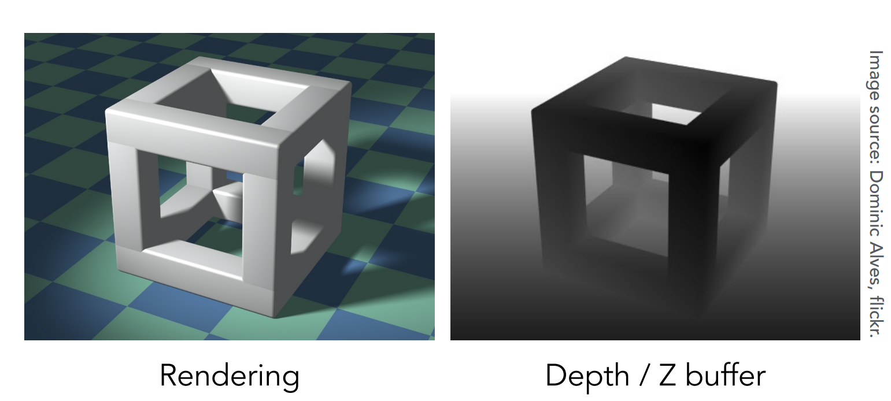

##### Blending、color logical operation 與 dithering：產生色彩結果

通過 stencil test 與 depth test 之後，目標 sample 就取得了更新 color attachment 所連接影像的資格。 為了產生準備寫入該 sample 的色彩結果，管線會取得 fragment shader 交出的候選顏色，以及該影像在同一個 sample 保存的既有顏色：

- 來源顏色 $\mathbf c_{\mathrm{source}}$：fragment shader 交出的候選顏色
- 目的顏色 $\mathbf c_{\mathrm{destination}}$：color attachment 所連接的影像在同一個 sample 保存的既有顏色

接著管線需要決定要用哪一種方式處理這兩筆顏色。 OpenGL 提供了 blending 與 color logical operation 這兩條互斥的色彩合成路徑：

- Blending：把 RGBA 視為數值，透過算術公式決定來源顏色與目的顏色各占多少比例。 這項操作常用於透明、淡入淡出與光照累加
- Color logical operation：把顏色視為一串 bits，再對來源顏色與目的顏色執行 `AND`、`OR` 或 `XOR` 等位元運算。 這項操作常用於位元遮罩與需要直接控制色彩 bits 的繪製效果

Application 會使用 `GL_COLOR_LOGIC_OP` 來選擇要走哪一條路徑：

- 關閉這項狀態時，管線會依 blending state 執行 blending，或直接讓來源顏色繼續傳遞
- 啟用這項狀態時，管線會略過 blending，再依目的 attachment 的 internal format 與 `GL_FRAMEBUFFER_SRGB` 狀態處理 color logical operation

這兩條路徑的輸出最後都要寫入 color attachment 中，但每個對應的 color attachment 內使用的儲存格式可能會不一樣，因此計算的結果可能會遇到「一個連續色彩值無法由 attachment 精確表示」的情況。 為了解決這個問題，Application 可以啟用 Dithering 來處理這兩個路徑的輸入與輸出資料，讓其最終要寫入 color attachment 的資料能夠被正確表示

###### Color attachment 的 internal format：決定顏色如何儲存

Color attachment 是 framebuffer 中用來連接色彩影像的 attachment point。 為了讓管線知道一筆 RGBA 要占用多少 bits，以及各個 bits 應該如何解讀，Application 會在建立這張影像時指定一個 internal format。 這項格式會定義每個色彩通道的資料型態、位元數與編碼方式

本文後面會先介紹下列三種常見的格式：

- `GL_RGBA8`：R、G、B 與 A 都採用 8-bit unsigned normalized fixed-point 格式
  - 儲存方式：每個通道以 $0$ 到 $255$ 的整數保存，共有 $256$ 個可儲存值
  - 解讀方式：管線以 $n/255$ 解讀 attachment 中保存的整數 $n$。 因此 $0$ 對應 $0.0$，$128$ 約對應 $0.502$，$255$ 對應 $1.0$
- `GL_RGBA16F`：R、G、B 與 A 都採用 16-bit floating-point 格式
  - 儲存方式：每個通道保存一個 16-bit 浮點值
  - 解讀方式：通道中的 bits 依 floating-point 格式表示數值，因此可以保存負數與大於 $1$ 的值
- `GL_RGBA8UI`：R、G、B 與 A 都採用 8-bit unsigned integer 格式
  - 儲存方式：每個通道以 $0$ 到 $255$ 的整數保存
  - 解讀方式：附件中的整數就是該通道的數值，例如整數 $128$ 代表數值 $128$

另外由於人眼對暗部的亮度差異較敏感，而 8-bit 通道一共只有 $256$ 個可儲存值。 為了讓這些儲存值更集中地描述暗部差異，同時配合常見影像與顯示系統採用的色彩編碼，color attachment 還可以使用 sRGB encoding。 它會先將線性亮度映射成非線性的數值，使暗部較小的亮度變化也能分配到不同的儲存值

- `GL_SRGB8_ALPHA8`：RGB 使用 sRGB encoding，A 使用 8-bit unsigned normalized fixed-point 格式
  - 儲存方式：RGB 每個通道保存一組 8-bit unsigned normalized 數值，這些數值會被視為 sRGB 編碼值。 A 則保存線性的 8-bit unsigned normalized 數值
  - 解讀方式：RGB 的整數代表非線性的 sRGB 編碼值，經過 sRGB decoding 後可以還原成對應的線性亮度。 A 則直接以 $n/255$ 解讀

這四種 internal format 會決定每個色彩分量有哪些可表示值。 下一小節我們會說明色彩落在兩個相鄰可表示值之間時，管線該如何藉由 Dithering 來選出後續要使用的值

###### Dithering：依 internal format 選擇可表示值

Color attachment 只能保存 internal format 所定義的離散數值。 以 `GL_RGBA8` 為例，每個通道會以 $0$ 到 $255$ 的整數儲存資料，管線會將整數 $n$ 解讀成 $n/255$，因此每個通道共有 $256$ 個可表示值

當準備寫入的色彩分量 $c$ 介於兩個相鄰的可表示值之間時，管線會先找出下列兩個候選值：

- 可表示下界：小於或等於 $c$ 的最大可表示值
- 可表示上界：大於或等於 $c$ 的最小可表示值

Dithering 會逐一處理各個色彩分量，從這兩個候選值中選出實際要寫入的結果。 `GL_DITHER` 的狀態會決定選擇時要使用哪些資訊，OpenGL context 的初始狀態會啟用 `GL_DITHER`，Application 可以透過 `glEnable(GL_DITHER)` 與 `glDisable(GL_DITHER)` 調整這項狀態：

- 啟用 `GL_DITHER`：OpenGL implementation 可以同時依據 $c$ 與 pixel 的 screen-space 位置選擇下界或上界，使相鄰位置採用不同的可表示值
- 停用 `GL_DITHER`：OpenGL implementation 只依據 $c$ 選擇下界或上界，同一套選擇規則會套用到所有 screen-space 位置

例如，假設十個相鄰 pixels 的某個通道都算出了 $100.4/255$，若使用的是 `GL_RGBA8`，則在它兩側的可表示值是 $100/255$ 與 $101/255$：

- 停用 `GL_DITHER` 後，假設 implementation 採用下界，那十個位置就會全都選擇 $100/255$，這片區域的平均值會是 $100/255$
- 啟用 dithering 後，實作可以讓其中六個位置選擇 $100/255$，另外四個位置選擇 $101/255$，此時平均值為：
  $$
  \frac{6\times100+4\times101}{10\times255}
  =\frac{100.4}{255}.
  $$

  因此每個位置取得的仍是 internal format 可以表示的數值，但一片區域的平均亮度可以更接近原始色彩

實際採用的圖樣與選擇方式由 OpenGL implementation 決定。 Dithering 選出的數值會交給這筆 fragment 後續的逐 sample 操作，真正修改 color attachment 的動作則由後面的 framebuffer write 完成

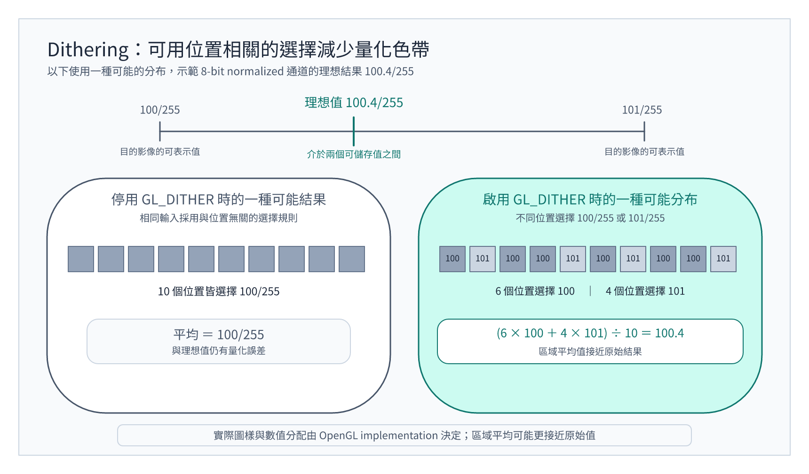

###### Blending：以 RGBA 算術合成兩筆顏色

下圖整理了 blending 路徑的完整資料流。 管線會先根據 color attachment 的 internal format 準備來源顏色與目的顏色，再執行 blending。 完成 blending 後，管線會根據目的格式找出與計算結果相鄰的可表示值，再由 dithering 選出後續要使用的結果：

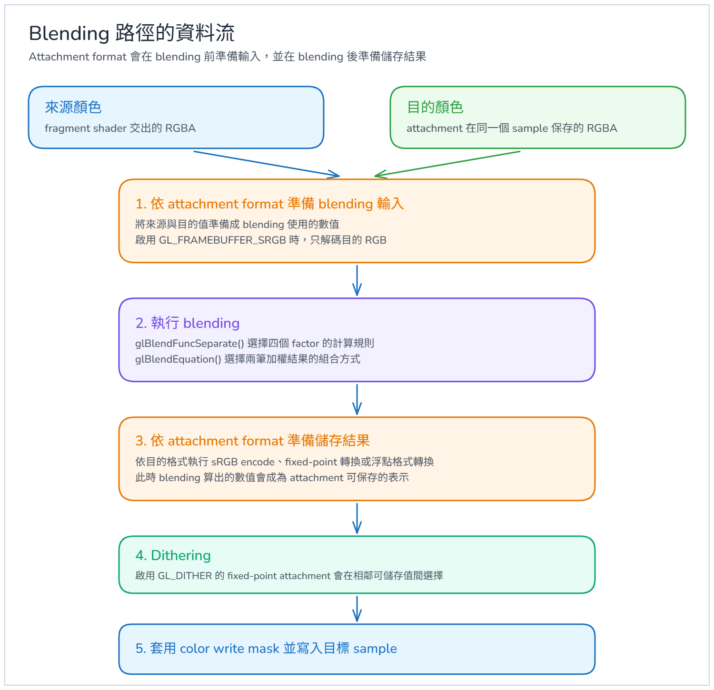

為了用算術公式來合成「來源顏色」與「目的顏色」，Application 需要指定是否要啟用 blending、要用哪一種公式產生結果，以及需要加權時每筆顏色在公式中所占的比例。 OpenGL 會使用下列 blending state 來保存這些設定：

- Blending 的啟用狀態：Application 以 `glEnable(GL_BLEND)` 啟用 blending
- Blending equation：指定來源顏色與目的顏色要按照哪一種公式產生結果，由 `glBlendEquation()` 設定
  - `GL_FUNC_ADD`：來源的加權結果加上目的的加權結果
  - `GL_FUNC_SUBTRACT`：來源的加權結果減去目的的加權結果
  - `GL_FUNC_REVERSE_SUBTRACT`：目的的加權結果減去來源的加權結果
  - `GL_MIN`：逐分量選擇來源顏色與目的顏色中的較小值，計算時不使用 blending factors
  - `GL_MAX`：逐分量選擇來源顏色與目的顏色中的較大值，計算時不使用 blending factors
- Blending factors：指定來源 RGB 與目的 RGB 各自要逐分量乘上的三個數值，以及來源 alpha 與目的 alpha 各自要乘上的單一數值。 `glBlendFuncSeparate()` 的四個參數會分別選擇這四組 factors 的計算規則。 本文後面的範例會用到下列選項
  - `GL_ZERO`：RGB factor 為 $(0,0,0)$，alpha factor 為 $0$
  - `GL_ONE`：RGB factor 為 $(1,1,1)$，alpha factor 為 $1$
  - `GL_SRC_ALPHA`：將來源顏色的 alpha 複製成 RGB factor 的三個分量，alpha factor 也使用來源 alpha
  - `GL_ONE_MINUS_SRC_ALPHA`：將 $1-$來源顏色的 alpha 複製成 RGB factor 的三個分量，alpha factor 也使用 $1-$來源 alpha

Application 會透過這些 blending state 選定 equation 與四個 factor 的計算規則。 以 `GL_FUNC_ADD` 為例，RGB 與 alpha 的計算可以分別寫成：

$$
\begin{aligned}
\mathbf c_{\mathrm{result},RGB}
&=\mathbf c_{\mathrm{source},RGB}F_{\mathrm{source},RGB}
+\mathbf c_{\mathrm{destination},RGB}F_{\mathrm{destination},RGB},\\
\alpha_{\mathrm{result}}
&=\alpha_{\mathrm{source}}F_{\mathrm{source},\alpha}
+\alpha_{\mathrm{destination}}F_{\mathrm{destination},\alpha}.
\end{aligned}
$$

管線會根據目的 color attachment 的 internal format，決定是否執行 blending，並將來源顏色與目的顏色準備成該格式所需的數值。 完成 blending 後，管線也會依同一個格式找出計算結果周圍的可表示值，再由 dithering 選出一個結果

常見的幾種 internal format 如下：

- `GL_RGBA8`：
  - 來源顏色：fragment shader 使用浮點 `vec4` 交出顏色。 管線會將各分量限制在 $[0,1]$ 內，並以限制後的浮點值作為 blending 的來源顏色
  - 目的顏色：管線會以 $n/255$ 將 attachment 中的 8-bit 整數解讀成 $[0,1]$ 內的浮點值
  - Blending：來源顏色、目的顏色與 factors 都會限制在 $[0,1]$ 內，再代入 blending equation
  - Blending 後的格式處理：管線會將計算結果限制在 $[0,1]$ 內，再依 8-bit normalized 尺度找出相鄰的 $n/255$ 可表示值
  - Dithering：逐分量選出其中一個 $n/255$，並將這組結果交給後續的逐 sample 操作
- `GL_RGBA16F`：
  - 來源顏色：fragment shader 使用浮點 `vec4` 交出顏色
  - 目的顏色：管線會將 attachment 中的 16-bit floating-point 數值提供給 blending
  - Blending：來源顏色、目的顏色與 factors 會以浮點值參與計算，負數與大於 $1$ 的數值也能進入 blending equation
  - Blending 後的格式處理：管線會依 16-bit floating-point 格式找出每個計算結果周圍的可表示值
  - Dithering：逐分量選出其中一個 16-bit floating-point 可表示值，並將結果交給後續的逐 sample 操作
- `GL_RGBA8UI`：
  - 來源顏色：fragment shader 使用 `uvec4` 這類 unsigned integer output 交出顏色
  - 目的顏色：attachment 以 8-bit unsigned integer 保存各通道
  - Blending：integer color attachment 會略過 blending equation，來源顏色接著進入儲存格式處理
  - Blending 後的格式處理：每個來源分量本身就是整數格式使用的數值。 位於格式範圍內時，它就已經可以由 attachment 精確表示了
  - Dithering：由於可表示下界與上界是同一個整數，因此來源值會直接交給後續的逐 sample 操作
- `GL_SRGB8_ALPHA8`：
  - 來源顏色：fragment shader 使用浮點 `vec4` 交出顏色。 管線會將各分量限制在 $[0,1]$ 內，並以限制後的浮點值執行 blending
  - 目的顏色：
    - 啟用 `GL_FRAMEBUFFER_SRGB`：將 attachment 中的 sRGB 編碼值解碼成 linear RGB。 A 維持線性的 normalized 數值
    - 停用 `GL_FRAMEBUFFER_SRGB`：直接以 $n/255$ 解讀 attachment 中保存的 RGB 與 A
  - Blending：
    - 啟用 `GL_FRAMEBUFFER_SRGB`：將來源 RGB 視為 linear RGB，並與解碼後的目的 RGB 進行計算
    - 停用 `GL_FRAMEBUFFER_SRGB`：直接以來源與目的的 normalized RGB 進行計算
  - Blending 後的格式處理：
    - 啟用 `GL_FRAMEBUFFER_SRGB`：將 blending 產生的 linear RGB 編碼成 sRGB，再依 8-bit normalized 尺度找出相鄰的可表示值
    - 停用 `GL_FRAMEBUFFER_SRGB`：直接依 8-bit normalized 尺度找出 blending 所產生之 RGB 周圍的可表示值
    - A 維持線性數值，並依 8-bit normalized 尺度找出相鄰的可表示值
  - Dithering：逐分量選出 RGB 與 A 後續要使用的 8-bit normalized 可表示值
  - 補充：sRGB attachment 保存的是非線性編碼後的 RGB，而 blending 需要在線性空間中進行算術運算
      - Application 啟用 `GL_FRAMEBUFFER_SRGB` 後，管線會先將 attachment 讀出的目的 RGB 解碼成 linear RGB，再與 fragment shader 交出的來源 RGB 進行 blending。 計算完成後，管線會將結果重新編碼成 sRGB，供 attachment 儲存

底下以 `GL_RGBA8` color attachment 為例，完整追蹤 blending 前的輸入準備、blending 計算，以及 blending 後的格式處理與 dithering。 本例使用加法 blending equation，並分別設定了 RGB 與 alpha 的 factor 計算規則：

```cpp
glDisable(GL_COLOR_LOGIC_OP);
glEnable(GL_BLEND);
glBlendEquation(GL_FUNC_ADD);
glEnable(GL_DITHER);
glBlendFuncSeparate(
    GL_SRC_ALPHA,
    GL_ONE,
    GL_ONE,
    GL_ONE_MINUS_SRC_ALPHA
);
```

假設 fragment shader 交出的來源顏色是：

$$
\mathbf c_{\mathrm{shader}}
=\left(\frac32,\frac{26}{255},-\frac14,\frac45\right).
$$

由於目標 attachment 使用 `GL_RGBA8`，因此管線會先將來源顏色的每個分量限制在 $[0,1]$ 內。 R 的 $3/2$ 會變成 $1$，B 的 $-1/4$ 會變成 $0$，G 與 A 則維持原值：

$$
\begin{aligned}
\mathbf c_{\mathrm{shader}}
&=\left(\frac32,\frac{26}{255},-\frac14,\frac45\right),\\
\mathbf c_{\mathrm{source,clamped}}
&=\operatorname{clamp}(\mathbf c_{\mathrm{shader}},0,1)\\
&=\left(1,\frac{26}{255},0,\frac45\right).
\end{aligned}
$$

管線會以這組限制後的浮點值作為 blending 的來源顏色：

$$
\mathbf c_{\mathrm{source}}
=\left(1,\frac{26}{255},0,\frac45\right).
$$

假設 color attachment 在同一個 sample 內保存的四個 8-bit 整數為 $(64,51,153,204)$。 `GL_RGBA8` 會將每個整數除以 $255$，讓管線取得 blending 使用的 normalized 目的顏色：

$$
\begin{aligned}
\mathbf b_{\mathrm{destination}}
&=(64,51,153,204),\\
\mathbf c_{\mathrm{destination}}
&=\left(\frac{64}{255},\frac{51}{255},\frac{153}{255},\frac{204}{255}\right)\\
&=\left(\frac{64}{255},\frac15,\frac35,\frac45\right).
\end{aligned}
$$

`glBlendFuncSeparate()` 的四個參數會選定 factors 的計算規則。 將來源 alpha $4/5$ 代入後，可以算出下列數值：

- 來源 RGB factor：`GL_SRC_ALPHA`，使用來源 alpha，也就是 $4/5$
- 目的 RGB factor：`GL_ONE`，使用 $1$
- 來源 alpha factor：`GL_ONE`，使用 $1$
- 目的 alpha factor：`GL_ONE_MINUS_SRC_ALPHA`，使用 $1-$來源 alpha，也就是 $1/5$

將這些 factors 代入 `GL_FUNC_ADD` 的計算公式後，可以得到：

$$
\begin{aligned}
\mathbf c_{\mathrm{result},RGB}
&=\left(1,\frac{26}{255},0\right)\frac45
+\left(\frac{64}{255},\frac15,\frac35\right)\cdot1\\
&=\left(\frac{268}{255},\frac{359}{1275},\frac35\right),\\
\alpha_{\mathrm{result}}
&=\frac45\cdot1
+\frac45\cdot\frac15\\
&=\frac{24}{25}.
\end{aligned}
$$

因此 blending 算出的完整顏色是：

$$
\mathbf c_{\mathrm{result}}
=\left(\frac{268}{255},\frac{359}{1275},\frac35,\frac{24}{25}\right).
$$

這筆 $\mathbf c_{\mathrm{result}}$ 是 blending equation 的輸出。 由於 R 分量的 $268/255$ 超出了 `GL_RGBA8` 的 normalized 範圍，因此管線會先將四個分量限制在 $[0,1]$ 內：

$$
\begin{aligned}
\mathbf c_{\mathrm{clamped}}
&=\operatorname{clamp}(\mathbf c_{\mathrm{result}},0,1)\\
&=\left(1,\frac{359}{1275},\frac35,\frac{24}{25}\right).
\end{aligned}
$$

接著，管線會將每個分量乘上 $255$，換算到 `GL_RGBA8` 的 8-bit 尺度：

$$
\begin{aligned}
255\mathbf c_{\mathrm{clamped}}
&=255\left(1,\frac{359}{1275},\frac35,\frac{24}{25}\right)\\
&=\left(255,\frac{359}{5},153,\frac{1224}{5}\right)\\
&=(255,71.8,153,244.8).
\end{aligned}
$$

由於 R 與 B 已經是整數了，因此兩者的可表示下界與上界相同。 G 與 A 則由於位於兩個相鄰整數之間，因此各自具有兩個候選值：

<center-panel natural>

| 分量 | 8-bit 尺度上的數值 | 可表示下界 | 可表示上界 |
|---|---:|---:|---:|
| R | $255$ | $255$ | $255$ |
| G | $71.8$ | $71$ | $72$ |
| B | $153$ | $153$ | $153$ |
| A | $244.8$ | $244$ | $245$ |

</center-panel>

假設 OpenGL implementation 根據目前 pixel 的 screen-space 位置，為 G 與 A 都選擇了上界，則 Dithering 會逐一得到下列結果：

- R：下界與上界都是 $255$，因此選出 $255$
- G：從 $71$ 與 $72$ 中選出上界 $72$
- B：下界與上界都是 $153$，因此選出 $153$
- A：從 $244$ 與 $245$ 中選出上界 $245$

所以這個 sample 經過 dithering 後的四個 8-bit 值為：

$$
\mathbf b_{\mathrm{dither}}
=(255,72,153,245).
$$

由於資料格式為 `GL_RGBA8`，所以後續在解讀時會再將四個整數會分別除以 $255$：

$$
\begin{aligned}
\mathbf c_{\mathrm{dither}}
&=\left(\frac{255}{255},\frac{72}{255},\frac{153}{255},\frac{245}{255}\right)\\
&=\left(1,\frac{24}{85},\frac35,\frac{49}{51}\right).
\end{aligned}
$$

###### Color logical operation：以位元運算組合兩筆顏色

下圖以 `GL_RGBA8` color attachment 為例，整理 color logical operation 路徑的完整資料流。 管線會先依 8-bit normalized 的格式來找出來源顏色周圍的可表示值，再由 dithering 選出實際的來源 bits。 這些來源 bits 接著會與 attachment 中既有的目的 bits 一起進入 logical operation：

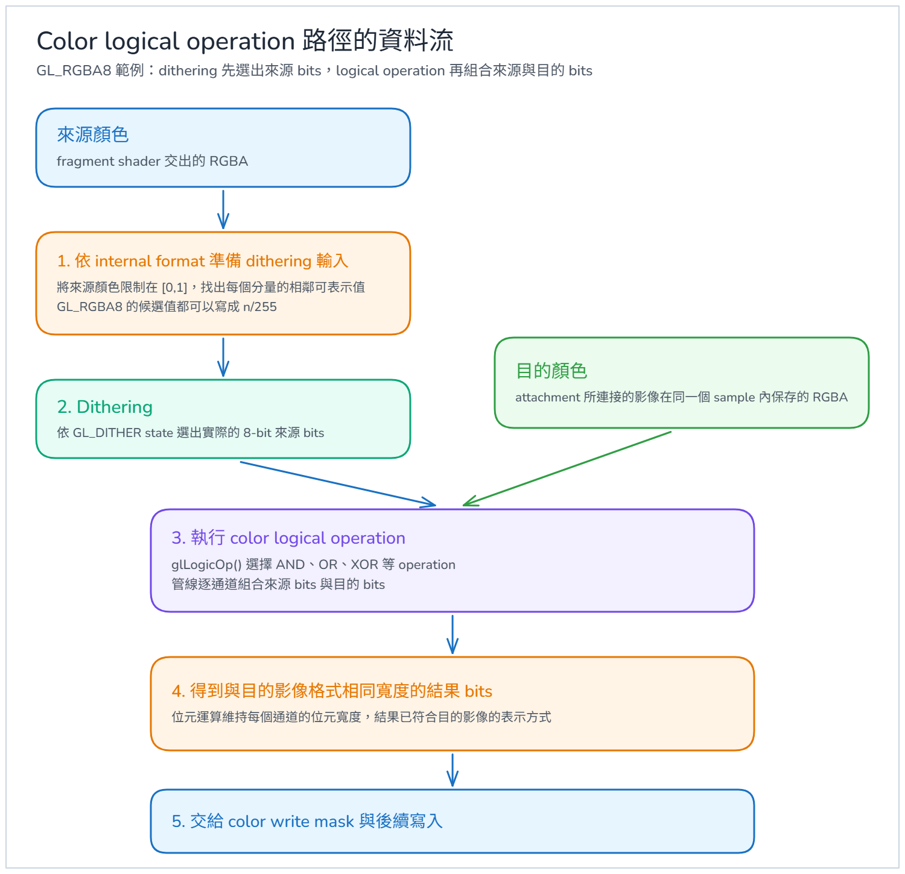

當 Application 要直接控制色彩表示中的 bits 時，可以啟用 `GL_COLOR_LOGIC_OP`，再用 `glLogicOp()` 指定來源顏色與目的顏色之間的位元運算。 常用的操作包括：

- `GL_AND`：只有兩側都為 $1$ 的 bits 會留下
- `GL_OR`：任一側為 $1$ 的 bits 都會留下
- `GL_XOR`：兩側不同的 bits 會留下

Internal format 會決定來源顏色要如何轉成 bits，以及 color logical operation 是否會套用到該 attachment：

- `GL_RGBA8`：
  - 來源顏色：fragment shader 使用浮點 `vec4` 交出顏色。 管線會將各分量限制在 $[0,1]$ 內，再依 8-bit normalized 尺度找出相鄰的可表示值
  - Dithering：逐分量選出其中一個可表示值，這些值的 8-bit 表示就是 logical operation 使用的來源 bits
  - 目的顏色：attachment 會為每個通道提供一組既有的 8-bit bits
  - Color logical operation：管線會對來源與目的的四組 8-bit bits 分別執行 `glLogicOp()` 指定的運算
  - Operation result：位元運算會產生四組新的 8-bit bits，可以直接進入 color write mask 與後續寫入
- `GL_RGBA16F`：
  - 來源顏色：fragment shader 使用浮點 `vec4` 交出顏色
  - Dithering：逐分量選出 16-bit floating-point 格式可以表示的來源值
  - 目的顏色：attachment 以 16-bit floating-point 格式保存各通道
  - Color logical operation：logical operation 在 floating-point color attachment 上不產生作用。 來源顏色會直接進入後續的寫入處理
  - Operation result：完成格式處理的來源顏色會直接進入 color write mask 與後續寫入
- `GL_RGBA8UI`：
  - 來源顏色：fragment shader 使用 `uvec4` 這類 unsigned integer output 交出顏色
  - Dithering：位於格式範圍內的來源整數已經可以精確表示，因此可表示下界與上界是同一個值
  - 目的顏色：attachment 會為每個通道提供一組既有的 8-bit bits
  - Color logical operation：管線會對來源與目的的整數 bits 分別執行 `glLogicOp()` 指定的運算
  - Operation result：位元運算結果可以直接進入 color write mask 與後續寫入
- `GL_SRGB8_ALPHA8`：
  - 來源顏色：
    - 啟用 `GL_FRAMEBUFFER_SRGB`：將 fragment shader 交出的來源 RGB 視為 linear RGB，編碼成 sRGB，再依 8-bit normalized 尺度找出相鄰的可表示值
    - 停用 `GL_FRAMEBUFFER_SRGB`：直接依 8-bit normalized 尺度找出來源 RGB 周圍的可表示值
    - A 維持線性數值，並依 8-bit normalized 尺度找出相鄰的可表示值
  - Dithering：逐分量選出 RGB 與 A 的 8-bit normalized 來源 bits
  - 目的顏色：
    - 啟用 `GL_FRAMEBUFFER_SRGB`：目的 bits 不會進入位元運算
    - 停用 `GL_FRAMEBUFFER_SRGB`：attachment 中既有的四組 8-bit bits 會作為 logical operation 的目的值
  - Color logical operation：
    - 啟用 `GL_FRAMEBUFFER_SRGB`：logical operation 在這個 attachment 上不產生作用，完成格式轉換的來源 bits 會直接進入 color write mask
    - 停用 `GL_FRAMEBUFFER_SRGB`：對來源與目的的 fixed-point bits 執行 `glLogicOp()` 指定的運算
  - Operation result：
    - 啟用 `GL_FRAMEBUFFER_SRGB`：完成格式處理的來源 bits 會直接進入 color write mask 與後續寫入
    - 停用 `GL_FRAMEBUFFER_SRGB`：logical operation 產生的四組 8-bit bits 會進入 color write mask 與後續寫入

以下使用 `GL_RGBA8` color attachment 示範完整的 `GL_XOR` 運算。 `GL_RGBA8` 會用 8-bit unsigned normalized fixed-point 格式保存 R、G、B 與 A 的每個通道

Application 會先啟用 color logical operation，並指定 `XOR`：

```cpp
glDisable(GL_BLEND);
glEnable(GL_COLOR_LOGIC_OP);
glLogicOp(GL_XOR);
glEnable(GL_DITHER);
```

假設 fragment shader 交出的浮點來源顏色為：

$$
\mathbf c_{\mathrm{shader}}
=\left(\frac{165.4}{255},-\frac{15}{255},\frac{300}{255},\frac{127.6}{255}\right).
$$

由於目標 attachment 使用的是 `GL_RGBA8`，所以管線會先將各分量限制在 $[0,1]$ 內。 G 的 $-15/255$ 會變成 $0$，B 的 $300/255$ 會變成 $1$，R 與 A 則維持原值：

$$
\begin{aligned}
\mathbf c_{\mathrm{source,clamped}}
&=\operatorname{clamp}(\mathbf c_{\mathrm{shader}},0,1)\\
&=\left(\frac{165.4}{255},0,1,\frac{127.6}{255}\right).
\end{aligned}
$$

接著，管線會將四個分量乘上 $255$，換算到 `GL_RGBA8` 的 8-bit 尺度：

$$
\begin{aligned}
255\mathbf c_{\mathrm{source,clamped}}
&=255\left(\frac{165.4}{255},0,1,\frac{127.6}{255}\right)\\
&=(165.4,0,255,127.6).
\end{aligned}
$$

其中 G 與 B 已經是格式可以精確表示的整數了，但由於 R 與 A 位於兩個相鄰整數之間，因此 dithering 需要為它們分別選出一個 8-bit 值：

<center-panel natural>

| 分量 | 8-bit 尺度上的數值 | 可表示下界 | 可表示上界 |
|---|---:|---:|---:|
| R | $165.4$ | $165$ | $166$ |
| G | $0$ | $0$ | $0$ |
| B | $255$ | $255$ | $255$ |
| A | $127.6$ | $127$ | $128$ |

</center-panel>

假設 OpenGL implementation 根據目前 pixel 的 screen-space 位置，為 R 選擇了下界，並為 A 選擇了上界，則 Dithering 會逐分量得到：

- R：從 $165$ 與 $166$ 中選出下界 $165$
- G：下界與上界都是 $0$，因此選出 $0$
- B：下界與上界都是 $255$，因此選出 $255$
- A：從 $127$ 與 $128$ 中選出上界 $128$

因此，這個 sample 交給 logical operation 的 normalized 來源顏色為：

$$
\mathbf c_{\mathrm{dither}}
=\left(\frac{165}{255},0,1,\frac{128}{255}\right).
$$

用 $\mathbf b_{\mathrm{source}}$ 來表示這組顏色的 8-bit 來源 bits，可以得到：

$$
\begin{aligned}
\mathbf b_{\mathrm{source}}
&=255\mathbf c_{\mathrm{dither}}\\
&=(165,0,255,128)\\
&=(\mathrm{0xA5},\mathrm{0x00},\mathrm{0xFF},\mathrm{0x80}).
\end{aligned}
$$

假設 color attachment 在同一個 sample 中已經保存了下列四個 8-bit 整數，那這組數值就是 logical operation 的目的 bits：

$$
\mathbf b_{\mathrm{destination}}
=(\mathrm{0x3C},\mathrm{0xF0},\mathrm{0x55},\mathrm{0x80}).
$$

管線會分別對四個通道中相同位置的 bits 執行 `XOR`。 以 R 通道為例，兩個輸入值可以先展開成二進位：

$$
\begin{aligned}
R_{\mathrm{source}}
&=\mathrm{0xA5}\\
&=1010\,0101,\\
R_{\mathrm{destination}}
&=\mathrm{0x3C}\\
&=0011\,1100.
\end{aligned}
$$

`XOR` 會讓兩個輸入 bit 不同的位置得到 $1$，相同的位置得到 $0$，因此 R 通道的結果為：

$$
\begin{aligned}
R_{\mathrm{result}}
&=1010\,0101\mathbin{\oplus}0011\,1100\\
&=1001\,1001\\
&=\mathrm{0x99}.
\end{aligned}
$$

其餘三個通道會執行相同的逐 bit 運算：

$$
\begin{aligned}
G_{\mathrm{result}}
&=0000\,0000\mathbin{\oplus}1111\,0000\\
&=1111\,0000\\
&=\mathrm{0xF0},\\
B_{\mathrm{result}}
&=1111\,1111\mathbin{\oplus}0101\,0101\\
&=1010\,1010\\
&=\mathrm{0xAA},\\
A_{\mathrm{result}}
&=1000\,0000\mathbin{\oplus}1000\,0000\\
&=0000\,0000\\
&=\mathrm{0x00}.
\end{aligned}
$$

將四個通道的輸出合在一起後，color logical operation 交出的結果為：

$$
\mathbf b_{\mathrm{result}}
=(\mathrm{0x99},\mathrm{0xF0},\mathrm{0xAA},\mathrm{0x00}).
$$

由於 color logical operation 會以兩組 8-bit 資料作為輸入，並維持每個通道的 8-bit 寬度，所以運算結果一定會落在 `0x00` 到 `0xFF` 之間，也就是 `GL_RGBA8` 可以表示的範圍內，因此其輸出可以直接成為下一節 color write mask 的輸入，不需要再做一次轉換

由於資料格式為 `GL_RGBA8`，所以後續在解讀時會再將四個整數會分別除以 $255$：

$$
\begin{aligned}
\mathbf c_{\mathrm{stored}}
&=\left(\frac{153}{255},\frac{240}{255},\frac{170}{255},\frac0{255}\right)\\
&=\left(\frac35,\frac{16}{17},\frac23,0\right).
\end{aligned}
$$

##### Write masks：控制各 attachments 的寫入範圍

前面我們藉由 stencil operation 算出了新的 stencil 值，接著用 depth test 決定了候選深度是否具有寫入資格，並且還用色彩操作算出了新的顏色。 在 per-fragment operations 將這些結果交給後面的 framebuffer write 之前，管線會再套用上對應的 write mask，決定結果中的哪些部分可以用來更新 attachment

Write masks 是 Application 在提交 draw call 前設定的繪製狀態：

- Color write mask 用來控制 color attachment 的 RGBA 通道
  - `glColorMask(red, green, blue, alpha)`：
    - `red`：控制 color attachment 的 R 通道
    - `green`：控制 color attachment 的 G 通道
    - `blue`：控制 color attachment 的 B 通道
    - `alpha`：控制 color attachment 的 A 通道
- depth write mask 用來控制候選深度是否能寫入 depth attachment
  - `glDepthMask(flag)`：控制通過 depth test 的候選深度能否寫入 depth attachment
- stencil write mask 用來控制新 stencil 值中的哪些 bits 可以寫入 stencil attachment
  - `glStencilMask(mask)`：以每個 bit 控制 stencil operation 的結果能否寫入 stencil attachment

這讓同一筆 draw call 能夠只更新 Application 指定的部分，其餘資料會保留原值。 例如，假設某個 sample 經過 blending 後得到了下列色彩結果，而 color attachment 在同一個 sample 內還保存了另一筆既有顏色：

$$
\begin{aligned}
\mathbf c_{\mathrm{result}}
&=\left(\frac45,\frac15,\frac15,\frac45\right),\\
\mathbf c_{\mathrm{stored}}
&=(0,1,1,0).
\end{aligned}
$$

如果 Application 使用了下列 color write mask，只允許更新 R 與 B 通道：

```cpp
glColorMask(GL_TRUE, GL_FALSE, GL_TRUE, GL_FALSE);
```

則管線會從 blending 的結果中取出 R 與 B，G 與 A 則沿用 attachment 的既有值：

$$
\begin{aligned}
\mathbf c_{\mathrm{new}}
&=(c_{\mathrm{result},R},
   c_{\mathrm{stored},G},
   c_{\mathrm{result},B},
   c_{\mathrm{stored},A})\\
&=\left(\frac45,1,\frac15,0\right).
\end{aligned}
$$

###### Depth write mask：決定候選深度是否寫入

由於一個 sample 在 depth attachment 中只會保存一筆深度，因此 depth write mask 只需要決定「允許寫入」或「保留既有值」即可。 假設目前具有下列資料與設定：

- 候選深度：$0.2$
- Depth attachment 的既有深度：$0.7$
- Depth comparison function：`GL_LESS`
- Application 設定的 depth write mask：`glDepthMask(GL_FALSE)`

Depth test 會先比較候選深度與既有深度：

$$
0.2<0.7.
$$

比較成立，所以候選深度 $0.2$ 會取得寫入資格。 接著，depth write mask 會決定是否要將這筆候選值交給 framebuffer write：

- `glDepthMask(GL_TRUE)`：允許候選深度寫入，depth attachment 可以由 $0.7$ 更新成 $0.2$
- `glDepthMask(GL_FALSE)`：禁止候選深度寫入，depth attachment 保留既有的 $0.7$

由於本例使用 `GL_FALSE`，所以 framebuffer write 不會修改這個 sample 的深度，最後保存的值仍是 $0.7$

###### Stencil write mask：決定新 stencil 值中的哪些 bits 可以寫入

Stencil write mask 會逐 bit 選擇 stencil attachment 是要保留既有值，還是採用 stencil operation 算出的新值。 假設目前具有下列資料與設定：

- 既有 stencil 值：$S_{\mathrm{old}}=\mathrm{0xA2}$
- Stencil operation result：$S_{\mathrm{operation}}=\mathrm{0x35}$
- Application 設定的 stencil write mask：`glStencilMask(0x0F)`，所以 $M=\mathrm{0x0F}$

將三筆 8-bit 資料展開後，可以得到：

$$
\begin{aligned}
S_{\mathrm{old}}
&=\mathrm{0xA2}=1010\,0010,\\
S_{\mathrm{operation}}
&=\mathrm{0x35}=0011\,0101,\\
M
&=\mathrm{0x0F}=0000\,1111.
\end{aligned}
$$

Write mask 中的每個 bit 都會決定結果中同一個 bit 的來源：

- Mask bit 為 $0$：沿用 $S_{\mathrm{old}}$ 中對應的 bit
- Mask bit 為 $1$：採用 $S_{\mathrm{operation}}$ 中對應的 bit

由於 `0x0F` 的高四個 bits 都是 $0$，低四個 bits 都是 $1$。 因此新值會保留 $S_{\mathrm{old}}$ 的高四個 bits，並採用 $S_{\mathrm{operation}}$ 的低四個 bits

在 8-bit 範圍內，將 `0x0F` 的每個 bit 逐一取反，就會從 $0000\,1111$ 得到 $1111\,0000$，也就是 `0xF0`。 管線會先使用 `0xF0` 取出既有值中需要保留的高四個 bits：

$$
\mathrm{0xA2}\mathbin{\&}\mathrm{0xF0}
=\mathrm{0xA0}.
$$

接著使用 write mask `0x0F` 取出 operation result 中允許寫入的低四個 bits：

$$
\mathrm{0x35}\mathbin{\&}\mathrm{0x0F}
=\mathrm{0x05}.
$$

最後再對兩部分執行逐位元 `OR`，組成準備交給 framebuffer write 的 stencil 值：

$$
\begin{aligned}
S_{\mathrm{new}}
&=\mathrm{0xA0}\mathbin{|}\mathrm{0x05}\\
&=1010\,0000\mathbin{|}0000\,0101\\
&=1010\,0101\\
&=\mathrm{0xA5}.
\end{aligned}
$$

因此，新值的高四個 bits 來自既有 stencil 值 `0xA2`，低四個 bits 則來自 operation result `0x35`。 Stencil write mask 最後交出的結果是 `0xA5`，framebuffer write 會使用這筆結果來更新 stencil attachment

#### framebuffer write：保存最後的色彩與深度

前面的 Per-fragment operations 已經逐 sample 完成了測試、色彩操作、格式轉換與 write-mask 的選擇，因此目前我們手上有各個 attachment 最後準備寫入的值。 為了將這些值保存到實際的影像中，管線還需要知道本次 draw call 使用的是哪一個 framebuffer、每筆結果應前往哪一個 attachment，以及該 attachment 連接到了哪一張影像。 Framebuffer write 會沿著這些連接關係找到目標影像，再更新其中對應 sample 的內容

OpenGL context 會分別保存目前選用的 draw framebuffer 與 read framebuffer。 Draw framebuffer 會接收 rendering pipeline 產生的色彩、深度與 stencil 結果，本節的 framebuffer write 使用的就是這個目標。 Read framebuffer 則提供了 `glReadPixels()` 或 framebuffer blit 等讀取操作的來源。 Application 可以讓兩個角色指向同一個 framebuffer，也可以分別指定不同的 framebuffer

當 Application 將名稱 $0$ 綁定到 `GL_DRAW_FRAMEBUFFER` 時，draw call 會直接使用視窗系統提供的 default framebuffer。 而將 Application 建立的非零名稱綁定到 `GL_DRAW_FRAMEBUFFER` 時，draw call 則會使用 framebuffer object（FBO）。 FBO 適合保存離屏繪製與 render-to-texture 所需的連接狀態，像是「先將畫面繪製到一張紋理影像，再於後續 draw call 中讀取該影像」這種操作

Framebuffer attachment point 是影像與繪製管線之間的連接位置。 FBO 會保存每個 attachment point 目前連接哪張影像，像素與 samples 的實際內容則保存連接到的 texture image 或 renderbuffer image 中。 因此，FBO 可以視為一組「attachment point 到影像」的連接狀態

一個 FBO 具有下列 attachment points：

- Color attachment points：以 `GL_COLOR_ATTACHMENT0`、`GL_COLOR_ATTACHMENT1` 等值指定。 OpenGL 標頭預先定義了從 `GL_COLOR_ATTACHMENT0` 到 `GL_COLOR_ATTACHMENT31` 的名稱，Application 可以使用的數量 $N$ 則由 implementation 決定
  - OpenGL 4.6 保證 $N$ 至少為 $8$
  - Application 可以透過 `GL_MAX_COLOR_ATTACHMENTS` 查詢 $N$，可用編號為 $0$ 到 $N-1$
  - 每個 attachment point 可以維持空白，或連接一張 color image
- Depth attachment point：以 `GL_DEPTH_ATTACHMENT` 指定，用來連接一張保存深度的影像
- Stencil attachment point：以 `GL_STENCIL_ATTACHMENT` 指定，用來連接一張保存 stencil 整數的影像
- Depth-stencil 連接方式：`GL_DEPTH_STENCIL_ATTACHMENT` 能一次設定兩個 attachment points，會讓同一張 packed depth-stencil image 同時連接到 depth 與 stencil attachment points

例如，延遲著色使用的 FBO 可以將最終色彩、法線與材質參數分別連接到 `GL_COLOR_ATTACHMENT0`、`GL_COLOR_ATTACHMENT1` 與 `GL_COLOR_ATTACHMENT2`，並另外連接一張 depth image。 一般的離屏 FBO 也可以只連接 `GL_COLOR_ATTACHMENT0` 與一張 depth image，將其餘 attachment points 維持空白

`GL_COLOR_ATTACHMENT0` 在 OpenGL API 中是一個預先定義的值，用來選取第 $0$ 個 color attachment point。 若以陣列表示 FBO 的連接狀態，它在概念上相當於選取 `color[0]`：

```text
framebuffer object
├─ GL_COLOR_ATTACHMENT0 → color[0] → image 或空白
├─ GL_COLOR_ATTACHMENT1 → color[1] → image 或空白
├─ ...
├─ GL_DEPTH_ATTACHMENT → depth → image 或空白
└─ GL_STENCIL_ATTACHMENT → stencil → image 或空白
```

FBO 的 attachment point 可以連接以下兩種 Application 建立的影像：

- Texture image：texture object 中的某個 mipmap 層級。 Application 可以依 texture target 與連接 API，選擇該層級中的單一 cube-map face、單一 array layer，或將整個層級連成 layered attachment。 Framebuffer write 可以更新這張影像，後續 draw call 也能讓 shader 對它進行紋理取樣
- Renderbuffer image：renderbuffer object 提供的一張可繪製影像。 Application 會指定它的 internal format、尺寸與 sample 數量，並將它用作 color、depth 或 stencil 儲存空間

Default framebuffer 的影像則由視窗系統建立並交給 OpenGL context。 Application 會在建立 drawable 時要求所需的 color、depth 與 stencil buffer 組態，實際可用的 buffers 由視窗系統選出的 framebuffer configuration 決定。 繪製期間的 draw-buffer 與 read-buffer state 會再選擇要使用的 color buffers，視窗系統則負責這些影像與畫面呈現之間的銜接

以目前 workspace 中的 Mesa 原始程式碼為例，Mesa 使用 C 的 `struct` 保存上述關係。 `src/mesa/main/mtypes.h` 中與 attachment 連接最相關的欄位如下。 程式碼中的省略號代表此處暫時略過的其他 framebuffer 狀態：

```c
struct gl_renderbuffer_attachment
{
   GLenum16 Type;
   GLboolean Complete;

   struct gl_renderbuffer *Renderbuffer;
   struct gl_texture_object *Texture;
   GLuint TextureLevel;
   GLsizei NumSamples;
   GLuint CubeMapFace;
   GLuint Zoffset;
   GLboolean Layered;
   GLsizei NumViews;
};

struct gl_framebuffer
{
   /* ... */
   GLuint Name;
   /* ... */
   struct gl_renderbuffer_attachment Attachment[BUFFER_COUNT];

   GLenum16 ColorDrawBuffer[MAX_DRAW_BUFFERS];
   GLenum16 ColorReadBuffer;
   /* ... */
};
```

`Attachment[]` 中的每個元素都是一筆描述 attachment point 連接狀態的資料。 其中幾個主要欄位的用途如下：

- `Type`：指出該 attachment point 目前連接 texture、renderbuffer 或空白
- `Texture`、`TextureLevel` 等欄位：指定 texture object 中的確切 image
- `Renderbuffer`：提供 Mesa 繪製時使用的 renderbuffer reference。 Texture image 作為 attachment 時，Mesa 也會在這裡建立統一的 renderable view

對 Application 建立的 FBO 而言，`ColorDrawBuffer[]` 會保存 fragment color outputs 到 color attachment points 的路由。 Mesa 也使用同一個欄位保存 default framebuffer 的 color-buffer selection，例如 `GL_FRONT_LEFT` 或 `GL_BACK_LEFT`。 這項路由狀態與 `Attachment[]` 保存的影像連接屬於不同層次

這裡的 `GL_MAX_COLOR_ATTACHMENTS` 與 `GL_MAX_DRAW_BUFFERS` 會限制不同的數量。 `GL_MAX_COLOR_ATTACHMENTS` 表示一個 FBO 可以提供多少個 color attachment points。 `GL_MAX_DRAW_BUFFERS` 則表示一次 draw call 最多能將多少筆 fragment color outputs 同時路由到 color buffers。 FBO 可以預先連接多張 color images，再由每次 draw call 使用的 draw-buffer state 選出這次要更新的部分

Mesa 的 `get_attachment()` 會將 OpenGL API 收到的列舉值轉成 `Attachment[]` 的索引。 第 $i$ 個 color attachment 會對應到 `Attachment[BUFFER_COLOR0 + i]`，depth 與 stencil 則分別對應到 `Attachment[BUFFER_DEPTH]` 與 `Attachment[BUFFER_STENCIL]`。 這項映射顯示了 `GL_COLOR_ATTACHMENT0` 等列舉值如何在 implementation 內選到一筆 attachment descriptor

目前綁定的 draw 與 read framebuffer 則保存在 OpenGL context 中。 Mesa 的 `gl_context` 會分別持有兩個指標：

```c
struct gl_framebuffer *DrawBuffer; /* buffer for writing */
struct gl_framebuffer *ReadBuffer; /* buffer for reading */
```

Application 建立 FBO 後，會把已配置儲存空間的影像連接到需要使用的 attachment points，再設定 fragment color outputs 的路由。 例如下列程式會建立一個 FBO，將一張 `GL_RGBA8` texture image 連接到 color attachment 0，並將一張 `GL_DEPTH32F_STENCIL8` renderbuffer image 同時連接到 depth 與 stencil attachment points：

```cpp
GLuint framebuffer;
glCreateFramebuffers(1, &framebuffer);

glNamedFramebufferTexture(
    framebuffer,
    GL_COLOR_ATTACHMENT0,
    color_texture,
    0
);

glNamedFramebufferRenderbuffer(
    framebuffer,
    GL_DEPTH_STENCIL_ATTACHMENT,
    GL_RENDERBUFFER,
    depth_stencil_renderbuffer
);

const GLenum draw_buffers[] = {
    GL_COLOR_ATTACHMENT0
};
glNamedFramebufferDrawBuffers(framebuffer, 1, draw_buffers);
```

`glNamedFramebufferTexture()` 的最後一個參數 $0$ 會選取 `color_texture` 的 mipmap level 0。 `glNamedFramebufferRenderbuffer()` 則會記錄 `depth_stencil_renderbuffer` 的連接。 `glNamedFramebufferDrawBuffers()` 中陣列的第 $i$ 個元素會指定 fragment color output location $i$ 的目的地，因此這裡會將 output location 0 送往 `GL_COLOR_ATTACHMENT0`

FBO 的 attachment 組態還需要符合 framebuffer completeness rules，例如被連接的影像必須使用可供該 attachment 繪製的格式，multisample 影像的 sample 數量也必須相容。 Application 可以在開始繪製前檢查 FBO：

```cpp
GLenum status = glCheckNamedFramebufferStatus(
    framebuffer,
    GL_DRAW_FRAMEBUFFER
);

if (status == GL_FRAMEBUFFER_COMPLETE) {
    glBindFramebuffer(GL_DRAW_FRAMEBUFFER, framebuffer);
}
```

當這個 FBO 成為 draw framebuffer 後，framebuffer write 會沿著下列路徑找到每筆結果的儲存位置：

1. Fragment shader 的 output location 0 產生候選顏色
2. Draw-buffer state 將 output location 0 對應到 `GL_COLOR_ATTACHMENT0`
3. FBO 的 `GL_COLOR_ATTACHMENT0` 找到 `color_texture` 的 mipmap level 0
4. Depth test 接受的深度與 stencil operation 產生的整數，分別經由 depth 與 stencil attachment points 找到 `depth_stencil_renderbuffer`
5. Framebuffer write 更新各張影像中目標像素與 sample 的內容

假設這是一個 single-sample FBO，現在要更新像素 $(3,2)$ 的唯一 sample。 前面的 Per-fragment operations 已經套用測試、色彩操作、格式轉換與 write masks，最後交出以下資料：

- Color attachment 0：
  - 目標影像：`color_texture` 的 mipmap level 0
  - 既有 RGBA 位元組：$(16,32,48,255)$
  - 獲准寫入的 RGBA 位元組：$(128,64,32,255)$
- Depth attachment：
  - 目標影像：`depth_stencil_renderbuffer` 的 depth component
  - 既有深度：$0.75$
  - 獲准寫入的深度：$0.25$
- Stencil attachment：
  - 目標影像：`depth_stencil_renderbuffer` 的 stencil component
  - 既有 stencil 值：`0xA2`
  - 獲准寫入的 stencil 值：`0xA5`

Framebuffer write 會按照 FBO 中保存的連接狀態，更新兩張被連接影像在像素 $(3,2)$ 的實際內容：

$$
\begin{aligned}
\mathrm{color}(3,2)
&:(16,32,48,255)\longrightarrow(128,64,32,255),\\
\mathrm{depth}(3,2)
&:0.75\longrightarrow0.25,\\
\mathrm{stencil}(3,2)
&:\mathrm{0xA2}\longrightarrow\mathrm{0xA5}.
\end{aligned}
$$

##### Multisample color attachment 的 resolve

Multisample color attachment 會在同一個像素保存多筆 sample 色彩，但顯示或後續使用的 single-sample 影像每個像素只能保存一筆色彩。 為了讓兩種儲存方式銜接，OpenGL 會將同一個像素的多筆 sample 色彩組合成一筆像素色彩。 這項轉換稱為 resolve

- Multisample default framebuffer：OpenGL 會在輸出到 single-sample 的 default color buffer 時完成 resolve
- Multisample FBO：Application 可以呼叫 `glBlitFramebuffer()`，把 multisample color attachment resolve 到 single-sample 目標影像
- Normalized 或 floating-point color attachments：各 sample 的具體組合方式由 OpenGL implementation 決定

例如一個 $4\times$ multisample attachment 的像素保存四筆色彩：

$$
\mathbf c_0,
\mathbf c_1,
\mathbf c_2,
\mathbf c_3.
$$

Resolve 會在 single-sample 目標影像的同一個像素只寫入一筆 $\mathbf c_{\mathrm{resolved}}$。 如果四筆 sample 都是 $(255,0,0,255)$，組合後的像素色彩也會是 $(255,0,0,255)$。 當四筆色彩彼此不同時，本文以 $\mathbf c_{\mathrm{resolved}}$ 表示 implementation 產生的結果

完成 framebuffer write，以及需要時執行的 multisample resolve 後，draw call 產生的色彩、深度與 stencil 結果便已保存到對應的目標影像，rendering pipeline 對這批片段的處理也到此完成
